# GoldenSpray

## Scenario

Với vai trò chuyên viên phân tích an ninh mạng tại **SecureTech Industries**, bạn nhận được cảnh báo về các nỗ lực đăng nhập bất thường và truy cập trái phép trong mạng nội bộ. Các chỉ báo ban đầu cho thấy dấu hiệu của một cuộc tấn công brute-force nhắm vào tài khoản người dùng. Nhiệm vụ là phân tích dữ liệu log, truy vết toàn bộ tiến trình tấn công, xác định phạm vi xâm nhập và làm rõ các TTPs mà attacker sử dụng.

## Thông tin môi trường

| Host | IP Address |
|---|---|
| ST-DC01 (Domain Controller) | 192.168.24.16 |
| ST-FS01 (File Server) | 192.168.24.53 |
| ST-WIN01 | 192.168.24.195 |
| ST-WIN02 | 192.168.24.251 |

- **Domain:** `SECURETECH.local`

---

## 1. Phát hiện & Phân tích ban đầu — Password Spraying

### 1.1 Xác định hoạt động đăng nhập thất bại bất thường

Theo mô tả tình huống, những dấu hiệu xâm nhập ban đầu được ghi nhận là tấn công brute-force lên user account, do đó, ta sẽ thống kê tổng số lượng sự kiện đăng nhập thất bại (Event ID 4625) cho từng địa chỉ IP trên toàn bộ hệ thống:

```splunk
index=goldenspray "winlog.channel"=Security event.code=4625
| stats count by host winlog.event_data.IpAddress winlog.channel
| sort - count
```

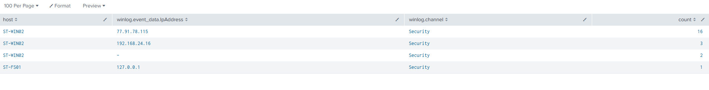

Ghi nhận số lượng đăng nhập thất bại bất thường trên host **ST-WIN02** từ một địa chỉ IP external là **77.91.78.115**.

### 1.2 Phân tích chi tiết các lần đăng nhập thất bại

Lọc toàn bộ Event ID 4625 liên quan đến IP đáng ngờ trên:

```splunk
index=goldenspray "winlog.channel"=Security event.code=4625
    winlog.event_data.TargetUserName != "*$"
    winlog.event_data.IpAddress=77.91.78.115
| table _time host
    winlog.event_data.TargetUserName
    winlog.event_data.TargetDomainName
    winlog.event_data.LogonType
    winlog.event_data.IpAddress
    winlog.event_data.WorkstationName
    winlog.event_data.Status
    winlog.event_data.SubStatus
    winlog.event_data.FailureReason
    winlog.event_data.AuthenticationPackageName
    winlog.event_data.LogonProcessName
| sort _time winlog.record_id
```

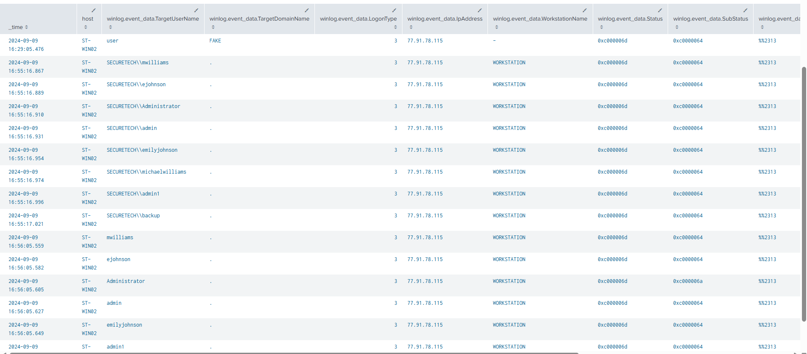

Phân tích chuỗi sự kiện cho thấy attacker thực hiện tấn công theo 3 giai đoạn:

1. **2024-09-09 16:29:05.476** — Thử đăng nhập vào host **ST-WIN02** với tài khoản `FAKE\user` (có thể chỉ là kiểm tra kết nối ban đầu).

2. **2024-09-09 16:55:16.867 → 16:55:17.021** (~200ms) — Thực hiện xác thực liên tiếp với **8 tên tài khoản** khác nhau mang tiền tố `SECURETECH\` (domain account). Tất cả đều thất bại do **sai username** (SubStatus = `0xC0000064`).

3. **2024-09-09 16:56:05.559 → 16:56:05.743** — Tiếp tục thử với **7 username** khác nhưng bỏ tiền tố `SECURETECH\` (local account). Các lần đăng nhập đều thất bại do sai username, ngoại trừ trường hợp `Administrator` (do là local account có sẵn trên Windows) ghi nhận **sai mật khẩu** (SubStatus = `0xC000006A`).

**Kết luận:** Attacker thực hiện **liệt kê username kết hợp password guessing** nhắm vào host ST-WIN02 từ IP external **77.91.78.115**.

### 1.3 Threat Intelligence

| Nguồn | Kết quả |
|---|---|
| VirusTotal | 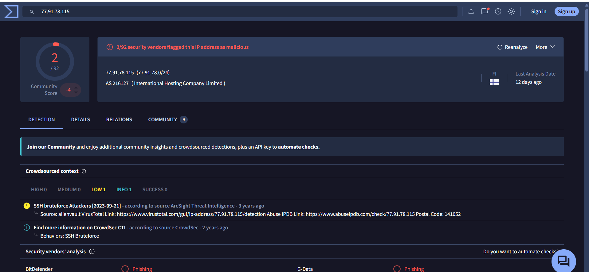 |
| AbuseIPDB | 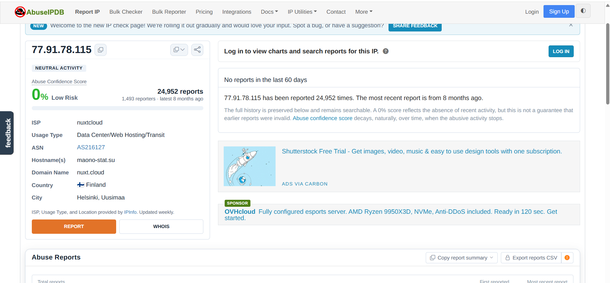 |

Cả hai nguồn threat intel đều ghi nhận các report **brute-force/scan** bắt nguồn từ IP có nguồn gốc tại **Finland** này.

### 1.4 Xác nhận giao thức tấn công — SMB Brute-force

Phân tích các sự kiện xảy ra trong khoảng thời gian tấn công:

```splunk
index=goldenspray host="ST-WIN02"
    earliest="09/09/2024:16:55:00" latest="09/09/2024:16:57:00"
| stats count by winlog.channel event.code
```

```splunk
index=goldenspray host="ST-WIN02"
    winlog.channel="Microsoft-Windows-SMBServer/Security"
    earliest="09/09/2024:16:55:00" latest="09/09/2024:16:57:00"
    event.code=551
| table _time
    winlog.user_data.ClientName
    winlog.user_data.Status
    winlog.user_data.SPN
    winlog.user_data.ConnectionGUID
    winlog.user_data.SessionGUID
    winlog.user_data.SessionId
| sort _time
```

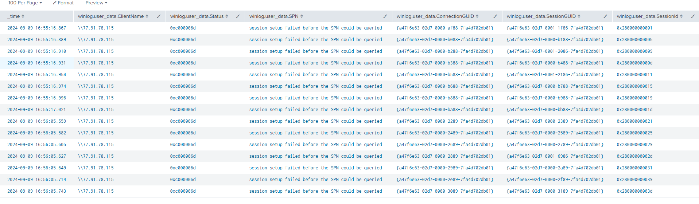

Event ID 551 (SMB Session Authentication Failure) ghi nhận **15 lần** SMB server không thể xác thực thành công cho SMB Client từ cùng IP **77.91.78.115** trong cùng khoảng thời gian. 15 sự kiện này tương ứng với 15 lần thử đăng nhập với các username khác nhau. Kết hợp với **Logon Type 3** được ghi nhận cho toàn bộ các sự kiện, xác nhận attacker đã thực hiện **brute-force qua giao thức SMB**.

## 2. Đăng nhập thành công — Initial Access

```splunk
index=goldenspray "winlog.channel"=Security event.code=4624
    winlog.event_data.TargetUserName != "*$"
    winlog.event_data.IpAddress=77.91.78.115
| table _time host
    winlog.event_data.TargetUserName
    winlog.event_data.TargetDomainName
    winlog.event_data.TargetLogonId
    winlog.event_data.TargetLinkedLogonId
    winlog.event_data.LogonType
    winlog.event_data.IpAddress
    winlog.event_data.AuthenticationPackageName
    winlog.event_data.ElevatedToken
| sort _time winlog.record_id
```

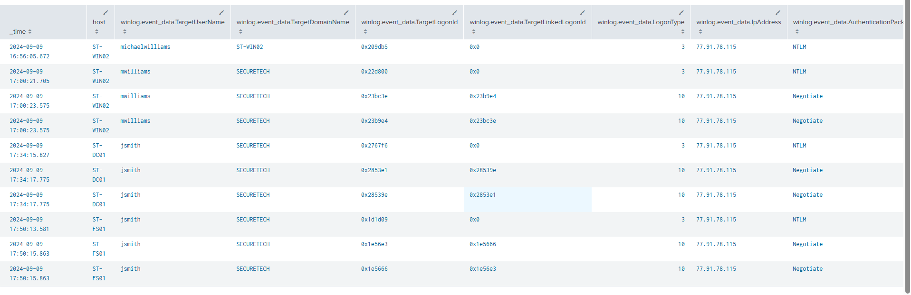

Ghi nhận các sự kiện đăng nhập thành công sau từ attacker (**77.91.78.115**):

| Thời gian | Host | Username | Mô tả |
|---|---|---|---|
| **2024-09-09 16:56:05.672** | ST-WIN02 | `michaelwilliams` | Đăng nhập thành công qua SMB sử dụng **local account** (TargetDomainName = `ST-WIN02`) |
| **2024-09-09 17:00:21.705** | ST-WIN02 | `mwilliams` | Sau 4 phút, RDP vào ST-WIN02 sử dụng **domain account** có đặc quyền cao do đó Windows tạo ra 2 access token (filtered & elevated) |
| **2024-09-09 17:34:15.827** | ST-DC01 | `jsmith` | RDP thành công vào **Domain Controller** sử dụng domain account có đặc quyền cao |
| **2024-09-09 17:50:13.581** | ST-FS01 | `jsmith` | Tiếp tục RDP vào **File Server** |

### 2.1 Phiên SMB của local account michaelwilliams

```splunk
index=goldenspray host="ST-WIN02"
    earliest="09/09/2024:16:56:00" latest="09/09/2024:17:00:00"
    0x209db5 "event.code"=4634
| table _time
    winlog.event_data.TargetLogonId
    winlog.event_data.LogonType
    winlog.event_data.TargetUserName
    winlog.event_data.TargetDomainName
    winlog.event_data.TargetUserSid
```

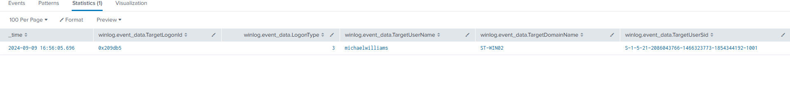

Vào **2024-09-09 16:56:05.696**, attacker đăng xuất khỏi ST-WIN02 **ngay lập tức** sau khi xác thực thành công bằng local account `michaelwilliams`. Đồng thời, không ghi nhận hoạt động bất thường nào trong phiên này. Đây nhiều khả năng chỉ là bước kiểm tra xem credential có hợp lệ hay không.

Bốn phút sau, attacker chuyển sang sử dụng **domain account `mwilliams`** để RDP vào ST-WIN02.

## 3. Phiên RDP của attacker trên ST-WIN02 — 2024-09-09 17:00:21

### 3.1 Đặc quyền của tài khoản mwilliams

```splunk
index=goldenspray winlog.channel=Security host="ST-WIN02"
    earliest="09/09/2024:17:00:00"
    event.code=4672
    "winlog.event_data.SubjectUserName"=mwilliams
| table _time
    winlog.event_data.SubjectLogonId
    winlog.event_data.SubjectDomainName
    winlog.event_data.SubjectUserName
    winlog.event_data.SubjectUserSid
    winlog.event_data.PrivilegeList
| sort _time
```

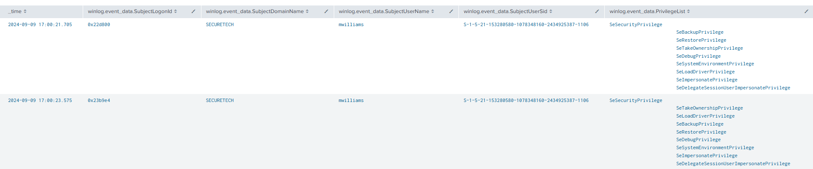

Do là tài khoản thuộc nhóm đặc quyền cao (có thể bao gồm Domain Admin, Local Admin), user `mwilliams` được gán các privilege đặc biệt:

| Privilege | Ý nghĩa |
|---|---|
| `SeDebugPrivilege` | Cho phép gỡ lỗi chương trình của người dùng khác — thường bị lạm dụng để truy cập bộ nhớ của `lsass.exe` |
| `SeImpersonatePrivilege` | Cho phép một thread mạo danh user khác — có thể bị khai thác để leo thang đặc quyền |

### 3.2 Process Tree 

```splunk
index=goldenspray winlog.channel=Microsoft-Windows-Sysmon/Operational
    host="ST-WIN02" earliest="09/09/2024:17:00:00" event.code=1
| table _time host
    winlog.event_data.User
    winlog.event_data.IntegrityLevel
    winlog.event_data.LogonId
    winlog.event_data.ParentProcessId
    winlog.event_data.ParentImage
    winlog.event_data.ProcessId
    winlog.event_data.CommandLine
| sort _time winlog.record_id
```

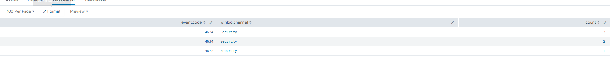

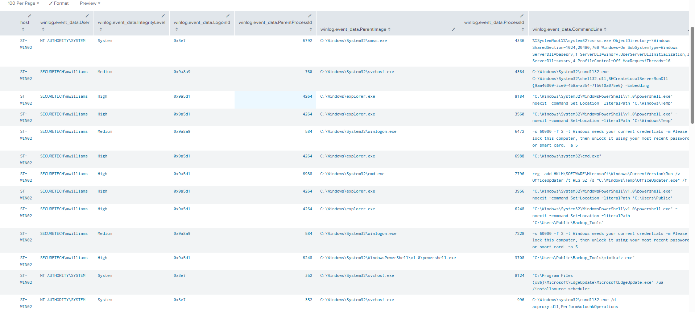

Toàn bộ process được attacker khởi chạy với đặc quyền cao (**Integrity Level = High**):

```
                        [4264] C:\Windows\explorer.exe
2024-09-09 17:10:24     ├── [8184] "C:\Windows\System32\WindowsPowerShell\v1.0\powershell.exe" -noexit -command Set-Location -literalPath 'C:\Windows\Temp'
2024-09-09 17:13:02     ├── [3560] "C:\Windows\System32\WindowsPowerShell\v1.0\powershell.exe" -noexit -command Set-Location -literalPath 'C:\Windows\Temp'
2024-09-09 17:17:07     ├── [6988] "C:\Windows\system32\cmd.exe"
2024-09-09 17:17:09     │   └── [7796] reg  add HKLM\SOFTWARE\Microsoft\Windows\CurrentVersion\Run /v OfficeUpdater /t REG_SZ /d "C:\Windows\Temp\OfficeUpdater.exe" /f
2024-09-09 17:21:52     ├── [3956] "C:\Windows\System32\WindowsPowerShell\v1.0\powershell.exe" -noexit -command Set-Location -literalPath 'C:\Users\Public'
2024-09-09 17:23:26     └── [6248] "C:\Windows\System32\WindowsPowerShell\v1.0\powershell.exe" -noexit -command Set-Location -literalPath 'C:\Users\Public\Backup_Tools'
2024-09-09 17:27:34         ├── [3708] "C:\Users\Public\Backup_Tools\mimikatz.exe"
2024-09-09 17:39:11         └── [528] "C:\Users\Public\Backup_Tools\mimikatz.exe"
```

Attacker khởi chạy 4 phiên powershell:

### 3.3 Phiên PowerShell #1 (PID 8184) — Payload Delivery

#### Khởi chạy phiên PowerShell

```splunk
index=goldenspray host="ST-WIN02" earliest="09/09/2024:17:00:00"
    {b526ab8f-2c00-66df-e900-000000000b00}
    winlog.event_data.ProcessId=8184 event.code=1
| table _time
    winlog.event_data.ParentProcessId
    winlog.event_data.ParentImage
    winlog.event_data.ProcessId
    winlog.event_data.ProcessGuid
    winlog.event_data.CommandLine
```

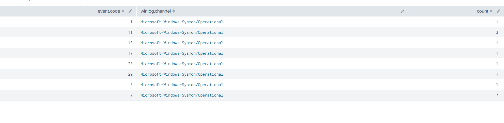

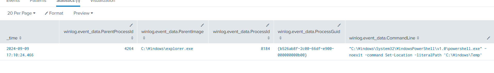

Vào **2024-09-09 17:10:24.466**, khoảng 10 phút sau khi RDP thành công, attacker khởi chạy một phiên PowerShell tương tác và chuyển thư mục làm việc sang `C:\Windows\Temp`, ý nghĩa các cờ trong lệnh:

| Thành phần | Ý nghĩa |
|---|---|
| `-noexit` | Giữ phiên PowerShell mở sau khi thực thi lệnh |
| `-command` | Chỉ định câu lệnh PowerShell cần thực thi |
| `Set-Location` | Cmdlet thay đổi thư mục làm việc hiện tại (tương tự `cd`) |
| `-literalPath` | Chỉ định đường dẫn chính xác, không diễn giải các kí tự đặc biệt như `*`, `?`, `[]` |
| `'C:\Windows\Temp'` | Thư mục đích — thường bị attacker lợi dụng vì mọi user đều có quyền ghi |

Ngoài ra, nếu attacker chạy các cmdlet như `Get-LocalUser` ngay trong phiên PowerShell, Sysmon sẽ **không** sinh Event ID 1 vì đây là lệnh chạy bên trong phiên tương ứng cho nên sẽ không có process mới được tạo ra.

#### Kết nối tới C2

```splunk
index=goldenspray host="ST-WIN02" earliest="09/09/2024:17:00:00"
    {b526ab8f-2c00-66df-e900-000000000b00} event.code=3
| table _time
    winlog.event_data.ProcessId
    winlog.event_data.ProcessGuid
    winlog.event_data.CommandLine
    winlog.event_data.DestinationIp
    winlog.event_data.DestinationPort
```

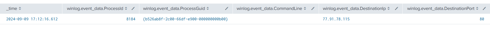

Vào **2024-09-09 17:12:16.612**, phiên PowerShell (PID 8184) thiết lập kết nối tới IP C2 **77.91.78.115** trên **port 80** — sử dụng cổng HTTP nhằm hòa lẫn vào traffic hợp lệ.

#### Drop payload OfficeUpdater.exe

```splunk
index=goldenspray host="ST-WIN02" earliest="09/09/2024:17:00:00"
    {b526ab8f-2c00-66df-e900-000000000b00} event.code=11
| table _time
    winlog.event_data.ProcessId
    winlog.event_data.ProcessGuid
    winlog.event_data.TargetFilename
```

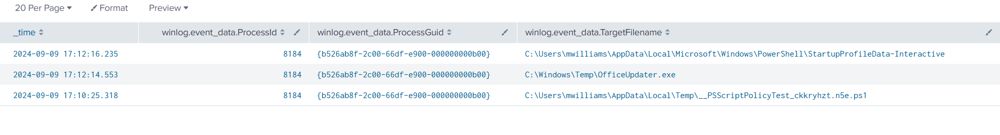

Vào **2024-09-09 17:12:14.553**, attacker drop payload `OfficeUpdater.exe` vào thư mục `C:\Windows\Temp\`. Kết hợp với sự kiện kết nối mạng ghi nhận ở gần thời điểm, payload này nhiều khả năng được tải về từ **77.91.78.115:80** qua giao thức HTTP.

#### Hash của payload

```splunk
index=goldenspray host="ST-WIN02" earliest="09/09/2024:17:00:00"
    {b526ab8f-2c00-66df-e900-000000000b00} event.code=29
| table _time
    winlog.event_data.ProcessId
    winlog.event_data.ProcessGuid
    winlog.event_data.TargetFilename
    winlog.event_data.Hashes
```

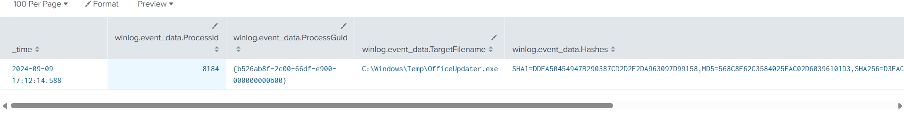

| Thuật toán | Giá trị |
|---|---|
| SHA256 | `D3EAC3A9B64E715D57E77D25603D01E6EF2BF28810BDB2FEC58725F219075149` |
| SHA1 | `DDEA50454947B290387CD2D2E2DA963097D99158` |
| MD5 | `568C8E62C3584025FAC02D60396101D3` |
| IMPHASH | `B4C6FFF030479AA3B12625BE67BF4914` |

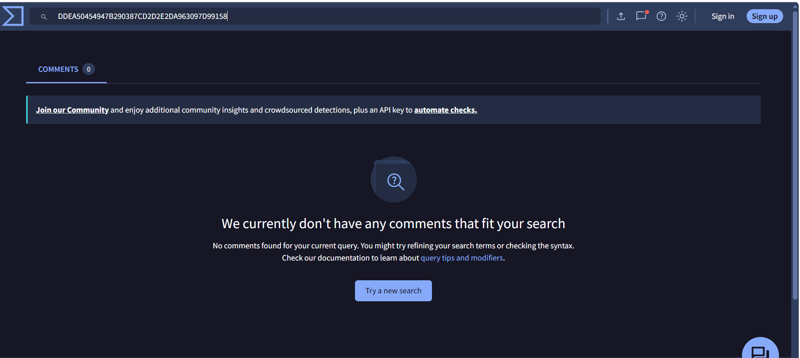

VirusTotal **không có thông tin** về tệp này, cho thấy đây có thể là một custom malware chưa được ghi nhận.

### 3.4 Phiên PowerShell #2 (PID 3560) — Không phát hiện hoạt động

```splunk
index=goldenspray host="ST-WIN02" earliest="09/09/2024:17:00:00"
    {b526ab8f-2c9e-66df-ed00-000000000b00}
    winlog.event_data.ProcessId=3560 event.code=1
| table _time
    winlog.event_data.ParentProcessId
    winlog.event_data.ParentImage
    winlog.event_data.ProcessId
    winlog.event_data.ProcessGuid
    winlog.event_data.CommandLine
```

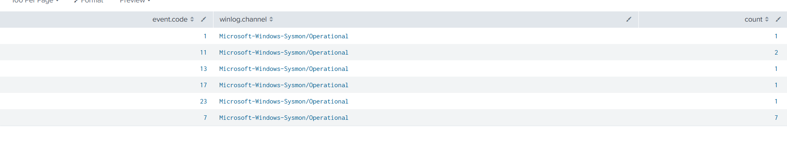

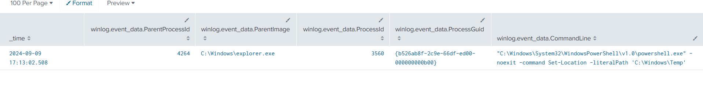

Vào **2024-09-09 17:13:02.508**, attacker khởi chạy phiên PowerShell thứ hai với commandline tương tự phiên đầu tiên. Tuy nhiên, điều tra các sự kiện liên quan **không ghi nhận hoạt động bất thường** trong phiên này.

### 3.5 Persistence — Run Key Registry

```splunk
index=goldenspray winlog.channel=Microsoft-Windows-Sysmon/Operational
    host="ST-WIN02" earliest="09/09/2024:17:00:00"
    event.code=1 winlog.event_data.ProcessId=7796
| table _time host
    winlog.event_data.User
    winlog.event_data.IntegrityLevel
    winlog.event_data.LogonId
    winlog.event_data.ParentProcessId
    winlog.event_data.ParentImage
    winlog.event_data.ProcessId
    winlog.event_data.CommandLine
| sort _time winlog.record_id
```

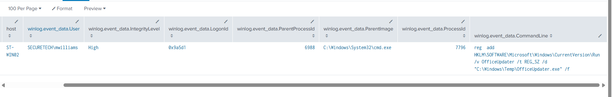

Vào **2024-09-09 17:17:09.627**, attacker khởi chạy `cmd.exe` để thực thi lệnh:

```
reg add HKLM\SOFTWARE\Microsoft\Windows\CurrentVersion\Run /v OfficeUpdater /t REG_SZ /d "C:\Windows\Temp\OfficeUpdater.exe" /f
```

Lệnh này thêm một registry value vào **Run Key** trong hive `HKLM` với tên `OfficeUpdater` (giả mạo trình cập nhật Office vô hại), giá trị trỏ đến payload `OfficeUpdater.exe` drop lúc trước. Vì value được thêm trong hive `HKLM` (Local Machine), persistence sẽ có tác dụng với **mọi người dùng** khi đăng nhập vào máy.

#### Xác nhận Registry Value được tạo thành công

```splunk
index=goldenspray winlog.channel=Microsoft-Windows-Sysmon/Operational
    host="ST-WIN02"
    earliest="09/09/2024:17:17:09" latest="09/09/2024:17:18:00"
    event.code=13
| table _time
    winlog.event_data.User
    winlog.event_data.ProcessId
    winlog.event_data.EventType
    winlog.event_data.TargetObject
    winlog.event_data.Details
    winlog.event_data.RuleName
```

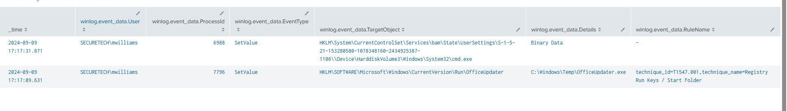

Vào **2024-09-09 17:17:09.631**, Sysmon Event ID 13 xác nhận value `OfficeUpdater` đã được thiết lập thành công.

#### Kích hoạt Persistence

```splunk
index=goldenspray host="ST-WIN02" earliest="09/09/2024:17:00:00"
    event.code=1 OfficeUpdater.exe
| table _time host
    winlog.event_data.User
    winlog.event_data.IntegrityLevel
    winlog.event_data.LogonId
    winlog.event_data.ParentProcessId
    winlog.event_data.ParentImage
    winlog.event_data.ProcessId
    winlog.event_data.CommandLine
| sort _time winlog.record_id
```

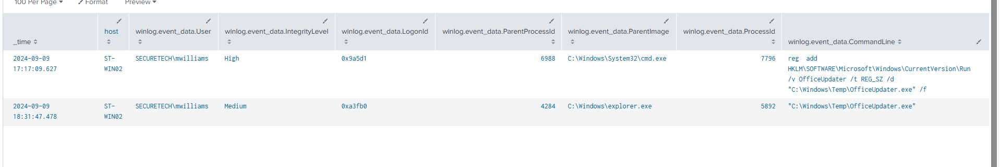

Vào **2024-09-09 18:31:47.478**, Run Key kích hoạt và khởi chạy `C:\Windows\Temp\OfficeUpdater.exe` sau khi `SECURETECH\mwilliams` đăng nhập vào máy. Payload chạy với **filtered token** (Integrity Level = Medium).

### 3.6 Phiên PowerShell #3 (PID 3956) — Tool Staging

#### Kết nối C2 và drop Backup_Tools.zip

```splunk
index=goldenspray host="ST-WIN02" earliest="09/09/2024:17:00:00"
    {b526ab8f-2eb0-66df-fa00-000000000b00} event.code=3
| table _time
    winlog.event_data.ProcessId
    winlog.event_data.ProcessGuid
    winlog.event_data.CommandLine
    winlog.event_data.DestinationIp
    winlog.event_data.DestinationPort
```

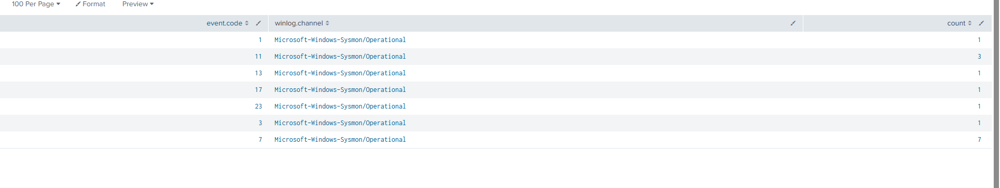

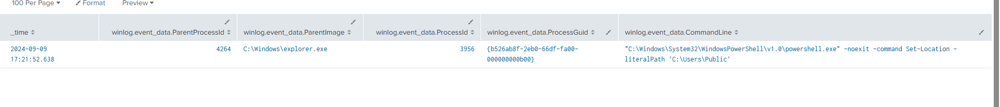

Vào **2024-09-09 17:21:52.638**, attacker khởi chạy phiên PowerShell thứ ba, lần này hắn thiết lập thư mục làm việc tại `C:\Users\Public`.

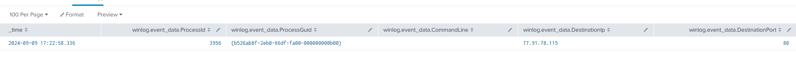

Tiếp tục kết nối tới IP C2 **77.91.78.115** trên port 80.

```splunk
index=goldenspray host="ST-WIN02" earliest="09/09/2024:17:00:00"
    {b526ab8f-2eb0-66df-fa00-000000000b00} event.code=11
| table _time
    winlog.event_data.ProcessId
    winlog.event_data.ProcessGuid
    winlog.event_data.TargetFilename
```

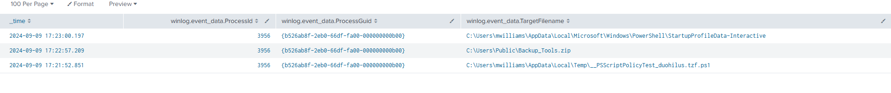

Vào **2024-09-09 17:22:57.209**, attacker drop `Backup_Tools.zip` vào `C:\Users\Public\`, nhiều khả năng payload này tiếp tục được tải về từ **77.91.78.115:80**.

#### Giải nén công cụ tấn công

```splunk
index=goldenspray host="ST-WIN02"
    earliest="09/09/2024:17:22:57" latest="09/09/2024:17:25:00"
    event.code=11
| table _time
    winlog.event_data.Image
    winlog.event_data.ProcessId
    winlog.event_data.TargetFilename
```

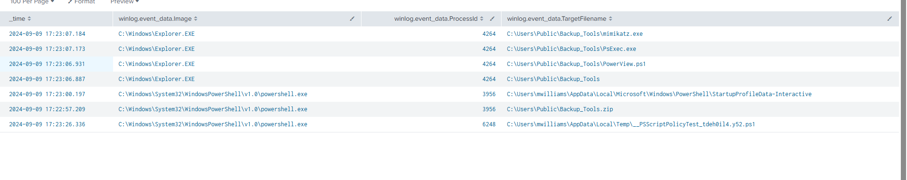

Attacker giải nén `Backup_Tools.zip` ra thư mục `C:\Users\Public\Backup_Tools\`, trong đó chứa **3 công cụ**:

| Tệp | Mô tả |
|---|---|
| `mimikatz.exe` | Công cụ mã nguồn mở thực hiện các kỹ thuật post-exploitation (credential dumping, pass-the-hash, golden ticket, ...) |
| `PsExec.exe` | Công cụ quản trị hợp lệ thuộc bộ Sysinternals — cho phép thực thi lệnh từ xa trên máy khác (quá trình điều tra sau đó cho thấy attacker không sử dụng công cụ này lần nào ) |
| `PowerView.ps1` | PowerShell script thuộc bộ PowerSploit — trinh sát và thu thập thông tin Active Directory |

#### Timestomping — Che giấu thời gian tạo

```splunk
index=goldenspray host="ST-WIN02"
    earliest="09/09/2024:17:22:57" latest="09/09/2024:17:25:00"
    "event.code"=2
| table _time
    winlog.event_data.User
    winlog.event_data.Image
    winlog.event_data.ProcessId
    winlog.event_data.TargetFilename
    winlog.event_data.PreviousCreationUtcTime
    winlog.event_data.CreationUtcTime
    winlog.event_data.RuleName
```

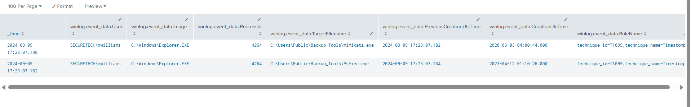

Ngay sau khi giải nén, attacker thay đổi **Creation Time** của 2 tệp executable vừa drop nhằm:
> - Che giấu thời điểm chính xác payload được drop vào máy
> - Giảm khả năng bị phát hiện bởi các truy vấn tìm file executable mới tạo trong khoảng thời gian incident
> - Hòa lẫn timestamp với các tệp vô hại cùng thư mục

### 3.7 Phiên PowerShell #4 (PID 6248) — PowerView & Mimikatz

#### Nạp script PowerView.ps1

```splunk
index=goldenspray host="ST-WIN02" earliest="09/09/2024:17:00:00"
    winlog.event_data.ProcessId=6248 event.code=1
| table _time
    winlog.event_data.ParentProcessId
    winlog.event_data.ParentImage
    winlog.event_data.ProcessId
    winlog.event_data.ProcessGuid
    winlog.event_data.CommandLine
```

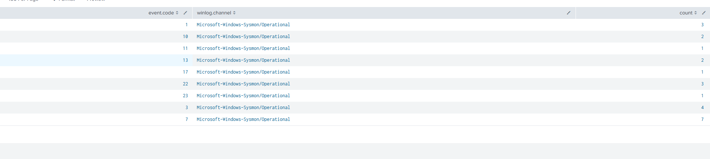

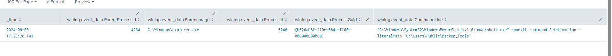

Vào **2024-09-09 17:23:26.143**, attacker khởi chạy phiên PowerShell thứ 4 tại thư mục chứa các tool vừa drop: `C:\Users\Public\Backup_Tools`.

```splunk
index=goldenspray host="ST-WIN02"
    earliest="09/09/2024:17:00:00" latest="09/09/2024:17:35:00"
    event.code=4100
```

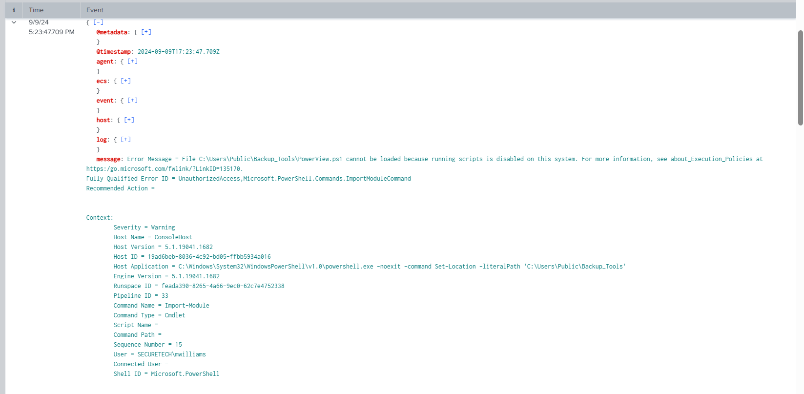

Vào **2024-09-09 17:23:47.709**, Event ID 4100 cho thấy attacker cố gắng sử dụng `Import-Module` để nạp `PowerView.ps1` nhưng bị **PowerShell Execution Policy chặn lại**.

```splunk
index=goldenspray host="ST-WIN02" earliest="09/09/2024:17:00:00"
    {b526ab8f-2f0e-66df-ff00-000000000b00} event.code=13
| table _time
    winlog.event_data.EventType
    winlog.event_data.Details
    winlog.event_data.TargetObject
    winlog.event_data.RuleName
```

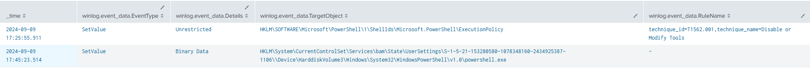

Sau đó vào **2024-09-09 17:25:55.911**, để nạp thành công script PowerView.ps1, attacker chỉnh sửa registry value HKLM\SOFTWARE\Microsoft\PowerShell\1\ShellIds\Microsoft.PowerShell\ExecutionPolicy thành Unrestricted nhằm cho phép nạp bất kỳ script nào.

```splunk
index=goldenspray host="ST-WIN02"
    earliest="09/09/2024:17:00:00" latest="09/09/2024:17:35:00"
    event.code=4104
    "winlog.event_data.Path"="C:\\Users\\Public\\Backup_Tools\\PowerView.ps1"
| table _time winlog.event_data.Path winlog.event_data.ScriptBlockText
| sort _time
```

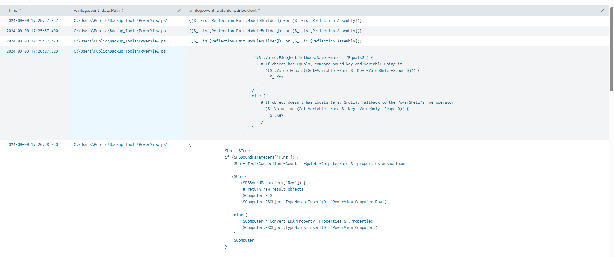

Vào **2024-09-09 17:25:57.367**, Event ID 4104 (Script Block Logging) ghi lại nội dung script. Dựa trên content, xác nhận payload là **PowerView** — một script thuộc bộ **PowerSploit** dùng để enumeration và phân tích cấu hình bảo mật môi trường Active Directory.

#### Khởi chạy Mimikatz

```splunk
index=goldenspray host="ST-WIN02" earliest="09/09/2024:17:00:00"
    {b526ab8f-2f0e-66df-ff00-000000000b00} event.code=1
    winlog.event_data.ParentProcessId=6248
| table _time winlog.event_data.CommandLine
```

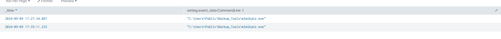

Trong phiên PowerShell thứ 4 này, attacker khởi chạy **2 phiên mimikatz** cách nhau 12 phút:
- **2024-09-09 17:27:34.067** — PID 3708
- **2024-09-09 17:39:11.233** — PID 528

## 4. Credential Access — Mimikatz trên ST-WIN02

### 4.1 Phiên Mimikatz #1 (PID 3708) — LSASS Memory Access

```splunk
index=goldenspray host="ST-WIN02"
    earliest="09/09/2024:17:27:00" latest="09/09/2024:17:39:00"
    event.code=10
| table _time
    winlog.event_data.SourceImage
    winlog.event_data.SourceProcessId
    winlog.event_data.TargetImage
    winlog.event_data.TargetProcessId
```

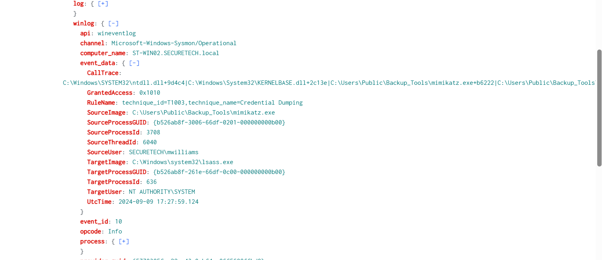

Vào **2024-09-09 17:27:59.124**, Sysmon Event ID 10 (Process Access) ghi nhận process `mimikatz.exe` (PID 3708) mở handle tới process `lsass.exe` với access mask = `0x1010` (PROCESS_QUERY_LIMITED_INFORMATION | PROCESS_VM_READ). Từ hành vi này, có thể attacker đã lần lượt nhập lệnh sau vào console mimikatz nhằm dump credentials:
1. `privilege::debug` → Kích hoạt `SeDebugPrivilege`
2. `sekurlsa::logonpasswords` → Truy cập LSASS để thu thập thông tin phiên logon và credentials

### 4.2 Phiên Mimikatz #2 (PID 528) — DCSync

Trước khi khởi chạy phiên mimikatz thứ hai, attacker đã RDP vào ST-DC01 (xem [Mục 5](#5-lateral-movement--st-dc01--2024-09-09-173415)). Sau đó quay lại ST-WIN02 để chạy mimikatz lần hai.

```splunk
index=goldenspray host="ST-WIN02" earliest="09/09/2024:17:27:00"
    {b526ab8f-32bf-66df-0d01-000000000b00} "event.code"=5
| table _time
    winlog.event_data.Image
    winlog.event_data.ProcessId
    winlog.event_data.ProcessGuid
```

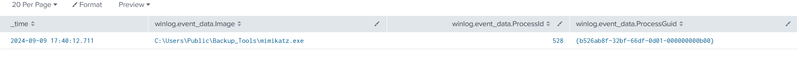

Phiên mimikatz này kết thúc sau khoảng **1 phút** thực thi.

#### Kết nối RPC tới DC

```splunk
index=goldenspray host="ST-WIN02" earliest="09/09/2024:17:27:00"
    {b526ab8f-32bf-66df-0d01-000000000b00} "event.code"=22
| table _time winlog.event_data.QueryName winlog.event_data.QueryResults
```

```splunk
index=goldenspray host="ST-WIN02" earliest="09/09/2024:17:27:00"
    {b526ab8f-32bf-66df-0d01-000000000b00} "event.code"=3
| table _time
    winlog.event_data.DestinationIp
    winlog.event_data.DestinationPort
```

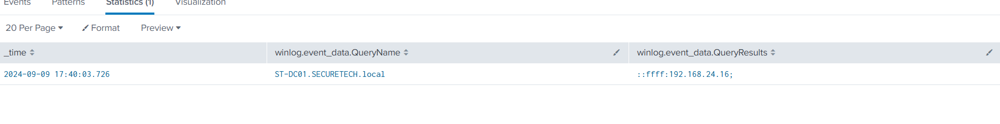

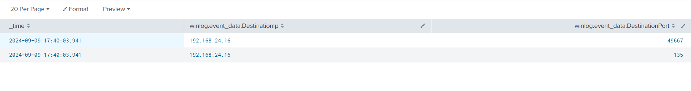

Phân tích kết nối mạng cho thấy process mimikatz (PID 528) thực hiện:
1. **Phân giải DNS** để lấy IP của Domain Controller
2. **Kết nối port 135** (RPC Endpoint Mapper) trên DC để truy vấn port động của dịch vụ được yêu cầu
3. **Kết nối port động 49667** (port động được Endpoint Mapper trả về)để gọi hàm RPC trên DC

Hai lệnh mimikatz chủ động tương tác với RPC endpoint trên DC là `lsadump::dcsync` và `lsadump::dcshadow`, trong đó:
- **DCSync**: Kỹ thuật lạm dụng cơ chế Active Directory Replication để yêu cầu DC cung cấp dữ liệu directory, bao gồm password hashes và các thông tin xác thực nhạy cảm. Attacker đóng vai trò replication client, gọi hàm `IDL_DRSGetNCChanges` thuộc RPC interface DRSUAPI (MS-DRSR). Để lấy password hashes, tài khoản thực hiện request thông thường cần có hai quyền `DS-Replication-Get-Changes` và `DS-Replication-Get-Changes-All` trên domain partition. Các quyền này thường được cấp cho Domain Admins nhưng cũng có thể được cấp cho những tài khoản khác.
- **DCShadow**: Kỹ thuật này giả mạo một máy bị chiếm quyền thành rogue DC nhằm push các thay đổi trái phép vào Active Directory thông qua cơ chế replication. Trong đó, attacker đăng ký các đối tượng `server`, `nTDSDSA` và SPN cần thiết, đồng thời khởi chạy một rogue DRSUAPI RPC server bằng Mimikatz. Sau đó, attacker gọi `IDL_DRSReplicaAdd` trên DC hợp lệ để thêm rogue DC làm replication source. DC hợp lệ sẽ kết nối ngược tới rogue DC và gọi `IDL_DRSGetNCChanges` để nhận dữ liệu replication do attacker cung cấp. Kỹ thuật này yêu cầu đặc quyền AD phù hợp để đăng ký replication partner và khả năng kết nối từ DC hợp lệ tới rogue RPC server.

Cả hai kỹ thuật đều có thể tạo ra hoạt động RPC tới Domain Controller. Tuy nhiên, xét đến các sự kiện xác thực và kết nối RPC được ghi nhận trong quá trình điều tra sau đó, DCSync là giả thuyết phù hợp hơn DCShadow. 

#### Xác thực Kerberos thất bại — Fallback sang NTLM

```splunk
index=goldenspray host="ST-DC01"
    earliest="09/09/2024:17:39:00" latest="09/09/2024:17:42:00"
    event.code=4768
| table _time winlog.event_data.IpAddress event.code winlog.event_data.IpPort
    winlog.event_data.PreAuthType winlog.event_data.ServiceName
    winlog.event_data.Status winlog.event_data.TicketEncryptionType
    winlog.event_data.TargetUserName winlog.event_data.TargetSid
| sort _time
```

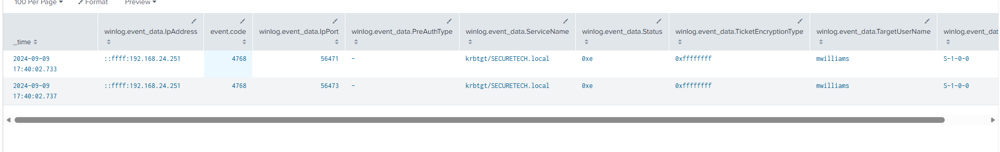

Vào **2024-09-09 17:40:02.737**, ghi nhận các yêu cầu cấp TGT cho user `mwilliams` nhưng **đều thất bại** với Result Code = `0xE` (`KDC_ERR_ETYPE_NOTSUPP`) tức KDC không thể decrypt phần enc-part vì encryption type mà client yêu cầu không được hỗ trợ.

```splunk
index=goldenspray host="ST-DC01"
    earliest="09/09/2024:17:39:00" latest="09/09/2024:17:42:00"
    event.code=4624
    "winlog.event_data.TargetUserName"=mwilliams
| table _time host
    winlog.event_data.TargetUserName
    winlog.event_data.TargetDomainName
    winlog.event_data.TargetLogonId
    winlog.event_data.TargetLinkedLogonId
    winlog.event_data.LogonType
    winlog.event_data.IpAddress
    winlog.event_data.AuthenticationPackageName
    winlog.event_data.ElevatedToken
| sort _time winlog.record_id
```

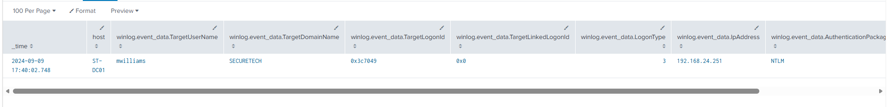

Ngay sau khi TGT request thất bại, vào **2024-09-09 17:40:02.748**, user `mwilliams` đăng nhập thành công vào ST-DC01 từ ip **192.168.24.251** (ST-WIN02) sử dụng giao thức **NTLM** thay vì Kerberos. Nhiều khả năng mimikatz tự động fallback sang NTLM sau khi xác thực Kerberos không thành công. Logon ID của phiên này là `0x3C7049`.

```splunk
index=goldenspray host="ST-DC01"
    earliest="09/09/2024:17:39:00"
    event.code!=4624 0x3C7049
```

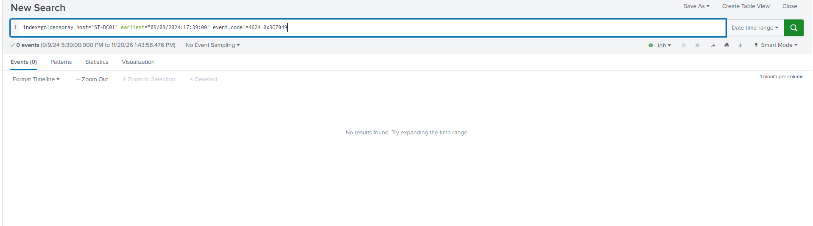

Không ghi nhận event nào khác liên quan đến phiên logon này, cho thấy DCSync **có thể đã thất bại** do user `mwilliams` không sở hữu quyền replication cần thiết.

```splunk
index=goldenspray host="ST-DC01"
    earliest="09/09/2024:17:39:00" latest="09/09/2024:17:42:00"
    event.code=3
```

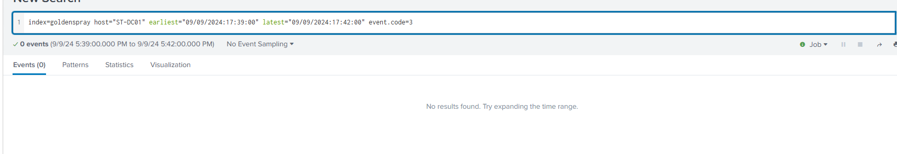

Không ghi nhận hoạt động network nào xuất phát từ ST-DC01 trong khoảng thời gian này.

## 5. Lateral Movement — ST-DC01 — 2024-09-09 17:34:15

### 5.1 RDP vào ST-DC01 với creds jsmith

```splunk
index=goldenspray host="ST-DC01" earliest="09/09/2024:17:34:00"
    event.code=4624 winlog.event_data.IpAddress=77.91.78.115
| table _time host
    winlog.event_data.TargetUserName
    winlog.event_data.TargetDomainName
    winlog.event_data.TargetLogonId
    winlog.event_data.TargetLinkedLogonId
    winlog.event_data.LogonType
    winlog.event_data.IpAddress
    winlog.event_data.AuthenticationPackageName
    winlog.event_data.ElevatedToken
| sort _time winlog.record_id
```

```splunk
index=goldenspray host="ST-DC01" earliest="09/09/2024:17:34:00"
    event.code IN (4768, 4769) jsmith
| table _time winlog.event_data.IpAddress event.code winlog.event_data.IpPort
    winlog.event_data.PreAuthType winlog.event_data.ServiceName
    winlog.event_data.Status winlog.event_data.TicketEncryptionType
    winlog.event_data.TargetUserName winlog.event_data.TargetSid
| sort _time
```

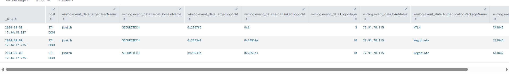

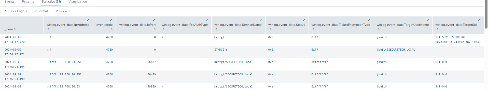

Quá trình xác thực RDP diễn ra theo chuẩn **NLA (Network Level Authentication)**:

| Thời gian | Sự kiện |
|---|---|
| **17:34:15.827** | Xác thực qua mạng sử dụng **CredSSP** (truyền credentials qua giao thức NTLM) |
| **17:34:17.770** | RDP Server yêu cầu **TGT** và **TGS** cho tài khoản `jsmith` trên DC để chuẩn bị nạp profile user cần thiết. Vì DC chính là RDP server, vé được cấp nội bộ trên cổng loopback (`::1`) |
| **17:34:17.775** | Đăng nhập RDP thành công (Event ID 4624 với **Logon Type 10**). |

```splunk
index=goldenspray host="ST-DC01" event.code IN (4768, 4769)
| stats count by event.code winlog.event_data.TicketEncryptionType
```

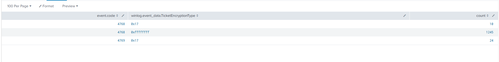

Toàn bộ Kerberos ticket (TGT và ST) trong môi trường AD đều sử dụng encryption type `0x17` (**RC4-HMAC**), là thuật toán yếu, không được recommend trong môi trường AD hiện đại.

### 5.2 Hoạt động trên DC01 — Payload Delivery & Scheduled Task

#### Phiên PowerShell #1 trên DC01

```splunk
index=goldenspray host="ST-DC01" earliest="09/09/2024:17:34:00" event.code=1
| table _time
    winlog.event_data.User
    winlog.event_data.IntegrityLevel
    winlog.event_data.LogonId
    winlog.event_data.ProcessGuid
    winlog.event_data.ProcessId
    winlog.event_data.CommandLine
    winlog.event_data.ParentProcessId
    winlog.event_data.ParentImage
| sort _time winlog.record_id
```

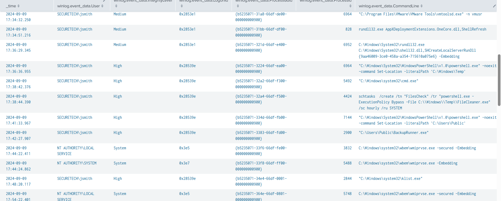

Vào **2024-09-09 17:36:36**, attacker khởi chạy một phiên PowerShell (PID 6964) và thiết lập thư mục làm việc tại `C:\Windows\Temp`.

#### Drop payload FileCleaner.exe

```splunk
index=goldenspray host="ST-DC01" earliest="09/09/2024:17:34:00"
    {b5235071-3224-66df-ea00-000000000900} event.code=3
| table _time winlog.event_data.DestinationIp winlog.event_data.DestinationPort
```

```splunk
index=goldenspray host="ST-DC01" earliest="09/09/2024:17:34:00"
    {b5235071-3224-66df-ea00-000000000900} event.code=11
| table _time winlog.event_data.TargetFilename
```

```splunk
index=goldenspray host="ST-DC01" earliest="09/09/2024:17:34:00"
    {b5235071-3224-66df-ea00-000000000900} event.code=29
| table _time winlog.event_data.TargetFilename winlog.event_data.Hashes
```

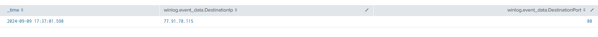

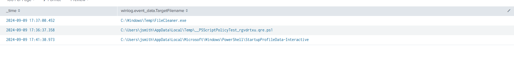

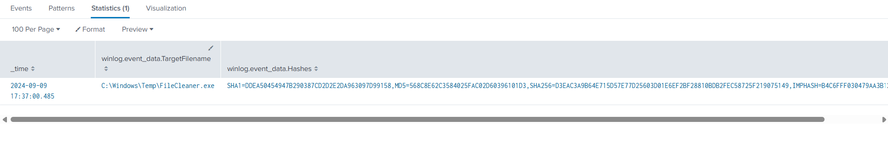

Vào **2024-09-09 17:37:00**, attacker tải payload `FileCleaner.exe` từ **77.91.78.115:80** về thư mục `C:\Windows\Temp\`.

Sysmon event 29 cho thấy hash của `FileCleaner.exe` **chính xác trùng khớp** với `OfficeUpdater.exe` trên ST-WIN02. Attacker drop **cùng một payload** trên các host khác nhau, chỉ thay đổi tên tệp để tránh phát hiện.

#### Persistence — Scheduled Task

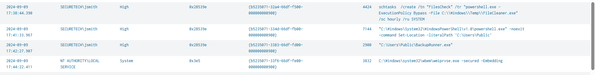

Vào **2024-09-09 17:38:44**, attacker tạo Scheduled Task qua `cmd.exe`:

```
schtasks /create /tn "FilesCheck" /tr "powershell.exe -ExecutionPolicy Bypass -File C:\\Windows\\Temp\\FileCleaner.exe" /sc hourly /ru SYSTEM
```

| Tham số | Ý nghĩa |
|---|---|
| `/tn "FilesCheck"` | Đặt tên task giả mạo trình kiểm tra tệp vô hại |
| `/tr "powershell.exe -ExecutionPolicy Bypass -File ..."` | Khởi chạy `FileCleaner.exe` thông qua 1 lệnh PowerShell |
| `/sc hourly` | Chạy task **mỗi giờ** |
| `/ru SYSTEM` | Chạy dưới đặc quyền cao nhất là **SYSTEM** |

**Vấn đề trong lệnh:** Cờ `-File` chỉ chấp nhận tệp có extension `.ps1` tức PowerShell script. Do `FileCleaner.exe` là executable, lệnh này nhiều khả năng **thực thi thất bại**.

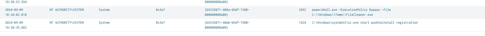

Vào **2024-09-09 18:38:02.010**, log ghi nhận task `FilesCheck` khởi chạy lệnh PowerShell dưới quyền **SYSTEM** thành công.

```splunk
index=goldenspray host="ST-DC01" earliest="09/09/2024:17:38:44"
    event.code=1 FileCleaner.exe
| table _time host
    winlog.event_data.User
    winlog.event_data.IntegrityLevel
    winlog.event_data.LogonId
    winlog.event_data.ParentProcessId
    winlog.event_data.ParentImage
    winlog.event_data.ProcessId
    winlog.event_data.CommandLine
| sort _time winlog.record_id
```

```splunk
index=goldenspray host="ST-DC01" earliest="09/09/2024:17:38:44"
    event.code=4688 FileCleaner.exe
```


Mặc dù Scheduled Task khởi chạy thành công, **không ghi nhận** Sysmon Event ID 1 hay Security Event 4688 cho thấy `FileCleaner.exe` được thực thi sau đó, xác nhận giả thuyết attacker sử dụng sai cờ `-File` khiến payload thực thi không thành công.

### 5.3 DCSync trực tiếp trên DC01

Sau khi DCSync từ ST-WIN02 thất bại (do `mwilliams` không có quyền replication), attacker chuyển sang thực thi trực tiếp trên DC01:


#### Phiên PowerShell #2 — Drop Mimikatz

```splunk
index=goldenspray host="ST-DC01" earliest="09/09/2024:17:34:00"
    {b5235071-334d-66df-fb00-000000000900} event.code=1
```


Vào **2024-09-09 17:41:33.966**, attacker khởi chạy phiên PowerShell mới và chuyển thư mục làm việc sang `C:\Users\Public`.

```splunk
index=goldenspray host="ST-DC01" earliest="09/09/2024:17:34:00"
    {b5235071-334d-66df-fb00-000000000900} event.code=3
| table _time winlog.event_data.DestinationIp winlog.event_data.DestinationPort
```

```splunk
index=goldenspray host="ST-DC01" earliest="09/09/2024:17:34:00"
    {b5235071-334d-66df-fb00-000000000900} event.code=11
| table _time winlog.event_data.Image winlog.event_data.ProcessId winlog.event_data.TargetFilename
```

```splunk
index=goldenspray host="ST-DC01" earliest="09/09/2024:17:34:00"
    {b5235071-334d-66df-fb00-000000000900} event.code=29
| table _time winlog.event_data.TargetFilename winlog.event_data.Hashes
```


Vào **2024-09-09 17:42:21**, attacker tải và drop `BackupRunner.exe` vào thư mục `C:\Users\Public\` từ **77.91.78.115:80**.


VirusTotal xác nhận `BackupRunner.exe` chính là **mimikatz** — attacker đổi tên thành "BackupRunner" nhằm giả mạo công cụ sao lưu vô hại.

#### Khởi chạy Mimikatz trên DC

```splunk
index=goldenspray host="ST-DC01" earliest="09/09/2024:17:34:00"
    {b5235071-3383-66df-fd00-000000000900} event.code=1
```


Vào **2024-09-09 17:42:27.903**, attacker khởi chạy mimikatz ngay sau khi drop thành công.

#### Kết nối RPC tới DC — DCSync

```splunk
index=goldenspray host="ST-DC01" earliest="09/09/2024:17:34:00"
    {b5235071-3383-66df-fd00-000000000900} event.code=22
| table _time winlog.event_data.Image
    winlog.event_data.QueryName winlog.event_data.QueryResults
```

```splunk
index=goldenspray host="ST-DC01" earliest="09/09/2024:17:34:00"
    {b5235071-3383-66df-fd00-000000000900} event.code=3
| table _time winlog.event_data.Image
    winlog.event_data.DestinationIp winlog.event_data.DestinationPort
```


Mimikatz trên ST-DC01 kết nối tới **port 135** (RPC Endpoint Mapper) và port động trên **chính ST-DC01**, nhiều khả năng đây là hành vi DCSync thực thi nội bộ trên Domain Controller.

**Giả thuyết:** Trên ST-WIN02, attacker chạy `lsadump::dcsync` dưới danh tính `mwilliams` nhưng **thất bại** vì tài khoản này chỉ có quyền local admin mà không sở hữu quyền replication. Attacker sau đó sử dụng tài khoản `jsmith` (có thể hắn đã dump được từ phiên mimikatz đầu tiên trên ST-WIN02) RDP trực tiếp vào DC rồi chạy lại DCSync. Do user `jsmith` thuộc nhóm **Domain Admin** và sở hữu quyền replication, lệnh được thực thi thành công và attacker đánh cắp thông tin nhạy cảm trong `ntds.dit`.

#### Golden Ticket — Giả thuyết

Ngay sau khi thực thi DCSync, attacker thực thi lệnh `klist` trong cùng phiên PowerShell:


Từ chuỗi hành vi: **DCSync → mimikatz → klist**, ta có giả thuyết rằng sau khi trích xuất NTLM hash của tài khoản `krbtgt`, attacker sử dụng lệnh `kerberos::golden` để tạo **Golden Ticket** (TGT giả mạo), inject vào phiên hiện tại, rồi kiểm tra xem ticket đã nạp thành công chưa bằng lệnh `klist`.

Tuy nhiên, phần trên chỉ là giả thuyết dựa trên chuỗi sự kiện tạo process và kết nối mạng theo thời gian. Log hiện tại chưa cung cấp đủ thông tin (thiếu các Event ID đặc trưng liên quan đến dcsync và dcshadow như 4662, 4928, 4929, ...) để xác nhận chính xác hành động của attacker.

## 6. Lateral Movement & Data Collection — ST-FS01 — 2024-09-09 17:50:13

### 6.1 RDP vào File Server

```splunk
index=goldenspray host="ST-FS01" earliest="09/09/2024:17:50:13"
    event.code=4624 winlog.event_data.IpAddress=77.91.78.115
| table _time host
    winlog.event_data.TargetUserName
    winlog.event_data.TargetDomainName
    winlog.event_data.TargetLogonId
    winlog.event_data.TargetLinkedLogonId
    winlog.event_data.LogonType
    winlog.event_data.IpAddress
    winlog.event_data.AuthenticationPackageName
    winlog.event_data.ElevatedToken
| sort _time winlog.record_id
```


Vào **2024-09-09 17:50:13**, attacker sử dụng tài khoản `jsmith` để RDP vào **ST-FS01** (File Server).

### 6.2 Thu thập dữ liệu — Collection

```splunk
index=goldenspray host="ST-FS01" earliest="09/09/2024:17:50:00" event.code=1
| table _time
    winlog.event_data.User
    winlog.event_data.IntegrityLevel
    winlog.event_data.LogonId
    winlog.event_data.ParentProcessId
    winlog.event_data.ParentImage
    winlog.event_data.ProcessGuid
    winlog.event_data.ProcessId
    winlog.event_data.CommandLine
| sort _time winlog.record_id
```


Vào **2024-09-09 17:50:54.016**, attacker khởi chạy một phiên PowerShell dưới đặc quyền cao (Integrity Level = High) và chuyển thư mục làm việc sang `C:\Shares` (thư mục này trên file server thường chứa dữ liệu được chia sẻ qua mạng bao gồm cả tài liệu nội bộ nhạy cảm).

```splunk
index=goldenspray host="ST-FS01"
    earliest="09/09/2024:17:50:54" latest="09/09/2024:18:00:00"
    event.code=4103
| table _time winlog.event_data.Payload winlog.event_data.ContextInfo
```


Event ID 4103 ghi nhận 2 namespace .NET được sử dụng: `System.IO.Compression` và `System.IO.Compression.FileSystem` — cho thấy attacker đang **thu thập và nén** các tệp trong `C:\Shares`.

### 6.3 Archive các tệp thu thập được

```splunk
index=goldenspray host="ST-FS01" earliest="09/09/2024:17:50:00"
    {f9fafac3-357e-66df-c700-000000000900} "event.code"=11
| table _time
    winlog.event_data.Image
    winlog.event_data.ProcessId
    winlog.event_data.TargetFilename
```


Vào **2024-09-09 17:53:10.708**, ghi nhận tệp `C:\Users\Public\Documents\Archive_8673812.zip` được tạo ra -> attacker đã nén toàn bộ dữ liệu thu thập vào một tệp duy nhất. Tuy nhiên, **chưa ghi nhận** hoạt động exfiltration sau thời điểm này.

# Incident Timeline – GoldenSpray

| Timestamp | Tactic | Technique ID | Technique / Sub-technique | Bằng chứng liên quan |
|---|---|---|---|---|
| 2024-09-09 16:29:05 | Reconnaissance | T1595 | Active Scanning | **ST-WIN02:** Attacker thăm dò kết nối bằng cách thử xác thực bằng account `FAKE\user` (Security 4625). |
| 2024-09-09 16:55:16–16:56:05 | Credential Access | T1110.001 | Brute Force: Password Guessing | **ST-WIN02:** Attacker thử xác thực qua giao thức SMB 15 username khác nhau, cả local và domain account  (Security 4625, SMBServer 551). |
| 2024-09-09 16:56:05 | Initial Access | T1078.003 | Valid Accounts: Local Accounts | **ST-WIN02:** Đăng nhập SMB thành công bằng tài khoản `ST-WIN02\michaelwilliams`, rồi kết thúc phiên ngay sau đó để chuyển sang RDP (4624/4634). |
| 2024-09-09 17:00:21 | Initial Access | T1078.002 / T1021.001 | Valid Accounts: Domain Accounts / Remote Services: Remote Desktop Protocol | **ST-WIN02:** RDP vào ST-WIN02 thành công bằng tài khoản `SECURETECH\mwilliams` (4624/4672). |
| 2024-09-09 17:10:24 | Execution | T1059.001 | Command and Scripting Interpreter: PowerShell | **ST-WIN02:** Mở 1 phiên PowerShell tương tác (PID 8184) tại thư mục `C:\Windows\Temp` (Sysmon 1). |
| 2024-09-09 17:12:14–17:12:16 | Command and Control | T1105 | Ingress Tool Transfer | **ST-WIN02:** Attacker drop payload `OfficeUpdater.exe` từ C2 server `77.91.78.115:80` (Sysmon 3/11). |
| 2024-09-09 17:17:09 | Persistence | T1547.001 | Boot or Logon Autostart Execution: Registry Run Keys / Startup Folder | **ST-WIN02:** Tạo Run Key `OfficeUpdater` trỏ tới payload `OfficeUpdater.exe` drop trong `C:\Windows\Temp` (Sysmon 1/13). |
| 2024-09-09 17:21:52–17:25:00 | Command and Control | T1105 | Ingress Tool Transfer | **ST-WIN02:** Tải `C:\Users\Public\Backup_Tools.zip` từ C2 server, sau đó giải nén ra 3 tools là: `mimikatz.exe`, `PsExec.exe`, và `PowerView.ps1` vào thư mục `Backup_Tools` (Sysmon 3/11). |
| 2024-09-09 17:22:57–17:25:00 | Defense Evasion | T1070.006 | Indicator Removal: Timestomp | **ST-WIN02:** Thay đổi Creation Time của hai executable (`mimikatz.exe` và `PsExec.exe`) vừa giải nén (Sysmon 2). |
| 2024-09-09 17:23:26–17:23:47 | Execution | T1059.001 | Command and Scripting Interpreter: PowerShell | **ST-WIN02:** Attacker nạp script `PowerView.ps1` nhưng bị Execution Policy chặn thực thi (4100). |
| 2024-09-09 17:25:55–17:25:57 | Defense Impairment / Discovery | T1112 | Modify Registry | **ST-WIN02:** Attacker thay đổi giá trị registry value Execution Policy thành `Unrestricted` nhằm cho phép thực thi script `PowerView.ps1` để recon AD (Sysmon 13, 4104). |
| 2024-09-09 17:27:34–17:27:59 | Credential Access | T1003.001 | OS Credential Dumping: LSASS Memory | **ST-WIN02:** Khởi chạy 1 phiên Mimikatz truy cập process `lsass.exe` với `GrantedAccess=0x1010` để dump creds |
| 2024-09-09 17:34:15–17:34:17 | Lateral Movement | T1078.002 / T1021.001 | Valid Accounts: Domain Accounts / Remote Desktop Protocol | **ST-DC01:** Thành công RDP trực tiếp vào ST-DC01 bằng tài khoản `SECURETECH\jsmith` từ máy tấn công `77.91.78.115` (4624). |
| 2024-09-09 17:36:36–17:37:00 | Command and Control | T1105 | Ingress Tool Transfer | **ST-DC01:** Tải `FileCleaner.exe` về thư mục `C:\Windows\Temp` trên ST-DC01 (Sysmon 3/11/29). |
| 2024-09-09 17:38:44 | Persistence | T1053.005 | Scheduled Task/Job: Scheduled Task | **ST-DC01:** Tạo task `FilesCheck` chạy hằng giờ dưới danh tính `SYSTEM`, task chạy 1 lệnh PowerShell để thực thi payload `FileCleaner.exe` nhưng thất bại do sai syntax (Sysmon 1). |
| 2024-09-09 17:39:11–17:40:02 | Credential Access | T1003.006 | OS Credential Dumping: DCSync | **ST-WIN02:** Attacker khởi chạy 1 phiên mimikatz mới và nhập lệnh lsadump::dcsync nhằm đánh cắp thông tin AD (Sysmon 3, 4768/4624). |
| 2024-09-09 17:41:33–17:42:21 | Command and Control | T1105 | Ingress Tool Transfer | **ST-DC01:** Tải payload `C:\Users\Public\BackupRunner.exe` về DC (Mimikatz đổi tên) từ C2 server (Sysmon 3/11). |
| 2024-09-09 17:42:27 và sau đó | Credential Access | T1003.006 / T1558.001 | OS Credential Dumping: DCSync / Steal or Forge Kerberos Tickets: Golden Ticket | **ST-DC01:** Attacker khởi chạy `BackupRunner.exe` (mimikatz) thực hiện dcsync đánh cắp Kerberos Long-Term Key của tài khoản krbtgt, tạo golden ticket rồi kiểm tra với klist  |
| 2024-09-09 17:50:13 | Lateral Movement | T1078.002 / T1021.001 | Valid Accounts: Domain Accounts / Remote Services: Remote Desktop Protocol | **ST-FS01:** RDP thành công vào File Server bằng tài khoản `SECURETECH\jsmith` (4624). |
| 2024-09-09 17:50:54–17:53:10 | Collection | T1560 | Archive Collected Data | **ST-FS01:** Khởi chạy 1 phiên PowerShell tại thư mục `C:\Shares`, thu thập và nén dữ liệu lại thành tệp `Archive_8673812.zip` (4103, Sysmon 11) |
| 2024-09-09 18:31:47 | Persistence | T1547.001 | Boot or Logon Autostart Execution: Registry Run Keys / Startup Folder | **ST-WIN02:** Run Key `OfficeUpdater` kích hoạt payload khi `mwilliams` đăng nhập lại (Sysmon 1). |
| 2024-09-09 18:38:02 | Persistence | T1053.005 | Scheduled Task/Job: Scheduled Task | **ST-DC01:** Schedule Task `FilesCheck` chạy lệnh PowerShell dưới danh tính `SYSTEM`, tuy nhiên, payload `FileCleaner.exe` chưa được thực thi thành công (Sysmon 1). |

